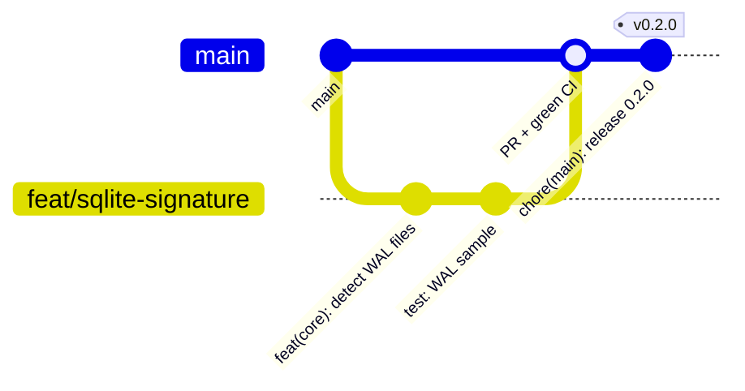
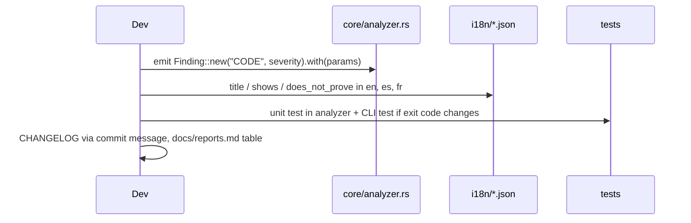

# Contributing to RV RSMF

Thank you for helping. This is a forensic tool: results may be presented in court, so every change
must keep results **correct, reproducible and explainable**.

## Workflow



1. Open an issue first for anything bigger than a typo.
2. Branch from `main`: `feat/…`, `fix/…`, `docs/…`.
3. Commit with [Conventional Commits](https://www.conventionalcommits.org/): `feat(core): …`, `fix(cli): …`,
   `docs: …`, `test: …`, `ci: …`. A `!` or `BREAKING CHANGE:` footer marks breaking changes. The changelog and
   version numbers are generated from these messages.
4. Open a pull request. CI must be green on Linux **and** Windows.
5. A maintainer reviews. Changes to hashing, the audit chain or report wording need two approvals.

## Before you push

```bash
cargo fmt --all
cargo clippy --workspace --all-targets -- -D warnings
cargo test --workspace
cargo run -q -p rv-rsmf-cli -- docs-cli > docs/usage-cli.md   # if you changed any --help text
python tests/verify_chain.py <some run>/logs/<RUN-ID>             # optional cross-language check
```

## Rules that keep the tool defensible

| Area | Rule |
| --- | --- |
| Evidence | Never open evidence for writing. Never follow symbolic links. |
| Core | The core never prints. Front-ends only render `Event`s. |
| Hashing | Any change needs known-answer tests (`hash::KNOWN_ANSWERS`). |
| Audit | Do not change the chain algorithm without bumping the log format and keeping `verify-log` able to read old logs. |
| Findings | Every finding has `shows` **and** `does_not_prove` wording in **all three** languages (`i18n/*.json`; a test checks the keys match). |
| Reports | Adding a field to a JSON report: update `schemas/` and `docs/reports.md`. Removing one is a breaking change. |
| Docs | Each page under `docs/` keeps at least one Mermaid diagram that renders on GitHub. |
| Dependencies | New crates need a reason in the PR and a permissive licence (MIT, Apache-2.0, BSD, ISC, Zlib) — no GPL/AGPL, because the tool is proprietary. |

## Adding a new finding



## Code of conduct

Be respectful and precise. Assume good faith. Harassment is not tolerated.
