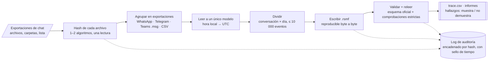
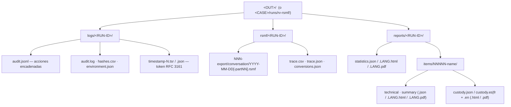

> La versión de referencia es la inglesa ([README.md](README.md)); esta traducción la sigue.

<p align="center"></p>

# RV RSMF

[English](README.md) · **Español** · [Français](README.fr.md)

<!-- forge:description -->
**Convierte exportaciones de chat a RSMF para Relativity.** RV RSMF convierte exportaciones de chat de WhatsApp, Telegram, Microsoft Teams y CSV de herramientas móviles en archivos RSMF 2.0 (uno por conversación y por día), valida cada archivo y remonta cada mensaje a su línea en la exportación.
<!-- /forge:description -->

[](https://github.com/Panacota96/rv-rsmf/actions/workflows/ci.yml)




## Contenido

- [Qué hace y qué no hace](#qué-hace-y-qué-no-hace)
- [Qué ofrece](#qué-ofrece)
- [Instalación](#instalación)
- [Inicio rápido](#inicio-rápido)
- [Salidas](#salidas)
- [Documentación](#documentación)
- [Estructura del proyecto](#estructura-del-proyecto)
- [Contribuir, seguridad, licencia](#contribuir-seguridad-licencia)
- [Licencia](#licencia)

## Qué hace y qué no hace

Relativity revisa los chats en **RSMF** (Relativity Short Message Format): un archivo con forma de correo electrónico
que lleva un manifiesto JSON de participantes, conversaciones y eventos, además de los adjuntos. RV RSMF produce esos
archivos a partir de las exportaciones que la gente entrega de verdad, y conserva un registro que permite a cualquiera
cotejar cada mensaje con su origen.

| Hace | No hace |
| --- | --- |
| Abrir cada entrada en solo lectura y calcular su hash (y, en una carpeta de caso, verificarla contra el registro de evidencia escrito por rv-hashinv) | Adquirir un teléfono o una cuenta; trabaja sobre exportaciones que alguien ya hizo |
| Leer WhatsApp `.txt`/`.zip` (Android e iOS), `result.json` de Telegram Desktop, archivos `.msg` de Microsoft Teams de Purview, y CSV/TSV con una correspondencia de columnas | Autenticar la exportación: una exportación de chat es un archivo de texto o JSON editable |
| Convertir las horas locales a UTC con la zona horaria **que elige el perito**, e informar de los huecos y solapamientos del horario de verano | Adivinar una zona horaria o un orden día/mes que la exportación no decide: se detiene y pregunta (código de salida 2) |
| Escribir un `.rsmf` por conversación y por día (los días con mucha actividad se dividen bajo el límite de 10 000 eventos de Relativity), de forma determinista | Recuperar mensajes borrados, el historial de ediciones o los archivos multimedia que no están en la exportación |
| Comprobar cada archivo contra el esquema RSMF 2.0 publicado por Relativity más reglas más estrictas, y releerlo | Probar cómo muestra los archivos una versión concreta de Relativity |
| Escribir `trace.csv`: exportación, archivo de origen, línea o id, texto original de la hora → archivo RSMF e id del evento | Decidir qué significa un mensaje: los hallazgos son señales para el perito |

## Qué ofrece

| | |
| --- | --- |
| **Dos formas de usarla** | `rv-rsmf` (línea de comandos) y `rv-rsmf-gui` (aplicación de escritorio para Windows 10/11). Mismo motor, mismos resultados. |
| **Orígenes** | WhatsApp (Android e iOS, `.txt` o `.zip` con multimedia), JSON de Telegram Desktop (exportación completa o de un solo chat), `.msg` de Microsoft Teams (Purview, un archivo por mensaje), CSV/TSV con una correspondencia de columnas TOML (perfil integrado `generic`; los perfiles `xry-draft` y `cellebrite-draft` aún no se han cotejado con exportaciones reales). Cómo se lee cada uno: [docs/theory.md](docs/theory.md#b5-how-each-source-is-read) (en inglés). |
| **RSMF 2.0** | Un archivo por conversación y por día natural en la zona del perito; los días de más de 10 000 eventos se dividen en partes de 12 horas, de 8 horas o de tamaño fijo; todos los archivos de una conversación comparten un mismo id de colección de eventos. |
| **Comprobaciones** | Esquema oficial (incluido, draft-07) + reglas estrictas (claves desconocidas, referencias, horas UTC, conteos, adjuntos en el zip) + relectura de cada archivo; `rv-rsmf validate` comprueba cualquier `.rsmf`, nuestro o de otra herramienta. |
| **Trazabilidad** | `trace.csv` / `trace.json`: una fila por evento; cada evento lleva además `source_file`, `source_lines` o `source_id` y el texto original de la hora en sus campos personalizados RSMF. |
| **Hash** | 1 o 2 de md5, sha1, sha256, sha512, sha3-256, blake3, calculados en la misma lectura; cada `.rsmf` y cada adjunto se hashean y se registran. |
| **Auditable** | Cada acción va a `logs/<RUN-ID>/audit.jsonl`, y cada entrada lleva el hash de la anterior; sello de tiempo RFC 3161 de la cabeza de la cadena; `verify-log` detecta cualquier edición y verifica la firma de la TSA (`--tsa-ca` valida además su cadena). |
| **Informes** | Estadísticas por ejecución; por exportación una revisión técnica, un resumen para el cliente y un formato de custodia (Colombia o Francia, más inglés): HTML, PDF y JSON, en inglés, español o francés. |
| **Carpeta del caso** | `--case-dir` enlaza las herramientas Rakvor de un caso: cada archivo se vuelve a hashear y se verifica contra el registro escrito en la recepción por rv-hashinv (`--intake hashinv` lo ejecuta primero). Vea [docs/case-folder.md](docs/case-folder.md) (en inglés). |

## Instalación

**Windows 10/11**: descargue desde la página [Releases](https://github.com/Panacota96/rv-rsmf/releases):

- `rv-rsmf-<version>-windows-x64-setup.exe`: instalador (acceso en el menú Inicio, agrega la CLI al PATH), o
- `rv-rsmf-<version>-windows-x64.zip`: portable; se descomprime y se ejecuta, no se instala nada.

Compruebe la descarga antes de usarla: SHA-256, atestación de procedencia y firma Authenticode (raíz interna de
Rakvor), paso a paso en [docs/installation.es.md](docs/installation.es.md) (resumen en
[SECURITY.md](SECURITY.md#verifying-a-release), en inglés).

**Desde el código fuente** (cualquier sistema operativo; compile con el compilador fijado en `rust-toolchain.toml`,
1.97.0; `Cargo.toml` declara 1.88 como mínimo, que la CI no prueba; auditores:
[docs/installation.es.md](docs/installation.es.md#8-compilar-desde-el-código-fuente-para-auditores)):

```bash
cargo build --release --locked
# binarios: target/release/rv-rsmf y target/release/rv-rsmf-gui
```

## Inicio rápido

```powershell
# Compruebe primero la compilación: cada algoritmo de hash contra vectores de prueba publicados
rv-rsmf self-test

# 1. Mirar antes de convertir: origen, orden de las fechas, zona horaria, primeros mensajes (no escribe nada)
rv-rsmf preview -i "D:\export\WhatsApp Chat with Ana Ruiz.txt" --timezone Europe/Paris

# 2. Convertir (teléfono con la hora de París); informes en español; la propietaria del dispositivo es Ana Ruiz
rv-rsmf convert -i D:\export -r --timezone Europe/Paris --custodian "Ana Ruiz" --lang es --case CASE-2026-014

# Una exportación cuyas fechas son todas <= 12 (03/04/26: ¿3 de abril o 4 de marzo?) necesita su decisión
rv-rsmf convert -i chat.txt --timezone America/Bogota --date-order dmy

# Un CSV de una herramienta forense móvil, con su propia correspondencia de columnas
rv-rsmf convert -i chats.csv --csv-map xry.toml --timezone Europe/Madrid

# En una carpeta de caso: rv-hashinv registra primero la evidencia, luego rv-rsmf la convierte y la verifica
rv-rsmf convert -i D:\export -r --case-dir E:\CASE-014 --case CASE-014 --timezone Europe/Paris --intake hashinv

# Comprobar cualquier archivo .rsmf (nuestro o de otra herramienta), el log de auditoría, el caso completo
rv-rsmf validate rakvor-out\rsmf\<RUN-ID>
rv-rsmf verify-log rakvor-out\logs\<RUN-ID>
rv-rsmf verify-case E:\CASE-014
```

**Aplicación de escritorio:** inicie *RV RSMF* desde el menú Inicio, agregue la exportación, indique la zona
horaria, pulse *Vista previa* y luego *Iniciar revisión*; vea [docs/usage-gui.es.md](docs/usage-gui.es.md).

**Muestra:** en [examples/](examples/README.md) (en inglés) hay exportaciones sintéticas de cada origen (solo personas
inventadas); `examples/sample/run.ps1` (Windows) o `run.sh` las convierte todas en una ejecución y comprueba el
resultado.

Las tareas habituales, paso a paso: [docs/quick-guide.es.md](docs/quick-guide.es.md).
Cada opción, ejemplo y código de salida: [docs/usage-cli.md](docs/usage-cli.md) (generado a partir de `--help`, en
inglés). El recorrido completo: [docs/usage.es.md](docs/usage.es.md).

## Salidas



En una carpeta de caso, las tres carpetas de la ejecución son `<CASE>/runs/rv-rsmf/<RUN-ID>/logs|reports|rsmf/` (sin
id de ejecución debajo). Cada archivo se describe en [docs/reports.md](docs/reports.md) (en inglés).

| Código de salida | Significado |
| :-: | --- |
| 0 | Terminado, ningún hallazgo de severidad alta |
| 1 | Error de ejecución (entrada inexistente, salida no escribible, bloqueo del caso ocupado…) |
| 2 | Error de uso, o una decisión que solo el perito puede tomar: `--timezone`, `--date-order`, correspondencia CSV |
| 3 | Terminado con un hallazgo de severidad alta (exportación ilegible, archivo RSMF no válido, evidencia distinta del registro) / cadena de auditoría o caso roto |
| 130 | Cancelado (se escribieron informes parciales) |

## Documentación

| Página | Para |
| --- | --- |
| [docs/quick-guide.es.md](docs/quick-guide.es.md) | Las seis tareas habituales (preview, convert, carpeta del caso, validate, verify-log y verify-case, timestamp), cada botón de la GUI, códigos de salida |
| [docs/theory.md](docs/theory.md) | Qué hace la herramienta con los datos: parte en lenguaje sencillo para clientes, abogados y jueces; estructura RSMF, reglas de lectura, conversión horaria, división, validación y mapa de trazas para peritos y peritos de la contraparte (en inglés) |
| [docs/admissibility.md](docs/admissibility.md) | Argumento de fiabilidad y requisitos de Colombia, Francia/UE, ISO y EE. UU./Reino Unido frente a las funciones de la herramienta, lista de brechas, lista de control del perito (para revisión por un abogado; en inglés) |
| [docs/usage.es.md](docs/usage.es.md) | Recorrido completo: vista previa, elección de la zona horaria, del orden de las fechas y del custodio, correspondencias CSV, carpeta del caso, validación, lectura de las salidas, solución de problemas |
| [docs/usage-cli.md](docs/usage-cli.md) | Cada comando y opción (generado desde `--help`, en inglés) |
| [docs/usage-gui.es.md](docs/usage-gui.es.md) | Uso de la aplicación de escritorio |
| [docs/reports.md](docs/reports.md) | Cada archivo de salida, el catálogo de hallazgos, los esquemas JSON, los idiomas (en inglés) |
| [docs/forensic-audit.md](docs/forensic-audit.md) | Pista de auditoría, cada acción registrada, sellos de tiempo, manejo de la evidencia, correspondencia con ISO/IEC 27037 (en inglés) |
| [docs/case-folder.md](docs/case-folder.md) | Carpeta de caso compartida: verificación de cada exportación contra el registro de rv-hashinv, recepción en un paso (`--intake hashinv`), `verify-case` (en inglés) |
| [docs/installation.es.md](docs/installation.es.md) | Instalación en Windows 10/11, verificación de la versión (SHA-256, procedencia, Authenticode), uso sin red, compilación desde el código fuente |
| [docs/architecture.md](docs/architecture.md) | Cómo encajan el motor, los lectores, el escritor RSMF, la CLI y la GUI (en inglés) |
| [docs/development.md](docs/development.md) | Compilación, pruebas, muestras, oráculos, CI (en inglés) |
| [docs/release-process.md](docs/release-process.md) | Paquetes para Windows, firma de código y versiones en GitHub, paso a paso (en inglés) |
| [docs/adr/](docs/adr/) | Decisiones de arquitectura (por qué Rust; en inglés) |

El README, la guía rápida, la guía de uso, la guía de la aplicación de escritorio y la guía de instalación existen
también en español (`.es.md`) y en francés (`.fr.md`); las páginas en inglés son la referencia.

## Estructura del proyecto

```text
rv-rsmf/
├── src/
│   ├── core/      biblioteca del motor (nunca imprime): entrada, hash, sources/ (lectores), modelo, rsmf/
│   │              (escritor, lector, validador, shortcodes), conversión, carpeta del caso, recepción, log de
│   │              auditoría, informes
│   ├── cli/       línea de comandos rv-rsmf (clap)
│   └── gui/       aplicación de escritorio rv-rsmf-gui (egui); state.rs contiene todas las reglas comprobables
├── schemas/       rsmf_schema_2_0_0.json (esquema oficial de Relativity) + esquemas JSON de los informes y del caso
├── templates/     plantillas HTML de los informes + CSS (minijinja)
├── i18n/          textos de los informes: en.json, es.json, fr.json
├── docs/          documentación (los diagramas Mermaid se muestran en GitHub)
├── scripts/       comprobaciones de la documentación (las traducciones mantienen la forma de las páginas en inglés)
├── tests/         oráculos en Python: oráculo RSMF, comprobación de extremo a extremo de la muestra, verificador de
│                  la cadena de auditoría, esquemas de los informes
├── examples/      exportaciones de chat sintéticas + resultados esperados + scripts de ejecución
├── packaging/     instalador de Windows (Inno Setup)
└── .github/       flujos de CI y de publicación
```

## Contribuir, seguridad, licencia

- Cómo contribuir: [CONTRIBUTING.md](CONTRIBUTING.md) · Cambios: [CHANGELOG.md](CHANGELOG.md)
- Reportar una vulnerabilidad de forma privada: [SECURITY.md](SECURITY.md)
- Licencia: ver [Licencia](#licencia). Avisos de terceros: [NOTICE](NOTICE).

## Licencia

Código disponible, uso no comercial: [PolyForm Noncommercial 1.0.0](LICENSE). Cualquiera puede usar, estudiar,
modificar y compartir RV RSMF con fines no comerciales. Se exige el crédito en todo uso: "RV RSMF by Rakvor", y
conservar la línea `Required Notice:` de [LICENSE](LICENSE). El uso comercial (venderla, servicios pagos, uso en el
trabajo remunerado de una empresa con fines de lucro) requiere una licencia escrita de Rakvor: ver
[COMMERCIAL.md](COMMERCIAL.md). Rakvor conserva todos los derechos comerciales como titular de los derechos de autor.
Los textos de licencia de Rakvor ([COMMERCIAL.md](COMMERCIAL.md), [NOTICE](NOTICE), esta sección) son borradores,
pendientes de verificación por un abogado (*to be verified*; Colombia, Francia), y no constituyen asesoría legal. Los
componentes de terceros conservan sus propias licencias: [NOTICE](NOTICE).
