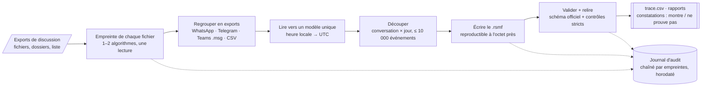
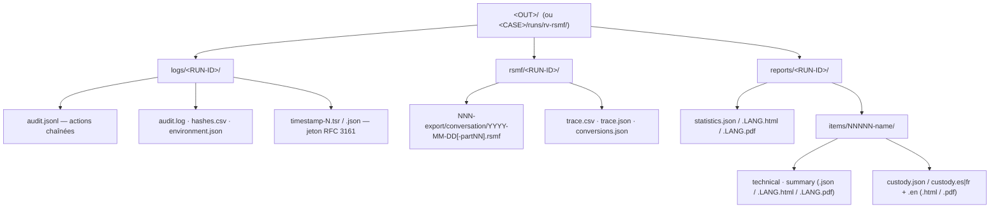

> La version de référence est la version anglaise ([README.md](README.md)) ; cette traduction la suit.

<p align="center"></p>

# RV RSMF

[English](README.md) · [Español](README.es.md) · **Français**

<!-- forge:description -->
**Convertit les exports de discussion en RSMF pour Relativity.** RV RSMF transforme les exports de discussion WhatsApp, Telegram, Microsoft Teams et CSV d'outils mobiles en fichiers RSMF 2.0 (un par conversation et par jour), valide chaque fichier et ramène chaque message à sa ligne dans l'export.
<!-- /forge:description -->

[](https://github.com/Panacota96/rv-rsmf/actions/workflows/ci.yml)




## Sommaire

- [Ce qu'il fait, et ce qu'il ne fait pas](#ce-quil-fait-et-ce-quil-ne-fait-pas)
- [Ce que vous obtenez](#ce-que-vous-obtenez)
- [Installation](#installation)
- [Démarrage rapide](#démarrage-rapide)
- [Sorties](#sorties)
- [Documentation](#documentation)
- [Organisation du projet](#organisation-du-projet)
- [Contribuer, sécurité, licence](#contribuer-sécurité-licence)
- [Licence](#licence)

## Ce qu'il fait, et ce qu'il ne fait pas

Relativity examine les discussions au format **RSMF** (Relativity Short Message Format) : un fichier en forme de
courriel qui transporte un manifeste JSON des participants, des conversations et des événements, plus les pièces
jointes. RV RSMF produit ces fichiers à partir des exports que les personnes remettent réellement, et garde une trace
qui permet à chacun de comparer chaque message avec sa source.

| Il fait | Il ne fait pas |
| --- | --- |
| Ouvrir chaque entrée en lecture seule et en calculer l'empreinte (et, dans un dossier de l'affaire, la vérifier avec le registre des éléments écrit par rv-hashinv) | Acquérir un téléphone ou un compte ; il travaille sur des exports que quelqu'un a déjà faits |
| Lire WhatsApp `.txt`/`.zip` (Android et iOS), le `result.json` de Telegram Desktop, les fichiers `.msg` de Microsoft Teams issus de Purview, et des CSV/TSV avec une correspondance de colonnes | Authentifier l'export : un export de discussion est un fichier texte ou JSON modifiable |
| Convertir les heures locales en UTC avec le fuseau horaire **que choisit l'expert**, et signaler les trous et chevauchements dus à l'heure d'été | Deviner un fuseau horaire ou un ordre jour/mois que l'export ne tranche pas : il s'arrête et demande (code de sortie 2) |
| Écrire un `.rsmf` par conversation et par jour (les jours chargés sont découpés sous la limite de 10 000 événements de Relativity), de façon déterministe | Récupérer des messages supprimés, l'historique des modifications ou des médias absents de l'export |
| Contrôler chaque fichier avec le schéma RSMF 2.0 publié par Relativity plus des règles plus strictes, et le relire | Tester comment une version donnée de Relativity affiche les fichiers |
| Écrire `trace.csv` : export, fichier source, ligne ou identifiant, texte original de l'heure → fichier RSMF et identifiant d'événement | Décider ce que signifie un message : les constatations sont des signaux pour l'expert |

## Ce que vous obtenez

| | |
| --- | --- |
| **Deux façons de l'utiliser** | `rv-rsmf` (ligne de commande) et `rv-rsmf-gui` (application de bureau pour Windows 10/11). Même moteur, mêmes résultats. |
| **Sources** | WhatsApp (Android et iOS, `.txt` ou `.zip` avec médias), JSON de Telegram Desktop (export complet ou d'une seule discussion), `.msg` de Microsoft Teams (Purview, un fichier par message), CSV/TSV avec une correspondance de colonnes TOML (profil intégré `generic` ; les profils `xry-draft` et `cellebrite-draft` ne sont pas encore contrôlés sur de vrais exports). Comment chacune est lue : [docs/theory.md](docs/theory.md#b5-how-each-source-is-read) (en anglais). |
| **RSMF 2.0** | Un fichier par conversation et par jour calendaire dans le fuseau de l'expert ; les jours de plus de 10 000 événements sont découpés en parties de 12 heures, de 8 heures ou de taille fixe ; tous les fichiers d'une conversation partagent un même identifiant de collection d'événements. |
| **Contrôles** | Schéma officiel (fourni, draft-07) + règles strictes (clés inconnues, références, heures UTC, comptes, pièces jointes dans le zip) + relecture de chaque fichier ; `rv-rsmf validate` contrôle n'importe quel `.rsmf`, le nôtre ou celui d'un autre outil. |
| **Traçabilité** | `trace.csv` / `trace.json` : une ligne par événement ; chaque événement porte aussi `source_file`, `source_lines` ou `source_id` et le texte original de l'heure dans ses champs personnalisés RSMF. |
| **Empreintes** | 1 ou 2 parmi md5, sha1, sha256, sha512, sha3-256, blake3, calculées dans la même lecture ; chaque `.rsmf` et chaque pièce jointe sont hachés et journalisés. |
| **Auditable** | Chaque action va dans `logs/<RUN-ID>/audit.jsonl`, chaque entrée portant l'empreinte de la précédente ; horodatage RFC 3161 de la tête de chaîne ; `verify-log` détecte toute modification et vérifie la signature de la TSA (`--tsa-ca` valide aussi sa chaîne). |
| **Rapports** | Statistiques par exécution ; par export un rapport technique, un résumé pour le client et une fiche de traçabilité (Colombie ou France, plus l'anglais) : HTML, PDF et JSON, en anglais, espagnol ou français. |
| **Dossier de l'affaire** | `--case-dir` relie les outils Rakvor d'une affaire : chaque fichier est haché de nouveau et vérifié avec le registre écrit à la réception par rv-hashinv (`--intake hashinv` le lance d'abord). Voir [docs/case-folder.md](docs/case-folder.md) (en anglais). |

## Installation

**Windows 10/11** : téléchargez depuis la page [Releases](https://github.com/Panacota96/rv-rsmf/releases) :

- `rv-rsmf-<version>-windows-x64-setup.exe` : programme d'installation (raccourci dans le menu Démarrer, ajoute la CLI au PATH), ou
- `rv-rsmf-<version>-windows-x64.zip` : version portable ; on décompresse et on lance, rien n'est installé.

Vérifiez le téléchargement avant usage : SHA-256, attestation de provenance et signature Authenticode (racine interne
Rakvor), pas à pas dans [docs/installation.fr.md](docs/installation.fr.md) (résumé dans
[SECURITY.md](SECURITY.md#verifying-a-release), en anglais).

**À partir des sources** (tout système ; compilez avec le compilateur fixé dans `rust-toolchain.toml`, 1.97.0 ;
`Cargo.toml` déclare 1.88 comme minimum, ce que la CI ne teste pas ; auditeurs :
[docs/installation.fr.md](docs/installation.fr.md#8-compiler-à-partir-des-sources-pour-les-auditeurs)) :

```bash
cargo build --release --locked
# binaires : target/release/rv-rsmf et target/release/rv-rsmf-gui
```

## Démarrage rapide

```powershell
# Vérifiez d'abord la compilation : chaque algorithme d'empreinte avec des vecteurs de test publiés
rv-rsmf self-test

# 1. Regarder avant de convertir : source, ordre des dates, fuseau horaire, premiers messages (n'écrit rien)
rv-rsmf preview -i "D:\export\WhatsApp Chat with Ana Ruiz.txt" --timezone Europe/Paris

# 2. Convertir (téléphone à l'heure de Paris) ; rapports en espagnol ; la propriétaire de l'appareil est Ana Ruiz
rv-rsmf convert -i D:\export -r --timezone Europe/Paris --custodian "Ana Ruiz" --lang es --case CASE-2026-014

# Un export dont toutes les dates sont <= 12 (03/04/26 : 3 avril ou 4 mars ?) demande votre décision
rv-rsmf convert -i chat.txt --timezone America/Bogota --date-order dmy

# Un CSV d'un outil d'extraction mobile, avec votre propre correspondance de colonnes
rv-rsmf convert -i chats.csv --csv-map xry.toml --timezone Europe/Madrid

# Dans un dossier de l'affaire : rv-hashinv enregistre d'abord les éléments, puis rv-rsmf les convertit et les vérifie
rv-rsmf convert -i D:\export -r --case-dir E:\CASE-014 --case CASE-014 --timezone Europe/Paris --intake hashinv

# Contrôler n'importe quel fichier .rsmf (le nôtre ou celui d'un autre outil), le journal d'audit, toute l'affaire
rv-rsmf validate rakvor-out\rsmf\<RUN-ID>
rv-rsmf verify-log rakvor-out\logs\<RUN-ID>
rv-rsmf verify-case E:\CASE-014
```

**Application de bureau :** lancez *RV RSMF* depuis le menu Démarrer, ajoutez l'export, indiquez le fuseau horaire,
appuyez sur *Aperçu*, puis sur *Lancer l'analyse* ; voir [docs/usage-gui.fr.md](docs/usage-gui.fr.md).

**Échantillon :** des exports synthétiques de chaque source (personnes inventées uniquement) se trouvent dans
[examples/](examples/README.md) (en anglais) ; `examples/sample/run.ps1` (Windows) ou `run.sh` les convertit tous en
une exécution et contrôle le résultat.

Les tâches courantes, étape par étape : [docs/quick-guide.fr.md](docs/quick-guide.fr.md).
Chaque option, exemple et code de sortie : [docs/usage-cli.md](docs/usage-cli.md) (généré à partir de `--help`, en
anglais). Le parcours complet : [docs/usage.fr.md](docs/usage.fr.md).

## Sorties



Dans un dossier de l'affaire, les trois dossiers de l'exécution sont `<CASE>/runs/rv-rsmf/<RUN-ID>/logs|reports|rsmf/`
(sans identifiant d'exécution en dessous). Chaque fichier est décrit dans [docs/reports.md](docs/reports.md) (en
anglais).

| Code de sortie | Signification |
| :-: | --- |
| 0 | Terminé, aucune constatation de gravité élevée |
| 1 | Erreur d'exécution (entrée absente, sortie non inscriptible, verrou de l'affaire occupé…) |
| 2 | Erreur d'utilisation, ou une décision que seul l'expert peut prendre : `--timezone`, `--date-order`, correspondance CSV |
| 3 | Terminé avec une constatation de gravité élevée (export illisible, fichier RSMF invalide, élément différent du registre) / chaîne d'audit ou affaire rompue |
| 130 | Annulé (rapports partiels écrits) |

## Documentation

| Page | Pour |
| --- | --- |
| [docs/quick-guide.fr.md](docs/quick-guide.fr.md) | Les six tâches courantes (preview, convert, dossier de l'affaire, validate, verify-log et verify-case, timestamp), chaque bouton de la GUI, codes de sortie |
| [docs/theory.md](docs/theory.md) | Ce que l'outil fait aux données : partie en langage simple pour les clients, avocats et juges ; structure RSMF, règles de lecture, conversion des heures, découpage, validation et carte des traces pour les experts et les experts adverses (en anglais) |
| [docs/admissibility.md](docs/admissibility.md) | Argumentaire de fiabilité et exigences de la Colombie, de la France/UE, de l'ISO et des États-Unis/Royaume-Uni rapprochés des fonctions de l'outil, liste des écarts, liste de contrôle de l'expert (pour revue par un avocat ; en anglais) |
| [docs/usage.fr.md](docs/usage.fr.md) | Parcours complet : aperçu, choix du fuseau horaire, de l'ordre des dates et du détenteur, correspondances CSV, dossier de l'affaire, validation, lecture des sorties, dépannage |
| [docs/usage-cli.md](docs/usage-cli.md) | Chaque commande et option (généré à partir de `--help`, en anglais) |
| [docs/usage-gui.fr.md](docs/usage-gui.fr.md) | Utilisation de l'application de bureau |
| [docs/reports.md](docs/reports.md) | Chaque fichier de sortie, le catalogue des constatations, les schémas JSON, les langues (en anglais) |
| [docs/forensic-audit.md](docs/forensic-audit.md) | Piste d'audit, chaque action consignée, horodatages, manipulation des éléments, correspondance avec ISO/IEC 27037 (en anglais) |
| [docs/case-folder.md](docs/case-folder.md) | Dossier d'affaire partagé : vérification de chaque export avec le registre de rv-hashinv, réception en une étape (`--intake hashinv`), `verify-case` (en anglais) |
| [docs/installation.fr.md](docs/installation.fr.md) | Installation sous Windows 10/11, vérification de la version (SHA-256, provenance, Authenticode), usage hors ligne, compilation à partir des sources |
| [docs/architecture.md](docs/architecture.md) | Comment s'assemblent le moteur, les lecteurs, l'écriture RSMF, la CLI et la GUI (en anglais) |
| [docs/development.md](docs/development.md) | Compilation, tests, échantillons, oracles, CI (en anglais) |
| [docs/release-process.md](docs/release-process.md) | Paquets Windows, signature de code et versions GitHub, pas à pas (en anglais) |
| [docs/adr/](docs/adr/) | Décisions d'architecture (pourquoi Rust ; en anglais) |

Le README, le guide rapide, le guide d'utilisation, le guide de l'application de bureau et le guide d'installation
existent aussi en espagnol (`.es.md`) et en français (`.fr.md`) ; les pages en anglais font référence.

## Organisation du projet

```text
rv-rsmf/
├── src/
│   ├── core/      bibliothèque du moteur (n'affiche jamais rien) : entrées, empreintes, sources/ (lecteurs), modèle,
│   │              rsmf/ (écriture, lecture, validation, shortcodes), conversion, dossier de l'affaire, réception,
│   │              journal d'audit, rapports
│   ├── cli/       ligne de commande rv-rsmf (clap)
│   └── gui/       application de bureau rv-rsmf-gui (egui) ; state.rs contient toutes les règles testables
├── schemas/       rsmf_schema_2_0_0.json (schéma officiel de Relativity) + schémas JSON des rapports et de l'affaire
├── templates/     modèles HTML des rapports + CSS (minijinja)
├── i18n/          textes des rapports : en.json, es.json, fr.json
├── docs/          documentation (les diagrammes Mermaid s'affichent sur GitHub)
├── scripts/       contrôles de la documentation (les traductions gardent la forme des pages anglaises)
├── tests/         oracles Python : oracle RSMF, contrôle de bout en bout de l'échantillon, vérificateur de la
│                  chaîne d'audit, schémas des rapports
├── examples/      exports de discussion synthétiques + résultats attendus + scripts d'exécution
├── packaging/     programme d'installation Windows (Inno Setup)
└── .github/       workflows de CI et de publication
```

## Contribuer, sécurité, licence

- Comment contribuer : [CONTRIBUTING.md](CONTRIBUTING.md) · Modifications : [CHANGELOG.md](CHANGELOG.md)
- Signaler une vulnérabilité en privé : [SECURITY.md](SECURITY.md)
- Licence : voir [Licence](#licence). Mentions des tiers : [NOTICE](NOTICE).

## Licence

Code source disponible, usage non commercial : [PolyForm Noncommercial 1.0.0](LICENSE). Toute personne peut
utiliser, étudier, modifier et partager RV RSMF à des fins non commerciales. La mention est obligatoire dans tout
usage : « RV RSMF by Rakvor », en conservant la ligne `Required Notice:` de [LICENSE](LICENSE). L'usage commercial
(la vendre, des services payants, l'usage dans le travail rémunéré d'une entreprise à but lucratif) nécessite une
licence écrite de Rakvor : voir [COMMERCIAL.md](COMMERCIAL.md). Rakvor conserve tous les droits commerciaux en tant
que titulaire du droit d'auteur. Les textes de licence de Rakvor ([COMMERCIAL.md](COMMERCIAL.md), [NOTICE](NOTICE),
cette section) sont des projets, à faire vérifier par un avocat (*to be verified* ; Colombie, France), et ne
constituent pas un avis juridique. Les composants tiers conservent leurs propres licences : [NOTICE](NOTICE).
