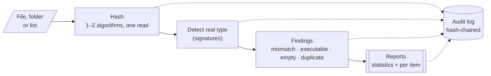
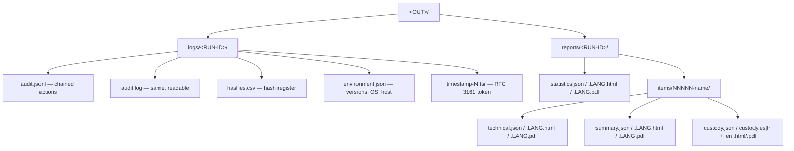

<p align="center"></p>

# RV RSMF

<!-- forge:description -->
**Converts chat exports to RSMF for Relativity.** RV RSMF turns WhatsApp, Telegram, Microsoft Teams and mobile-tool CSV chat exports into RSMF 2.0 files (one per conversation per day), validates every file, and traces each message back to its line in the export.
<!-- /forge:description -->

[](https://github.com/Panacota96/rv-rsmf/actions/workflows/ci.yml)




## Contents

- [What you get](#what-you-get)
- [Install](#install)
- [Quick start](#quick-start)
- [Outputs](#outputs)
- [Documentation](#documentation)
- [Project layout](#project-layout)
- [Contributing, security, licence](#contributing-security-licence)

## What you get

| | |
| --- | --- |
| **Two ways to use it** | `rv-rsmf` (command line) and `rv-rsmf-gui` (Windows 10/11 desktop app). Same engine, same results. |
| **Single or bulk** | One file, many files, whole folders (`--recursive`) or a list file (`--input-list`). |
| **Hashing** | Choose 1 or 2 of md5, sha1, sha256, sha512, sha3-256, blake3. Both are computed in the same read. |
| **Progress** | Progress bar, elapsed time, throughput and estimated time remaining (CLI and GUI). Cancel at any time. |
| **Auditable** | Every action goes to `logs/<RUN-ID>/audit.jsonl`, where each entry carries the hash of the previous one. `verify-log` detects any edit. |
| **Reports** | A statistics report per run, and for **each file** a technical review and a customer summary — HTML, PDF and JSON, in English, Spanish or French. |
| **Case folder** | `--case-dir` links the Rakvor tools of one case: rv-rsmf (the intake tool) registers each file as `E0001`, `E0002`, … so later tools prove they examined bit-identical copies; `verify-case` checks the whole folder. See [docs/case-folder.md](docs/case-folder.md). |

## Install

**Windows 10/11** — download from the [Releases](https://github.com/Panacota96/rv-rsmf/releases) page:

- `rv-rsmf-<version>-windows-x64-setup.exe` — installer (Start-menu shortcut, adds the CLI to PATH), or
- `rv-rsmf-<version>-windows-x64.zip` — portable: unzip and run, nothing is installed.

Check the download before use (see [SECURITY.md](SECURITY.md#verifying-a-release)).

**From source** (any OS, Rust 1.85+):

```bash
cargo build --release
# binaries: target/release/rv-rsmf and target/release/rv-rsmf-gui
```

## Quick start

```powershell
# Check the build first: every algorithm against published test vectors
rv-rsmf self-test

# Review a folder with SHA-256 + MD5, reports in Spanish, for case CASE-2026-014
rv-rsmf scan -i D:\evidence -r --hash sha256,md5 --lang es --case CASE-2026-014 --actor "Ana Ruiz"

# French case: custody form in French + English, every PDF signed with your certificate
$env:RV_SIGN_PASSWORD = Read-Host -AsSecureString | ConvertFrom-SecureString -AsPlainText
rv-rsmf scan -i D:\evidence -r --jurisdiction fr --sign-cert C:\certs\examiner.p12 --lang fr

# Later, prove the log was not altered (also checks the RFC 3161 timestamp)
rv-rsmf verify-log rakvor-out\logs\<RUN-ID>

# The run was offline? Add the trusted timestamp once the network is back
rv-rsmf timestamp rakvor-out\logs\<RUN-ID>
```

Every option, example and exit code: [docs/usage-cli.md](docs/usage-cli.md) (generated from `--help`).
The desktop app: [docs/usage-gui.md](docs/usage-gui.md). A ready-made sample: [examples/](examples/README.md).

## Outputs



| Exit code | Meaning |
| :-: | --- |
| 0 | Completed, no high-severity finding |
| 1 | Runtime error |
| 2 | Usage error (e.g. three hash algorithms) |
| 3 | Completed with high-severity findings / broken audit chain |
| 130 | Cancelled (partial reports written) |

## Documentation

| Page | For |
| --- | --- |
| [docs/usage.md](docs/usage.md) | End-to-end case walkthrough: intake, analysis, `verify-case`, reading every output, troubleshooting |
| [docs/installation.md](docs/installation.md) | Installing and verifying a release (SHA256SUMS, provenance, Authenticode), building from source for auditors |
| [docs/theory.md](docs/theory.md) | Why each step works: plain-language part for clients and courts, expert part with algorithms and real values |
| [docs/admissibility.md](docs/admissibility.md) | Colombia, France/EU, ISO/IEC and US/UK requirements mapped to the tool, gap list, examiner checklist |
| [docs/usage-cli.md](docs/usage-cli.md) | Every command and option (generated from `--help`) |
| [docs/usage-gui.md](docs/usage-gui.md) | Using the desktop app |
| [docs/architecture.md](docs/architecture.md) | How the engine, CLI and GUI fit together |
| [docs/forensic-audit.md](docs/forensic-audit.md) | Audit trail, hash chain, evidence handling, ISO/IEC 27037 mapping |
| [docs/reports.md](docs/reports.md) | Report kinds, fields, JSON schemas, languages |
| [docs/case-folder.md](docs/case-folder.md) | Shared case folder: evidence registry, case log, intake vs analysis tools, `verify-case` |
| [docs/development.md](docs/development.md) | Building, testing, CI/CD and releasing |
| [docs/adr/](docs/adr/) | Architecture decisions (e.g. why Rust) |

## Project layout

```text
rv-rsmf/
├── src/
│   ├── core/      engine library: input, hashing, analysis, audit log, reports (never prints)
│   ├── cli/       rv-rsmf command line (clap)
│   └── gui/       rv-rsmf-gui desktop app (egui); state.rs holds all testable rules
├── templates/     HTML report templates + CSS (Jinja2/minijinja compatible)
├── i18n/          report wording: en.json, es.json, fr.json
├── schemas/       JSON Schemas of the three report kinds
├── docs/          documentation (Mermaid diagrams render on GitHub)
├── tests/         cross-language checks (Python verifier of the audit chain)
├── examples/      sample evidence + run scripts + expected hashes
├── packaging/     Windows installer (Inno Setup)
└── .github/       CI and release workflows
```

## Contributing, security, licence

- How to contribute: [CONTRIBUTING.md](CONTRIBUTING.md) · Changes: [CHANGELOG.md](CHANGELOG.md)
- Report a vulnerability privately: [SECURITY.md](SECURITY.md)
- Rakvor Source-Auditable Licence ([LICENSE](LICENSE), draft pending legal review): used locally by Rakvor; customers, courts and their experts may inspect and rebuild the source for audit; no redistribution. Third-party notices: [NOTICE](NOTICE).
