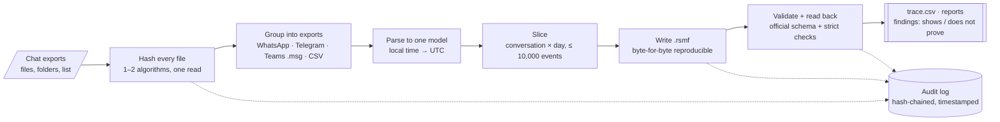
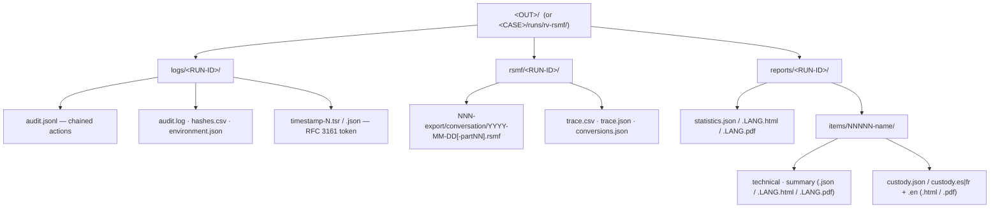

<p align="center"></p>

# RV RSMF

<!-- forge:description -->
**Converts chat exports to RSMF for Relativity.** RV RSMF turns WhatsApp, Telegram, Microsoft Teams and mobile-tool CSV chat exports into RSMF 2.0 files (one per conversation per day), validates every file, and traces each message back to its line in the export.
<!-- /forge:description -->

[](https://github.com/Panacota96/rv-rsmf/actions/workflows/ci.yml)




## Contents

- [What it does, and what it does not do](#what-it-does-and-what-it-does-not-do)
- [What you get](#what-you-get)
- [Install](#install)
- [Quick start](#quick-start)
- [Outputs](#outputs)
- [Documentation](#documentation)
- [Project layout](#project-layout)
- [Contributing, security, licence](#contributing-security-licence)

## What it does, and what it does not do

Relativity reviews chat as **RSMF** (Relativity Short Message Format): an e-mail-shaped file that carries a JSON
manifest of participants, conversations and events plus the attachments. RV RSMF produces those files from the
exports people actually hand over, and keeps a record that lets anyone check each message against its source.

| It does | It does not |
| --- | --- |
| Open every input read-only and hash it (and, in a case folder, verify it against the evidence registry written by rv-hashinv) | Acquire a phone or account; it works on exports someone already made |
| Read WhatsApp `.txt`/`.zip` (Android and iOS), Telegram Desktop `result.json`, Microsoft Teams `.msg` files from Purview, and CSV/TSV with a column mapping | Authenticate the export: a chat export is an editable text or JSON file |
| Convert local times to UTC with the time zone **the examiner chooses**, and report daylight-saving gaps and overlaps | Guess a time zone or a day/month order the export does not settle: it stops and asks (exit code 2) |
| Write one `.rsmf` per conversation per day (busy days split under Relativity's 10,000-event limit), deterministically | Recover deleted messages, edit history or media left out of the export |
| Check every file against Relativity's published RSMF 2.0 schema plus stricter rules, and read it back | Test how a given Relativity version displays the files |
| Write `trace.csv`: export, source file, line or id, original time text → RSMF file and event id | Decide what a message means: findings are signals for the examiner |

## What you get

| | |
| --- | --- |
| **Two ways to use it** | `rv-rsmf` (command line) and `rv-rsmf-gui` (Windows 10/11 desktop app). Same engine, same results. |
| **Sources** | WhatsApp (Android and iOS, `.txt` or `.zip` with media), Telegram Desktop JSON (full or single-chat export), Microsoft Teams `.msg` (Purview, one file per message), CSV/TSV with a TOML column mapping (built-in `generic` profile; `xry-draft` and `cellebrite-draft` profiles not yet checked against real exports). How each is read: [docs/theory.md](docs/theory.md#b5-how-each-source-is-read). |
| **RSMF 2.0** | One file per conversation per calendar day in the examiner's zone; days over 10,000 events split into 12-hour, 8-hour or fixed-size parts; all files of a conversation share one event collection id. |
| **Checks** | Official schema (bundled, draft-07) + strict rules (unknown keys, references, UTC times, counts, attachments in the zip) + read-back of every file; `rv-rsmf validate` checks any `.rsmf`, ours or another tool's. |
| **Traceability** | `trace.csv` / `trace.json`: one row per event; every event also carries `source_file`, `source_lines` or `source_id` and the original time text in its RSMF custom fields. |
| **Hashing** | 1 or 2 of md5, sha1, sha256, sha512, sha3-256, blake3, computed in the same read; every `.rsmf` and attachment hashed and logged. |
| **Auditable** | Every action goes to `logs/<RUN-ID>/audit.jsonl`, each entry carrying the hash of the previous one; RFC 3161 timestamp of the chain head; `verify-log` detects any edit. |
| **Reports** | Statistics per run; per export a technical review, a customer summary and a custody form (Colombia or France, plus English) — HTML, PDF and JSON, in English, Spanish or French. |
| **Case folder** | `--case-dir` links the Rakvor tools of one case: each file is re-hashed and verified against the registry written at intake by rv-hashinv (`--intake hashinv` runs it first). See [docs/case-folder.md](docs/case-folder.md). |

## Install

**Windows 10/11** — download from the [Releases](https://github.com/Panacota96/rv-rsmf/releases) page:

- `rv-rsmf-<version>-windows-x64-setup.exe` — installer (Start-menu shortcut, adds the CLI to PATH), or
- `rv-rsmf-<version>-windows-x64.zip` — portable: unzip and run, nothing is installed.

Check the download before use: SHA-256, provenance attestation and the Authenticode signature (internal Rakvor
root), step by step in [docs/installation.md](docs/installation.md) (summary in
[SECURITY.md](SECURITY.md#verifying-a-release)).

**From source** (any OS; build with the compiler pinned in `rust-toolchain.toml`, 1.97.0 — `Cargo.toml` declares
1.88 as the minimum, which CI does not test; auditors:
[docs/installation.md](docs/installation.md#8-build-from-source-for-auditors)):

```bash
cargo build --release --locked
# binaries: target/release/rv-rsmf and target/release/rv-rsmf-gui
```

## Quick start

```powershell
# Check the build first: every hash algorithm against published test vectors
rv-rsmf self-test

# 1. Look before converting: source, date order, time zone, first messages (writes nothing)
rv-rsmf preview -i "D:\export\WhatsApp Chat with Ana Ruiz.txt" --timezone Europe/Paris

# 2. Convert (phone set to Paris time); Spanish reports; the device owner is Ana Ruiz
rv-rsmf convert -i D:\export -r --timezone Europe/Paris --custodian "Ana Ruiz" --lang es --case CASE-2026-014

# An export whose dates are all <= 12 (03/04/26: 3 April or 4 March?) needs your decision
rv-rsmf convert -i chat.txt --timezone America/Bogota --date-order dmy

# A CSV from a mobile forensic tool, with your own column mapping
rv-rsmf convert -i chats.csv --csv-map xry.toml --timezone Europe/Madrid

# In a case folder: rv-hashinv registers the evidence first, then rv-rsmf converts and verifies it
rv-rsmf convert -i D:\export -r --case-dir E:\CASE-014 --case CASE-014 --timezone Europe/Paris --intake hashinv

# Check any .rsmf file (ours or another tool's), the audit log, the whole case
rv-rsmf validate rakvor-out\rsmf\<RUN-ID>
rv-rsmf verify-log rakvor-out\logs\<RUN-ID>
rv-rsmf verify-case E:\CASE-014
```

**Desktop app:** start *RV RSMF* from the Start menu, add the export, set the time zone, press *Preview*, then
*Start*; see [docs/usage-gui.md](docs/usage-gui.md).

**Sample:** synthetic exports of every source (invented people only) are in [examples/](examples/README.md);
`examples/sample/run.ps1` (Windows) or `run.sh` converts them all in one run and checks the result.

Every option, example and exit code: [docs/usage-cli.md](docs/usage-cli.md) (generated from `--help`). The
complete walkthrough: [docs/usage.md](docs/usage.md).

## Outputs



In a case folder the three run folders are `<CASE>/runs/rv-rsmf/<RUN-ID>/logs|reports|rsmf/` (no run id below
them). Every file is described in [docs/reports.md](docs/reports.md).

| Exit code | Meaning |
| :-: | --- |
| 0 | Completed, no high-severity finding |
| 1 | Runtime error (input missing, output not writable, case lock held …) |
| 2 | Usage error, or a decision only the examiner can make: `--timezone`, `--date-order`, CSV mapping |
| 3 | Completed with a high-severity finding (export not readable, RSMF file invalid, evidence differs from the registry) / broken audit chain or case |
| 130 | Cancelled (partial reports written) |

## Documentation

| Page | For |
| --- | --- |
| [docs/theory.md](docs/theory.md) | What the tool does to the data: plain-language part for clients, lawyers and judges; RSMF structure, parsing rules, time conversion, slicing, validation and trace map for examiners and opposing experts |
| [docs/admissibility.md](docs/admissibility.md) | Reliability argument and requirements of Colombia, France/EU, ISO and US/UK mapped to tool features, gap list, examiner checklist (for counsel review) |
| [docs/usage.md](docs/usage.md) | End-to-end walkthrough: preview, choosing time zone, date order and custodian, CSV mappings, case folder, validation, reading the outputs, troubleshooting |
| [docs/usage-cli.md](docs/usage-cli.md) | Every command and option (generated from `--help`) |
| [docs/usage-gui.md](docs/usage-gui.md) | Using the desktop app |
| [docs/reports.md](docs/reports.md) | Every output file, the findings catalogue, JSON schemas, languages |
| [docs/forensic-audit.md](docs/forensic-audit.md) | Audit trail, every recorded action, timestamps, evidence handling, ISO/IEC 27037 mapping |
| [docs/case-folder.md](docs/case-folder.md) | Shared case folder: verifying each export against the rv-hashinv registry, one-step intake (`--intake hashinv`), `verify-case` |
| [docs/installation.md](docs/installation.md) | Installing on Windows 10/11, verifying the release (SHA-256, provenance, Authenticode), offline use, building from source |
| [docs/architecture.md](docs/architecture.md) | How the engine, parsers, RSMF writer, CLI and GUI fit together |
| [docs/development.md](docs/development.md) | Building, tests, samples, oracles, CI |
| [docs/release-process.md](docs/release-process.md) | Windows packages, code signing and GitHub releases, step by step |
| [docs/adr/](docs/adr/) | Architecture decisions (why Rust) |

## Project layout

```text
rv-rsmf/
├── src/
│   ├── core/      engine library (never prints): input, hashing, sources/ (parsers), model, rsmf/ (writer,
│   │              reader, validator, shortcodes), convert, case folder, intake, audit log, reports
│   ├── cli/       rv-rsmf command line (clap)
│   └── gui/       rv-rsmf-gui desktop app (egui); state.rs holds all testable rules
├── schemas/       rsmf_schema_2_0_0.json (Relativity's official schema) + JSON Schemas of the reports and case
├── templates/     HTML report templates + CSS (minijinja)
├── i18n/          report wording: en.json, es.json, fr.json
├── docs/          documentation (Mermaid diagrams render on GitHub)
├── tests/         Python oracles: RSMF oracle, end-to-end sample check, audit-chain verifier, report schemas
├── examples/      synthetic chat exports + expected results + run scripts
├── packaging/     Windows installer (Inno Setup)
└── .github/       CI and release workflows
```

## Contributing, security, licence

- How to contribute: [CONTRIBUTING.md](CONTRIBUTING.md) · Changes: [CHANGELOG.md](CHANGELOG.md)
- Report a vulnerability privately: [SECURITY.md](SECURITY.md)
- Rakvor Source-Auditable Licence ([LICENSE](LICENSE), draft pending legal review): used locally by Rakvor;
  customers, courts and their experts may inspect and rebuild the source for audit; no redistribution.
  Third-party notices: [NOTICE](NOTICE).
