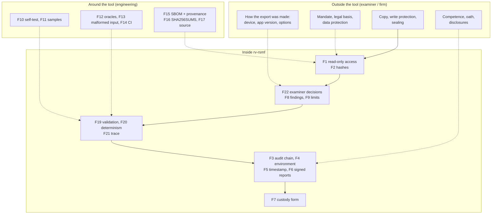

# Admissibility and reliability

> **Not legal advice.** This page maps legal and technical requirements to what RV RSMF actually does, so that an
> examiner, a lawyer or an opposing expert can see where the tool helps and where it does not. The legal analysis
> was prepared from a sourced research note dated 2026-10-21 (pass 2, verification, same date) for the Rakvor
> toolkit and adapted here to chat conversion; the RSMF and export-format facts come from the rv-rsmf research brief
> of 2026-10-27 ([theory.md](theory.md#b21-references)). It **must be reviewed by counsel in each jurisdiction
> before it is relied on or quoted**. Status: draft for counsel review.

## Contents

- [1. Purpose and how to read this page](#1-purpose-and-how-to-read-this-page)
- [2. Evidence lifecycle and where each control sits](#2-evidence-lifecycle-and-where-each-control-sits)
- [3. The reliability argument](#3-the-reliability-argument)
  - [3.1 What converting chat to RSMF changes](#31-what-converting-chat-to-rsmf-changes)
- [4. Colombia](#4-colombia)
- [5. France and the European Union](#5-france-and-the-european-union)
- [6. International standards](#6-international-standards)
- [7. United States and United Kingdom](#7-united-states-and-united-kingdom)
- [Consolidated gap list](#consolidated-gap-list)
- [Examiner checklist before filing a report](#examiner-checklist-before-filing-a-report)
- [Sources](#sources)

## 1. Purpose and how to read this page

RV RSMF is used **locally** by Rakvor; it is not distributed. Clients, courts and opposing experts may audit it. It
**converts** chat exports into Relativity's RSMF format and traces every message; it does not authenticate the
export and never gives a verdict ([theory.md](theory.md#a1-what-the-tool-is-and-is-not)). Admissibility and weight
are decided by a court about the **examiner's evidence**, of which the tool's output is one part. This page
separates five kinds of status:

| Status | Meaning |
| --- | --- |
| **met** | A tool feature satisfies or directly supports the requirement (the file or command is named) |
| **partial** | Supported, with a named shortfall |
| **examiner** | An obligation of the examiner or of Rakvor as a firm, not a tool feature |
| **gap** | Not met today; listed in the [consolidated gap list](#consolidated-gap-list) with a mitigation and an owner |
| **context** | Background that frames the other rows |

**Verification marks** (kept from the research note; never upgraded here):

| Mark | Meaning |
| --- | --- |
| **[V]** | Article or clause number and substance checked against the primary text (project document, official gazette or faithful mirror). Quoted fragments are verbatim. |
| **[S]** | Checked against a secondary source (Conseil constitutionnel dossier, law-firm note, Rama Judicial cartilla). The number is reliable; check the wording before quoting. |
| **to be verified** | Marked UNVERIFIED in the research: from general professional knowledge, or the primary text could not be reached. **Do not cite before a lawyer or engineer has checked it against the primary source.** |

Research limits that still apply: the Colombian project PDFs `Ley_906_de_2004.pdf`, `Ley_1564_de_2012.pdf` and
`manualcadena2.pdf` were verified against official web copies, not the project files — **re-check quoted
fragments against the project PDFs before publishing**; the ISO/IEC 27037 copy was the free preview (table of
contents and clauses 1–4); Légifrance refused automated access (CPP, Code civil and décret 2017-1416 read from
the Pappers LEGI mirror). Pass 2 verified eIDAS (EUR-Lex consolidated text), the GDPR (gdpr-info.eu mirror and the
Commission's adequacy page), the FRE text, SWGDE, the NIST CFTT page, ISO editions and ISO/IEC 17025:2017 clauses,
and the UK FSR Code v2. Still **to be verified**: ISO/IEC 27037 clauses 5–7 body text and 27041/27042 clause
text (paywalled); Daubert/Kumho citations; CPP art. 427, Code civil art. 1358, CPC arts. 16, 233, 237, 238, 276;
loi Informatique et Libertés art. 46 and Directive 2016/680 applicability; NIST FIPS 180-4/202; Decreto
2364/2012, RNBD thresholds, CSJ penal 29.877, C-604/16 and the CGP art. 226 look-back periods; the ANSSI PRIS
content. The legal research was written for document evidence in general; whether a court treats a chat export
and its RSMF conversion as a *mensaje de datos* / *écrit électronique* in the way assumed below is itself for
counsel to confirm.

### Tool features referred to in the tables

| Key | Feature | Where it is implemented (file / command) |
| --- | --- | --- |
| F1 | Read-only evidence access (software level) | `File::open` in [src/core/src/run.rs](../src/core/src/run.rs) and the parsers ([src/core/src/sources/](../src/core/src/sources/mod.rs)); `mtime_unchanged` in `item_hashed` |
| F2 | Hashing with 1 or 2 algorithms (md5, sha1, sha256, sha512, sha3-256, blake3) of every input; SHA-256 (and the selected algorithms) of every `.rsmf` and packed attachment | [src/core/src/hash.rs](../src/core/src/hash.rs); `convert --hash`; `logs/<RUN-ID>/hashes.csv`; `rsmf_written`, `attachment_packed` |
| F3 | SHA-256 hash-chained audit log + independent verifier | [src/core/src/audit.rs](../src/core/src/audit.rs); `rv-rsmf verify-log`; [tests/verify_chain.py](../tests/verify_chain.py) |
| F4 | `environment.json`: tool, compiler and dependency versions, OS, host, user, command line | [src/core/src/env.rs](../src/core/src/env.rs) |
| F5 | RFC 3161 timestamp of the audit chain head | [src/core/src/trust.rs](../src/core/src/trust.rs); `--tsa-url`, `--no-timestamp`, `rv-rsmf timestamp` |
| F6 | PDF reports signed with the examiner's own certificate (CMS, `adbe.pkcs7.detached`) | `--sign-cert`; `PdfSigner` in [src/core/src/trust.rs](../src/core/src/trust.rs); [src/core/src/report/pdf.rs](../src/core/src/report/pdf.rs) |
| F7 | Per-item chain-of-custody form: Colombia (Fiscalía style) or France (scellés), plus English | `--jurisdiction co` or `fr`; `custody.json/.html/.pdf`; [templates/custody.html](../templates/custody.html); [schemas/item-custody.schema.json](../schemas/item-custody.schema.json) |
| F8 | Findings state what they show **and** what they do not prove; observations only | [i18n/en.json](../i18n/en.json) (`findings`), es/fr; [reports.md](reports.md#findings-catalogue) |
| F9 | Declared limitations, printed in every report (8, incl. "converts, does not authenticate" and "the export, not the device") | `LIMITATIONS` in [src/core/src/report/mod.rs](../src/core/src/report/mod.rs); [i18n/en.json](../i18n/en.json) (`limitations`) |
| F10 | Known-answer self-test (hash algorithms only) | `rv-rsmf self-test` |
| F11 | Synthetic sample exports of every source with expected results | [examples/sample/](../examples/README.md): `expected/*.json`, `expected_hashes.csv`; checked by [src/core/tests/](../src/core/tests/parsers_whatsapp_telegram.rs) and [tests/run_samples.py](../tests/run_samples.py) |
| F12 | Test oracles (independent tools) | [tests/oracle_rsmf.py](../tests/oracle_rsmf.py) (Python `email` + Relativity's official schema fetched at a pinned commit, digests vs the audit log, trace rows — CI on every push); [tests/verify_chain.py](../tests/verify_chain.py) (CI); Python `hashlib`/`blake3` for the sample hashes |
| F13 | Malformed-input handling | parser panics contained per export (`PARSER_FAILED`) and per `.msg` file; tests for corrupt `.msg` files, garbage text, path tricks in attachment names; **no fuzzing** (G21) |
| F14 | CI on Windows and Linux | [.github/workflows/ci.yml](../.github/workflows/ci.yml) |
| F15 | SBOM and build provenance | [.github/workflows/release.yml](../.github/workflows/release.yml) (CycloneDX, `actions/attest-build-provenance`) |
| F16 | Versioned releases with `SHA256SUMS` | [.github/workflows/release.yml](../.github/workflows/release.yml); [installation.md](installation.md#2-verify-the-download) |
| F17 | Source auditable by customers and opposing experts; local use only | Repository access; [LICENSE](../LICENSE) is the Rakvor source-auditable licence (draft pending legal review, see G17) |
| F18 | One-step intake by RV HashInv (`--intake hashinv`): the hash inventory and registry come from rv-hashinv itself; rv-rsmf records which executable ran (path, version ≥ 0.3.0, SHA-256), its arguments, run id and exit code, and converts nothing if it fails | [src/core/src/intake.rs](../src/core/src/intake.rs); `intake_delegated` in `audit.jsonl`; [case-folder.md](case-folder.md#one-step-intake-with-rv-hashinv) |
| F19 | Every RSMF file checked against Relativity's official RSMF 2.0 schema plus strict rules, and read back; `rv-rsmf validate` for any file | [src/core/src/rsmf/mod.rs](../src/core/src/rsmf/mod.rs); `rsmf_validated`; [theory.md B11](theory.md#b11-validation-and-read-back) |
| F20 | Deterministic writing: the same export, options and version give byte-identical `.rsmf` files | [theory.md B10](theory.md#b10-deterministic-writing); checked twice per sample in CI by [tests/run_samples.py](../tests/run_samples.py) |
| F21 | Message-level trace: `trace.csv` / `trace.json` (export, file, line or id, time as written, UTC, RSMF file, event id) and the same source fields in every RSMF event | [src/core/src/convert.rs](../src/core/src/convert.rs); [theory.md B12](theory.md#b12-the-trace-map) |
| F22 | Examiner decisions required, never guessed, and recorded: time zone, day/month order, CSV mapping, custodian (exit code 2 when missing; `conversion_started`, parser facts, `DATE_ORDER_*`, `TIMEZONE_APPLIED`, `source_time` kept in every event) | [src/core/src/sources/mod.rs](../src/core/src/sources/mod.rs) `ParseError`; [theory.md B6](theory.md#b6-time-local-time-to-utc-and-the-date-order) |

## 2. Evidence lifecycle and where each control sits

```mermaid
flowchart LR
    A["Device / account<br/>(phone, Teams tenant)"] --> X["Export<br/>by the custodian, a forensic tool or Purview"]
    X --> B["Forensic copy<br/>write-protected"]
    B --> C["Intake<br/>rv-hashinv: registry + hashes"]
    C --> D["Conversion<br/>rv-rsmf convert"]
    D --> E["Examiner review<br/>trace.csv, findings, Relativity"]
    E --> F["Report<br/>signed PDF, timestamped log"]
    F --> G["Disclosure<br/>party, court, opposing expert"]
    G --> H["Counter-expertise<br/>re-run, oracles, source review"]
```

## 3. The reliability argument

Courts in all four traditions ask, in different words, whether the method is **reliable** and whether it was
**reliably applied** in this case. Colombia's Ley 906 art. 422 lists Daubert-like criteria ([V]); France leaves
evidence free but weighs it; ISO/IEC 17025 §7.2 ([V]; 27041 clause text to be verified) asks for validation before
use and verification by each user; the US FRE 702 (2023 amendment, [V]) and Daubert/Kumho (to be verified) give the
vocabulary opposing experts use.

| Factor | What RV RSMF offers (evidence an examiner can show) | Status |
| --- | --- | --- |
| **Testability** — can the method be tested? | Byte-identical output for the same input and options (F20); 8 synthetic sample exports with hand-counted expected results (F11); unit and integration tests on Windows and Linux (F14); every message traceable to its line or id (F21), so any conversion can be checked by hand | met |
| **Known or potential error rate, and limits** | Every finding states what it does not prove (F8); 8 limitations in every report (F9); unverified format facts and known defects stated in [theory.md](theory.md) (G25, G26, G28). **No measured error rates** across app versions, locales and export tools (G5) | partial |
| **Peer review / independent oracles** | Source auditable (F17); RSMF output re-checked by Python's `email` parser and Relativity's official schema fetched at a pinned commit (F12, CI); independent chain verifier (CI). No second parser of the exports, no fuzzing (G21); no publication or external review (G7) | partial |
| **Standards controlling the operation** | RSMF 2.0 as published by Relativity (schema, headers, 10,000-event limit); RFC 5322/2045–2047 (message), RFC 3339 and the IANA time-zone database (times); RFC 3161, RFC 5652, FIPS 180-4/202 (cryptography); release verification ([installation.md](installation.md)); examiner checklist (below). No enforced hash policy (G11); no formal SOP signed by the firm | partial |
| **General acceptance** | RSMF is the format Relativity itself documents for short messages; hashing and per-message trace are standard practice. Acceptance of rv-rsmf's parsing rules is not demonstrated (G5, G7, G21) | partial |
| **Validation for intended use** (17025 §7.2.2 [V]; ISO/IEC 27041 — to be verified) | Inputs exist (F10–F14, F19, F20) but there is **no per-release validation report** with plan, acceptance criteria, results and sign-off, and no test against real exports or a Relativity workspace (G6, G25, G27) | gap |
| **Verification by the user** before casework (17025 §7.2.1 [V title]; 27041 — to be verified) | `self-test` (hashes) + sample conversion with a known expected summary, `verify-log` and `validate` ([installation.md](installation.md#6-first-run-self-test-and-sample-conversion)) | met |
| **Reliable application in this case** (FRE 702(d), 2023 — [V]) | Every step and every examiner decision in the audit chain (F3, F22), environment pinned (F4), digests of every output, timestamp (F5), signed report (F6), message-level trace (F21) | met |

### 3.1 What converting chat to RSMF changes

Four points are specific to this tool and should be in the examiner's report whenever RSMF files are produced.

| Point | What the tool does | What the examiner must still do |
| --- | --- | --- |
| **Conversion is not authentication** | rv-rsmf reproduces the export faithfully and proves, from intake onward, that the RSMF came from those exact bytes (F2, F3, F21). It says so in every report (`EXPORT_CONTENT_NOT_AUTHENTICATED`). | Authenticate the conversation by other means: a forensic extraction of the device, the other party's copy, server records, metadata consistency. Present the RSMF as a review copy of the export, not as the original evidence. |
| **Completeness of exports** | It reports what the export itself says is missing (`MEDIA_OMITTED_IN_EXPORT`, `TELEGRAM_FILE_NOT_INCLUDED`, `ATTACHMENT_REFERENCED_NOT_FOUND`, `EDIT_HISTORY_NOT_IN_EXPORT`), what it could not read (`UNPARSED_LINES`), that deleted messages are never exported (`DELETED_MESSAGES_NOT_IN_EXPORT`) and a possible export cap (`POSSIBLE_EXPORT_LIMIT`). It cannot know what the export left out silently. | Document how the export was made (device, app version, "with/without media", date range); compare first and last messages and counts with an extraction when completeness matters; review every unparsed line (G28). |
| **Time zone and date order are examiner decisions** | For WhatsApp and most CSV exports the times have no UTC offset: the tool refuses to guess, requires `--timezone` (and `--date-order` when the file cannot decide), records the choice and its basis, keeps the original time text in every event, and reports daylight-saving gaps and overlaps (F22). | State the zone and the evidence for it (device settings, custodian, travel); state the date-order basis; check messages flagged at clock changes; remember that a wrong zone shifts every time by the same amount. |
| **Reproducibility** | The same export, options and tool version give byte-identical `.rsmf` files (F20); every option is in `conversion_started`; the version is in `X-RSMF-Generator` and `environment.json`. | Keep the export, the exact release (zip + `SHA256SUMS`) and the run folders, so the opposing expert can re-run and compare SHA-256 values. |

## 4. Colombia

### 4.1 Ley 906 de 2004 (Código de Procedimiento Penal)

Context: adversarial criminal procedure; digital items are *elementos materiales probatorios / evidencia física*
(EMP/EF) and data messages are expressly included (art. 275 lit. g). Authenticity rests on the chain of custody
(arts. 254–266, 277); expert evidence is tested orally (arts. 405–423); novel techniques must meet at least one
of four Daubert-like criteria (art. 422). Sources: Secretaría del Senado (arts. 202–286) and the Colpensiones
normograma mirror (arts. 366–453).

| # | Requirement | Source | How rv-rsmf meets it | Status |
| --- | --- | --- | --- | --- |
| CO-P1 | Data messages are EMP/EF and enter the chain-of-custody regime | Art. 275 lit. g [V] | F7 per-item custody form; F2 identity by hash | met |
| CO-P2 | Chain of custody evidences identity, original state, collection, preservation, packaging, sending, places and dates, changes by each custodian, everyone who had contact | Art. 254 [V]: "identidad, estado original, condiciones de recolección, preservación, embalaje y envío" | F2 (identity, state by hash); F3 (who, when, what); F7; physical packaging by the examiner | met (digital) / examiner (physical) |
| CO-P3 | Everyone who packs, labels, hands over or receives records full name, cédula and position on the form | Art. 264 [V] | F7 transfer rows ask for "name, ID, signature" (cédula fits "ID"); **no field for position (cargo)**; F4 records OS user and host | partial |
| CO-P4 | Recipient inspects the container and records its state; the perito records it on receipt | Arts. 263, 260 [V] | F7 column "Condition of packaging / media"; F2 re-hash at analysis, logged in F3 | met (digital) / examiner (seal) |
| CO-P5 | Each custodian prevents destruction, substitution, alteration, deterioration | Art. 261 [V]: "no pueda ser destruido, suplantado, alterado o deteriorado" | F1, F2, F3 | met |
| CO-P6 | Police and peritos certify the item is the one collected and was always in custody | Art. 265 [V] | F6 signed report citing F2/F3/F7 | met (support) / examiner (signs) |
| CO-P7 | Authenticity = detected, fixed, collected, packed technically and kept in custody; without it, the proponent proves authenticity | Art. 277 [V] | F3, F7, F2 | met |
| CO-P8 | Evidence is legal only if collected per Constitution, treaties and law (data recovery: fiscal order + legality hearing) | Art. 276 [V]; arts. 236–237 [V] | None: mandate, consent, authorisation | examiner |
| CO-P9 | Lab report describes EMP, procedures, instruments and their state, scientific principles, interpretation | Art. 210 [V] | F4 (instruments, versions); F10 (instrument state); technical report "Method" and parser facts; F8; F9; [theory.md](theory.md) for principles | met |
| CO-P10 | Field report describes "la forma, técnica e instrumentos utilizados" | Art. 209 [V] | F3, F4 | met |
| CO-P11 | Perito holds a recognised title or competence | Art. 408 [V] | None | examiner |
| CO-P12 | Party-retained report comes with a "certificación que acredite la idoneidad del perito" | Art. 413 [V] | None | examiner |
| CO-P13 | Summary report disclosed ≥ 5 days before the hearing; inadmissible if the perito does not testify | Art. 415 [V] | F6 produces the report | examiner |
| CO-P14 | Perito examined on instruments, principles, methods, and "corroboración … por otros expertos" | Art. 417 [V] | F4, F9, F12, F17, F21 (any message can be re-checked by another expert); [theory.md](theory.md); validation dossier missing (G6) | partial |
| CO-P15 | Court weighs competence, acceptance of principles, instruments, consistency | Art. 420 [V] | F12, F16, F17, F19; RSMF is Relativity's published format; acceptance of the parsing rules is not shown (unverified format facts, G5, G25) | partial |
| CO-P16 | Novel technique meets ≥ 1: verifiable; published and peer-reviewed; "se haya acreditado el nivel de confiabilidad"; academic acceptance | Art. 422 [V] | Verifiable: F11, F20 (byte-identical re-run), F21 (message-level trace) — criterion 1 met; reliability level of the parsers not measured (G5); no publication (G7) | partial |
| CO-P17 | Peritos have access to the EMP referred to in reports (enables opposing review) | Art. 416 [V] | F17 auditable source; F11 samples; F16 exact release; every `.rsmf`, `trace.csv` and report hashed in F3 | met |
| CO-P18 | Data messages are documents; authenticated by certification of a digital-signature entity or "informe de experto" | Art. 424 #7, art. 426 [V] | Chat exports carry no signature; rv-rsmf converts and does not authenticate (F9 `EXPORT_CONTENT_NOT_AUTHENTICATED`); the expert report must rest on other evidence (extraction, the other party's copy) | gap (G4) |
| CO-P19 | Documentary appraisal: "Que no haya sido alterado en su forma ni en su contenido" | Art. 432 #1 [V] | From intake onward: F2, F3, F20; before the export reached the examiner: not detectable by the tool (G4) | partial |
| CO-P20 | Best evidence: the original is required where it is part of custody or a technical study | Arts. 433–434 parágrafo [V] | F1 preserves the export; the RSMF is a derived representation, never a replacement of the export | examiner (custody of the original export and device) |
| CO-P21 | Defence and non-imputed persons may collect evidence and use private peritos | Arts. 267–268 [V] | F7 | context (Rakvor as defence expert) |
| CO-P22 | Remnants of analysed material kept identified in an evidence store | Art. 262 [V] | F3 keeps the records | examiner |

### 4.2 Ley 1564 de 2012 (Código General del Proceso)

Context: civil, commercial, labour and family litigation. A *dictamen* must be "claro, preciso, exhaustivo y
detallado" with ten disclosures (art. 226), weighed by *sana crítica* (art. 232); data-message documents are
presumed authentic (art. 244) and valued as such only in native or exact format (art. 247); a disowned document
needs its authenticity established, possibly *de oficio* (art. 272).

| # | Requirement | Source | How rv-rsmf meets it | Status |
| --- | --- | --- | --- | --- |
| CO-C1 | Report clear, precise, exhaustive, detailed; explains exams, methods, experiments, technical bases | Art. 226 [V] | F6 technical review, F8, F9, F4; [theory.md](theory.md) | met (template) / examiner |
| CO-C2 | Expert declares under oath (by signing) that the opinion is "independiente y corresponde a su real convicción profesional"; attaches documents and proof of competence | Art. 226 [V] | F6 signature; no oath wording in the template | examiner |
| CO-C3 | Ten disclosures (#1–#10), incl. whether methods differ from prior reports (#8) and regular practice (#9) and "Relacionar y adjuntar los documentos e información utilizados" (#10) | Art. 226 #1–10 [V]; look-back periods of #4/#5 **to be verified** | #8, #9: F4 and F16 pin the method version; #10: F3 log, hashes.csv, intake registry | met (#8–10) / examiner (#1–7) |
| CO-C4 | Dictamen from an "institución o profesional especializado" | Art. 227 [V] | None | examiner |
| CO-C5 | Opposing party may summon the expert or file a competing dictamen; no attendance, no value | Art. 228 [V] | F11, F12, F16, F17 enable reproduction | met (support) |
| CO-C6 | Sana crítica on soundness, clarity, exhaustiveness, precision, foundations, competence | Art. 232 [V] | F8, F9; validation dossier missing (G6) | partial |
| CO-C7 | Objectivity and impartiality; no fees contingent on the outcome | Art. 235 [V]: "se prohíbe pactar cualquier remuneración que penda del resultado del litigio" | None | examiner (commercial terms) |
| CO-C8 | Data messages count only in native format or exact reproduction; a printout is an ordinary document | Art. 247 [V] | F1 keeps the native export; F2 proves its exactness; the RSMF is a conversion (UTC times, appended notes for missing attachments) traceable line by line (F21, F22) | met / examiner (produce the native export with the RSMF) |
| CO-C9 | Data-message documents presumed authentic; disowned ones need authenticity established, possibly *de oficio* | Arts. 244, 272 [V] | rv-rsmf supplies a faithful, traceable conversion and the export's own gaps (F8), not authenticity (G4) | met (support) |
| CO-C10 | *Tacha de falsedad*: judge orders a *cotejo pericial* | Art. 270 [V] | F21 lets the expert compare each RSMF message with the export; F20 lets the opposing expert reproduce the files | met (support) |

### 4.3 Ley 527 de 1999 (data messages, e-commerce, digital signatures)

Context: Colombian implementation of the UNCITRAL Model Law; read in full from the project file. Art. 10 still
refers to the repealed Código de Procedimiento Civil, now the CGP.

| # | Requirement | Source | How rv-rsmf meets it | Status |
| --- | --- | --- | --- | --- |
| CO-L1 | Evidential effect not denied solely because information is a data message | Arts. 5, 10 [V] | None | context |
| CO-L2 | "Original" satisfied by a "garantía confiable de que se ha conservado la integridad de la información" since first generated in final form | Art. 8 lit. a [V] | F2 at intake; F3 continuity; F5 time anchor; F20 reproducible conversion | met from intake onward; integrity **before** intake cannot be proven by the tool (F9, G4) |
| CO-L3 | Integrity = "completa e inalterada", except endorsements or changes inherent to communication, storage, display | Art. 9 [V] | F2 for the export; the conversion changes only the representation (UTC times with the original text kept, appended "[attachment not in export …]" notes, reaction shortcodes), each documented (F21, F22, [theory.md B8](theory.md#b8-the-rsmf-20-file-we-write)); unconverted lines are reported (`UNPARSED_LINES`) | met / partial (completeness of unconverted lines, G28) |
| CO-L4 | Weight by sana crítica: reliability of generation, archiving, communication, integrity, originator identification | Art. 11 [V] | Integrity: F2, F3, F5. Process: F4, F10–F12, F19. Originator: participants as named in the export only (`PARTICIPANT_IDENTIFIED_BY_NUMBER_ONLY`) | partial — the tool cannot attribute authorship |
| CO-L5 | Retention: accessible; original format or one that "reproduce con exactitud"; origin, destination, date, time kept | Art. 12 [V] | F1; F2; every RSMF event keeps `source_time`, `source_file`, `source_lines`/`source_id`; senders, recipients and UTC times in the manifest | met |
| CO-L6 | Retention through third parties under the same conditions | Art. 13 [V] | None | examiner (storage contracts) |
| CO-L7 | Signature requirement met by a method that identifies, shows approval, "tanto confiable como apropiado" | Art. 7 [V]; Decreto 2364 de 2012 **to be verified** | F6 | met (electronic-signature level) |
| CO-L8 | **Firma digital** equals a handwritten one if unique, verifiable, under sole control, linked so changes invalidate it, and "conforme a las reglamentaciones adoptadas por el Gobierno Nacional" | Art. 28 parágrafo [V] | F6 uses the examiner's own certificate; unless issued by an authorised *entidad de certificación* (arts. 29–30), condition 5 and the presumption are doubtful | gap (G3) |
| CO-L9 | Trusted time-stamping (*estampado cronológico*) is a service of authorised certification entities | Art. 30 #5 [V]; art. 2 lit. d [V] | F5 uses an RFC 3161 TSA (default DigiCert); not a Colombian ECD | gap (G2) |
| CO-L10 | Foreign certificates recognised if a Colombian authorised entity vouches for them | Art. 43 [V] | F5, F6 with a French/EU certificate | gap unless cross-recognised |

### 4.4 Fiscalía chain-of-custody manuals

Context: the project doc `manualcadena2.pdf` is the earlier *Manual de Procedimientos para Cadena de Custodia*
(ISBN 958-97542-8-7; cites Res. 0-2869/2003 and Res. 0-6394/2004). The current manual is *Manual del Sistema de
Cadena de Custodia* v4 (2018), adopted by Acuerdo 001 of 18 April 2018 of the Consejo Nacional de Policía
Judicial. **Neither has a procedure specific to digital evidence**; fill that with ISO/IEC 27037 and the Rama
Judicial cartilla. Both read via Fiscalía PDFs ([S]: AI-summarised extraction — check quotes against the PDF).

| # | Requirement | Source | How rv-rsmf meets it | Status |
| --- | --- | --- | --- | --- |
| CO-F1 | Nine validity requirements: autenticidad, capacidad demostrativa, identidad, integridad, preservación, seguridad, almacenamiento, continuidad, registro | Manual 2018 §5.3.1–5.3.9 [S]; older manual (integridad, continuidad, autenticidad, identidad, registro) [S] | identidad, integridad: F2; continuidad, registro: F3, F7; preservación: F1; seguridad, almacenamiento: examiner | met / examiner |
| CO-F2 | One Registro de Cadena de Custodia per EMP/EF, a single original, accompanying it to final disposal | Manual 2018 §6 [S]; older manual p. 63 [S] | F7 per item, but a "Fiscalía-style" internal record, not the official form | partial (G9) |
| CO-F3 | Minimum fields: entry/exit date, NUNC, EMP/EF identifier, description, handover parties, ID document type and number | Manual 2018 §7.3 [S] | F7 has NUNC (case ID), description, transfer rows with date/time and "name, position, ID type and number, signature"; a persons table (examiner, assistants, witnesses: name, position (*cargo*), ID type, ID number, signature) filled in by hand; EMP/EF code is generated (`<RUN-ID>-<index>`), not the official one | partial (G9) |
| CO-F4 | Label (*rótulo*) filled separately, never on the item; year-month-day; 00:00–24:00; legible, no erasures | Manual 2018 §8.1.5 [S]; older manual pp. 52–53 [S] | F7 dates in ISO 8601 UTC, 24-hour; no separate label output | partial / examiner (physical) |
| CO-F5 | Receiver inspects the container; normally only the designated perito opens it; other openings documented | Manual 2018 §6 [S]; older manual pp. 67–68 [S] | F2 re-hash; F3 logs each run | met / examiner |
| CO-F6 | Private entities with their own custody procedures follow the manual; provisional delivery to the defence needs written authorisation | Manual 2018 §2, §6 [S] | F7 | examiner |
| CO-F7 | Photos and video kept in the entity's system and delivered digitally | Manual 2018 §8.1.4 [S] | F2, F3 | context |

### 4.5 Ley 1581 de 2012 (personal data)

Context: evidence nearly always contains personal data, including sensitive data (art. 5). Relevant exceptions:
public entity in its functions or court order (art. 10 lit. a); sensitive data for the "defensa de un derecho en
un proceso judicial" (art. 6 lit. d). Rakvor is usually an *Encargado* for a client *Responsable* (art. 3). Text
from Secretaría del Senado [V].

| # | Requirement | Source | How rv-rsmf meets it | Status |
| --- | --- | --- | --- | --- |
| CO-D1 | Principles: legalidad, finalidad, libertad, veracidad, transparencia, acceso y circulación restringida, seguridad, confidencialidad | Art. 4 [V] | Local processing, no telemetry; network only for the optional timestamp, which sends a 32-byte hash, never evidence (F5); F3 records access | met (tool) / examiner (policies) |
| CO-D2 | Sensitive data may be processed for the defence of a right in judicial proceedings | Art. 6 lit. d [V] | None | examiner |
| CO-D3 | No authorisation needed for data requested by a public entity or by court order | Art. 10 lit. a [V] | None | examiner |
| CO-D4 | Keep information "bajo las condiciones de seguridad necesarias"; report breaches to the SIC | Art. 17 lit. d, n; art. 18 lit. b, k [V] | F1, F3 help; no encryption at rest or access control of outputs (they contain extracted content) | examiner / gap (G13) |
| CO-D5 | Controller and processor duties (both if one party holds both roles) | Arts. 3 lit. d–e, 18 parágrafo [V] | None | examiner |
| CO-D6 | Registration in the Registro Nacional de Bases de Datos | Art. 25 [V]; thresholds and decree **to be verified** | None | examiner |
| CO-D7 | International transfer only to adequate countries, with exceptions | Art. 26 [V]; C-748/11 flagged lit. f [S] | Local processing, no cloud | examiner (Colombia–France flows) |

### 4.6 Colombian case law and judicial-school criteria

Context: the Escuela Judicial cartilla (project file) reproduces the method of **CSJ Sala de Casación Civil,
16 Dec. 2010, M.P. Pedro Octavio Munar Cadena, exp. 11001-3110-005-2004-01074-01** ([S], cartilla §9.11,
§9.13), which separates *autenticidad* from *veracidad* and applies art. 11 Ley 527. The cartilla also cites the
Raúl Reyes computers: the INTERPOL 2008 report (conclusion 3) found "48.055 archivos" with timestamps changed by
direct access without imaging or write-blocking, presented with **CSJ Sala de Casación Penal, proceso 29.877**
(auto 18 May 2011; reposición 1 Aug. 2011) ([S]; the holding itself **to be verified**). Corte Constitucional
**C-662/2000** and **C-831/2001** upheld Ley 527 ([V]). **C-604/2016** (linked to CGP art. 247 in searches):
content **to be verified**.

| # | Requirement | Source | How rv-rsmf meets it | Status |
| --- | --- | --- | --- | --- |
| CO-J1 | *Integralidad*: received complete | CSJ Civ. 16-12-2010 via cartilla Tabla 9 [S] | F2 | met (from intake) |
| CO-J2 | *Inalterabilidad*: unchanged after its final form | Same [S] | F2, F3, F5 from intake; F20 | met (from intake) |
| CO-J3 | *Rastreabilidad*: original source traceable | Same [S] | F7, F3 record provenance at intake; `--case-dir` re-verifies every file against the intake registry ([case-folder.md](case-folder.md)); F21 traces each message to its line | partial — depends on the examiner recording how the export was made |
| CO-J4 | *Recuperabilidad*: accessible for later consultation | Same [S] | F1; F16 (tool remains re-runnable) | met |
| CO-J5 | *Conservación*: loss and destruction prevented (forensic image) | Same [S] | F2 for images or copies | met / examiner (storage) |
| CO-J6 | *Autenticidad*: mechanisms identify the author and link them to the content | Same [S] | Senders as named in the export; no authorship attribution, no authentication (G4) | partial (examiner opinion) |
| CO-J7 | Never access original media without write-blocking (access alters metadata — Raúl Reyes/INTERPOL); desynchronised clocks undermine traceability | Cartilla §9.4, §9.5.1, §9.5.2 [V] | F1 is software read-only, **not** a hardware write-blocker; F4 does not record the clock source or offset; message times depend on the phone's clock and the examiner's zone choice (F22) | partial (G10, G12) |
| CO-J8 | Reliability: tested procedures, known tool error rates, two tools to cross-check, audits of tool efficacy | Cartilla §9.10.1 (Jeimy Cano questions) [V] | F12 (Python oracle of the RSMF output); F10, F11; no second tool for the parsing itself, error rates not measured (G5, G21) | partial |

## 5. France and the European Union

### 5.1 Code de procédure pénale (CPP)

Context: evidence is free in criminal matters (principle of art. 427 — wording **to be verified**), so probative
weight and procedural regularity matter more than admissibility. Data are seized as the medium or "une copie
réalisée en présence des personnes qui assistent à la perquisition" (art. 56 al. 5; art. 97), inventoried and
sealed. A *personne qualifiée* may open seals "pour réaliser une ou plusieurs copies … sans porter atteinte à leur
intégrité", reporting "conformément aux articles 163 et 166" (art. 60-3). Experts come from the Cour de cassation
and cour d'appel lists (art. 157); non-listed experts swear each time (art. 160). Texts from justice.pappers.fr
(LEGI mirror) [V] unless marked.

**Recodification.** Ordonnance n° 2025-1091 of 19 Nov. 2025 rewrote the legislative part of the CPP; arts. 56, 60,
60-3, 97, 157, 160, 163 and 166 are shown as "sera abrogé le 1 janvier 2029". **Article numbers change on
1 January 2029.** A concordance table (old → new numbers) must be added here once the new numbering has been
verified (to be verified; G14).

| # | Requirement | Source | How rv-rsmf meets it | Status |
| --- | --- | --- | --- | --- |
| FR-P1 | Data seized as the medium or a copy made in the presence of those attending | Art. 56 al. 5 (loi 2024-582, in force 26-06-2024) [V]; art. 97 (loi 2019-222) [V] | F2 hash of the copy; F7 FR form has transfer rows and a persons table with witness rows (name, *qualité*, ID document, signature) filled in by hand | partial (G9) |
| FR-P2 | Seized items immediately inventoried and sealed (provisional closed seals if needed) | Art. 56 al. 4 [V]; art. 97 [V] | F7 "Seal number" (generated) and description | examiner (OPJ/JI act); F7 internal record |
| FR-P3 | Seals opened in the presence of the *personne mise en examen* and their lawyer (with exceptions) | Art. 97 [V] | F3 logs each run (each opening of the copy) | examiner |
| FR-P4 | Qualified person opens seals and copies data "sans porter atteinte à leur intégrité", reporting under arts. 163, 166 | Art. 60-3 (loi 2023-22, in force 26-01-2023) [V] | F1, F2, F3, F6 | met |
| FR-P5 | Non-listed persons requisitioned under art. 60 swear in writing "d'apporter leur concours à la justice" | Art. 60 al. 3 [V] | None | examiner |
| FR-P6 | Expertise on "une question d'ordre technique"; mission limited to technical questions | Arts. 156, 158 [S] (CC 2018-765 QPC dossier) | F8: technical observations about the export only, no verdict or legal conclusion | met |
| FR-P7 | Experts from the national or cour d'appel lists (loi 71-498); others exceptionally, by reasoned decision | Art. 157 (loi 2004-130) [V] | None | gap for Rakvor experts not yet listed (G8) |
| FR-P8 | Non-listed experts take the loi 71-498 oath at each appointment | Art. 160 [V] | None | examiner |
| FR-P9 | Experts may open and re-seal; must mention it in the report after inventory | Art. 163 al. 2 (loi 2016-731) [V] | F7 FR form (transfer rows, condition of packaging); F3 | partial (no explicit open/re-seal fields) |
| FR-P10 | Report describes operations and conclusions, is signed, names qualified assistants; divergent opinions reasoned; report and seals deposited with the clerk | Art. 166 (loi 2003-239) [V] (the old "attester avoir personnellement accompli" wording applied 1986–2003 only) | F6 signed report; F3 operations; F4 operator; assistant rows in the custody form's persons table (the technical report itself has no assistants field) | partial |
| FR-P11 | Parties receive conclusions and may request a "complément d'expertise ou de contre-expertise" (period ≥ 15 days) | Art. 167 [S] | F11, F12, F16, F17 make counter-expertise reproducible | met (support) |
| FR-P12 | At trial, experts swear to assist justice "en leur honneur et en leur conscience" | Art. 168 [S] | F6, F9 | examiner |
| FR-P13 | Results of technical operations under arts. 230-1 ff. come with an attestation "certifiant la sincérité des résultats transmis" | Art. 230-3 [S] (CC 2022-987 QPC) | F6 | context |
| FR-P14 | Plan for renumbering when the recodified CPP takes effect on 1 Jan. 2029 | Ordonnance n° 2025-1091 [S] (search results; Pappers abrogation notes [V]) | This page (versioned in git) | gap (G14) |

### 5.2 Civil side: Code civil, décret 2017-1416, Code de procédure civile

Context: C. civ. art. 1366 makes an electronic writing equal to paper "sous réserve que puisse être dûment
identifiée la personne dont il émane et qu'il soit établi et conservé dans des conditions de nature à en garantir
l'intégrité" [V] (Pappers LEGIARTI000032042461). Art. 1367 al. 2 requires "l'usage d'un procédé fiable
d'identification garantissant son lien avec l'acte auquel elle s'attache", presumed reliable "jusqu'à preuve
contraire" under decree conditions [V] (LEGIARTI000032042456). Décret 2017-1416 art. 1 limits the presumption to a
**qualified** electronic signature (eIDAS arts. 26, 28, 29) [V] (Pappers JORFTEXT000035676246). Art. 1368: "le juge
règle les conflits de preuve par écrit en déterminant par tout moyen le titre le plus vraisemblable" [V].
Cass. 1re civ., 7 Oct. 2020, n° 19-18.135: a signature electronic under eIDAS but not reliable under art. 1367
did not create a valid electronic writing ([S], via CMS). Art. 1358 and CPC arts. 16, 233, 237, 238, 263–284-1,
145, 276: **to be verified**.

| # | Requirement | Source | How rv-rsmf meets it | Status |
| --- | --- | --- | --- | --- |
| FR-C1 | Electronic writing has probative force only if the author is identifiable and integrity is guaranteed (applies to Rakvor's reports and to the chats examined) | C. civ. art. 1366 [V] | Reports: F6 (identity), F2, F3, F5 (integrity). Examined chats: integrity from intake only; author as named in the export (G4) | met / partial |
| FR-C2 | Reliable identification process linked to the act; presumption needs decree conditions | C. civ. art. 1367 al. 2 [V] | F6 (CMS, examiner certificate) | partial — no presumption (G3) |
| FR-C3 | Presumption only for qualified electronic signatures (eIDAS arts. 26, 28, 29) | Décret 2017-1416 art. 1 [V] | F6 is not a QES unless a qualified certificate on a QSCD is used (RSA `.p12` files only today) | gap (G3) |
| FR-C4 | Technician acts personally, objectively, impartially; no legal assessment | CPC arts. 233, 237, 238 — **to be verified** | F8 (no legal verdict); F4 records the operator | met (support) / examiner |
| FR-C5 | Adversarial principle: parties can discuss the technical bases | CPC arts. 16, 276 — **to be verified** | F17, F11, F12; [theory.md](theory.md) | met (support) |

### 5.3 eIDAS — Regulation (EU) 910/2014 as amended by (EU) 2024/1183

Verified [V] against the EUR-Lex consolidated text CELEX 02014R0910-20241018 (amended by Directive (EU)
2022/2555 and Regulation (EU) 2024/1183; corrigendum of 9.4.2025). Changes by 2024/1183 that matter here:
**art. 25(3) and art. 41(3) are deleted**; art. 26 gained a paragraph 2 (implementing acts); **art. 42 gained
paragraph 1a** — compliance with art. 42(1) "shall be presumed where the binding of date and time to data and the
accuracy of the time source comply with the standards" listed under art. 42(2), which Commission Implementing
Regulation (EU) **2025/1929** of 29 Sept. 2025 establishes ([S]: title and date; its annex was not read — **to be
verified**).

What an RFC 3161 timestamp from a **non-qualified** TSA does and does not give (legal analysis for counsel; the
quoted article text is [V]):

- **Gives:** cryptographic proof that the audit chain head existed no later than the TSA time, signed by the TSA
  key; under art. 41(1) it "shall not be denied legal effect and admissibility … solely on the grounds that it is
  in electronic form or that it does not meet the requirements of the qualified electronic time stamp". With F3,
  every entry up to the covered one existed by then and was not changed afterwards (assuming SHA-256 collision
  resistance).
- **Does not give:** the art. 41(2) presumption "of the accuracy of the date and the time it indicates and the
  integrity of the data to which the date and time are bound" (qualified ETS from a QTSP on an EU Trusted List
  meeting art. 42; compliance with art. 42(1) presumed under art. 42(1a) when the CIR 2025/1929 standards are met); any statutory status in Colombia (Ley 527 art. 30 #5); proof of anything
  before intake; proof of when individual entries were written (only the head is stamped).
- **Consequence:** Rakvor carries the burden of showing the TSA's reliability: policy OID, clock source,
  certificate chain and revocation at stamping time. rv-rsmf's `verify-log` checks only that the token's imprint
  equals the stored head (and the token file's digest); it does **not** check the TSA's signature, chain, revocation,
  policy or accuracy (G18): run the OpenSSL check in the [checklist](#examiner-checklist-before-filing-a-report).

| # | Requirement | Source | How rv-rsmf meets it | Status |
| --- | --- | --- | --- | --- |
| EU-1 | Electronic signature not denied effect solely for being electronic or non-qualified; QES equals handwritten | eIDAS art. 25(1)–(2) [V]; art. 25(3) deleted by 2024/1183 [V] | F6 | context |
| EU-2 | Advanced e-signature: uniquely linked, identifies the signatory, created with data under their sole control "with a high level of confidence", changes detectable | eIDAS art. 26(a)–(d) [V] | F6 (CMS over the PDF byte range; any change is detectable); sole control of the key is the examiner's (hardware token recommended; today the key comes from a `.p12` file) | met technically if the key is controlled; not qualified |
| EU-3 | Time stamp not denied effect solely because it is not qualified | eIDAS art. 41(1) [V] | F5 | met (no presumption) |
| EU-4 | Qualified time stamp: presumption of accurate date/time and integrity | eIDAS art. 41(2) [V]; art. 41(3) deleted by 2024/1183 [V] | F5 with a non-qualified TSA (default DigiCert URL) | gap (G2) |
| EU-5 | Qualified ETS: binds date/time so as to reasonably preclude undetectable change, accurate UTC-linked time source, QTSP advanced signature or seal; compliance presumed when the CIR 2025/1929 standards are met | eIDAS art. 42(1)(a)–(c) and (1a) [V]; CIR (EU) 2025/1929 [S] | F5 pointed at a QTSP's TSA with `--tsa-url` | gap (configure a QTSP) |
| EU-6 | QES validation confirms a qualified certificate valid at signing from a qualified provider, matching validation data, intact signed data, QSCD and art. 26 at signing | eIDAS art. 32(1)(a)–(h) [V] | Not applicable to chat exports (unsigned); rv-rsmf does not validate certificates | context |

### 5.4 GDPR (Regulation (EU) 2016/679) and loi Informatique et Libertés

GDPR article text verified [V] against gdpr-info.eu (a faithful reproduction of the OJ text); the adequacy list
against the European Commission's page (checked 21-10-2026). The application to forensic work is a reading for
counsel to confirm.

| # | Requirement | Source | How rv-rsmf meets it | Status |
| --- | --- | --- | --- | --- |
| EU-D1 | Lawful basis (usually legitimate interest or legal obligation of the client) | GDPR art. 6(1)(c), (e), (f) [V] | None | examiner |
| EU-D2 | Special categories only under an exception, e.g. "establishment, exercise or defence of legal claims" | GDPR art. 9(2)(f) [V] | None | examiner |
| EU-D3 | Offence data processed only "under the control of official authority" or where "authorised by Union or Member State law" with safeguards (France: LIL art. 46) | GDPR art. 10 [V]; loi 78-17 art. 46 — **to be verified** | None | examiner (lawyer review) |
| EU-D4 | Data minimisation ("limited to what is necessary") and storage limitation | GDPR art. 5(1)(c), (e) [V] | The RSMF files, `trace.csv` and reports contain the full message content, names, numbers and media of every converted conversation; there is no filter by conversation or date range and no retention tooling | gap (G13) / examiner (convert only what the mandate covers) |
| EU-D5 | Processor contract with the client (instructions, confidentiality, security, sub-processors, deletion or return, audits) | GDPR art. 28(3)(a)–(h) [V] | None | examiner |
| EU-D6 | Security "appropriate to the risk", breach notification "not later than 72 hours", records of processing, DPIA where high risk | GDPR arts. 32(1), 33(1)–(2), 30, 35(1), 35(3)(b) [V] | F3 access trail; local processing, no telemetry | met (tool) / examiner |
| EU-D7 | Data protection by design and by default | GDPR art. 25 [V] (title) | Local, no telemetry; only a hash leaves the machine (optional timestamp); F1 | met |
| EU-D8 | Third-country transfers: **Colombia is not on the Commission's adequacy list** (16 countries and territories, checked 21-10-2026), so standard contractual clauses or another art. 46 safeguard are needed for transfers from France to Colombia | GDPR art. 46(1), 46(2)(c) [V]; Commission adequacy page [V] | Local processing | examiner |
| EU-D9 | Acting for a judicial authority in criminal matters may fall under the Law Enforcement Directive (LIL Title III) | Directive (EU) 2016/680 — **to be verified** | None | examiner (lawyer review) |

### 5.5 ANSSI

The ANSSI *Référentiel d'exigences PRIS* (incident-response providers) is at **v3.2** (title and version confirmed
by search). It is a market and regulatory credential, **not** an admissibility condition. Content **to be
verified**. Recorded as optional gap G16.

## 6. International standards

### 6.1 ISO/IEC 27037:2012 — identification, collection, acquisition and preservation of digital evidence

Context: first edition 2012-10-15 [V]; current status **to be verified**. Its normative reference to
ISO/IEC 17025:2005 [V] is outdated (current: 17025:2017). Definitions verified in the preview [V]: 3.6 "digital
evidence copy" includes "both the digital evidence and verification means"; 3.17 repeatability "on the same
testing environment"; 3.18 reproducibility "on a different testing environment (different computer, hard drive,
operator, etc.)"; 3.25 verification function: "No two non-identical data sets should produce an identical match";
3.19 spoliation; 3.21 tampering. Clause titles 5.3.2 Auditability, 5.3.3 Repeatability, 5.3.4 Reproducibility,
5.3.5 Justifiability verified from the table of contents [V]; their content [S] (DEFR paper). The cartilla presents
27037 as the reference for *relevancia, confiabilidad, suficiencia* (§9.10.1) [V].

| # | Requirement | Source | How rv-rsmf meets it | Status |
| --- | --- | --- | --- | --- |
| ISO-1 | Auditability: an independent assessor can evaluate every action | §5.3.2 [V title / S content] | F3 + `verify-log` + [tests/verify_chain.py](../tests/verify_chain.py); F4; F6 | met |
| ISO-2 | Repeatability: same results, same environment | §3.17 [V]; §5.3.3 | F10, F11; deterministic outputs; F4 pins the environment | met |
| ISO-3 | Reproducibility: different environment and operator | §3.18 [V]; §5.3.4 | Hashes and chain: F12 (Python, in CI), F14 (Windows + Linux). RSMF output: F20 byte-identical on Linux and Windows, Python oracle (F12). Parsing: no independent second parser (G21); releases not bit-reproducible (G22) | met (hashes, chain, RSMF) / partial (parsing) |
| ISO-4 | Justifiability: each decision and method documented and justified | §5.3.5 [V title / S content] | F8, F9; [theory.md](theory.md); method-selection rationale belongs in the examiner's report | partial |
| ISO-5 | A copy includes verification means, embedded or independent | §3.6 [V] | F2 hashes stored with each copy and each output; F3; independent verifier | met |
| ISO-6 | Verification function must not match non-identical data (collision-resistant) | §3.25 [V] (MD5, SHA-1 cited only as examples) | F2 allows `md5,sha1` with no SHA-2/3 algorithm | gap (G11) |
| ISO-7 | Avoid spoliation and tampering | §3.19, §3.21 [V]; §6.5 "Use reasonable care" [V title] | F1 | met (logical) / partial (G10) |
| ISO-8 | Chain-of-custody record | §6.1 [V title]; content **to be verified** | F7, F3 | met (subject to content check) |
| ISO-9 | Documentation of all actions | §6.6 [V title] | F3, F4 | met |
| ISO-10 | Competency of DEFR and DES | §3.7–3.8 [V]; §6.4 [V title] | None | examiner |
| ISO-11 | Acquisition procedures for computers and media | §7.1.3 [V title] | Not an acquisition tool: it works on exports already made; intake by rv-hashinv | partial (scope, G15) |

### 6.2 ISO/IEC 27041, 27042, 27043 (2015), ISO 21043, ISO/IEC 17025:2017, Global ACI-TECH-1-004 (formerly ILAC G19)

Editions and statuses verified [V] on iso.org: ISO/IEC 27041:2015 (assurance that methods are fit for purpose),
27042:2015 (analysis and interpretation: continuity, validity, reproducibility, repeatability) and 27043:2015
(investigation principles and processes) — their clause text is paywalled and remains **to be verified**; ISO 21043
parts 1–5 (2018/2025 editions, [S]). ISO/IEC 17025:2017 clause titles verified [V] from a public copy (6.2, 6.4,
6.5, 7.2.1, 7.2.2, 7.5, 7.6, 7.7, 7.8, 7.11, 8.3, 8.4); §6.4.13 requires equipment records to include "the identity
of equipment, including software and firmware version" [V]. **ILAC G19:06/2022 was withdrawn in June 2026** and
replaced, without substantive change, by **Global ACI-TECH-1-004 (G) *Modules in a Forensic Science Process***
after ILAC and IAF merged into Global ACI on 1-1-2026 ([S], UKAS Technical Bulletin 2026-08-17).

| # | Requirement | Source | How rv-rsmf meets it | Status |
| --- | --- | --- | --- | --- |
| ISO-12 | Validate methods for intended use before use, against documented criteria; keep the record, incl. "a statement on the validity of the method" | 17025:2017 §7.2.2.1, §7.2.2.4 [V]; 27041 clauses — **to be verified** | F10–F14 produce evidence; **no formal per-release validation report** | gap (G6) |
| ISO-13 | Re-validate after any change to the tool or its dependencies (software changes "authorized, documented and validated before implementation") | 17025 §7.11.2, §7.2.2.2 [V]; 27041 — **to be verified** | F14 CI; F15 SBOM shows dependency change; F4 per run; F16 | partial (G6) |
| ISO-14 | Verification by the user before casework | 17025 §7.2.1 [V title]; 27041 clauses — **to be verified** | `self-test` (hashes) + sample run ([installation.md](installation.md#6-first-run-self-test-and-sample-conversion)) | met |
| ISO-15 | Interpretation states limitations and alternative explanations | 27042 abstract [V]; clause text and ISO 21043-4 — **to be verified** | F8 ("does not prove" = alternative explanations), F9 | met |
| ISO-16 | Technical records sufficient to repeat the work; equipment records include the software and firmware version | 17025 §7.5 [V title]; §6.4.13 [V] | F3, F4, F16; hashed outputs | met |
| ISO-17 | Measurement uncertainty / error characterisation where relevant (e.g. parsing coverage across app versions and locales) | 17025 §7.6 [V title] | Not measured | gap (G5) |
| ISO-18 | Accreditation of the laboratory scope (COFRAC, ONAC) | 17025:2017 [V]; Global ACI-TECH-1-004, formerly ILAC G19 [S] | None | gap (G1) |

## 7. United States and United Kingdom

Context: none of these binds a Colombian or French court; opposing experts still use them as the vocabulary of
reliability, and Ley 906 art. 422 closely mirrors Daubert. **FRE 702** [V] (Cornell LII text): the proponent must
show "more likely than not" that (a)–(d) are met; (d) requires that "the expert's opinion reflects a reliable
application of the principles and methods to the facts of the case"; amendment effective 1 Dec. 2023 [S].
**FRE 901(b)(9)** and **902(13)–(14)** [V] (902 amendments effective 1 Dec. 2017 [S]). *Daubert v. Merrell Dow*,
509 U.S. 579 (1993) and *Kumho Tire v. Carmichael*, 526 U.S. 137 (1999): citations **to be verified**. **SWGDE**
[V]: 18-Q-001-2.1 v2.1 (2024-03-07) on testing tools; 12-f-002 v1.0 (2019-09-29) on MD5/SHA1; Error Mitigation
Analysis v2.0 (2018-11-20). **NIST CFTT** [V] (programme page): hashing and PDF analysis are not CFTT categories (research note); whether a CFTT category covers chat-export conversion is **to be verified**.
**UK FSR Code of Practice v2** [V]: in force since 2 Oct. 2025, applies to FSA DIG 100; §24 requires methods to be
fit for purpose and validated before implementation.

| # | Requirement | Source | How rv-rsmf meets it | Status |
| --- | --- | --- | --- | --- |
| US-1 | Opinion based on sufficient facts and data | FRE 702(b) [V] | F3 lists every input and output; F2 | met |
| US-2 | Product of reliable principles and methods | FRE 702(c) [V] | F10–F13 + a validation report (missing) | partial (G6) |
| US-3 | Reliable application to the facts (2023 emphasis) | FRE 702(d), amended 2023 [V] | F3 each step; F4; F10 at installation; F8 (no overreach) | met |
| US-4 | Daubert: testability | Daubert — **to be verified** | F11, F13, F12 | met |
| US-5 | Daubert: peer review and publication | Daubert | No publication of the parsing rules; RSMF itself is Relativity's published format | gap (G7) |
| US-6 | Daubert: known or potential error rate; SWGDE: "relying solely on error rates is insufficient" — document error sources and mitigations | Daubert (**to be verified**); SWGDE Error Mitigation Analysis v2.0 [V] | Error sources documented ([theory.md](theory.md): unverified format facts, DST rule, date order, known defects); rates not measured | gap (G5) |
| US-7 | Daubert: standards controlling operation | Daubert | F10, F16, the checklist below; hash policy (G11) | partial |
| US-8 | Daubert: general acceptance | Daubert | F12 agreement with accepted tools (hashes vs standard utilities; RSMF vs Relativity's official schema and Python's `email` parser); parsing not compared with another tool (G21) | partial |
| US-9 | Authentication by evidence that a process produces an accurate result | FRE 901(b)(9) [V] | F10, F11, F12 records | met |
| US-10 | Self-authentication of copied data by digital identification (hash) via a qualified person's certification | FRE 902(14) [V]; 2017 note [S] | F2; **no certification template** in the reports | partial (add template) |
| US-11 | Self-authentication of records generated by an electronic process via certification | FRE 902(13) [V] | F6, F3; no certification template | partial (add template) |
| US-12 | Tools tested against documented requirements, results retained, re-tested after updates | SWGDE 18-Q-001-2.1 §4, §5.1.3, §5.6, §6, App. A [V]; NIST CFTT methodology [V] | F10–F14, F16 | partial (G6) |
| US-13 | Hash choice following community and NIST positions (MD5/SHA-1 practical collisions; BLAKE3 not NIST-approved, FIPS 180-4 / 202) | SWGDE 12-f-002 v1.0 [V] (MD5 and SHA-1 acceptable for integrity verification; transition to SHA-2/SHA-3 recommended); NIST FIPS 180-4 / 202 — **to be verified** | F2 (default sha256; no enforced policy) | gap (G11) |
| UK-1 | Method validation and accreditation for regulated forensic science | FSR Code v2 §24.1.1, §24.3.1, §24.3.7 [V]; Table 1 DIG 100 [V] | F10–F16 | gap (G1, G6) if UK work is in scope |

## Consolidated gap list

G1–G17 come from the toolkit research note (2026-10-21); G4, G5, G13 and G15 are restated for chat conversion
(the note's G4 covered PDF signature trust chains, which do not apply to unsigned chat exports). G18–G30 were found
while documenting this tool's code at this commit; each row states what remains. Owners: **Eng.** = engineering
(tool), **Counsel**, **Examiner**, **Firm** = Rakvor management.

| ID | Gap | Affected | Mitigation now | Remedy | Owner |
| --- | --- | --- | --- | --- | --- |
| G1 | No ISO/IEC 17025 accreditation (COFRAC/ONAC), no scope aligned with Global ACI-TECH-1-004 (formerly ILAC G19, withdrawn June 2026) (Ley 906 art. 275 lit. h names "laboratorios … oficialmente aceptados") | ISO-18, UK-1, US-7 | State "not accredited" in the report | Accreditation roadmap | Firm |
| G2 | RFC 3161 TSA not qualified (no eIDAS 41(2) presumption) and not a Colombian ECD (Ley 527 art. 30 #5) | EU-4, EU-5, CO-L9 | `--tsa-url` to an EU Trusted List QTSP (France; art. 42(1a) presumption via the CIR 2025/1929 standards) or an ONAC-accredited ECD (Colombia); record the TSA chain in the case file | Dual-stamp cross-border cases; record policy OID and chain in the output | Eng. + Counsel |
| G3 | Reports signed with the examiner's own certificate: not a QES, not a Colombian *firma digital* with the art. 28 presumption | FR-C2, FR-C3, CO-L8, CO-L10 | Publish the certificate fingerprint (logged as `signing_certificate_loaded`) out of band | Support qualified certificates on a QSCD / ECD-issued certificates (today: RSA `.p12` only) | Eng. + Examiner |
| G4 | The tool does not authenticate the export: a WhatsApp `.txt`, a Telegram JSON or a CSV can be edited before intake, and nothing in rv-rsmf would show it | CO-P18, CO-P19, CO-C9, CO-J6, FR-C1, CO-L2 | Limitation printed in every report (F9); corroborate with an extraction or the other party's copy; describe the RSMF as a review copy | Out of scope for a converter; possible future consistency checks (e.g. against a forensic extraction) | Examiner |
| G5 | Unknown error rates and coverage of the parsers across app versions, languages and export tools (WhatsApp has no published format; XRY/Cellebrite layouts are undocumented) | CO-P15, CO-P16, CO-J8, ISO-17, US-6 | Preview and spot-check messages against the export (F21); state the app and version | Corpus of real, consented exports per app version and locale; publish coverage and failure rates per release | Eng. |
| G6 | No per-release validation record (plan, criteria, results, limitations, sign-off), no re-validation trigger | ISO-12, ISO-13, US-2, US-12, CO-P14, CO-C6 | Keep CI logs and the sample run of the installed version with the case | CI-generated, signed `validation-report` per tag, listed in SHA256SUMS | Eng. + Firm |
| G7 | No peer-reviewed publication or external review of the methods | CO-P16, US-5, CO-P15 | Offer source review to opposing experts | White paper; external review under NDA | Firm |
| G8 | Examiner status: not on French lists, oath per appointment; Colombian *certificado de idoneidad* and CGP art. 226 disclosures | FR-P5, FR-P7, FR-P8, CO-P11, CO-P12, CO-C3 | Examiner prepares these documents | Add CGP art. 226 #1–10 and CPP art. 166 fields to the technical report | Examiner + Eng. |
| G9 | F7 are "style" forms, not the official Fiscalía *Registro*; French scellés are created by OPJ/judge/clerk; no official EMP/EF code, no seal opening/re-sealing fields | CO-F2, CO-F3, CO-P3, FR-P1, FR-P2, FR-P9 | Label F7 as an internal custody record; use the official forms alongside | Map to the official forms; seal fields | Eng. + Counsel |
| G10 | F1 is software read-only, not a hardware write-blocker (Raúl Reyes / INTERPOL precedent) | CO-J7, ISO-7 | Work only on write-protected copies; record how the copy was made in the case notes | Record write-protection details in F3 (case folder) | Examiner + Eng. |
| G11 | Hash policy allows md5/sha1-only pairs; BLAKE3/SHA3 less familiar to courts | ISO-6, US-13 | Always select `sha256` (or `sha512`) as one of the two (checklist) | Require SHA-256/512 as one of the two | Eng. |
| G12 | Audit log uses the host clock; only the chain head is stamped | CO-J7, CO-L4 | Check the workstation's time sync before the run; note it | Record clock source and NTP offset in F4 at start and end | Eng. |
| G13 | Personal data: the RSMF files, `trace.csv` and reports hold every message, name, number and media item of the converted conversations; no filter by conversation or date, no retention/deletion tooling, no encryption at rest or access control of outputs | CO-D4, EU-D4, EU-D6 | Convert only the exports the mandate covers; encrypted case volume | Conversation / date-range selection; firm retention policy and deletion logs | Firm + Eng. |
| G14 | Moving legal references: CPP renumbering on 1 Jan. 2029 (ordonnance 2025-1091); Ley 527 art. 10 cites the repealed CPC | FR-P14, CO-L1 | Cite with the version date | Concordance table on this page | Counsel |
| G15 | Scope: no acquisition of devices or accounts; the tool works on exports made by others | ISO-11 | Declared; acquire with dedicated tools and document how the export was made | — | Examiner |
| G16 | No ANSSI PRIS qualification (market positioning, not admissibility) | §5.5 | — | Optional roadmap item | Firm |
| G17 | Source access offered without a defined protocol; `LICENSE` is the Rakvor source-auditable licence but still a draft not reviewed by a lawyer | CO-P17, FR-P11, CO-C5 | Provide the exact tagged source on request | Standard NDA and inspection protocol; counsel review of the licence | Firm + Counsel |
| G18 | `verify-log` checks a token's imprint against the stored head and the token file's digest, **not** the TSA's CMS signature, certificate chain, revocation, policy OID or accuracy | EU-4, CO-L9 | `openssl ts -verify` against the TSA's chain (checklist step 12) | Signature and chain verification (as in rv-rsmf), then revocation and policy checks | Eng. |
| G19 | No command re-verifies the output files (`.rsmf`, trace, reports) against the digests in the audit log | ISO-1, CO-P2 | Script in [usage.md](usage.md#timestamps-signing-and-verifying-a-run) | `verify-run` command | Eng. |
| G20 | The evidence is read several times (hash pass; detection; parser; attachment packing) and the bytes parsed are **not** re-hashed against the first pass; `mtime_unchanged` covers the hash pass only | CO-P5, ISO-7 | Convert a write-protected copy only | Parse from the hashed bytes, or re-hash what the parser read and compare (as rv-rsmf does) | Eng. |
| G21 | No independent second parser of the exports (the oracles check the RSMF output, not that the parser read the export correctly) and no fuzzing of the parsers | CO-J8, US-8, ISO-3, CO-P14 | Spot-check messages via `trace.csv`; compare counts with another tool when available | Cross-check against an independent parser (e.g. whatsapp-chat-parser) on a corpus; cargo-fuzz targets per parser | Eng. |
| G22 | Release binaries are not bit-for-bit reproducible (no path remapping, archive timestamps; the toolchain is pinned) | ISO-3, CO-P17 | Provenance attestation + `environment.json` + byte-identical `.rsmf` comparison ([installation.md](installation.md#8-build-from-source-for-auditors)) | Path remapping, deterministic packaging | Eng. |
| G23 | Network: the only network code is the timestamp request, but there is no OS-level block | CO-D1, EU-D7 | Run on an offline workstation or add a firewall rule allowing only the TSA | — | Examiner |
| G24 | Case-folder linking implemented ([case-folder.md](case-folder.md)); residual: the registry is only as good as the intake, attachments found on disk but not given as inputs are packed without a registry check, and with `--evidence` (or no `--input`) a missing examiner decision surfaces as `PARSER_FAILED` instead of exit 2 | CO-J3, CO-F5, CO-P2 | Give whole export folders as inputs; preview registered items first | Pre-run check for registered items; register media that are packed | Eng. |
| G25 | Format facts **unverified** against real exports or primary documentation: the Teams `.msg` property mapping (Purview), iOS media-omitted strings, the WhatsApp export limits, the Telegram single-chat shape, the `X-RSMF-Participants` separator, the `xry-draft` and `cellebrite-draft` CSV profiles | CO-P15, ISO-12, US-6 | Marked in [theory.md](theory.md), the technical report facts (`teams.property_mapping`) and `CSV_MAPPING_DRAFT_PROFILE`; spot-check | Test on real, consented exports; promote profiles from draft only after that | Eng. |
| G26 | Known conversion defects at this commit: a reply to a message of another day makes that RSMF file invalid (`RSMF_SCHEMA_INVALID`, Telegram/Teams); CSV line numbers one too low for CRLF files; `PART_OF_EXPORT` can name the wrong export when two exports share a folder; `csv.rows` over-counts; an unreadable attachment stops the whole run | ISO-4, CO-C6, US-8 | Described in [theory.md](theory.md) with their workarounds (use `native_id` for CSV rows; do not load invalid files) | Fix in code (keep parents within a file or drop them with a custom field; correct line counting) | Eng. |
| G27 | How Relativity renders the files is not tested; Relativity's own RSMF validator is not run in CI | ISO-12, US-2 | Load a sample of the files into a test workspace and check; run Relativity's validator by hand | Rendering test per Relativity release in the validation record (G6) | Eng. + Examiner |
| G28 | Unconverted content is only counted: `UNPARSED_LINES` quotes the first 3 lines/rows, with no complete list in the outputs | CO-L3, CO-C1 | Review the export around the quoted lines by hand | Write every unconverted line/row to a hashed file next to `trace.csv` | Eng. |
| G29 | Time details: the IANA time-zone data release used is not recorded (only the `chrono-tz` crate version); a skipped local time is moved forward one hour even in zones with a 30-minute shift; sub-second times are truncated to the second in the RSMF | CO-J7, ISO-16 | `source_time` keeps the original text; check messages flagged by `DST_AMBIGUOUS_OR_MISSING_TIME` | Record the tzdata version; use the real gap length | Eng. |
| G30 | RFC 5322 conformance of the envelope: without a matching `--custodian` there is no `From` header, and participants without an e-mail address are written `"Name" <>`; Relativity's behaviour with either is unverified | ISO-12 | Give `--custodian`; check loading in Relativity (G27) | Always write a `From` participant; omit empty addresses | Eng. |

## Examiner checklist before filing a report

1. **Mandate and legal basis** are documented (order, contract, consent; Ley 1581 / GDPR basis; processor
   contract), and only the conversations it covers are converted. Fees are not contingent on the outcome (CGP
   art. 235).
2. **Competence documents** are ready: Colombia — title/competence, *certificado de idoneidad*, CGP art. 226
   disclosures #1–#7; France — list status or oath (CPP arts. 157, 160).
3. **The installed tool was verified**: `SHA256SUMS`, provenance attestation and (if signed) Authenticode checked;
   `rv-rsmf self-test` passed; the sample conversion gave the expected summary on this workstation
   ([installation.md](installation.md)). Keep the outputs.
4. **How the export was made is documented**: who exported it, from which device or account, app and version,
   options ("with/without media", date range), and when. The export analysed is a write-protected copy whose intake
   hash (rv-hashinv registry) **equals** the `hashes.csv` of this run (`--case-dir`: `verified` for every file).
5. **Hash policy**: one of the two algorithms is `sha256` or `sha512`.
6. **The workstation clock** was synchronised before the run; note the time source.
7. **Time zone**: the `--timezone` used is the device's zone for the period of the messages, and the evidence for it
   is stated in the report; messages flagged `DST_AMBIGUOUS_OR_MISSING_TIME` were checked.
8. **Date order**: the basis is stated (`DATE_ORDER_INFERRED` line, or the reason for the `--date-order` choice).
9. **Custodian and CSV mapping**: `--custodian` matches the owner as named in the export; a draft CSV profile or
   your own mapping was checked against the source tool on a sample of messages, and the mapping file is kept.
10. **The run is complete**: the audit log ends with `run_finished` (not `run_failed` / `run_cancelled`), and
    `rv-rsmf verify-log <log folder>` prints `OK`; `python tests/verify_chain.py <log folder>` exits 0.
11. **Every RSMF file is valid**: no `RSMF_SCHEMA_INVALID`, `RSMF_ROUNDTRIP_MISMATCH` or `PARSER_FAILED` left
    unexplained; `rv-rsmf validate` on the delivered copy prints `OK` for every file; outputs match the audited
    digests ([usage.md](usage.md#timestamps-signing-and-verifying-a-run), step 4).
12. **Timestamp**: `timestamp_obtained` is present (or obtained later with `rv-rsmf timestamp`) and the token was
    verified with OpenSSL against the TSA's certificate chain (G18). For proceedings needing a presumption, a
    qualified (EU) or ECD (Colombia) TSA was used.
13. **Trace sampling**: a sample of messages (including the first and last of each conversation and every message
    near an unparsed line) was compared with the export through `trace.csv`; every `UNPARSED_LINES` example was
    reviewed in the export (G28).
14. **Completeness**: the export's own gaps (`MEDIA_OMITTED_IN_EXPORT`, `ATTACHMENT_REFERENCED_NOT_FOUND`,
    `TELEGRAM_FILE_NOT_INCLUDED`, `EDIT_HISTORY_NOT_IN_EXPORT`, `POSSIBLE_EXPORT_LIMIT`) are stated in the report;
    when completeness matters, counts were compared with a forensic extraction.
15. **Authentication**: the report does not present the RSMF as proof of authenticity; the conversation was
    corroborated by other evidence where it matters (G4).
16. **Relativity**: the files were loaded into the review workspace and a sample was checked against `trace.csv`
    (G27).
17. **Limitations** of the report (F9) are kept, plus case-specific ones (unverified format facts used, G25; known
    defects that apply, G26).
18. **Custody**: the official custody form (Fiscalía *Registro* or scellés record) is completed alongside the tool's
    internal form; its blank fields are filled in by hand and signed (G9).
19. **The report is signed** with the examiner's certificate (`--sign-cert`) and the certificate fingerprint is
    stated; for a presumption of reliability, a qualified certificate was used (G3).
20. **The case file keeps together**: the export copy, `logs/<RUN-ID>/` (incl. `.tsr`), `rsmf/<RUN-ID>/` (incl.
    `trace.csv`), `reports/<RUN-ID>/`, any CSV mapping file, the tool release (zip + SHA256SUMS) and this page's
    version (git commit).
21. **Disclosure**: the opposing party can obtain the export copy, the tool version, the outputs and access to the
    source under the inspection protocol (G17), so it can re-run the conversion and compare digests; Colombia:
    summary report ≥ 5 days before the hearing (Ley 906 art. 415).
22. **Counsel reviewed** the legal statements of the report for the jurisdiction and date (CPP renumbering in 2029,
    G14).

## Sources

Numbering follows the research note (`admissibility-research.md`, 2026-10-21). Marks as in the tables. Sources
for RSMF and the export formats (Relativity documentation and schema, whatsapp-chat-parser, Telegram Desktop,
Microsoft MS-OXMSG / Purview) are listed in [theory.md B21](theory.md#b21-references).

Project documents (claude.ai Project "Bussiness idea")

1. `Ley_527_de_1999.pdf`: Ley 527 de 1999, Función Pública EVA copy; arts. 1–47 [V].
2. `ISOIEC270372012.pdf`: ISO/IEC 27037:2012, iTeh preview (TOC and clauses 1–4) [V].
   <https://standards.iteh.ai/catalog/standards/sist/1a0f0032-a18e-4c41-baef-932b9c410aa5/iso-iec-27037-2012>
3. `ISO27037_DigitalEvidenceforDEFR.pdf`: secondary paper summarising ISO/IEC 27037 [S].
4. `22_cartilla_evidencia_digital__procedimientos_teicnicos.pdf`: Rama Judicial, Escuela Judicial "Rodrigo Lara
   Bonilla", *Guía de aprendizaje autodirigido en evidencia digital y prueba electrónica en Colombia No. 2:
   Procedimientos Técnicos* (2020) [V].
5. `Ley_906_de_2004.pdf`: not readable in the research session; verified via items 8–11.
6. `Ley_1564_de_2012.pdf`: not readable; verified via items 12–13.
7. `manualcadena2.pdf`: read via the Fiscalía URL in item 15.

Colombia

8. Ley 906/2004, arts. 202–244: <https://www.secretariasenado.gov.co/senado/basedoc/ley_0906_2004_pr005.html>
9. Ley 906/2004, arts. 245–286: <https://www.secretariasenado.gov.co/senado/basedoc/ley_0906_2004_pr006.html>
   (also <https://normativa.colpensiones.gov.co/colpens/docs/ley_0906_2004_pr006.htm>)
10. Ley 906/2004, arts. 366–410: <https://normativa.colpensiones.gov.co/colpens/docs/ley_0906_2004_pr009.htm>
11. Ley 906/2004, arts. 411–453: <https://normativa.colpensiones.gov.co/colpens/docs/ley_0906_2004_pr010.htm>
12. Ley 1564/2012 (CGP), arts. 204–247: <https://normativa.colpensiones.gov.co/colpens/docs/ley_1564_2012_pr005.htm>
13. Ley 1564/2012 (CGP), arts. 248–290: <https://normativa.colpensiones.gov.co/colpens/docs/ley_1564_2012_pr006.htm>
14. Ley 1581/2012: <https://www.secretariasenado.gov.co/senado/basedoc/ley_1581_2012.html>
15. Fiscalía, *Manual de Procedimientos para Cadena de Custodia* (older edition, = project doc) [S]:
    <https://www.fiscalia.gov.co/colombia/wp-content/uploads/2012/01/manualcadena2.pdf>
16. Fiscalía, *Manual del Sistema de Cadena de Custodia* v4 (2018) [S]:
    <https://www.fiscalia.gov.co/colombia/wp-content/uploads/MANUAL-DEL-SISTEMA-DE-CADENA-DE-CUSTODIA.pdf>
17. Fiscalía Resolución 0-6394 de 2004 [S]: <https://www.alcaldiabogota.gov.co/sisjur/normas/Norma1.jsp?i=15634>
18. CSJ Sala Civil, 16-12-2010, exp. 11001-3110-005-2004-01074-01, as reproduced in item 4; full text linked by
    the cartilla (not fetched):
    <https://arkhaios.com/wp-content/uploads/2011/07/DOCUMENTO-ELECTRNICO-autenticidad-y-veracidad.pdf>
19. CSJ Sala Penal, proceso 29.877 (2011), as cited in item 4 (not fetched — **to be verified**):
    <https://www.ambitojuridico.com/BancoMedios/Documentos%20PDF/auto%2029877%20(01-08-2011)%20reposici%C3%B3n%20wilson%20borja.pdf>
20. Corte Constitucional C-604/16 (content **to be verified**):
    <https://www.corteconstitucional.gov.co/relatoria/2016/C-604-16.htm>

France

21. CPP art. 56 (v. loi 2024-582): <https://justice.pappers.fr/loi/LEGITEXT000006071154/article/LEGIARTI000049778813>
22. CPP art. 60 (v. loi 2023-22): <https://justice.pappers.fr/loi/LEGITEXT000006071154/article/LEGIARTI000047052981>
23. CPP art. 60-3 (v. loi 2023-22): <https://justice.pappers.fr/loi/LEGITEXT000006071154/article/LEGIARTI000047052956>
    (Légifrance: <https://www.legifrance.gouv.fr/codes/article_lc/LEGIARTI000047052956>)
24. CPP art. 97 (v. loi 2019-222): <https://justice.pappers.fr/loi/LEGITEXT000006071154/article/LEGIARTI000038312157>
25. CPP art. 157: <https://justice.pappers.fr/loi/LEGITEXT000006071154/article/LEGIARTI000006575366>
26. CPP art. 160: <https://justice.pappers.fr/loi/LEGITEXT000006071154/article/LEGIARTI000006575370>
27. CPP art. 163 (v. loi 2016-731): <https://justice.pappers.fr/loi/LEGITEXT000006071154/article/LEGIARTI000032655631>
28. CPP art. 166 (v. loi 2003-239): <https://justice.pappers.fr/loi/LEGITEXT000006071154/article/LEGIARTI000006575383>
    (older "attester" version: LEGIARTI000006575380)
29. Conseil constitutionnel 2018-765 QPC, dossier documentaire [S]:
    <https://webview-ccfr.sites.prod.conseilconstitutionnel.aquaray.com/sites/default/files/as/root/bank_mm/decisions/2018765qpc/2018765qpc_doc.pdf>
30. Conseil constitutionnel 2022-987 QPC [S]: <https://www.conseil-constitutionnel.fr/decision/2022/2022987QPC.htm>
31. Ordonnance n° 2025-1091 of 19-11-2025 (not fetched; existence from search):
    <https://www.actu-juridique.fr/procedure-penale/la-reecriture-du-code-de-procedure-penale-enjeux-methode-et-architecture-de-lordonnance-n-2025-1091-du-19-novembre-2025/>
    and Conseil d'État opinion
    <https://conseil-etat.fr/avis-consultatifs/derniers-avis-rendus/au-gouvernement/avis-relatif-a-un-projet-de-loi-ratifiant-l-ordonnance-n-2025-1091-du-19-novembre-2025-portant-reecriture-du-code-de-procedure-penale-partie-legi>
32. Cass. 1re civ. 11-07-2018 n° 17-10.458 and 07-10-2020 n° 19-18.135, via CMS [S]:
    <https://cms.law/en/fra/news-information/le-regime-de-l-ecrit-electronique-a-la-lumiere-de-la-jurisprudence-recente>
33. Code civil art. 1366 [V]: <https://justice.pappers.fr/loi/LEGITEXT000006070721/article/LEGIARTI000032042461>;
    art. 1367: …/LEGIARTI000032042456; art. 1368: …/LEGIARTI000032042451
34. Décret n° 2017-1416 of 28-09-2017 [V]: <https://justice.pappers.fr/loi/JORFTEXT000035676246> (Légifrance
    <https://www.legifrance.gouv.fr/jorf/id/JORFTEXT000035676246> not reachable)
35. ANSSI, Référentiel PRIS v3.2 (not fetched):
    <https://cyber.gouv.fr/sites/default/files/document/PRIS_Referentiel-exigences_v3.2.pdf>

EU

36. Regulation (EU) 910/2014 (eIDAS), consolidated text 2024-10-18 including Regulation (EU) 2024/1183 and the
    2025 corrigendum [V]: <https://eur-lex.europa.eu/legal-content/EN/TXT/HTML/?uri=CELEX:02014R0910-20241018>
37. Regulation (EU) 2024/1183: <https://eur-lex.europa.eu/eli/reg/2024/1183/oj> (amendments read through item 36)
    37a. Commission Implementing Regulation (EU) 2025/1929 of 29-09-2025 (QETS reference standards) [S] (title and
    date only; annex **to be verified**): <https://eur-lex.europa.eu/eli/reg_impl/2025/1929/oj/eng>
38. Regulation (EU) 2016/679 (GDPR): <https://eur-lex.europa.eu/eli/reg/2016/679/oj>; articles read via
    <https://gdpr-info.eu/> [V]
    38a. European Commission, adequacy decisions [V] (checked 2026-10-21; Colombia not listed):
    <https://commission.europa.eu/law/law-topic/data-protection/international-dimension-data-protection/adequacy-decisions_en>
39. Directive (EU) 2016/680: <https://eur-lex.europa.eu/eli/dir/2016/680/oj> (not fetched — **to be verified**)

International standards

40. iso.org catalogue pages [V]: ISO/IEC 27037 <https://www.iso.org/standard/44381.html>, 27041
    <https://www.iso.org/standard/44405.html>, 27042 <https://www.iso.org/standard/44406.html>, 27043
    <https://www.iso.org/standard/44407.html>, 17025 <https://www.iso.org/standard/66912.html>
    40a. ISO/IEC 17025:2017 public copy (clause titles, 6.4.13, 7.2.2, 7.11.2) [V]:
    <https://law.resource.org/pub/us/cfr/ibr/inc/iec/iec.17025.2017.pdf>
    40b. ISO 21043 parts and editions [S]: <https://connect.snv.ch/en/ics/forensic-science>
41. UKAS Technical Bulletin 2026-08-17 (ILAC G19 withdrawn, replaced by Global ACI-TECH-1-004) [S]:
    <https://www.ukas.com/wp-content/uploads/2026/08/2026.08.17-Technical-Bulletin-Modules-in-a-forensic-science-process.pdf>;
    earlier ILAC notice: <https://ilac.org/latest_ilac_news/revised-ilac-g19-document-published/>

US and UK

42. FRE 702 text and 2023 note [V]: <https://www.law.cornell.edu/rules/fre/rule_702>; effective date [S]:
    <https://www.sidley.com/en/insights/newsupdates/2023/12/an-amendment-to-federal-rule-of-evidence-702>
43. FRE 902(13)–(14) and 2017 notes [V]: <https://www.law.cornell.edu/rules/fre/rule_902>; background [S]:
    <https://www.americanbar.org/groups/litigation/resources/newsletters/trial-evidence/new-rules-self-authenticating-electronic-evidence/>
44. FRE 901(b)(9) [V]: <https://www.law.cornell.edu/rules/fre/rule_901>
45. SWGDE 18-Q-001-2.1 v2.1 (2024-03-07) [V]:
    <https://www.swgde.org/wp-content/uploads/2024/04/2024-03-07-SWGDE-Minimum-Requirements-for-Testing-Tools-Used-in-Digital-and-Multimedia-Forensics-18-Q-001-2.1.pdf>
46. SWGDE 12-f-002 v1.0 (2019-09-29), MD5/SHA1 position [V]:
    <https://www.swgde.org/documents/published-complete-listing/swgde-position-on-the-use-of-md5-and-sha1-hash-algorithms-in-digital-and-multimedia-forensics/>
47. SWGDE Error Mitigation Analysis v2.0 (2018-11-20) [V]:
    <https://www.swgde.org/wp-content/uploads/2023/11/2018-11-20-SWGDE-Establishing-Confidence-in-DME.pdf>
48. NIST CFTT programme page [V]:
    <https://www.nist.gov/itl/ssd/software-quality-group/computer-forensics-tool-testing-program-cftt>
49. UK FSR Code of Practice v2 (in force 2025-10-02) [V]:
    <https://www.gov.uk/government/publications/forensic-science-activities-statutory-code-of-practice-version-2/forensic-science-activities-statutory-code-of-practice-version-2-accessible>;
    PDF <https://assets.publishing.service.gov.uk/media/68401f4be550203c8209cce9/2025_05_20_Code_of_Practice_final.pdf>;
    v1 (withdrawn):
    <https://assets.publishing.service.gov.uk/media/69aaf8756827004e30b8a4d9/WITHDRAWN_FINAL_2023.1.18_Code_of_Practice.pdf>
50. Daubert v. Merrell Dow Pharmaceuticals, 509 U.S. 579 (1993); Kumho Tire Co. v. Carmichael, 526 U.S. 137
    (1999). Citations **to be verified**.
