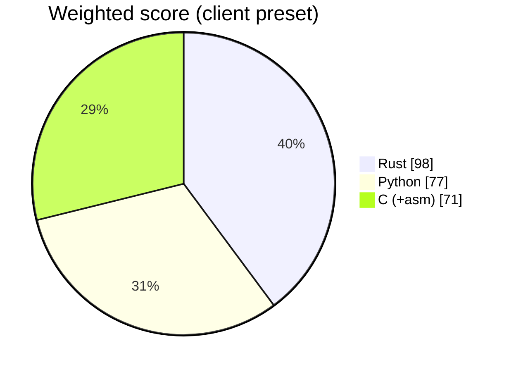

# ADR 0001 — Implementation language: Rust (Profile A)

- Status: accepted
- Date: 2026-10-27
- Deciders: language council (Rust, Python and C/assembly advocates + rebuttal round), approved by the project owner

## Context

Converts WhatsApp, Telegram Desktop, Microsoft Teams (Purview) and mobile-tool CSV chat exports into RSMF 2.0 files for Relativity (one per conversation per day), hashing every input and output, with reports and custody forms; an analysis tool in the Rakvor case folder; output goes to law firms and courts; 8 GB Windows laptops.

Weight preset: **client**. Score overrides argued by the council:

- Rust · Team velocity: 3 → 2 (the founder's RSMF and WhatsApp-parsing experience is in Python; locale date formats need fast trial and error)
- Rust · DFIR library ecosystem: 4 → 3 (no Rust crate for RSMF, WhatsApp exports or locale-aware date parsing; all written in-house)
- Python · Hardware / RAM (8 GB laptops, VMs without GPU): 3 → 4 (per-day slicing keeps each manifest small; zipfile and ijson stream media and Telegram's result.json)
- C (+asm) · Team velocity: 3 → 2 (four parsers, locale dates, Teams HTML and trilingual reports by hand in C)
- C (+asm) · DFIR library ecosystem: 4 → 2 (no C RSMF library or mature JSON Schema validator)
- C (+asm) · Storage (executable / installer size): 5 → 4 (ICU4C locale data (~30 MB) cancels C's size advantage)

## Options scored (1–5, weighted)

| Criterion | Weight | Rust | Python | C (+asm) |
| --- | :-: | :-: | :-: | :-: |
| Speed (throughput, startup) | 3 | 5 | 3 | 5 |
| Transferability (Win10/11 x64 + ARM64, Linux) | 3 | 5 | 4 | 3 |
| Storage (executable / installer size) | 2 | 4 | 2 | 4 |
| Hardware / RAM (8 GB laptops, VMs without GPU) | 2 | 5 | 4 | 5 |
| Windows GUI maturity | 2 | 4 | 4 | 2 |
| CLI --help quality | 2 | 5 | 5 | 2 |
| Packaging, signing, antivirus false positives | 2 | 4 | 2 | 4 |
| Memory safety / court auditability | 3 | 5 | 3 | 2 |
| Team velocity | 2 | 2 | 5 | 2 |
| CI/CD complexity (5 = simple) | 1 | 5 | 3 | 3 |
| **Weighted total** (max 110) | | **98** | 77 | 71 |

## Decision

Profile A (Rust workspace: core + clap CLI + egui GUI). 

## Consequences

- Two static executables (CLI + GUI), no runtime to install; one core library powers both.
- Contributors need Rust; Windows binaries are built on GitHub's `windows-latest` runners.
- No hand-written assembly: hash and parsing crates already use SIMD/CPU intrinsics.

## Rebuttal round

| Proposal | Outcome |
| --- | --- |
| rust.velocity 3→2 (RSMF and WhatsApp-parsing know-how is in Python; locale dates need fast iteration) | Accepted |
| rust.dfir_ecosystem 4→3 (no Rust crate for RSMF, WhatsApp exports or locale dates) | Accepted |
| rust.packaging 4→5 (proven signed release pipeline) | Rejected: the Python template's pipeline is proven too, so it does not separate the options |
| python.hardware 3→4 (per-day slices; zipfile/ijson stream media and result.json) | Accepted |
| python.packaging 2→3 (Nuitka proven at Rakvor) | Rejected for the same reason; Nuitka antivirus risk remains |
| c.velocity, c.dfir_ecosystem, c.storage (manual parsers; no C RSMF or JSON Schema library; ICU data ≈ 30 MB) | Accepted; C stays a wrapper-only option |

## Consequences

- Rust workspace from the Rakvor template (core + clap CLI + egui GUI), shared case-folder and trust code with rv-hashinv and rv-pdfauth.
- Crates: serde_json, zip, jsonschema, csv, encoding_rs, chrono + chrono-tz, cfb (Teams .msg), toml. MIME written in-house so output bytes are deterministic.
- Main risk (shared by every language): silent date misreads. Mitigation: `--timezone` required when the source has no offset, `--date-order` required when the file is ambiguous, both recorded in the audit log; golden sample corpus with expected outputs; independent oracles in CI.
