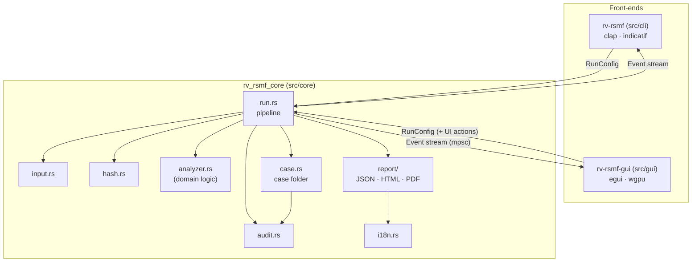
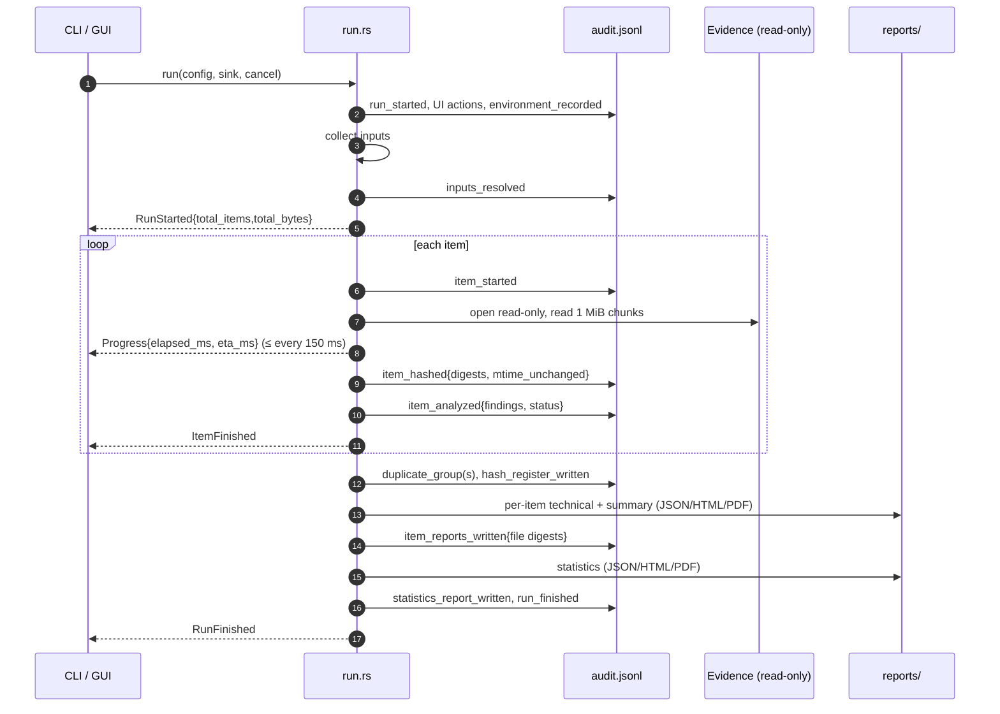
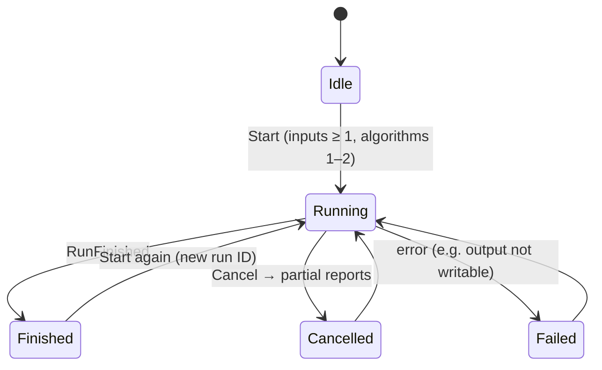

# Architecture

One engine, two front-ends. The engine (`src/core`) does all the work and never prints; the CLI and
the GUI only turn user input into a `RunConfig` and render the `Event`s the engine emits. This is why
both interfaces always produce identical logs and reports.

## Modules

| Module | Responsibility | Replace when building a new tool? |
| --- | --- | --- |
| `input.rs` | Files, folders, list files → sorted, de-duplicated, absolute paths. Symlinks not followed. | No |
| `hash.rs` | One read loop (1 MiB chunks) feeding 1–2 digests; known-answer self-test. | No |
| `analyzer.rs` | Signature detection and per-item findings. | **Yes — this is the domain logic** |
| `audit.rs` | Append-only hash-chained `audit.jsonl` + `audit.log`; `verify`. | No |
| `case.rs` | Shared case folder: `case.json`, hash-chained `case-log.jsonl` under a lock, evidence registry, `verify_case`. Role = `CASE_ROLE` (intake here, analysis in scaffolded tools). See [case-folder.md](case-folder.md). | No (flip `CASE_ROLE`) |
| `report/` | View models → minijinja HTML, built-in PDF writer, schema-versioned JSON. | Adapt wording/fields |
| `events.rs` | Typed events; ETA computation. | No |
| `env.rs` | `environment.json` (versions, OS, host, user, command line). | No |
| `run.rs` | Orchestration, cancellation, duplicates, `hashes.csv`. | Small changes |

## One run, step by step

## Run states (as the GUI sees them)

## Concurrency and cancellation

- The GUI runs the engine on a worker thread and receives events through a channel, so the window stays
  responsive; the elapsed-time label is refreshed every 200 ms from the window clock.
- Cancellation is an `AtomicBool` checked after every 1 MiB chunk: large images stop within milliseconds.
  The engine still writes `hashes.csv`, partial reports and `run_cancelled` to the audit log.
- Files are processed sequentially on purpose: the order of audit entries equals the order of work, which is
  easier to explain in court. Hashing is I/O-bound on typical evidence drives.

## Why Rust

See [ADR 0001](adr/0001-language.md).
