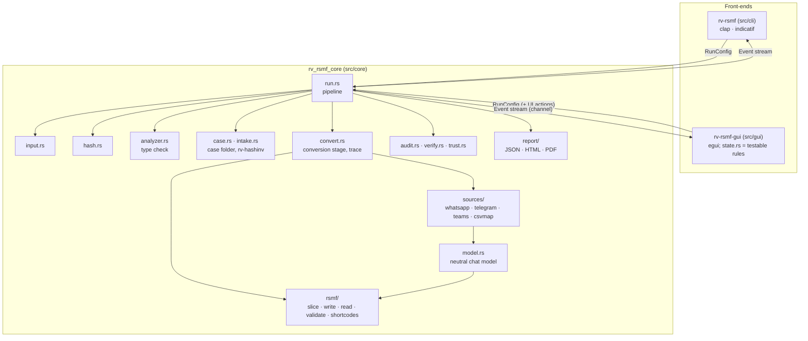
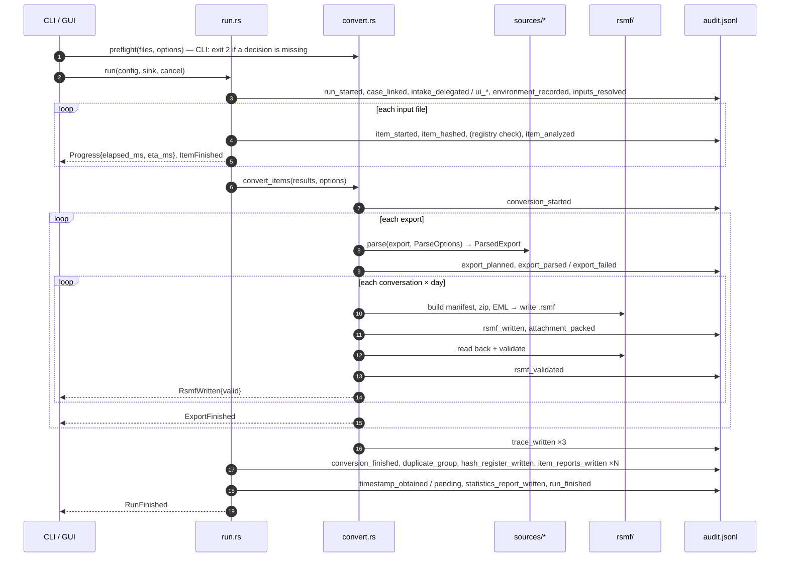
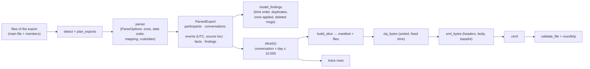
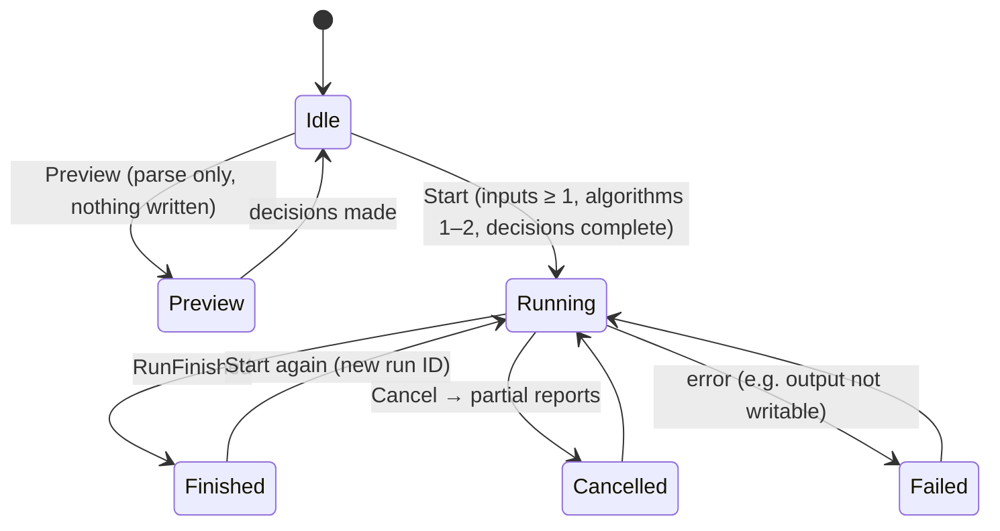

# Architecture

One engine, two front-ends. The engine (`src/core`, crate `rv_rsmf_core`) does all the work and never prints; the
CLI and the GUI only turn user input into a `RunConfig` and render the `Event`s the engine emits. Both interfaces
therefore produce identical audit logs, RSMF files and reports.

## Modules

| Module | Responsibility |
| --- | --- |
| `input.rs` | Files, folders, list files → sorted, de-duplicated, absolute paths. Symlinks not followed. |
| `hash.rs` | One read loop (1 MiB chunks) feeding 1–2 digests; known-answer self-test. |
| `analyzer.rs` | Magic-byte type check of every input file (`EMPTY_FILE`, `EXTENSION_MISMATCH`, `EXECUTABLE_CONTENT`); the `Finding` type. |
| `model.rs` | The neutral chat model (participants, conversations, events, attachments, reactions, source locations) every parser produces. Frozen: fields are only added with a default. |
| `sources/mod.rs` | Detection of each file's export type, grouping files into exports (`plan_exports`), parser dispatch with panic containment, `ParseOptions`, the examiner-decision errors (`NeedsTimezone`, `NeedsDateOrder`, `NeedsMapping`). |
| `sources/whatsapp.rs`, `telegram.rs`, `teams.rs`, `csvmap.rs` | One parser per source → `ParsedExport` ([theory.md B5](theory.md#b5-how-each-source-is-read)). |
| `rsmf/mod.rs` | Slicing per conversation per day, manifest building, deterministic zip and EML writing, the RSMF reader, schema + strict validation, read-back, `local_to_utc`. |
| `rsmf/shortcodes.rs` | Emoji → Relativity shortcode table. |
| `convert.rs` | The conversion stage: plan, parse, slice, write, validate, trace (`trace.csv`, `trace.json`, `conversions.json`), pipeline-level findings, `preflight` for examiner decisions. |
| `run.rs` | Orchestration: case link, hashing, registry verification, conversion, duplicates, `hashes.csv`, reports, timestamp, cancellation. |
| `case.rs`, `intake.rs` | Shared case folder (`rakvor.case/1`); one-step intake by running rv-hashinv. |
| `audit.rs`, `verify.rs` | Append-only hash-chained `audit.jsonl` + `audit.log`; log verification and truncation anchors. |
| `trust.rs` | RFC 3161 client; CMS signing of PDF reports. |
| `report/` | View models → minijinja HTML, built-in PDF writer, schema-versioned JSON. |
| `events.rs`, `env.rs`, `i18n.rs`, `time.rs` | Typed events and ETA; `environment.json`; EN/ES/FR wording; UTC formatting. |

## One run, step by step

## Data flow of one export

The parsers never write anything; only `convert.rs` writes (into the run's `rsmf/` folder) and only through
`rsmf::write_slice` and `report::write_hashed`, which hash what they write.

## Run states (as the GUI sees them)

## Concurrency and cancellation

- The GUI runs the engine on a worker thread and receives events through a channel, so the window stays responsive.
- Cancellation is an `AtomicBool` checked after every 1 MiB chunk while hashing, and before every export and every
  RSMF file while converting. The engine still writes the trace files, `hashes.csv`, partial reports and
  `run_cancelled`.
- Files and exports are processed sequentially on purpose: the order of audit entries equals the order of work.
- A panic inside a parser is caught and reported as `PARSER_FAILED` for that export; the Teams reader also contains
  a panic per `.msg` file.

## Why Rust

See [ADR 0001](adr/0001-language.md).
