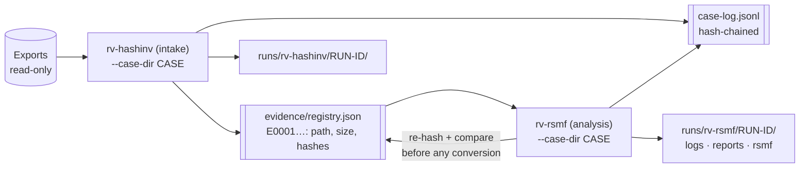
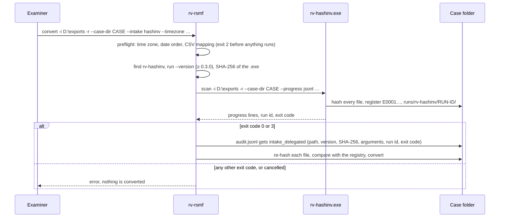
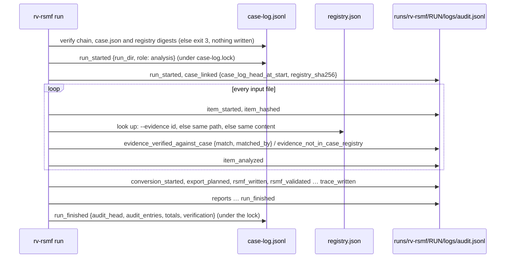
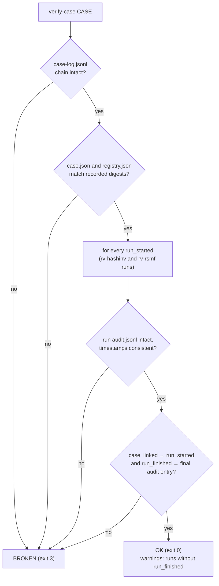

# Case folder

rv-rsmf can work alone (`--out DIR`). In a real engagement the Rakvor tools share **one case folder**
(`--case-dir`): rv-hashinv, the **intake** tool, registers each evidence file once and gives it an evidence id
(`E0001`, `E0002`, …). rv-rsmf is an **analysis** tool (`CASE_ROLE = Analysis`): before it converts an export it
re-hashes every file (the export, its media, every Teams `.msg`), compares it with that registry and links its own
audit chain to the case. A reviewer can then follow one export from intake to the last RSMF file and check that
the bytes converted are the bytes registered.



The contract (`rakvor.case/1`: schemas, events, rules) is shared by every Rakvor tool; the code is
[src/core/src/case.rs](../src/core/src/case.rs).

## Layout (`rakvor.case/1`)

```text
<CASE>/
  case.json                   {"schema":"rakvor.case/1","case_id","jurisdiction","created_utc",
                               "created_by":{"tool","version","run_id","actor"}}       (written once)
  case-log.jsonl              hash-chained case log (same algorithm as audit.jsonl), append-only
  case-log.lock               exists only while a tool appends (created exclusively, then removed)
  evidence/registry.json      {"schema":"rakvor.registry/1","items":[{"evidence_id","path","size","hashes",
                               "registered_by":{"tool","version","run_id","audit_seq"},"registered_utc"}]}
  evidence/registry.csv       evidence_id,path,size,<algorithms>,run_id
  runs/rv-hashinv/<RUN-ID>/   the intake runs (hash inventory and its reports)
  runs/rv-rsmf/<RUN-ID>/logs/     audit.jsonl, audit.log, hashes.csv, environment.json, timestamp-*.tsr|.json
  runs/rv-rsmf/<RUN-ID>/rsmf/     <NNN>-<export>/<conversation>/<day>.rsmf, trace.csv, trace.json, conversions.json
  runs/rv-rsmf/<RUN-ID>/reports/  statistics.*, items/<NNNNN>-<NAME>/{technical,summary,custody}.*
```

rv-rsmf **reads** the registry and **never writes** it. JSON schemas:
[case.schema.json](../schemas/case.schema.json) and [registry.schema.json](../schemas/registry.schema.json).

## Using it

```bash
# 1. Intake: open the case and register the exports (rv-hashinv; --case and --jurisdiction only now)
rv-hashinv scan -i D:\exports -r --case-dir E:\CASE-014 --case CASE-014 --jurisdiction fr
# 2. Convert every registered item (no --input needed) ...
rv-rsmf convert --case-dir E:\CASE-014 --timezone Europe/Paris
#    ... or only some registered items, or files given by path (matched against the registry)
rv-rsmf convert --case-dir E:\CASE-014 --evidence E0001,E0002 --timezone Europe/Paris
rv-rsmf convert --case-dir E:\CASE-014 -i "D:\exports\WhatsApp Chat with Ana Ruiz.txt" --timezone Europe/Paris
# 3. Check the whole case before handing it over (either tool; they agree)
rv-rsmf verify-case E:\CASE-014
```

| Option | Meaning |
| --- | --- |
| `--case-dir DIR` | Work in this case folder. `--out` is not used. |
| `--case ID` | Only needed if the folder is not a case yet (rv-rsmf then creates `case.json`, with an empty registry: every item is reported as not registered). Afterwards it must match `case.json` or be left out. |
| `--jurisdiction co\|fr` | Set at creation; later runs use the case's jurisdiction for custody forms. |
| `--evidence E0001,E0007` | Convert these registered items (needs `--case-dir`; unknown id → exit 2). |
| no `--input` | Every registered item is examined. |

Give the **whole export** — the `.txt` with its media, the Telegram folder, the folder of `.msg` files — either as
inputs or as registered items. Parsers look for an attachment among the export's input files **and then on disk
next to the export file**, so a media file that was not an input is still packed: it then has a digest in
`attachment_packed` but no `item_hashed` entry and no registry check. Teams `.msg` files that are not inputs are not
read at all.

**Examiner decisions with `--evidence` or without `--input`.** The pre-run check that stops with exit code 2 when
`--timezone`, `--date-order` or a CSV mapping is needed looks only at `--input` / `--input-list`. When the items
come from the registry, a missing decision is found during the run instead and reported as `PARSER_FAILED` (high,
exit 3) for that export. Run `rv-rsmf preview` on the registered files first, or give them with `-i`.

## One-step intake with rv-hashinv

`--intake hashinv` (GUI: the intake option shown once a case folder is set) runs the intake tool for you, then the
conversion, in one action. rv-rsmf does **not** hash or register evidence on rv-hashinv's behalf: the hash
inventory, hash reports and registry are written by rv-hashinv's own executable, with its own tests and audit log.
rv-rsmf only starts it, watches it and records what ran ([intake.rs](../src/core/src/intake.rs)).



```bash
rv-rsmf convert -i D:\exports -r --case-dir E:\CASE-014 --case CASE-014 --jurisdiction fr --timezone Europe/Paris --intake hashinv
```

| Rule | Why |
| --- | --- |
| rv-hashinv is searched in this order: `--hashinv-exe`, the `RV_HASHINV` environment variable, the folder of `rv-rsmf.exe`, the RV HashInv install folder (`%LOCALAPPDATA%\Programs\Rakvor\RV HashInv`), `PATH`. An explicit `--hashinv-exe` is never replaced by another copy. | The examiner knows which copy runs; the audit log says how it was found (`found_by`). |
| Its `--version` must print `rv-hashinv X.Y.Z` with X.Y.Z ≥ 0.3.0; its SHA-256 is recorded. | 0.3.0 is the first version with the case folder; the hash lets a reviewer match the executable with a release's `SHA256SUMS`. |
| The same inputs, recursion, hash algorithms, languages, examiner, timestamp setting and certificate are passed on (`--no-timestamp` when rv-rsmf has none). The certificate password travels in an environment variable of the child process only (`RV_RSMF_INTAKE_SIGN_PASS`) and never appears in a log. | Both runs describe the same evidence with the same settings. |
| `--case` and `--jurisdiction` are passed only while the case is being created; afterwards `case.json` decides. | Same rule as both tools' own `--case-dir`. |
| Exit codes 0 and 3 continue; any other code, a failure to start, or a cancel stops the run before any conversion. | The registry must be complete before items are verified against it. |
| Not with `--evidence`, and `--input` or `--input-list` is required (exit 2). | The items are new. |

The case then holds `runs/rv-hashinv/<RUN-ID>/` (hash inventory) and `runs/rv-rsmf/<RUN-ID>/` (conversion);
`verify-case` in either tool checks both.

## What rv-rsmf does with each item



Every file is verified **before** any export is converted, so the audit log shows the continuity check first.

| Situation | Audit event | Finding | Report |
| --- | --- | --- | --- |
| Same content as the registered item | `evidence_verified_against_case` (match: true) | — | evidence id, "Verified" |
| Registered path (or `--evidence` id), different content | `evidence_verified_against_case` (match: false, expected, actual) | `EVIDENCE_HASH_MISMATCH_WITH_CASE` (**high**, exit 3) | evidence id, "MISMATCH" |
| Not in the registry | `evidence_not_in_case_registry` | `EVIDENCE_NOT_IN_CASE_REGISTRY` (medium) | "Not in the case registry" |

On a mismatch the conversion **still runs**: the examiner decides what the difference means, and the report shows
both digests. The event collection id of the RSMF files includes the case id ([theory.md
B8](theory.md#b8-the-rsmf-20-file-we-write)), so the same export converted in two different cases gets different
collection ids.

**Hash algorithms.** A case run always includes at least one algorithm present in every registered item. If the
examiner picked a disjoint set, SHA-256 is added (or replaces the second choice) and the change is audited as
`case_algorithm_added`.

**Reports.** The evidence id appears in the technical review, the customer summary, the statistics report (with a
case-folder section) and every JSON report; the custody form uses the case id, the evidence id, the intake date and
the case's jurisdiction.

## Safety rules

- **A broken case is never extended.** Before every append rv-rsmf re-verifies the case-log chain, `case.json` and
  the registry digest; on failure it stops with exit code 3 and writes nothing.
- **One writer at a time.** Appends happen under `case-log.lock`. A tool waits up to 30 s (then exit 1); a lock
  older than 10 minutes is reported as stale and is **never deleted automatically**. The lock is not held during
  the conversion.
- **`run_finished` is always written**, also after a cancel or a failure, with the final audit head read back from
  disk.
- **Paths on Windows are matched without regard to case** (`E:\Exports\Chat.txt` = `e:\exports\chat.txt`); the
  stored spelling is never changed.
- **The two chains vouch for each other**: `case_linked.case_log_head_at_start` quotes the run's `run_started` in the
  case log; the case log's `run_finished.audit_head` quotes the run's final audit entry.

## Exit codes with `--case-dir`

| Code | Case-folder causes |
| --- | --- |
| 1 | lock held by another tool (after 30 s) or stale lock; file-system error; rv-hashinv intake failed or not found; `verify-case` on a folder without `case.json` |
| 2 | `case.json` of another schema, case id mismatch, `--case` missing when creating, unknown or malformed evidence id, `--evidence` with `--intake hashinv`, `--intake` without inputs |
| 3 | the case folder fails verification (nothing written); or the run completed with a high finding (e.g. `EVIDENCE_HASH_MISMATCH_WITH_CASE`, `PARSER_FAILED`, `RSMF_SCHEMA_INVALID`) |

## How a reviewer verifies a case



1. `rv-rsmf verify-case <CASE>` (rv-hashinv has the same command). Exit 0 = intact, 3 = broken, 1 = not a case
   folder. `--rehash` also re-reads every registered file still reachable and compares it with the registry.
2. Independently: `python tests/verify_chain.py <CASE>/runs/rv-rsmf/<RUN-ID>/logs`; `sha256sum
   evidence/registry.json` must equal the last `registry_sha256` in `case-log.jsonl`.
3. `rv-rsmf validate <CASE>/runs/rv-rsmf/<RUN-ID>/rsmf` re-checks every RSMF file; compare their SHA-256 with the
   `rsmf_written` entries ([usage.md](usage.md#timestamps-signing-and-verifying-a-run)).
4. `python tests/validate_reports.py <CASE>` validates `case.json`, `registry.json` and every JSON report.

## Tests

- [src/core/src/case.rs](../src/core/src/case.rs) and [src/core/src/run.rs](../src/core/src/run.rs): case creation,
  registry verification, tampered copy, unregistered file, cancelled/failed runs, edited case log and registry,
  locks.
- [src/cli/tests/cli.rs](../src/cli/tests/cli.rs): the CLI with `--case-dir` (exit codes, `--evidence`,
  `verify-case`, tampering) and a committed case folder written by another implementation
  ([tests/golden/](../tests/golden/regenerate.py)), verified in CI.
- [src/core/src/intake.rs](../src/core/src/intake.rs): locating rv-hashinv, the version rule, the arguments passed.
