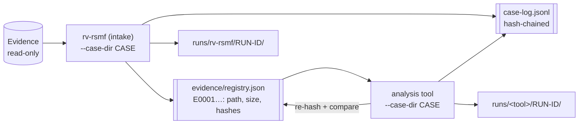
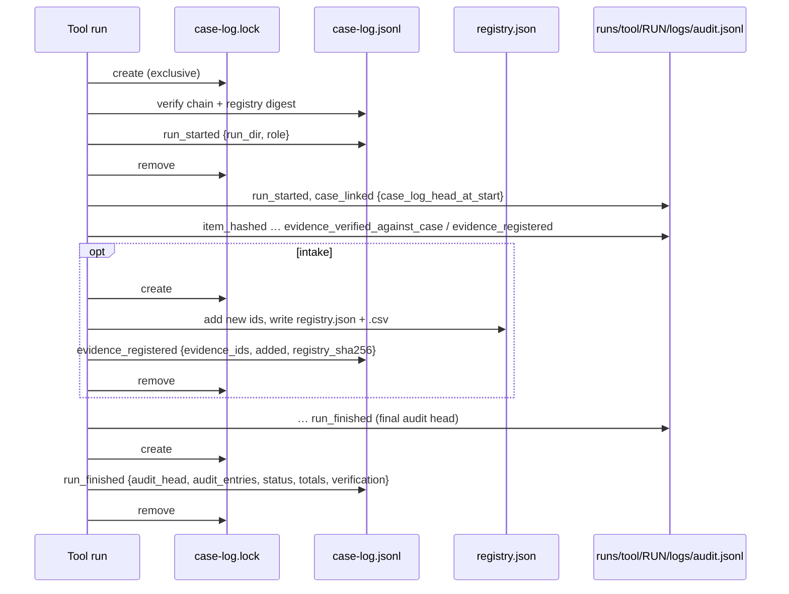
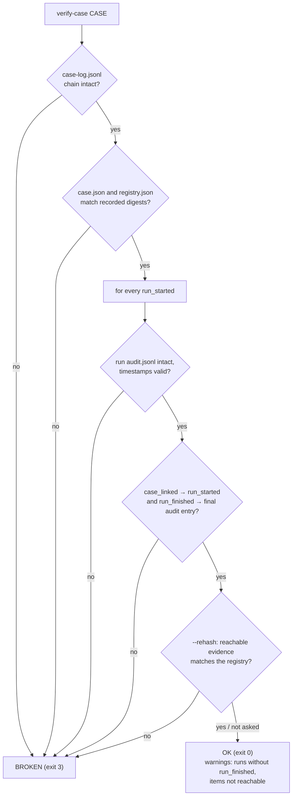

# Case folder

Every Rakvor tool can work alone (`--out DIR`). In a real engagement the tools share **one case folder**
(`--case-dir`): rv-rsmf, the **intake** tool, registers each evidence file once and gives it an evidence id
(`E0001`, `E0002`, …); every later **analysis** tool re-hashes each file, compares it with that registry and links
its own audit chain to the case. A reviewer can then follow one item from intake to the last report, across tools,
and check that nothing changed in between.



The contract (schemas, events, rules) is the same in the Rust and Python profiles, and a case written by one is
read and extended by the other (tested in CI when both are present).

## Layout (`rakvor.case/1`)

```text
<CASE>/
  case.json                   {"schema":"rakvor.case/1","case_id","jurisdiction","created_utc",
                               "created_by":{"tool","version","run_id","actor"}}       (written once)
  case-log.jsonl              hash-chained case log (same algorithm as audit.jsonl), append-only
  case-log.lock               exists only while a tool appends (created exclusively, then removed)
  evidence/registry.json      {"schema":"rakvor.registry/1","items":[{"evidence_id","path","size","hashes",
                               "registered_by":{"tool","version","run_id","audit_seq"},"registered_utc"}]}
  evidence/registry.csv       evidence_id,path,size,<algorithms>,run_id
  runs/<tool>/<RUN-ID>/logs/     audit.jsonl, audit.log, hashes.csv, environment.json, timestamp-*.tsr|.json
  runs/<tool>/<RUN-ID>/reports/  statistics.*, items/<NNNNN>-<NAME>/{technical,summary,custody}.*
```

JSON schemas: [case.schema.json](../schemas/case.schema.json) and [registry.schema.json](../schemas/registry.schema.json).

## Using it

```bash
# 1. Open the case and register the evidence (creates case.json; --case and --jurisdiction are needed only now)
rv-rsmf scan -i D:\evidence -r --case-dir E:\CASE-014 --case CASE-014 --jurisdiction fr
# 2. Re-examine some registered items later (or run an analysis tool with the same --case-dir)
rv-rsmf scan --case-dir E:\CASE-014 --evidence E0001,E0002
# 3. Check the whole case before handing it over
rv-rsmf verify-case E:\CASE-014
```

In the GUI, fill **Case folder** in section 1. The output folder is then derived (`<case>/runs/rv-rsmf/<RUN-ID>`)
and locked, the change is audited (`ui_case_dir_changed`), and the result panel lists the evidence id of every
item.

| Option | Meaning |
| --- | --- |
| `--case-dir DIR` | Work in this case folder (created when it has no `case.json`). `--out` is not used. |
| `--case ID` | Names the case at creation; afterwards it must match `case.json` (or be left out). |
| `--jurisdiction co\|fr` | Set at creation; later runs use the case's jurisdiction for custody forms. |
| `--evidence E0001,E0007` | Examine these registered items (no `--input` needed). |
| no `--input` | Every registered item is examined. |

## Roles

The role is one constant: `CASE_ROLE` (`src/core/src/lib.rs`) and `"case_role"` in `.forge.json`. The reference
rv-rsmf is `intake`; a tool scaffolded from it is `analysis`. Both behaviours live in the shared code and are
tested in both profiles.

| | Intake (rv-rsmf) | Analysis (later tools) |
| --- | --- | --- |
| Registry | Registers every successfully hashed item | Never writes it |
| Same path, same content | Keeps the existing id (`already_registered`) | `evidence_verified_against_case` (match) |
| Same path, other content | New id + finding `REGISTRY_PATH_CONTENT_CHANGED` (medium) | Finding `EVIDENCE_HASH_MISMATCH_WITH_CASE` (**high**); the analysis still runs |
| Not in the registry | Registered (new id) | Finding `EVIDENCE_NOT_IN_CASE_REGISTRY` (medium) |
| Matching order | — | `--evidence` id, else same path, else same content |

**Hash algorithms.** A case run always includes at least one algorithm present in every registered item. If the
user picked a disjoint set, SHA-256 (or the registry's algorithm) is added — or replaces the second choice, since
the two-algorithm limit still holds — and the change is audited as `case_algorithm_added`.

## Events



| Case-log event | Written by | Details |
| --- | --- | --- |
| `case_created` | first tool | case_id, jurisdiction, schema, `case_json_sha256`, `registry_sha256: null` |
| `run_started` | every tool | tool, version, `run_dir` (relative), frontend, role, evidence_ids |
| `evidence_registered` | intake tool | evidence_ids (all of this run), added (new ones), registry_items, `registry_sha256` |
| `run_finished` | every tool, also after a cancel or a failure | status `completed`/`cancelled`/`failed`, `audit_head`, `audit_entries`, timestamp_status, totals, verification {registered, added, verified, mismatched, unregistered} |

Run audit (`audit.jsonl`) events added by the case folder: `case_linked` (entry #2, right after `run_started`),
`case_algorithm_added`, `evidence_registered`, `evidence_verified_against_case`, `evidence_not_in_case_registry`.

**The two chains vouch for each other.** `case_linked.case_log_head_at_start` is the hash of the run's
`run_started` entry in the case log; `run_finished.audit_head` in the case log is the hash of the run's final audit
entry. Editing either side breaks a link.

## Safety rules

- **A broken case is never extended.** Before every append a tool re-verifies the case-log chain, `case.json`
  (digest at creation) and the registry digest; on failure it stops with exit code 3 and writes nothing.
- **One writer at a time.** Appends happen under `case-log.lock` (created exclusively). A tool waits up to 30 s for
  another one; a lock older than 10 minutes is reported as *stale* with its owner, and is **never deleted
  automatically** — a person decides.
- **Only the intake tool writes the registry**, and every change records its new SHA-256 in the case log.
- **Reports name the evidence id** of each item; the custody form uses the case id, the evidence id and the intake
  date from the registry.

## How a reviewer verifies a case



1. `rv-rsmf verify-case <CASE>` (any Rakvor tool has it; they agree). Exit 0 = intact, 3 = broken, 1 = not a
   case folder. Only `timestamp_obtained` may follow a run's recorded final entry (a delayed timestamp).
   `--rehash` also re-hashes every registered item still reachable at its registered path (the latest registration
   of a path) and compares it with the registry: a difference is exit 3, an unreachable item a warning.
   `rv-rsmf verify-log <CASE>/runs/<tool>/<RUN-ID>/logs` checks one run and anchors its end to `run_finished` in
   the case log.
2. Independently of any Rakvor binary: `python tests/verify_chain.py <CASE>/runs/<tool>/<RUN-ID>/logs` re-checks a
   run; the case log uses the same chain rule, and `sha256sum evidence/registry.json` must equal the last
   `registry_sha256` in `case-log.jsonl`.
3. Re-hash the evidence with any tool and compare it with `evidence/registry.csv` (or `verify-case --rehash`).
4. `python tests/validate_reports.py <CASE>` validates `case.json`, `registry.json` and every JSON report against
   `schemas/`.
