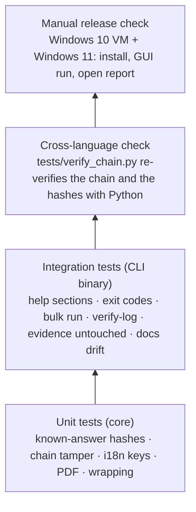
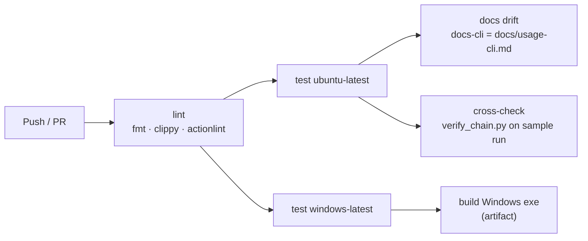
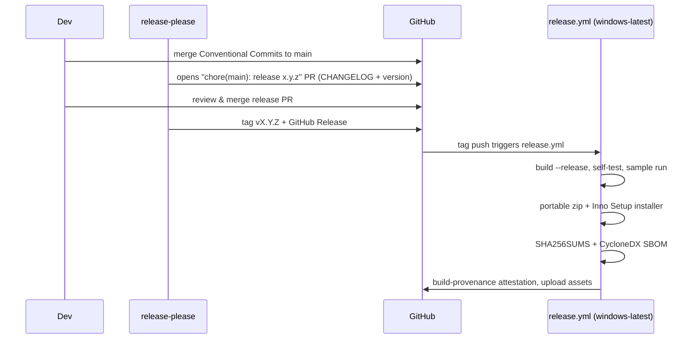

# Development, CI/CD and releases

## Build and test locally

```bash
cargo build --workspace                 # debug build of core, CLI and GUI
cargo test  --workspace                 # unit + integration tests (GUI tests are headless)
cargo clippy --workspace --all-targets -- -D warnings
cargo fmt --all -- --check
cargo run -p rv-rsmf-cli -- scan -i examples/sample/evidence --lang all
cargo run -p rv-rsmf-gui
```

Linux needs no system packages to build. On Windows use the MSVC toolchain (`rustup default stable-msvc`);
binaries are linked with the static C runtime (`.cargo/config.toml`), so they run on a clean Windows 10/11.

## Test pyramid



## Continuous integration



`ci.yml` runs on every push and pull request with read-only permissions.

## Releasing



| Artifact | Built by |
| --- | --- |
| `rv-rsmf-X.Y.Z-windows-x64.zip` | portable: both exes + README + LICENSE + NOTICE + examples |
| `rv-rsmf-X.Y.Z-windows-x64-setup.exe` | Inno Setup (`packaging/windows/installer.iss`), per-user install, adds CLI to PATH |
| `SHA256SUMS` | `sha256sum` over the assets |
| `sbom.cdx.json` | `cargo cyclonedx` |
| Attestation | `actions/attest-build-provenance` |

### Code signing

Unsigned executables trigger SmartScreen warnings. Options (decide per legal entity):

| Option | Notes |
| --- | --- |
| Azure Artifact Signing (Trusted Signing) | Low cost, integrates with GitHub Actions; available to organisations in eligible countries (the French entity qualifies, the Colombian one currently does not). |
| OV code-signing certificate (HSM/cloud key) | Works for either entity; slower reputation build-up. |

Signing is a step in `release.yml` guarded by `if: secrets…` so unsigned builds still work for testing.

### Release checklist (manual)

- [ ] `rv-rsmf self-test` on the released exe passes on Windows 10 **and** Windows 11
- [ ] GUI opens, runs the sample, *Open report* works
- [ ] `SHA256SUMS` matches the downloaded files; `gh attestation verify` passes
- [ ] CHANGELOG entry reviewed by a human
