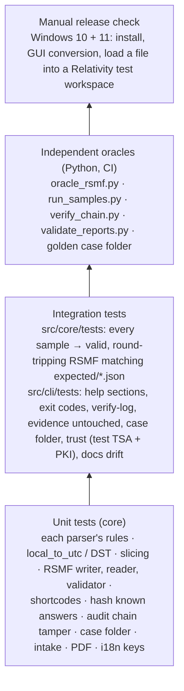
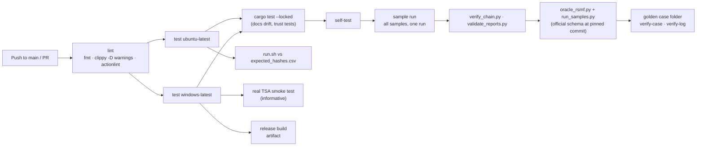

# Development, tests and CI

## Build and test locally

```bash
cargo build --workspace --locked             # core, CLI and GUI (compiler pinned by rust-toolchain.toml)
cargo test  --workspace --locked             # unit + integration tests (GUI state tests are headless)
cargo clippy --workspace --all-targets -- -D warnings
cargo fmt --all -- --check
cargo run -p rv-rsmf-cli -- preview -i examples/sample/evidence -r --timezone Europe/Paris --date-order dmy
cargo run -p rv-rsmf-cli -- convert -i examples/sample/evidence -r --timezone Europe/Paris --date-order dmy --no-timestamp
cargo run -p rv-rsmf-gui
```

Linux needs no system packages to build the CLI. On Windows use the MSVC toolchain; binaries are linked with the
static C runtime (`.cargo/config.toml`). Python 3.12 with `blake3 jsonschema pyhanko` runs the oracles and the trust
tests (`RV_TEST_PYTHON=python`).

| Crate | Path | Contents |
| --- | --- | --- |
| `rv-rsmf-core` | `src/core` | engine ([architecture.md](architecture.md)); never prints |
| `rv-rsmf-cli` | `src/cli` | `rv-rsmf` binary; `docs-cli` (hidden) prints `docs/usage-cli.md` |
| `rv-rsmf-gui` | `src/gui` | `rv-rsmf-gui` binary; `state.rs` holds the testable rules |

## Test pyramid



| Test | What it proves |
| --- | --- |
| `src/core/src/sources/*.rs` (unit) | WhatsApp header variants (Android/iOS, 12/24 h, U+202F, localised media and attachment strings, system lines, owner and custodian, number-only participants, zip exports, path tricks, export limit), date-order rules, DST counting; Telegram text entities, replies, reactions, service messages, media placeholders, local-time fallback; Teams stream names, FILETIME, HTML-to-text, property reading; CSV encodings, delimiters, offsets, time formats, mapping errors, participants, profiles |
| `src/core/src/rsmf/mod.rs` (unit) | slicing and the 10,000-event split, manifest, deterministic zip and EML, reader, schema + strict validation, round trip |
| `src/core/tests/parsers_whatsapp_telegram.rs`, `parsers_teams_csv.rs` | every committed sample converts to valid, round-tripping RSMF with the counts and finding codes of `examples/sample/expected/*.json`; the committed Teams/CSV samples equal the generator's output; corrupt `.msg` files are reported, not fatal; CSV without zone or mapping stops |
| `src/cli/tests/cli.rs` | `--help` sections, usage errors (exit 2), missing input audited (exit 1), bulk run with verifiable chain, JSONL progress, evidence not modified, sample script, `timestamp` and trust (local TSA + test PKI, pyHanko check of signed PDFs, custody forms), case folder (verify-case, tampering), golden case folder, pinned toolchain in workflows, `docs/usage-cli.md` equals `docs-cli` output |
| `src/gui/src/state.rs` | GUI rules headless: settings become audit actions, preview blocks start on a missing decision, … |

## Samples and expected results

Everything under [examples/sample/evidence/](../examples/README.md) is synthetic (invented people, `example.org`,
`+33 6 00 00 00 0x` / `+57 300 000 000x` numbers) and generated deterministically:

| Generator | Writes |
| --- | --- |
| `python3 tests/samples/whatsapp_telegram.py` (standard library only) | the WhatsApp and Telegram samples and their `expected/*.json` (counts written by hand from the content, not by running rv-rsmf) |
| `cargo test -p rv-rsmf-core --test make_samples -- --ignored` (`src/core/tests/support/`) | the Teams `.msg` files (OLE compound files built from MAPI properties) and the CSV samples |

After regenerating, re-compute `examples/sample/expected_hashes.csv` independently (Python `hashlib` + `blake3`) and
commit both. `parsers_teams_csv.rs` fails if the committed Teams/CSV files differ from the generator.

## Oracles (independent checks)

| Oracle | Independent of rv-rsmf because | Checks |
| --- | --- | --- |
| [tests/oracle_rsmf.py](../tests/oracle_rsmf.py) | Python's `email` package parses the files; Relativity's official schema is downloaded by CI at a pinned commit of `relativitydev/rsmf-validator-samples` (not the bundled copy); format checking on | `X-RSMF-Version`, one `rsmf.zip`, a text body, schema, header counts, attachments in the zip, each file's SHA-256 equals `rsmf_written` in the audit log, `trace.csv` has one row per event and points at existing files |
| [tests/run_samples.py](../tests/run_samples.py) | drives the real CLI binary; expectations come from `expected/*.json` | per sample: conversations, events, packed/missing attachments, expected finding codes, all files valid, `verify-log`, the RSMF oracle, a **second conversion byte-identical**; the ambiguous sample without `--date-order` exits 2 and writes nothing |
| [tests/verify_chain.py](../tests/verify_chain.py) | standard-library re-implementation of the chain rule | audit chain; re-hashes the files of `hashes.csv` |
| [tests/validate_reports.py](../tests/validate_reports.py) | `jsonschema` | report JSON files, `case.json`, `registry.json` against `schemas/` |
| [tests/golden/](../tests/golden/regenerate.py) | a case folder written by another implementation (the Python profile of the Rakvor forge reference) | `verify-case` and `verify-log` keep reading it |
| [examples/sample/expected_hashes.csv](../examples/sample/expected_hashes.csv) | Python `hashlib`/`blake3` | the tool's `hashes.csv` (run.sh / run.ps1) |

Not automated: loading the files into a Relativity workspace (RSMF rendering; [admissibility.md](admissibility.md)
gap G27), Relativity's own RSMF validator (Windows GUI / NuGet SDK, commercial DLLs — use it by hand), OpenSSL
checks of RFC 3161 tokens.

## Continuous integration



[.github/workflows/ci.yml](../.github/workflows/ci.yml) runs on every push to `main`, every pull request and on
demand, with `contents: read` permissions and the toolchain from `rust-toolchain.toml`. A failing test is also
surfaced as an annotation. The release workflow is described in [release-process.md](release-process.md).

## Conventions

- Commit messages follow Conventional Commits (they drive release-please and `CHANGELOG.md`).
- `src/core/src/model.rs` and the parser interface in `sources/mod.rs` are **frozen**: add optional fields with a
  default only.
- Every new finding code needs `title`, `shows` and `does_not_prove` in `i18n/en.json`, `es.json` and `fr.json`
  (a test enforces identical keys) and a row in [reports.md](reports.md#findings-catalogue).
- Every new audit action belongs in [forensic-audit.md](forensic-audit.md#actions-recorded).
- `docs/usage-cli.md` is generated: `cargo run -q -p rv-rsmf-cli -- docs-cli > docs/usage-cli.md` (CI fails on
  drift).
- Facts about export formats that are not confirmed by a primary source or a real export are marked
  **unverified** in code comments and in [theory.md](theory.md).
