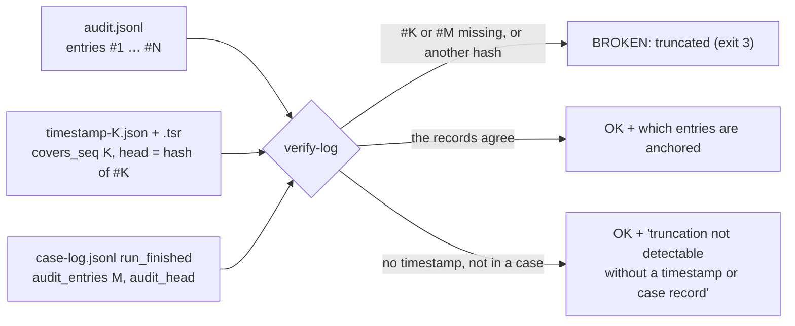
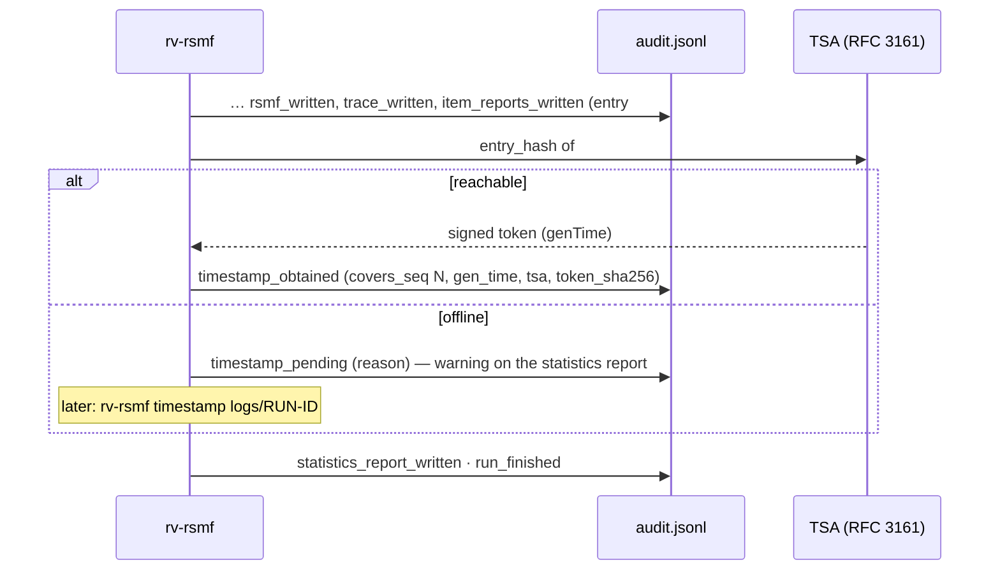
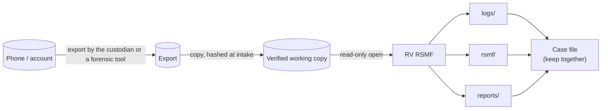

# Forensic audit trail

Everything RV RSMF does is written to the run's log folder (`<OUT>/logs/<RUN-ID>/`, or
`<CASE>/runs/rv-rsmf/<RUN-ID>/logs/` in a case folder). The folder is designed so that a second examiner, months
later, can check **what was done, to which files, with which options and tool version, by whom**, which RSMF files
came out of it, and that the record was not altered.

| File | Content |
| --- | --- |
| `audit.jsonl` | One JSON object per action, hash-chained (authoritative) |
| `audit.log` | The same actions as readable text (convenience copy, not chained) |
| `hashes.csv` | Hash register of the input files: `index,path,size,<algo1>[,<algo2>],status,error` |
| `environment.json` | Tool version, compiler, target, every dependency version, OS, host, OS user, working folder, command line |
| `timestamp-<N>.tsr` / `.json` | RFC 3161 token for the chain head at entry N |

## The hash chain


Each entry has: `seq`, `ts_utc`, `run_id`, `actor`, `action`, optional `item`, `details`, `prev_entry_hash`,
`entry_hash`.

```text
entry_hash = SHA-256( canonical JSON of the entry without "entry_hash" )
canonical  = keys sorted at every level, no spaces, UTF-8, non-ASCII not escaped
             (Python: json.dumps(e, sort_keys=True, separators=(",", ":"), ensure_ascii=False))
```

Editing a value changes that entry's hash; deleting or re-ordering breaks `seq` and `prev_entry_hash`. A worked
example with real hashes is in [theory.md B14](theory.md#b14-the-audit-hash-chain). Verify with either
implementation:

```bash
rv-rsmf verify-log rakvor-out/logs/<RUN-ID>             # exit 0 intact, 3 broken or truncated
python tests/verify_chain.py rakvor-out/logs/<RUN-ID>   # independent re-implementation (chain + hashes.csv)
```

> The chain proves the log is **internally consistent**. On its own it does not prove *when* it was written —
> that is what the trusted timestamp adds — nor that it is *complete*: removing the last entries leaves a shorter
> chain that is still valid. The anchors below close that gap.

### Truncation: what anchors the end of the log



| Record | Where | What `verify-log` checks |
| --- | --- | --- |
| RFC 3161 timestamp | `timestamp-<K>.json` / `.tsr` next to the log | entry `#K` still exists and its `entry_hash` is the head the token signs; every `timestamp_obtained` entry still has its token file |
| Case log | `<CASE>/case-log.jsonl`, for a run in `<CASE>/runs/<tool>/<RUN-ID>/logs` | `run_finished` of this run records `audit_entries` and `audit_head`: entry `#M` exists with that hash, and only `timestamp_obtained` follows it |

A standalone run timestamps the head **before** writing `timestamp_obtained`, `statistics_report_written` and
`run_finished`, so those 3 entries are reported as "cannot be proven complete"; a run in a case folder is anchored to
its last entry by the case log.

## Trusted timestamp (RFC 3161)

Every run asks a Time-Stamp Authority (TSA) to sign the chain head just before the statistics report is written.
At that point the chain already holds the digest of every input file, every `.rsmf`, every packed attachment,
`trace.csv`, `trace.json`, `conversions.json`, `hashes.csv` and every item report. Default TSA:
`http://timestamp.digicert.com` (`--tsa-url` to change).



- The token is stored as `timestamp-<N>.tsr` (DER) and `timestamp-<N>.json` (readable summary).
- Offline: the run still completes; `rv-rsmf timestamp <log folder>` later re-verifies the chain and appends
  `timestamp_obtained` — earlier entries are never rewritten.
- `verify-log` checks each token's imprint against the stored head and that entry `#N` still exists. It does
  **not** check the TSA's signature or certificate chain: run
  `openssl ts -verify -digest <head> -in timestamp-<N>.tsr -CAfile <TSA chain>` (gap G18).
- `--no-timestamp` (or `RV_NO_TIMESTAMP=1`) disables it; tests use a local TSA (`tests/fake_tsa.py`).
- A timestamp proves the log existed at that time, not that its content is true.

## Signed PDF reports

`--sign-cert examiner.p12` signs every PDF — statistics, technical, summary and custody — with **your own**
certificate. The password comes from the environment variable named by `--sign-pass-env` (default
`RV_SIGN_PASSWORD`) or an interactive prompt without echo; it is never logged. The log records
`signing_certificate_loaded` (subject, SHA-256 fingerprint); a wrong password stops the run (`run_failed`, exit 1)
before any evidence is read. The `.rsmf` files, HTML and JSON reports are not signed: their digests are in the
chain, which is timestamped. Details: [theory.md B17](theory.md#b17-signed-pdf-reports).

## Chain-of-custody form per item

`--jurisdiction co` (default) writes, for each input file, a Colombian *registro de cadena de custodia* in Spanish;
`--jurisdiction fr` a French *fiche de scellé / suivi* in French; an English version is always added. In a case
folder the case's jurisdiction applies. The form is pre-filled from the run and leaves signature lines for the
physical transfers. It is a working aid, not the official form ([theory.md B18](theory.md#b18-custody-forms)).

## Actions recorded

Every action the code records (`AuditLog::record` in [run.rs](../src/core/src/run.rs),
[convert.rs](../src/core/src/convert.rs) and the CLI `timestamp` command), in the order they occur. `item` is the
entry's `item` field.

| Action | When | `item` | Details |
| --- | --- | --- | --- |
| `run_started` | first entry | — | tool, version, frontend (`cli`/`gui`), algorithms, langs, case_id, inputs, input_list, recursive, out_dir, jurisdiction, tsa_url, sign_cert (path), case_dir, evidence_ids |
| `case_linked` | case folder | — | case_id, case_dir, role (`analysis`), run_dir, case_created, case_log_seq_at_start, case_log_head_at_start, registry_sha256, registry_items, jurisdiction, requested_jurisdiction |
| `case_algorithm_added` | case folder, the selection shared no algorithm with the registry | — | requested, added, replaced, algorithms, registry_algorithms |
| `intake_delegated` | `--intake hashinv` | — | tool `rv-hashinv`, path, version, sha256 of the executable, found_by, arguments, exit_code, run_id, items, errors, report_dir |
| `ui_*` | GUI only, before the run | — | one entry per settings change: `ui_input_added`, `ui_input_removed`, `ui_hash_selection_changed`, `ui_language_changed`, `ui_interface_language_changed`, `ui_recursive_changed`, `ui_source_changed`, `ui_timezone_changed`, `ui_timezone_rejected`, `ui_date_order_changed`, `ui_custodian_changed`, `ui_csv_map_changed`, `ui_csv_profile_changed`, `ui_platform_name_changed`, `ui_preview_run`, `ui_jurisdiction_changed`, `ui_timestamp_changed`, `ui_signing_certificate_changed`, `ui_case_dir_changed`, `ui_intake_changed`, `ui_start_clicked` (see [usage-gui.md](usage-gui.md)) |
| `environment_recorded` | | `environment.json` | its digests |
| `signing_certificate_loaded` | `--sign-cert` | certificate path | subject, certificate_sha256 |
| `inputs_resolved` | | — | items, bytes |
| `item_started` | each input file | path | index, size, modified_utc |
| `item_hashed` | each input file | path | index, bytes_read, hashes, mtime_unchanged |
| `item_error` | unreadable file | path | index, message |
| `item_cancelled` | cancel during hashing | path | index |
| `evidence_verified_against_case` | case folder, item found in the registry | path | index, evidence_id, algorithm, match, matched_by (`evidence_id`/`path`/`content`); on a mismatch also expected, actual |
| `evidence_not_in_case_registry` | case folder, item not found | path | index, case_id |
| `item_analyzed` | each input file | path | index, detected_type, extension, findings (so far), status |
| `run_cancelled` | after a cancel | — | processed, of |
| `conversion_started` | after all items | — | options {source, timezone, date_order, csv_map, csv_profile, custodian, platform_name, slice: `day`}, rsmf_dir, rsmf_version, shortcode_table |
| `export_planned` | each export | path of its main file | export (number), source, item_index, members, root |
| `export_parsed` | export read | path of its main file | source, conversations, participants, events, facts, findings (of the parser) |
| `export_failed` | export not readable | path of its main file | source, error (then `PARSER_FAILED`) |
| `rsmf_written` | each `.rsmf` | path under `rsmf/` | conversation, day, part, events, attachments, missing_attachments, event_collection_id, bytes, hashes (selected algorithms), sha256 |
| `attachment_packed` | each attachment in `rsmf.zip` | path of the `.rsmf` | event, zip_name, display, size, sha256 |
| `rsmf_validated` | each `.rsmf`, after read-back | path under `rsmf/` | valid, schema_errors, strict_errors, roundtrip_problems, schema (`rsmf_schema_2_0_0.json`) |
| `trace_written` | ×3 | `trace.csv`, `trace.json`, `conversions.json` | digests |
| `conversion_finished` | | — | exports, exports_failed, conversations, events, files, files_invalid, attachments_packed, attachments_missing |
| `duplicate_group` | identical input files | — | algorithm, hash, items |
| `hash_register_written` | | `hashes.csv` | digests |
| `item_reports_written` | each input file | path | folder, files {name: digests} |
| `timestamp_obtained` | TSA reached (run or `rv-rsmf timestamp`) | `timestamp-<N>.tsr` | tsa, gen_time, covers_seq, head, token_sha256, file |
| `timestamp_pending` | TSA not reached | — | tsa, reason, covers_seq, head |
| `statistics_report_written` | | — | files {name: digests} |
| `run_finished` | last entry | — | items, bytes, errors, elapsed_ms, high, medium, low, info, cancelled |
| `error` / `run_failed` | input collection failure, wrong certificate password | — | stage, message / reason |

Not recorded: the content of messages (only counts, ids and digests), the certificate password, preview runs of the
CLI (`rv-rsmf preview` writes nothing and logs nothing; the GUI records `ui_preview_run` in the next run).

**Case log** (`<CASE>/case-log.jsonl`, same chain rule): rv-rsmf appends `run_started` {tool, version, run_dir,
frontend, role, evidence_ids} and `run_finished` {status `completed`/`cancelled`/`failed`, audit_head,
audit_entries, timestamp_status, totals, verification counts}; it writes `case_created` only when it creates a new
case itself. `evidence_registered` entries come from rv-hashinv. See [case-folder.md](case-folder.md).

## Evidence handling



- Files are opened read-only; modification times are compared before and after hashing (`mtime_unchanged`).
- The export is read again by the parser and attachments again when packed; those reads are not re-hashed against
  the first pass (gap G20): work on a write-protected copy.
- Symbolic links are never followed; attachment paths that leave the export folder (`..`, absolute, drive letters)
  are refused and reported as missing.
- The tool does not replace the acquisition: how the export was made (by the custodian on the phone, by a forensic
  tool, by Purview) must be documented separately.

## Mapping to ISO/IEC 27037:2012

| 27037 principle / activity | How RV RSMF supports it |
| --- | --- |
| Auditability (5.3.2) | Every action logged with actor, UTC time and chain hash, including every conversion option and every output digest; `verify-log` checks the chain and its end against the timestamp and the case log |
| Repeatability (5.3.3) | Same export + options + version → byte-identical `.rsmf` files; `environment.json` records the exact tool and dependency versions |
| Reproducibility (5.3.4) | Independent oracles: Python `email` + the official schema (`tests/oracle_rsmf.py`), Python chain verifier (`tests/verify_chain.py`); `trace.csv` lets anyone compare each event with the export by hand |
| Justifiability (5.3.5) | Every finding states what it shows and what it does **not** prove; every examiner decision (time zone, date order, custodian, mapping) is recorded; limitations in every report |
| Preservation (7.1.4) | Read-only access; digests of every input and every output |
| Documentation / chain of custody | Hash register, trace map, reports, custody forms and the log folder form the record of this step |
