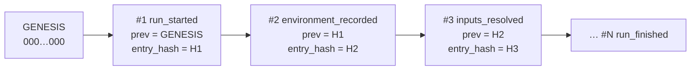
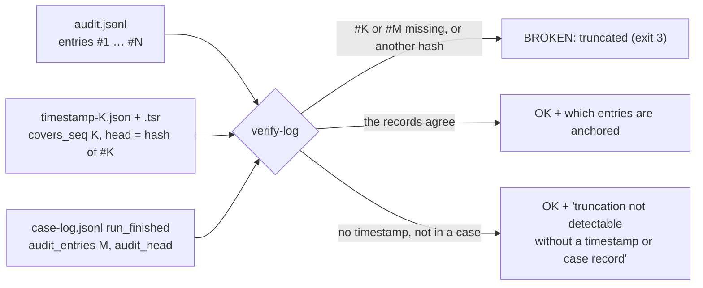
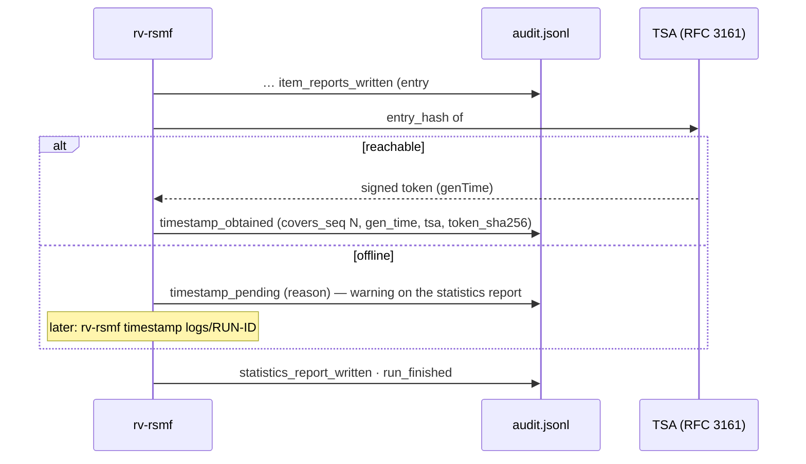
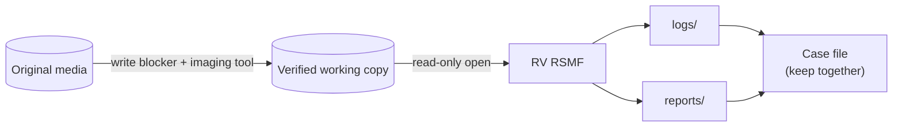

# Forensic audit trail

Everything RV RSMF does is written to `<OUT>/logs/<RUN-ID>/`. The folder is designed so that a second
examiner, months later, can check **what was done, to which files, by whom, with which tool version**, and
that the record was not altered.

| File | Content |
| --- | --- |
| `audit.jsonl` | One JSON object per action, hash-chained (authoritative) |
| `audit.log` | The same actions as readable text (convenience copy) |
| `hashes.csv` | Hash register: `index,path,size,<algo1>[,<algo2>],status,error` |
| `environment.json` | Tool version, compiler, target, every dependency version, OS, host, OS user, working folder, command line |

## The hash chain



Each entry has: `seq`, `ts_utc`, `run_id`, `actor`, `action`, optional `item`, `details`,
`prev_entry_hash`, `entry_hash`.

```text
entry_hash = SHA-256( canonical JSON of the entry without "entry_hash" )
canonical  = keys sorted at every level, no spaces, UTF-8, integers only
             (Python: json.dumps(e, sort_keys=True, separators=(",", ":"), ensure_ascii=False))
```

Editing a value changes that entry's hash; deleting or re-ordering breaks `seq` and `prev_entry_hash`.
Verify with either implementation:

```bash
rv-rsmf verify-log rakvor-out/logs/<RUN-ID>          # exit 0 intact, 3 broken or truncated
python tests/verify_chain.py rakvor-out/logs/<RUN-ID>   # independent re-implementation (chain + hashes.csv)
```

> The chain proves the log is **internally consistent**. On its own it does not prove *when* it was written —
> that is what the trusted timestamp below adds — nor that it is *complete*: removing the last entries leaves a
> shorter chain that is still valid. Storing the final `entry_hash` (printed in the statistics report) in your
> case management system remains good practice.

### Truncation: what anchors the end of the log

A chain cannot vouch for its own length, so `verify-log` compares the end of the log with the records kept
**outside** it:



| Record | Where | What `verify-log` checks |
| --- | --- | --- |
| RFC 3161 timestamp | `timestamp-<K>.json` / `.tsr` next to the log | entry `#K` still exists and its `entry_hash` is the head the token signs; every `timestamp_obtained` entry still has its token file |
| Case log | `<CASE>/case-log.jsonl`, for a run in `<CASE>/runs/<tool>/<RUN-ID>/logs` | `run_finished` of this run records `audit_entries` and `audit_head`: entry `#M` exists with that hash, and only `timestamp_obtained` follows it |

The output names the last anchored entry. A standalone run timestamps the head **before** writing
`timestamp_obtained`, `statistics_report_written` and `run_finished`, so those 3 entries are reported as
"cannot be proven complete"; a run in a case folder is anchored to its last entry by the case log. Without either
record `verify-log` prints `truncation not detectable without a timestamp or case record` (exit 0: nothing
contradicts the log, but nothing vouches for its length). Deleting the timestamp files **and** the entries that
refer to them is detectable only through the case log or a head kept elsewhere.

## Trusted timestamp (RFC 3161)

Every run asks a Time-Stamp Authority (TSA) to sign the chain head **just before the statistics report** is
written, so the report can show the result. Default TSA: `http://timestamp.digicert.com` (`--tsa-url` to change).



- The token is stored next to the log: `timestamp-<N>.tsr` (DER) and `timestamp-<N>.json` (readable summary).
- Offline or air-gapped: the run still completes. When the network is back, `rv-rsmf timestamp <log folder>`
  re-verifies the chain and appends `timestamp_obtained` — earlier entries are never rewritten.
- The TSA receives the chain head itself: the `entry_hash` of entry `#N` (already a SHA-256 digest) is the
  message imprint of the request (hash algorithm SHA-256); it is not hashed a second time.
- `verify-log` checks each token: imprint = stored head, and entry `#N` still exists with that hash (a missing
  entry `#N` is reported as truncation).
- Independent check: `openssl ts -verify -digest <head> -in timestamp-<N>.tsr -CAfile <TSA chain>`.
- `--no-timestamp` (or `RV_NO_TIMESTAMP=1`) disables it; tests use a local TSA (`tests/fake_tsa.py`).
- **Limitation:** a timestamp proves the log existed at that time, not that its content is true.

## Signed PDF reports

`--sign-cert examiner.p12` (GUI: *4. Trust → Certificate*) signs every PDF — statistics, technical, summary and
custody — with **your own** certificate. The password comes from the environment variable named by
`--sign-pass-env` (default `RV_SIGN_PASSWORD`) or an interactive prompt; it is never written to any log.
The log records `signing_certificate_loaded` with the certificate subject and SHA-256 fingerprint; a wrong password
stops the run (`run_failed`, exit 1) before any evidence is read. HTML and JSON reports are not signed: their
digests are in the audit chain, which is timestamped.

## Chain-of-custody form per item

`--jurisdiction co` (default) writes, for each item, a Colombian *registro de cadena de custodia* in Spanish
(fields of the Fiscalía manual, Ley 906 de 2004); `--jurisdiction fr` a French *fiche de scellé / suivi* in French
(Code de procédure pénale art. 156 ff.). An English version is always added. The form is pre-filled from the run
(case, item, size, both digests, UTC times, tool, examiner, audit entries) and leaves signature lines for the
physical transfers. This is a working aid, not legal advice: check it against the current official form.

## Actions recorded

| Action | When | Key details |
| --- | --- | --- |
| `run_started` | first | tool, version, frontend, algorithms, langs, inputs, case |
| `ui_*` | GUI only, before the run | input added/removed, hash selection, language, recursive, start clicked |
| `environment_recorded` | | digests of `environment.json` |
| `inputs_resolved` | | number of items and bytes |
| `item_started` | each item | index, size, modified time |
| `item_hashed` | each item | digests, bytes read, `mtime_unchanged` |
| `item_error` | unreadable item | error message |
| `item_analyzed` | each item | detected type, extension, findings, status |
| `item_cancelled` / `run_cancelled` | on cancel | processed count |
| `duplicate_group` | after the loop | hash, item indexes |
| `hash_register_written` | | digests of `hashes.csv` |
| `item_reports_written` | each item | digests of every report file |
| `statistics_report_written` | | digests of statistics files |
| `run_finished` / `run_failed` | last | totals, severities, elapsed |

## Evidence handling



- Files are opened with read-only access; modification times are compared before and after hashing
  (`mtime_unchanged` in `item_hashed`).
- Symbolic links are never followed (no escape outside the selected folders).
- The tool does not replace imaging tools or write blockers: run it on a verified copy.

## Mapping to ISO/IEC 27037:2012

| 27037 principle / activity | How RV RSMF supports it |
| --- | --- |
| Auditability (5.3.2) | Every action logged with actor, UTC time and chain hash; `verify-log` checks the chain and its end against the timestamp and the case log |
| Repeatability (5.3.3) | `environment.json` records exact tool and dependency versions; same input → same hashes |
| Reproducibility (5.3.4) | Independent verifier (`tests/verify_chain.py`), standard algorithms, and a second implementation of the tool (the other profile) that numbers, hashes and verifies identically |
| Justifiability (5.3.5) | Every finding states what it shows and what it does **not** prove; limitations in every report |
| Preservation (7.1.4) | Read-only access; hashes of every file and of every report produced |
| Documentation / chain of custody | Hash register, reports, and log folder form the record of the examination |

Colombian practice (Ley 906 de 2004, Manual de cadena de custodia) and French practice (Code de procédure
pénale, art. 156 ff. for expertise) both expect the examiner to document the method and preserve integrity;
the log folder plus the reports are that documentation for this step of the examination.
