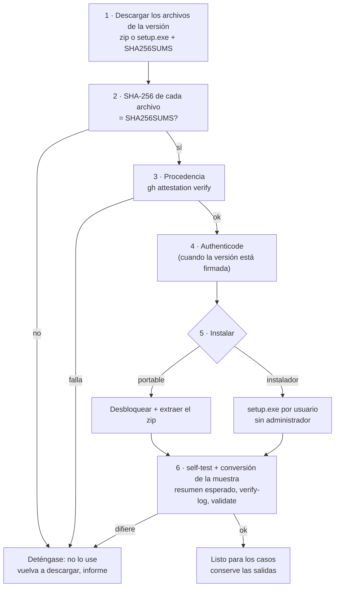

> La versión de referencia es la inglesa ([installation.md](installation.md)); esta traducción la sigue.

# Instalación y verificación (Windows 10/11)

RV RSMF se ejecuta **localmente** en el PC con Windows 10 u 11 del perito (x64). No necesita derechos de
administrador, ni runtime (runtime de C estático), ni biblioteca nativa, ni red, salvo para el sello de tiempo RFC 3161
opcional y la comprobación de versiones opcional. Esta página cubre: obtener una versión, **demostrar que es la
compilación auténtica**, instalarla (zip portable o instalador por usuario), el self-test de la primera ejecución y la
conversión de la muestra, el uso sin red, la compilación desde el código fuente para auditores, dónde quedan los
archivos y la desinstalación.

Por qué importa la verificación: un tribunal puede preguntar cómo sabe usted que el programa que ejecutó es aquel cuyo
código fuente revisó un experto. Los pasos 2–4 y 6 dan esa respuesta; conserve su salida en el expediente del caso
([admissibility.md](admissibility.md#examiner-checklist-before-filing-a-report), paso 3, en inglés).



## Requisitos

| Elemento | Requisito |
| --- | --- |
| Sistema operativo | Windows 10 u 11, x64 (`MinVersion=10.0`, `ArchitecturesAllowed=x64compatible` en el instalador). Linux/macOS: compilar desde el código fuente. |
| Derechos | Usuario estándar. El instalador es por usuario (`PrivilegesRequired=lowest`). |
| Disco | Los dos ejecutables y la documentación (unos pocos MB). Salidas: los archivos `.rsmf` ocupan más o menos el tamaño de la exportación más sus archivos multimedia empaquetados (base64 agrega un tercio), más unos 11 archivos de informe por archivo de entrada para un idioma. |
| Memoria | Los archivos de entrada se hashean en bloques de 1 MiB, pero cada exportación se lee en memoria y cada archivo RSMF (con sus adjuntos) se construye en memoria: prevea unas cuantas veces el tamaño de la exportación más grande o del día con más multimedia. |
| Gráficos | Ninguno: la GUI también funciona en máquinas virtuales sin controlador de GPU (renderizado por software). |
| Red | Ninguna, salvo la solicitud opcional de sello de tiempo ([paso 7](#7-uso-sin-red-y-en-equipos-aislados)). |
| Verificación de versiones | Opcional, solo aviso: la aplicación de escritorio al arrancar y `rv-rsmf update-check` leen la página pública de la última versión en github.com ([Verificación de versiones](#verificación-de-versiones)); `RV_NO_UPDATE_CHECK=1` la desactiva. |

## 1. Descarga

Archivos de la versión en la página GitHub Releases del repositorio (`Panacota96/rv-rsmf`):

| Archivo | Qué es |
| --- | --- |
| `rv-rsmf-X.Y.Z-windows-x64.zip` | Portable: `rv-rsmf.exe`, `rv-rsmf-gui.exe`, README, LICENSE, COMMERCIAL.md, NOTICE, CHANGELOG, `docs/`, `examples/` |
| `rv-rsmf-X.Y.Z-windows-x64-setup.exe` | Instalador Inno Setup, por usuario |
| `SHA256SUMS` | SHA-256 del zip, del instalador y del SBOM (formato `sha256sum`: `<hash>  ./<archivo>`) |
| `sbom.cdx.json` | Lista de materiales de software CycloneDX (cada dependencia Rust y su versión) |

Póngalos en una carpeta, p. ej. `C:\Rakvor\downloads\rv-rsmf-0.1.0\`.

## 2. Verificar la descarga

```powershell
cd C:\Rakvor\downloads\rv-rsmf-0.1.0
Get-Content .\SHA256SUMS | ForEach-Object {
    $hash, $name = $_ -split '\s+', 2
    $name = $name.TrimStart('*').Replace('./', '')
    if (Test-Path $name) {
        $actual = (Get-FileHash -Algorithm SHA256 $name).Hash.ToLower()
        if ($actual -eq $hash) { "OK    $name" } else { "FAIL  $name  (got $actual)" }
    } else { "skip  $name (not downloaded)" }
}
```

Cada archivo descargado debe imprimir `OK`. Un archivo a la vez: `Get-FileHash .\rv-rsmf-0.1.0-windows-x64.zip
-Algorithm SHA256`. El propio `SHA256SUMS` lo produce el mismo flujo de trabajo; la atestación del paso 3 es la
comprobación más fuerte.

## 3. Verificar la procedencia de la compilación

Cada zip e instalador lleva una atestación de procedencia de compilación de GitHub (`actions/attest-build-provenance`):
una declaración firmada de que ese archivo exacto lo compiló el flujo de publicación del repositorio a partir de un
commit dado. En un equipo con acceso a internet y la CLI de GitHub:

```powershell
gh attestation verify .\rv-rsmf-0.1.0-windows-x64.zip --repo Panacota96/rv-rsmf
gh attestation verify .\rv-rsmf-0.1.0-windows-x64-setup.exe --repo Panacota96/rv-rsmf
```

La salida nombra el flujo de trabajo (`.github/workflows/release.yml`) y el commit de origen; anote ambos. Para un
laboratorio aislado, verifique en una máquina conectada y lleve los archivos verificados en un soporte protegido
contra escritura. `SHA256SUMS` y el SBOM no tienen atestación propia.

## 4. Verificar la firma Authenticode (versiones firmadas)

El flujo de publicación firma `rv-rsmf.exe`, `rv-rsmf-gui.exe` y el instalador **solo cuando hay un certificado de
firma de código configurado** para el repositorio (secretos `SIGN_PFX_BASE64`, `SIGN_PFX_PASSWORD`). Rakvor firma sus
herramientas con su certificado de firma de código **interno** ("Rakvor Code Signing (internal)", emitido por "Rakvor
Internal Code Signing Root CA"). No es un certificado público: Windows solo confía en él en las máquinas donde está
instalada la raíz de Rakvor, los portátiles de la propia Rakvor, ya que la herramienta se usa localmente y no se
distribuye. Los auditores y los clientes verifican las versiones con los pasos 2–3 y pueden inspeccionar la firma
frente a la huella de la raíz que figura más abajo.

Instale la raíz una vez por máquina de Rakvor (PowerShell, como el usuario que ejecuta la herramienta). El archivo raíz
`rakvor-code-signing-root.cer` es el mismo para todas las herramientas Rakvor; este repositorio lo tiene en
`packaging/signing/rakvor-code-signing-root.cer` (solo el certificado público). Compruebe primero su huella:

```powershell
# Debe ser exactamente:
#   SHA-256 DC9BA1A2FCD4F0633C5214B7CCEB25BED8F3F7D9EBAF111590250CBCAA83DF60
(New-Object System.Security.Cryptography.X509Certificates.X509Certificate2 .\rakvor-code-signing-root.cer).GetCertHashString([System.Security.Cryptography.HashAlgorithmName]::SHA256)
Import-Certificate -FilePath .\rakvor-code-signing-root.cer -CertStoreLocation Cert:\CurrentUser\Root
```

Windows muestra un cuadro de confirmación para la nueva raíz; acéptelo solo si la huella coincidió. Luego:

```powershell
Get-AuthenticodeSignature .\rv-rsmf-0.1.0-windows-x64-setup.exe |
    Format-List Status, StatusMessage, SignerCertificate, TimeStamperCertificate
# después de extraer el zip:
Get-AuthenticodeSignature .\rv-rsmf.exe, .\rv-rsmf-gui.exe | Format-Table Status, Path
```

| Estado | Significado |
| --- | --- |
| `Valid` | Firmado e intacto; el firmante debe ser "Rakvor Code Signing (internal)" |
| `UnknownError` | Firmado, pero la raíz de Rakvor no está instalada en este equipo (instálela como arriba) |
| `NotSigned` | La versión se compiló sin certificado de firma: apóyese en los pasos 2–3; SmartScreen avisará |
| `HashMismatch` / otro | Deténgase: el archivo fue alterado después de firmarse |

Con el Windows SDK, `signtool verify /pa /v rv-rsmf.exe` muestra la cadena completa. El flujo de publicación comprueba
tras firmar que cada firma se encadena a la raíz de Rakvor (`signtool verify /pa`); compruébelo de nuevo aquí.

**SmartScreen.** SmartScreen juzga una descarga por la reputación de un certificado de confianza **pública**. La raíz
interna de Rakvor no lo es, así que "Windows protegió su PC" (editor desconocido) puede aparecer incluso cuando la
firma es `Valid`, y siempre cuando es `NotSigned`. Solo después de superar los pasos 2–4: quite la marca de archivo
descargado con `Unblock-File .\<archivo>` (en el zip **antes** de extraerlo), o elija *Más información → Ejecutar de
todas formas*. El aviso desaparece definitivamente solo con un certificado público
([release-process.md](release-process.md#5-the-signing-certificate), en inglés).

## 5. Instalar

### 5a. Zip portable

```powershell
# solo después de los pasos 2–4
Unblock-File .\rv-rsmf-0.1.0-windows-x64.zip
Expand-Archive .\rv-rsmf-0.1.0-windows-x64.zip -DestinationPath C:\Rakvor\tools\rv-rsmf-0.1.0
cd C:\Rakvor\tools\rv-rsmf-0.1.0
.\rv-rsmf.exe --version
```

Conserve una carpeta por versión para poder volver a ejecutar un caso pasado con la versión exacta registrada en su
`environment.json` (los archivos `.rsmf` llevan la versión en `X-RSMF-Generator`, y otra versión da otros bytes).

### 5b. Instalador (por usuario, sin administrador)

Haga doble clic en `rv-rsmf-X.Y.Z-windows-x64-setup.exe` (asistente en inglés, español o francés). Se instala en
`%LOCALAPPDATA%\Programs\Rakvor\RV RSMF\`, crea un grupo *Rakvor* en el menú Inicio (aplicación + documentación) y
ofrece dos tareas: **Add the rv-rsmf command to PATH** (PATH del usuario, marcada en la primera instalación) y un
icono en el escritorio. Abra después una terminal **nueva** para que se aplique el PATH. Sin intervención:

```powershell
.\rv-rsmf-0.1.0-windows-x64-setup.exe /VERYSILENT /SUPPRESSMSGBOXES /NORESTART /TASKS="addtopath"
```

El instalador copia los ejecutables, README, LICENSE, COMMERCIAL.md, NOTICE, CHANGELOG, `docs\` y la evidencia de
muestra (`examples\sample\evidence\` con sus subcarpetas), no los scripts de la muestra, `expected\` ni
`expected_hashes.csv`. Use el zip portable para la comprobación de la muestra del paso 6.

### 5c. Bibliotecas nativas

Ninguna. El hash, los lectores de WhatsApp/Telegram/Teams/CSV, el lector de archivos compuestos (`.msg`), el escritor
de zip, el validador de esquemas JSON, la base de datos de zonas horarias, el escritor de PDF, el cliente RFC 3161 y el
firmante CMS están compilados dentro (crates de Rust listados en el SBOM y en cada `environment.json`), y el runtime de
C se enlaza de forma estática (`.cargo/config.toml`). No hay ninguna DLL que verificar ni que mantener junto a los
ejecutables.

## 6. Self-test de la primera ejecución y conversión de la muestra

```powershell
rv-rsmf --version
rv-rsmf self-test
```

`self-test` imprime `PASS` para md5, sha1, sha256, sha512, sha3-256 y blake3 (respuestas conocidas para `"abc"`),
código de salida 0. Solo prueba las implementaciones de hash. Luego convierta las muestras sintéticas, que ejercitan
cada lector, el escritor y el validador RSMF, los informes y la cadena de auditoría:

```powershell
# zip portable (script incluido): self-test, conversión, verify-log, validate, hashes.csv frente a expected_hashes.csv
.\examples\sample\run.ps1 -Bin .\rv-rsmf.exe

# a mano (p. ej. con el exe instalado sobre la carpeta de muestra del zip), en una carpeta temporal
$samples = "C:\Rakvor\tools\rv-rsmf-0.1.0\examples\sample\evidence"
$out = Join-Path $env:TEMP "rv-rsmf-check"
rv-rsmf convert -i $samples -r --timezone Europe/Paris --date-order dmy `
    --hash sha256,md5 --out $out --progress none --no-timestamp
$LASTEXITCODE                                                         # 0
$run = (Get-ChildItem "$out\logs" | Select-Object -Last 1).Name
rv-rsmf verify-log "$out\logs\$run"                                   # OK … chain intact
rv-rsmf validate "$out\rsmf\$run"                                     # 17 × OK
```

Resumen esperado (medido en este commit):

```text
  items: 16  bytes: 99559  errors: 0
  findings: high 0, medium 10, low 2, info 24
  rsmf:   8 export(s), 10 conversation(s), 49 event(s), 17 file(s)
```

código de salida 0, cada archivo `OK` en `validate`. `run.ps1` / `run.sh` comparan además el `logs\<RUN-ID>\hashes.csv`
de la herramienta con `examples\sample\expected_hashes.csv` (calculado de forma independiente con Python) e imprimen
`hashes.csv matches expected_hashes.csv (16 files: size, SHA-256, MD5)`; cualquier diferencia sale con 3. Un resumen
distinto significa otra versión o muestras modificadas: compare `environment.json` con las notas de la versión.
Conserve la salida de la consola y la carpeta de la ejecución como registro de esta verificación.

## 7. Uso sin red y en equipos aislados

Además de la comprobación de versiones opcional ([Verificación de versiones](#verificación-de-versiones)), el **único**
acceso a la red en el código es la solicitud de sello de tiempo RFC 3161 (un HTTP POST de un hash de 32 bytes a la
TSA, [src/core/src/trust.rs](../src/core/src/trust.rs)). No hay telemetría ni comprobación de licencia; las
exportaciones, los mensajes y los archivos multimedia nunca salen de la máquina. Con `--intake hashinv`, rv-hashinv se
inicia con el mismo ajuste de sello de tiempo.

| Para desactivar el sello de tiempo | Cómo |
| --- | --- |
| Una ejecución de la CLI | `--no-timestamp` |
| Todas las ejecuciones de la CLI en este equipo / sesión | `$env:RV_NO_TIMESTAMP = "1"` (o defínala como variable de entorno del usuario) |
| GUI | desmarque la opción de sello de tiempo confiable antes de iniciar ([usage-gui.es.md](usage-gui.es.md)) |

Una ejecución sin red con el sello de tiempo activado termina igualmente: registra `timestamp_pending` y el informe de
estadísticas muestra un aviso. Más tarde, en una máquina que llegue a la TSA, ejecute `rv-rsmf timestamp <carpeta de
logs>` (vuelve a verificar la cadena y luego agrega `timestamp_obtained`). Para usar una TSA interna o cualificada,
pase `--tsa-url` ([admissibility.md](admissibility.md#53-eidas--regulation-eu-9102014-as-amended-by-eu-20241183), en
inglés). El sello de tiempo solo es cualificado en el sentido de eIDAS si la dirección de la TSA es la de un prestador
cualificado de servicios de confianza (QTSP) inscrito en una lista de confianza de la UE; la dirección por defecto
(DigiCert) no lo es. El sistema operativo no impone la restricción; en un puesto conectado, una regla de salida del
Firewall de Windows para `rv-rsmf.exe` / `rv-rsmf-gui.exe` que solo permita el host de la TSA la impone.

## 8. Compilar desde el código fuente para auditores

### Cadena de herramientas

| Elemento | Versión |
| --- | --- |
| Rust | Fijado por [rust-toolchain.toml](../rust-toolchain.toml): **1.97.0** con rustfmt y clippy; `rustup` lo instala y lo selecciona automáticamente dentro del árbol de código (la CI y el trabajo de publicación hacen lo mismo). `Cargo.toml` declara `rust-version = "1.88"` (edición 2024) para el núcleo y la CLI y `1.95` para la GUI (egui/eframe 0.37); ningún trabajo de CI comprueba estos mínimos. Para coincidir exactamente con una versión, use el compilador registrado en el `environment.json` de esa versión → `tool.rustc`. |
| Enlazador de Windows | Visual Studio 2022 Build Tools, carga de trabajo *Desktop development with C++* (MSVC + Windows SDK); destino `x86_64-pc-windows-msvc`. El CRT estático se define en `.cargo/config.toml`. |
| Linux | No hacen falta paquetes del sistema para compilar la CLI. |
| Opcional | Python 3.12 con `blake3 jsonschema pyhanko` para los oráculos y las pruebas de confianza (`RV_TEST_PYTHON=python`). |

### Compilación

```powershell
git clone https://github.com/Panacota96/rv-rsmf.git
cd rv-rsmf
git checkout v0.1.0                       # la etiqueta de la versión bajo revisión
rustc --version                           # debe imprimir la 1.97.0 fijada
cargo build --release --locked -p rv-rsmf-cli -p rv-rsmf-gui
.\target\release\rv-rsmf.exe self-test
.\examples\sample\run.ps1 -Bin .\target\release\rv-rsmf.exe
cargo test --workspace --locked            # pruebas unitarias + de integración (las pruebas de confianza se omiten sin pyhanko)
```

```bash
# Linux
cargo build --release --locked -p rv-rsmf-cli
target/release/rv-rsmf self-test && examples/sample/run.sh target/release/rv-rsmf
# comprobaciones independientes: el esquema oficial en el commit fijado, el analizador de correo de Python, los hashes frente al log de auditoría
curl -sSfL -o rsmf_schema_2_0_0.json https://raw.githubusercontent.com/relativitydev/rsmf-validator-samples/c717cd322264b46115d27d034a6107c8c91043d8/RSMFManifestSchema/rsmf_schema_2_0_0.json
run=$(ls examples/sample/out/logs | tail -n 1)
python3 tests/oracle_rsmf.py examples/sample/out/rsmf/$run examples/sample/out/logs/$run/audit.jsonl rsmf_schema_2_0_0.json
python3 tests/run_samples.py target/release/rv-rsmf rsmf_schema_2_0_0.json /tmp/sample-check
python3 tests/verify_chain.py examples/sample/out/logs/$run
```

`--locked` se niega a compilar si `Cargo.lock` tuviera que cambiar, así que el conjunto de dependencias es igual al
listado en `environment.json` → `dependencies` y en `sbom.cdx.json`. La versión del producto viene de `version.txt`;
las versiones de las crates en `Cargo.toml` no cambian, así que una versión nunca modifica el archivo de bloqueo.

### Reproducir los hashes de una versión

| Artefacto | ¿Idéntico bit a bit a la versión publicada? | Cómo verificarlo |
| --- | --- | --- |
| Archivos de `docs/`, `examples/` | Sí (desde git; finales de línea LF salvo `*.ps1`, `*.iss`; la evidencia de muestra es binaria) | `git ls-files` + `Get-FileHash` contra el zip extraído |
| `rv-rsmf.exe`, `rv-rsmf-gui.exe` | **No garantizado**: el compilador está fijado, pero las rutas no se reasignan y la cabecera PE lleva datos del enlazado (brecha G22) | La atestación de procedencia (paso 3) vincula el binario publicado al flujo de trabajo y al commit; luego compare el comportamiento (abajo) |
| zip, instalador | No (marcas de tiempo del archivo comprimido) | Atestación (paso 3) |
| Archivos `.rsmf` producidos por la misma versión con la misma exportación y opciones | **Sí**, byte a byte ([theory.md B10](theory.md#b10-deterministic-writing), en inglés) | Comparar el SHA-256 |

**Equivalencia funcional**: convierta la muestra con el binario publicado y con su compilación (mismas opciones, mismo
`--case`, mismo orden de `--hash`); los archivos `.rsmf` deben ser idénticos:

```bash
python - "<release-out>/rsmf/<RUN-ID>" "<your-out>/rsmf/<RUN-ID>" <<'EOF'
import hashlib, pathlib, sys
def load(d):
    d = pathlib.Path(d)
    return {p.relative_to(d).as_posix(): hashlib.sha256(p.read_bytes()).hexdigest() for p in sorted(d.rglob("*.rsmf"))}
a, b = load(sys.argv[1]), load(sys.argv[2])
print("identical .rsmf files" if a == b else "DIFFERENT: " + ", ".join(k for k in a.keys() | b.keys() if a.get(k) != b.get(k)))
EOF
```

`X-RSMF-Generator` lleva la versión: dos compilaciones de la **misma** versión dan resultados iguales; versiones
distintas, no.

## 9. Dónde quedan las cosas

| Qué | Ubicación |
| --- | --- |
| Programa (instalador) | `%LOCALAPPDATA%\Programs\Rakvor\RV RSMF\` (`rv-rsmf.exe`, `rv-rsmf-gui.exe`, `docs\`, `examples\sample\evidence\`, `unins000.exe`) |
| Programa (portable) | la carpeta que extrajo |
| Entrada del PATH (tarea del instalador) | variable de entorno del usuario `Path` (`HKCU\Environment`) |
| Salidas de las ejecuciones | `--out` (por defecto `.\rakvor-out` **relativo a la carpeta actual**): `logs\<RUN-ID>\`, `reports\<RUN-ID>\`, `rsmf\<RUN-ID>\`. Con `--case-dir`: `<CASE>\runs\rv-rsmf\<RUN-ID>\{logs,reports,rsmf}` |
| rv-hashinv (para `--intake hashinv`) | `--hashinv-exe`, `RV_HASHINV`, junto a `rv-rsmf.exe`, `%LOCALAPPDATA%\Programs\Rakvor\RV HashInv\`, o el `PATH` |
| Ajustes de la GUI | no se guardan: cada inicio usa los valores por defecto; cada cambio hecho antes de una ejecución se registra en el log de auditoría de esa ejecución (`ui_*`) |
| Certificado de firma | donde usted lo guarde; solo se registran su ruta, su sujeto y su huella SHA-256, nunca la contraseña |
| Datos locales, cachés, archivos temporales | ninguno |

## 10. Desinstalar

- **Instalador:** *Configuración → Aplicaciones → Aplicaciones instaladas → RV RSMF → Desinstalar*, o ejecute
  `"%LOCALAPPDATA%\Programs\Rakvor\RV RSMF\unins000.exe"`. Quita los archivos instalados y los accesos directos. La
  **entrada del PATH del usuario no se quita** en esta versión (el script del instalador no tiene un paso de
  desinstalación para ella); quítela con:

  ```powershell
  $dir = "$env:LOCALAPPDATA\Programs\Rakvor\RV RSMF"
  $p = [Environment]::GetEnvironmentVariable("Path", "User").Split(";") | Where-Object { $_ -and $_ -ne $dir }
  [Environment]::SetEnvironmentVariable("Path", ($p -join ";"), "User")
  ```

- **Portable:** borre la carpeta.
- **Se conservan a propósito** (en ambos casos): las salidas de las ejecuciones y las carpetas de caso (material del
  caso). Conserve el zip de la versión y `SHA256SUMS` de cada versión usada en un caso, para poder volver a ejecutarlo.

## 11. Problemas de instalación

| Síntoma | Causa y solución |
| --- | --- |
| SmartScreen "Windows protegió su PC" (editor desconocido) | Esperado con el certificado interno de Rakvor o con una compilación sin firmar ([paso 4](#4-verificar-la-firma-authenticode-versiones-firmadas)). Solo después de superar los pasos 2–4: `Unblock-File` o *Más información → Ejecutar de todas formas*. |
| `Get-AuthenticodeSignature` dice `UnknownError` | La raíz de Rakvor no está instalada en este PC (paso 4), o verifique con `SHA256SUMS` y la atestación |
| `rv-rsmf` no se reconoce | No se eligió la tarea del PATH, o la terminal se abrió antes de instalar: abra una terminal nueva o use la ruta completa |
| `self-test` imprime `FAIL` | No use esta compilación para evidencia; vuelva a descargar y repita los pasos 2–4 |
| El resumen de la muestra difiere del paso 6 | Versión equivocada o archivos de muestra modificados; compare `environment.json` con las notas de la versión y los hashes de la muestra con `expected_hashes.csv` |
| La ventana de la GUI queda en blanco o va muy lenta en una VM | No hay controlador de GPU: se usa el renderizado por software; dé más CPU a la VM |
| Compilar desde el código fuente descarga otro compilador | Esperado: rustup instala la 1.97.0 fijada en `rust-toolchain.toml`. Sin red, instálela antes (`rustup toolchain install 1.97.0 --profile minimal`) |

## Verificación de versiones

¿Hay una versión más reciente publicada? La herramienta puede decírselo; nunca se actualiza sola.

| | |
| --- | --- |
| Cuándo | La aplicación de escritorio verifica una vez al arrancar, en segundo plano (solo aparece un aviso con la página de la versión cuando hay una más reciente). La CLI solo verifica con `rv-rsmf update-check` (`--json` para scripts; salida 0 = última, 3 = versión más reciente, 1 = no se pudo verificar). Ningún otro comando contacta la red para esto. RV Hub verifica cada herramienta que lista. |
| Qué se envía | Un HTTPS GET de `https://github.com/Panacota96/rv-rsmf/releases/latest` (se lee la redirección, no se sigue) con `User-Agent: rv-rsmf/<version>` y ninguna otra cabecera, cookie ni parámetro: nada sobre el caso, la evidencia, el perito ni el equipo. |
| Qué hace | Nombra la versión más reciente y su página. Nunca descarga ni instala nada: descargue la versión y verifíquela (`SHA256SUMS`, cadena Authenticode hasta la raíz de Rakvor) como en [Verificar la descarga](#2-verificar-la-descarga) antes de usarla. |
| Auditoría | La verificación no forma parte de una ejecución y no se escribe en ningún log de auditoría; una verificación fallida o lenta (sin red, límite de 5 s) nunca bloquea la herramienta. |
| Desactivarla | `RV_NO_UPDATE_CHECK=1` (cualquier valor salvo vacío o `0`), o el archivo `update-check-off` en `%APPDATA%\Rakvor` (lo escribe el ajuste de RV Hub): desactivada para toda herramienta Rakvor en este equipo. |
| Código | [src/core/src/update.rs](../src/core/src/update.rs) (compartido, idéntico byte a byte, en toda herramienta Rakvor) |
