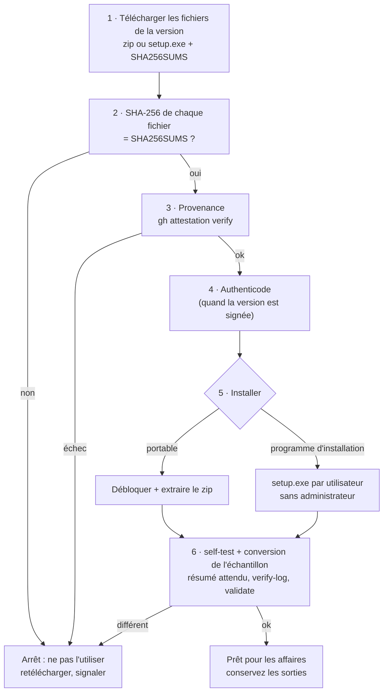

> La version de référence est la version anglaise ([installation.md](installation.md)) ; cette traduction la suit.

# Installation et vérification (Windows 10/11)

RV RSMF s'exécute **localement** sur le PC Windows 10 ou 11 de l'expert (x64). Il ne demande ni droits
d'administrateur, ni runtime (runtime C statique), ni bibliothèque native, ni réseau, sauf pour l'horodatage RFC 3161
facultatif et la vérification des versions facultative. Cette page couvre : obtenir une version, **prouver qu'il s'agit
de la compilation authentique**, l'installer (zip portable ou programme d'installation par utilisateur), l'autotest du
premier lancement et la conversion de l'échantillon, l'usage hors ligne, la compilation à partir des sources pour les
auditeurs, l'emplacement des fichiers et la désinstallation.

Pourquoi la vérification compte : un tribunal peut demander comment vous savez que le programme exécuté est celui
dont un expert a examiné le code source. Les étapes 2–4 et 6 apportent cette réponse ; conservez leur sortie au
dossier ([admissibility.md](admissibility.md#examiner-checklist-before-filing-a-report), étape 3, en anglais).



## Prérequis

| Élément | Exigence |
| --- | --- |
| Système d'exploitation | Windows 10 ou 11, x64 (`MinVersion=10.0`, `ArchitecturesAllowed=x64compatible` dans le programme d'installation). Linux/macOS : compiler à partir des sources. |
| Droits | Utilisateur standard. Le programme d'installation est par utilisateur (`PrivilegesRequired=lowest`). |
| Disque | Les deux exécutables et la documentation (quelques Mo). Sorties : les fichiers `.rsmf` font à peu près la taille de l'export plus ses médias empaquetés (le base64 ajoute un tiers), plus environ 11 fichiers de rapport par fichier d'entrée pour une langue. |
| Mémoire | Les fichiers d'entrée sont hachés par blocs de 1 Mio, mais chaque export est lu en mémoire et chaque fichier RSMF (avec ses pièces jointes) est construit en mémoire : prévoyez quelques fois la taille du plus gros export ou de la journée la plus riche en médias. |
| Graphisme | Aucun prérequis : la GUI fonctionne aussi sur des machines virtuelles sans pilote GPU (rendu logiciel). |
| Réseau | Aucun, sauf la demande d'horodatage facultative ([étape 7](#7-usage-hors-ligne-et-sur-poste-isolé)). |
| Vérification des versions | Facultative, simple avertissement : l'application de bureau au démarrage et `rv-rsmf update-check` lisent la page publique de la dernière version sur github.com ([Vérification des versions](#vérification-des-versions)) ; `RV_NO_UPDATE_CHECK=1` la désactive. |

## 1. Téléchargement

Fichiers de la version sur la page GitHub Releases du dépôt (`Panacota96/rv-rsmf`) :

| Fichier | Ce que c'est |
| --- | --- |
| `rv-rsmf-X.Y.Z-windows-x64.zip` | Portable : `rv-rsmf.exe`, `rv-rsmf-gui.exe`, README, LICENSE, COMMERCIAL.md, NOTICE, CHANGELOG, `docs/`, `examples/` |
| `rv-rsmf-X.Y.Z-windows-x64-setup.exe` | Programme d'installation Inno Setup, par utilisateur |
| `SHA256SUMS` | SHA-256 du zip, du programme d'installation et du SBOM (format `sha256sum` : `<empreinte>  ./<fichier>`) |
| `sbom.cdx.json` | Nomenclature logicielle CycloneDX (chaque dépendance Rust et sa version) |

Placez-les dans un même dossier, par ex. `C:\Rakvor\downloads\rv-rsmf-0.1.0\`.

## 2. Vérifier le téléchargement

```powershell
cd C:\Rakvor\downloads\rv-rsmf-0.1.0
Get-Content .\SHA256SUMS | ForEach-Object {
    $hash, $name = $_ -split '\s+', 2
    $name = $name.TrimStart('*').Replace('./', '')
    if (Test-Path $name) {
        $actual = (Get-FileHash -Algorithm SHA256 $name).Hash.ToLower()
        if ($actual -eq $hash) { "OK    $name" } else { "FAIL  $name  (got $actual)" }
    } else { "skip  $name (not downloaded)" }
}
```

Chaque fichier téléchargé doit afficher `OK`. Un fichier à la fois : `Get-FileHash .\rv-rsmf-0.1.0-windows-x64.zip
-Algorithm SHA256`. `SHA256SUMS` lui-même est produit par le même workflow ; l'attestation de l'étape 3 est le contrôle
le plus fort.

## 3. Vérifier la provenance de la compilation

Chaque zip et programme d'installation porte une attestation de provenance de compilation GitHub
(`actions/attest-build-provenance`) : une déclaration signée indiquant que ce fichier précis a été compilé par le
workflow de publication du dépôt à partir d'un commit donné. Sur un poste connecté à internet, avec la CLI GitHub :

```powershell
gh attestation verify .\rv-rsmf-0.1.0-windows-x64.zip --repo Panacota96/rv-rsmf
gh attestation verify .\rv-rsmf-0.1.0-windows-x64-setup.exe --repo Panacota96/rv-rsmf
```

La sortie nomme le workflow (`.github/workflows/release.yml`) et le commit source ; notez les deux. Pour un laboratoire
isolé, vérifiez sur une machine connectée et transportez les fichiers vérifiés sur un support protégé en écriture.
`SHA256SUMS` et le SBOM ne sont pas attestés eux-mêmes.

## 4. Vérifier la signature Authenticode (versions signées)

Le workflow de publication signe `rv-rsmf.exe`, `rv-rsmf-gui.exe` et le programme d'installation **uniquement quand un
certificat de signature de code est configuré** pour le dépôt (secrets `SIGN_PFX_BASE64`, `SIGN_PFX_PASSWORD`). Rakvor
signe ses outils avec son certificat de signature de code **interne** (« Rakvor Code Signing (internal) », émis par
« Rakvor Internal Code Signing Root CA »). Ce n'est pas un certificat public : Windows ne lui fait confiance que sur les
machines où la racine Rakvor est installée, les portables de Rakvor elle-même, puisque l'outil est utilisé localement et
n'est pas distribué. Les auditeurs et les clients vérifient les versions avec les étapes 2–3 et peuvent contrôler la
signature avec l'empreinte de la racine ci-dessous.

Installez la racine une fois par machine Rakvor (PowerShell, en tant qu'utilisateur qui lance l'outil). Le fichier
racine `rakvor-code-signing-root.cer` est le même pour tous les outils Rakvor ; ce dépôt le contient dans
`packaging/signing/rakvor-code-signing-root.cer` (certificat public uniquement). Vérifiez d'abord son empreinte :

```powershell
# Elle doit être exactement :
#   SHA-256 DC9BA1A2FCD4F0633C5214B7CCEB25BED8F3F7D9EBAF111590250CBCAA83DF60
(New-Object System.Security.Cryptography.X509Certificates.X509Certificate2 .\rakvor-code-signing-root.cer).GetCertHashString([System.Security.Cryptography.HashAlgorithmName]::SHA256)
Import-Certificate -FilePath .\rakvor-code-signing-root.cer -CertStoreLocation Cert:\CurrentUser\Root
```

Windows affiche une boîte de confirmation pour la nouvelle racine ; acceptez-la seulement si l'empreinte correspond.
Ensuite :

```powershell
Get-AuthenticodeSignature .\rv-rsmf-0.1.0-windows-x64-setup.exe |
    Format-List Status, StatusMessage, SignerCertificate, TimeStamperCertificate
# après extraction du zip :
Get-AuthenticodeSignature .\rv-rsmf.exe, .\rv-rsmf-gui.exe | Format-Table Status, Path
```

| Statut | Signification |
| --- | --- |
| `Valid` | Signé et intact ; le signataire doit être « Rakvor Code Signing (internal) » |
| `UnknownError` | Signé, mais la racine Rakvor n'est pas installée sur ce poste (installez-la comme ci-dessus) |
| `NotSigned` | La version a été compilée sans certificat de signature : appuyez-vous sur les étapes 2–3 ; SmartScreen avertira |
| `HashMismatch` / autre | Arrêtez : le fichier a été modifié après sa signature |

Avec le Windows SDK, `signtool verify /pa /v rv-rsmf.exe` affiche la chaîne complète. Le workflow de publication
vérifie après la signature que chaque signature remonte à la racine Rakvor (`signtool verify /pa`) ; vérifiez-le de
nouveau ici.

**SmartScreen.** SmartScreen juge un téléchargement d'après la réputation d'un certificat **publiquement** reconnu. La
racine interne de Rakvor n'en est pas un, donc « Windows a protégé votre ordinateur » (éditeur inconnu) peut apparaître
même quand la signature est `Valid`, et toujours quand elle est `NotSigned`. Seulement après la réussite des
étapes 2–4 : retirez la marque de fichier téléchargé avec `Unblock-File .\<fichier>` (sur le zip **avant** de
l'extraire), ou choisissez *Informations complémentaires → Exécuter quand même*. L'avertissement ne disparaît
définitivement qu'avec un certificat public ([release-process.md](release-process.md#5-the-signing-certificate), en
anglais).

## 5. Installer

### 5a. Zip portable

```powershell
# seulement après les étapes 2–4
Unblock-File .\rv-rsmf-0.1.0-windows-x64.zip
Expand-Archive .\rv-rsmf-0.1.0-windows-x64.zip -DestinationPath C:\Rakvor\tools\rv-rsmf-0.1.0
cd C:\Rakvor\tools\rv-rsmf-0.1.0
.\rv-rsmf.exe --version
```

Gardez un dossier par version pour pouvoir relancer une affaire passée avec la version exacte consignée dans son
`environment.json` (les fichiers `.rsmf` portent la version dans `X-RSMF-Generator`, et une autre version donne
d'autres octets).

### 5b. Programme d'installation (par utilisateur, sans administrateur)

Double-cliquez sur `rv-rsmf-X.Y.Z-windows-x64-setup.exe` (assistant en anglais, espagnol ou français). Il s'installe
dans `%LOCALAPPDATA%\Programs\Rakvor\RV RSMF\`, crée un groupe *Rakvor* dans le menu Démarrer (application +
documentation) et propose deux tâches : **Add the rv-rsmf command to PATH** (PATH de l'utilisateur, cochée à la
première installation) et une icône sur le bureau. Ouvrez ensuite un **nouveau** terminal pour que le PATH s'applique.
Sans intervention :

```powershell
.\rv-rsmf-0.1.0-windows-x64-setup.exe /VERYSILENT /SUPPRESSMSGBOXES /NORESTART /TASKS="addtopath"
```

Le programme d'installation copie les exécutables, README, LICENSE, COMMERCIAL.md, NOTICE, CHANGELOG, `docs\` et les
éléments d'exemple (`examples\sample\evidence\` avec ses sous-dossiers), pas les scripts de l'échantillon, ni
`expected\`, ni `expected_hashes.csv`. Utilisez le zip portable pour le contrôle de l'échantillon de l'étape 6.

### 5c. Bibliothèques natives

Aucune. Le hachage, les lecteurs WhatsApp/Telegram/Teams/CSV, le lecteur de fichiers composés (`.msg`), l'écriture des
zip, le validateur de schémas JSON, la base des fuseaux horaires, l'écriture des PDF, le client RFC 3161 et le
signataire CMS sont compilés dans l'exécutable (crates Rust listées dans le SBOM et dans chaque `environment.json`), et
le runtime C est lié statiquement (`.cargo/config.toml`). Il n'y a aucune DLL à vérifier ni à garder à côté des
exécutables.

## 6. Autotest du premier lancement et conversion de l'échantillon

```powershell
rv-rsmf --version
rv-rsmf self-test
```

`self-test` affiche `PASS` pour md5, sha1, sha256, sha512, sha3-256 et blake3 (réponses connues pour `"abc"`), code
de sortie 0. Il ne teste que les implémentations d'empreinte. Convertissez ensuite les échantillons synthétiques, qui
exercent chaque lecteur, l'écriture et la validation RSMF, les rapports et la chaîne d'audit :

```powershell
# zip portable (script inclus) : self-test, conversion, verify-log, validate, hashes.csv comparé à expected_hashes.csv
.\examples\sample\run.ps1 -Bin .\rv-rsmf.exe

# à la main (p. ex. avec l'exe installé sur le dossier d'exemple du zip), dans un dossier temporaire
$samples = "C:\Rakvor\tools\rv-rsmf-0.1.0\examples\sample\evidence"
$out = Join-Path $env:TEMP "rv-rsmf-check"
rv-rsmf convert -i $samples -r --timezone Europe/Paris --date-order dmy `
    --hash sha256,md5 --out $out --progress none --no-timestamp
$LASTEXITCODE                                                         # 0
$run = (Get-ChildItem "$out\logs" | Select-Object -Last 1).Name
rv-rsmf verify-log "$out\logs\$run"                                   # OK … chain intact
rv-rsmf validate "$out\rsmf\$run"                                     # 17 × OK
```

Résumé attendu (mesuré sur ce commit) :

```text
  items: 16  bytes: 99559  errors: 0
  findings: high 0, medium 10, low 2, info 24
  rsmf:   8 export(s), 10 conversation(s), 49 event(s), 17 file(s)
```

code de sortie 0, chaque fichier `OK` dans `validate`. `run.ps1` / `run.sh` comparent aussi le `logs\<RUN-ID>\hashes.csv`
de l'outil avec `examples\sample\expected_hashes.csv` (calculé indépendamment avec Python) et affichent
`hashes.csv matches expected_hashes.csv (16 files: size, SHA-256, MD5)` ; toute différence sort avec 3. Un résumé
différent signifie une autre version ou des échantillons modifiés : comparez `environment.json` avec les notes de
version. Gardez la sortie de la console et le dossier de l'exécution comme trace de cette vérification.

## 7. Usage hors ligne et sur poste isolé

En dehors de la vérification des versions facultative ([Vérification des versions](#vérification-des-versions)), le
**seul** accès réseau du code est la demande d'horodatage RFC 3161 (un HTTP POST d'une empreinte de 32 octets vers la
TSA, [src/core/src/trust.rs](../src/core/src/trust.rs)). Il n'y a ni télémétrie ni contrôle de licence ; les exports,
les messages et les médias ne quittent jamais la machine. Avec `--intake hashinv`, rv-hashinv est lancé avec le même
réglage d'horodatage.

| Pour désactiver l'horodatage | Comment |
| --- | --- |
| Une exécution de la CLI | `--no-timestamp` |
| Toutes les exécutions de la CLI sur ce poste / cette session | `$env:RV_NO_TIMESTAMP = "1"` (ou définissez-la comme variable d'environnement de l'utilisateur) |
| GUI | décochez l'option d'horodatage avant de lancer ([usage-gui.fr.md](usage-gui.fr.md)) |

Une exécution hors ligne avec l'horodatage activé se termine quand même : elle journalise `timestamp_pending` et le
rapport de statistiques affiche un avertissement. Plus tard, sur une machine qui joint la TSA, lancez
`rv-rsmf timestamp <dossier des journaux>` (il revérifie la chaîne, puis ajoute `timestamp_obtained`). Pour utiliser
une TSA interne ou qualifiée, passez `--tsa-url`
([admissibility.md](admissibility.md#53-eidas--regulation-eu-9102014-as-amended-by-eu-20241183), en anglais). Malgré
le libellé de l'application, cet horodatage n'est qualifié au sens d'eIDAS que si l'adresse de la TSA est celle d'un
prestataire de services de confiance qualifié (QTSP) inscrit sur une liste de confiance de l'UE ; l'adresse par défaut
(DigiCert) ne l'est pas. Le système d'exploitation n'impose pas cette restriction ; sur un poste connecté, une règle
sortante du Pare-feu Windows pour `rv-rsmf.exe` / `rv-rsmf-gui.exe` n'autorisant que l'hôte de la TSA l'impose.

## 8. Compiler à partir des sources pour les auditeurs

### Chaîne d'outils

| Élément | Version |
| --- | --- |
| Rust | Fixé par [rust-toolchain.toml](../rust-toolchain.toml) : **1.97.0** avec rustfmt et clippy ; `rustup` l'installe et le sélectionne automatiquement dans l'arborescence des sources (la CI et la tâche de publication font de même). `Cargo.toml` déclare `rust-version = "1.88"` (édition 2024) pour le cœur et la CLI et `1.95` pour la GUI (egui/eframe 0.37) ; aucune tâche de CI ne vérifie ces minimums. Pour correspondre exactement à une version, utilisez le compilateur consigné dans le `environment.json` de cette version → `tool.rustc`. |
| Éditeur de liens Windows | Visual Studio 2022 Build Tools, charge de travail *Desktop development with C++* (MSVC + Windows SDK) ; cible `x86_64-pc-windows-msvc`. Le CRT statique est défini dans `.cargo/config.toml`. |
| Linux | Aucun paquet système n'est nécessaire pour compiler la CLI. |
| Facultatif | Python 3.12 avec `blake3 jsonschema pyhanko` pour les oracles et les tests de confiance (`RV_TEST_PYTHON=python`). |

### Compilation

```powershell
git clone https://github.com/Panacota96/rv-rsmf.git
cd rv-rsmf
git checkout v0.1.0                       # l'étiquette de la version examinée
rustc --version                           # doit afficher la 1.97.0 fixée
cargo build --release --locked -p rv-rsmf-cli -p rv-rsmf-gui
.\target\release\rv-rsmf.exe self-test
.\examples\sample\run.ps1 -Bin .\target\release\rv-rsmf.exe
cargo test --workspace --locked            # tests unitaires + d'intégration (les tests de confiance sont ignorés sans pyhanko)
```

```bash
# Linux
cargo build --release --locked -p rv-rsmf-cli
target/release/rv-rsmf self-test && examples/sample/run.sh target/release/rv-rsmf
# contrôles indépendants : le schéma officiel au commit fixé, l'analyseur de courriel de Python, les empreintes comparées au journal d'audit
curl -sSfL -o rsmf_schema_2_0_0.json https://raw.githubusercontent.com/relativitydev/rsmf-validator-samples/c717cd322264b46115d27d034a6107c8c91043d8/RSMFManifestSchema/rsmf_schema_2_0_0.json
run=$(ls examples/sample/out/logs | tail -n 1)
python3 tests/oracle_rsmf.py examples/sample/out/rsmf/$run examples/sample/out/logs/$run/audit.jsonl rsmf_schema_2_0_0.json
python3 tests/run_samples.py target/release/rv-rsmf rsmf_schema_2_0_0.json /tmp/sample-check
python3 tests/verify_chain.py examples/sample/out/logs/$run
```

`--locked` refuse de compiler si `Cargo.lock` devait changer : l'ensemble des dépendances est donc celui listé dans
`environment.json` → `dependencies` et dans `sbom.cdx.json`. La version du produit vient de `version.txt` ; les
versions des crates dans `Cargo.toml` restent fixes, si bien qu'une version publiée ne modifie jamais le fichier de
verrouillage.

### Reproduire les empreintes d'une version

| Artefact | Identique bit à bit à la version publiée ? | Comment le vérifier |
| --- | --- | --- |
| Fichiers de `docs/`, `examples/` | Oui (depuis git ; fins de ligne LF sauf `*.ps1`, `*.iss` ; les éléments d'exemple sont binaires) | `git ls-files` + `Get-FileHash` sur le zip extrait |
| `rv-rsmf.exe`, `rv-rsmf-gui.exe` | **Non garanti** : le compilateur est fixé, mais les chemins ne sont pas remappés et l'en-tête PE porte des données d'édition de liens (écart G22) | L'attestation de provenance (étape 3) lie le binaire publié au workflow et au commit ; comparez ensuite le comportement (ci-dessous) |
| zip, programme d'installation | Non (horodatages de l'archive) | Attestation (étape 3) |
| Fichiers `.rsmf` produits par la même version avec le même export et les mêmes options | **Oui**, octet pour octet ([theory.md B10](theory.md#b10-deterministic-writing), en anglais) | Comparer le SHA-256 |

**Équivalence fonctionnelle** : convertissez l'échantillon avec le binaire publié et avec votre compilation (mêmes
options, même `--case`, même ordre de `--hash`) ; les fichiers `.rsmf` doivent être identiques :

```bash
python - "<release-out>/rsmf/<RUN-ID>" "<your-out>/rsmf/<RUN-ID>" <<'EOF'
import hashlib, pathlib, sys
def load(d):
    d = pathlib.Path(d)
    return {p.relative_to(d).as_posix(): hashlib.sha256(p.read_bytes()).hexdigest() for p in sorted(d.rglob("*.rsmf"))}
a, b = load(sys.argv[1]), load(sys.argv[2])
print("identical .rsmf files" if a == b else "DIFFERENT: " + ", ".join(k for k in a.keys() | b.keys() if a.get(k) != b.get(k)))
EOF
```

`X-RSMF-Generator` porte la version : deux compilations de la **même** version donnent des résultats égaux ; des
versions différentes, non.

## 9. Emplacement des fichiers

| Quoi | Emplacement |
| --- | --- |
| Programme (programme d'installation) | `%LOCALAPPDATA%\Programs\Rakvor\RV RSMF\` (`rv-rsmf.exe`, `rv-rsmf-gui.exe`, `docs\`, `examples\sample\evidence\`, `unins000.exe`) |
| Programme (portable) | le dossier que vous avez extrait |
| Entrée du PATH (tâche du programme d'installation) | variable d'environnement de l'utilisateur `Path` (`HKCU\Environment`) |
| Sorties des exécutions | `--out` (par défaut `.\rakvor-out` **relatif au dossier courant**) : `logs\<RUN-ID>\`, `reports\<RUN-ID>\`, `rsmf\<RUN-ID>\`. Avec `--case-dir` : `<CASE>\runs\rv-rsmf\<RUN-ID>\{logs,reports,rsmf}` |
| rv-hashinv (pour `--intake hashinv`) | `--hashinv-exe`, `RV_HASHINV`, à côté de `rv-rsmf.exe`, `%LOCALAPPDATA%\Programs\Rakvor\RV HashInv\`, ou le `PATH` |
| Réglages de la GUI | non conservés : chaque lancement repart des valeurs par défaut ; chaque modification faite avant une exécution est consignée dans le journal d'audit de cette exécution (`ui_*`) |
| Certificat de signature | là où vous le gardez ; seuls son chemin, son sujet et son empreinte SHA-256 sont journalisés, jamais le mot de passe |
| Données locales, caches, fichiers temporaires | aucun |

## 10. Désinstaller

- **Programme d'installation :** *Paramètres → Applications → Applications installées → RV RSMF → Désinstaller*, ou
  lancez `"%LOCALAPPDATA%\Programs\Rakvor\RV RSMF\unins000.exe"`. Il retire les fichiers installés et les raccourcis.
  L'**entrée du PATH de l'utilisateur n'est pas retirée** dans cette version (le script d'installation n'a pas
  d'étape de désinstallation pour elle) ; retirez-la avec :

  ```powershell
  $dir = "$env:LOCALAPPDATA\Programs\Rakvor\RV RSMF"
  $p = [Environment]::GetEnvironmentVariable("Path", "User").Split(";") | Where-Object { $_ -and $_ -ne $dir }
  [Environment]::SetEnvironmentVariable("Path", ($p -join ";"), "User")
  ```

- **Portable :** supprimez le dossier.
- **Conservés volontairement** (dans les deux cas) : les sorties des exécutions et les dossiers d'affaire (pièces de
  l'affaire). Gardez le zip de la version et `SHA256SUMS` de chaque version utilisée dans une affaire, pour pouvoir la
  relancer.

## 11. Dépannage de l'installation

| Symptôme | Cause et solution |
| --- | --- |
| SmartScreen « Windows a protégé votre ordinateur » (éditeur inconnu) | Attendu avec le certificat interne de Rakvor ou une compilation non signée ([étape 4](#4-vérifier-la-signature-authenticode-versions-signées)). Seulement après la réussite des étapes 2–4 : `Unblock-File` ou *Informations complémentaires → Exécuter quand même*. |
| `Get-AuthenticodeSignature` indique `UnknownError` | La racine Rakvor n'est pas installée sur ce PC (étape 4), ou vérifiez avec `SHA256SUMS` et l'attestation |
| `rv-rsmf` n'est pas reconnu | Tâche PATH non choisie, ou terminal ouvert avant l'installation : ouvrez un nouveau terminal ou utilisez le chemin complet |
| `self-test` affiche `FAIL` | N'utilisez pas cette compilation pour des éléments de preuve ; retéléchargez et refaites les étapes 2–4 |
| Le résumé de l'échantillon diffère de l'étape 6 | Mauvaise version ou fichiers d'exemple modifiés ; comparez `environment.json` avec les notes de version et les empreintes de l'échantillon avec `expected_hashes.csv` |
| Fenêtre de la GUI vide ou très lente dans une VM | Pas de pilote GPU : le rendu logiciel est utilisé ; donnez plus de CPU à la VM |
| La compilation à partir des sources télécharge un autre compilateur | Attendu : rustup installe la 1.97.0 fixée dans `rust-toolchain.toml`. Hors ligne, installez-la avant (`rustup toolchain install 1.97.0 --profile minimal`) |

## Vérification des versions

Une version plus récente est-elle publiée ? L'outil peut vous le dire ; il ne se met jamais à jour tout seul.

| | |
| --- | --- |
| Quand | L'application de bureau vérifie une fois au démarrage, en arrière-plan (un bandeau avec la page de la version n'apparaît que lorsqu'une version plus récente existe). La CLI ne vérifie qu'avec `rv-rsmf update-check` (`--json` pour les scripts ; sortie 0 = dernière, 3 = version plus récente, 1 = vérification impossible). Aucune autre commande ne contacte le réseau pour cela. RV Hub vérifie chaque outil qu'il liste. |
| Ce qui est envoyé | Un HTTPS GET de `https://github.com/Panacota96/rv-rsmf/releases/latest` (la redirection est lue, pas suivie) avec `User-Agent: rv-rsmf/<version>` et aucun autre en-tête, cookie ni paramètre : rien sur l'affaire, les éléments, l'expert ou le poste. |
| Ce que cela fait | Cela nomme la version plus récente et sa page. Rien n'est jamais téléchargé ni installé : téléchargez la version et vérifiez-la (`SHA256SUMS`, chaîne Authenticode jusqu'à la racine Rakvor) comme dans [Vérifier le téléchargement](#2-vérifier-le-téléchargement) avant usage. |
| Audit | La vérification ne fait pas partie d'une exécution et n'est inscrite dans aucun journal d'audit ; une vérification en échec ou lente (hors ligne, délai de 5 s) ne bloque jamais l'outil. |
| La désactiver | `RV_NO_UPDATE_CHECK=1` (toute valeur sauf vide ou `0`), ou le fichier `update-check-off` dans `%APPDATA%\Rakvor` (écrit par le réglage de RV Hub) : désactivée pour chaque outil Rakvor de ce poste. |
| Code | [src/core/src/update.rs](../src/core/src/update.rs) (partagé, identique octet pour octet, par chaque outil Rakvor) |
