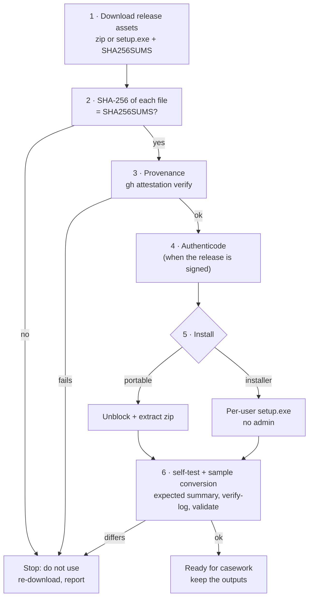

# Installation and verification (Windows 10/11)

RV RSMF runs **locally** on the examiner's Windows 10 or 11 PC (x64). It needs no administrator rights, no runtime
(static C runtime), no native library and no network, except for the optional RFC 3161 timestamp. This page
covers: getting a release, **proving it is the genuine build**, installing it (portable zip or per-user
installer), the first-run self-test and sample conversion, offline use, building from source for auditors, where
files live, and uninstalling.

Why verification matters: a court may ask how you know the program you ran is the one whose source an expert
reviewed. Steps 2–4 and 6 produce that answer; keep their output with the case file
([admissibility.md](admissibility.md#examiner-checklist-before-filing-a-report), step 3).



## Requirements

| Item | Requirement |
| --- | --- |
| Operating system | Windows 10 or 11, x64 (`MinVersion=10.0`, `ArchitecturesAllowed=x64compatible` in the installer). Linux/macOS: build from source. |
| Rights | Standard user. The installer is per-user (`PrivilegesRequired=lowest`). |
| Disk | The two executables and the docs (a few MB). Outputs: the `.rsmf` files are roughly the size of the export plus its packed media (base64 adds a third), plus ~11 report files per input file for one language. |
| Memory | Input files are hashed in 1 MiB chunks, but each export is parsed in memory and each RSMF file (with its attachments) is built in memory: allow a few times the size of the largest export or day of media. |
| Graphics | None required: the GUI also runs on VMs without a GPU driver (software rendering). |
| Network | None, except the optional timestamp request ([step 7](#7-offline-and-air-gapped-use)). |

## 1. Download

Release assets on the GitHub Releases page of the repository (`Panacota96/rv-rsmf`):

| Asset | What it is |
| --- | --- |
| `rv-rsmf-X.Y.Z-windows-x64.zip` | Portable: `rv-rsmf.exe`, `rv-rsmf-gui.exe`, README, LICENSE, NOTICE, CHANGELOG, `docs/`, `examples/` |
| `rv-rsmf-X.Y.Z-windows-x64-setup.exe` | Inno Setup installer, per-user |
| `SHA256SUMS` | SHA-256 of the zip, the installer and the SBOM (`sha256sum` format: `<hash>  ./<file>`) |
| `sbom.cdx.json` | CycloneDX software bill of materials (every Rust dependency and version) |

Put them in one folder, e.g. `C:\Rakvor\downloads\rv-rsmf-0.1.0\`.

## 2. Verify the download

```powershell
cd C:\Rakvor\downloads\rv-rsmf-0.1.0
Get-Content .\SHA256SUMS | ForEach-Object {
    $hash, $name = $_ -split '\s+', 2
    $name = $name.TrimStart('*').Replace('./', '')
    if (Test-Path $name) {
        $actual = (Get-FileHash -Algorithm SHA256 $name).Hash.ToLower()
        if ($actual -eq $hash) { "OK    $name" } else { "FAIL  $name  (got $actual)" }
    } else { "skip  $name (not downloaded)" }
}
```

Every downloaded file must print `OK`. One file at a time: `Get-FileHash .\rv-rsmf-0.1.0-windows-x64.zip -Algorithm
SHA256`. `SHA256SUMS` itself is produced by the same workflow; the attestation in step 3 is the stronger check.

## 3. Verify build provenance

Each zip and installer carries a GitHub build-provenance attestation (`actions/attest-build-provenance`): a signed
statement that this exact file was built by the repository's release workflow from a given commit. On a machine
with internet access and the GitHub CLI:

```powershell
gh attestation verify .\rv-rsmf-0.1.0-windows-x64.zip --repo Panacota96/rv-rsmf
gh attestation verify .\rv-rsmf-0.1.0-windows-x64-setup.exe --repo Panacota96/rv-rsmf
```

The output names the workflow (`.github/workflows/release.yml`) and the source commit; record both. For an
air-gapped lab, verify on a connected machine and carry the verified files on write-protected media.
`SHA256SUMS` and the SBOM are not attested themselves.

## 4. Verify the Authenticode signature (signed releases)

The release workflow signs `rv-rsmf.exe`, `rv-rsmf-gui.exe` and the installer **only when a code-signing certificate
is configured** for the repository (secrets `SIGN_PFX_BASE64`, `SIGN_PFX_PASSWORD`). Rakvor signs its tools with its
**internal** code-signing certificate ("Rakvor Code Signing (internal)", issued by "Rakvor Internal Code Signing
Root CA"). It is not a public certificate: Windows trusts it only on machines where the Rakvor root is installed —
Rakvor's own laptops, since the tool is used locally and not distributed. Auditors and customers verify releases
with steps 2–3 and can inspect the signature against the root's fingerprint below.

Install the root once per Rakvor machine (PowerShell as the user who runs the tool). The root file
`rakvor-code-signing-root.cer` is the same for every Rakvor tool; this repository does not carry a copy (the
rv-pdfauth repository has it at `packaging/signing/rakvor-code-signing-root.cer`), so obtain it from Rakvor's
internal tooling and check its fingerprint first:

```powershell
# It must be exactly:
#   SHA-256 DC9BA1A2FCD4F0633C5214B7CCEB25BED8F3F7D9EBAF111590250CBCAA83DF60
(New-Object System.Security.Cryptography.X509Certificates.X509Certificate2 .\rakvor-code-signing-root.cer).GetCertHashString([System.Security.Cryptography.HashAlgorithmName]::SHA256)
Import-Certificate -FilePath .\rakvor-code-signing-root.cer -CertStoreLocation Cert:\CurrentUser\Root
```

Windows shows a confirmation dialog for the new root; accept it only if the fingerprint matched. Then:

```powershell
Get-AuthenticodeSignature .\rv-rsmf-0.1.0-windows-x64-setup.exe |
    Format-List Status, StatusMessage, SignerCertificate, TimeStamperCertificate
# after extracting the zip:
Get-AuthenticodeSignature .\rv-rsmf.exe, .\rv-rsmf-gui.exe | Format-Table Status, Path
```

| Status | Meaning |
| --- | --- |
| `Valid` | Signed and intact; the signer must be "Rakvor Code Signing (internal)" |
| `UnknownError` | Signed, but the Rakvor root is not installed on this machine (install it as above) |
| `NotSigned` | The release was built without a signing certificate: rely on steps 2–3; SmartScreen will warn |
| `HashMismatch` / other | Stop: the file was altered after signing |

With the Windows SDK, `signtool verify /pa /v rv-rsmf.exe` shows the full chain. The release workflow of this
repository does **not** yet verify the signature against the Rakvor root after signing (rv-pdfauth's does); check it
here.

**SmartScreen.** SmartScreen judges a download by the reputation of a **publicly** trusted certificate. The internal
Rakvor root is not one, so "Windows protected your PC" (unknown publisher) can appear even when the signature is
`Valid`, and always when it is `NotSigned`. Only after steps 2–4 pass: remove the downloaded-file mark with
`Unblock-File .\<file>` (on the zip **before** extracting it), or choose *More info → Run anyway*. The warning goes
away for good only with a public certificate ([release-process.md](release-process.md#5-the-signing-certificate)).

## 5. Install

### 5a. Portable zip

```powershell
# only after steps 2–4
Unblock-File .\rv-rsmf-0.1.0-windows-x64.zip
Expand-Archive .\rv-rsmf-0.1.0-windows-x64.zip -DestinationPath C:\Rakvor\tools\rv-rsmf-0.1.0
cd C:\Rakvor\tools\rv-rsmf-0.1.0
.\rv-rsmf.exe --version
```

Keep one folder per version so a past case can be re-run with the exact version recorded in its `environment.json`
(the `.rsmf` files carry the version in `X-RSMF-Generator`, and a different version gives different bytes).

### 5b. Installer (per-user, no administrator)

Double-click `rv-rsmf-X.Y.Z-windows-x64-setup.exe` (English, Spanish or French wizard). It installs to
`%LOCALAPPDATA%\Programs\Rakvor\RV RSMF\`, creates a *Rakvor* Start-menu group (app + documentation), and offers
two tasks: **Add the rv-rsmf command to PATH** (user PATH, checked on first install) and a desktop icon. Open a
**new** terminal afterwards for PATH to apply. Unattended:

```powershell
.\rv-rsmf-0.1.0-windows-x64-setup.exe /VERYSILENT /SUPPRESSMSGBOXES /NORESTART /TASKS="addtopath"
```

The installer copies the executables, README, LICENSE, NOTICE, CHANGELOG, `docs\` and the sample evidence
(`examples\sample\evidence\` with its subfolders), not the sample scripts, `expected\` or `expected_hashes.csv`. Use the portable zip for the
sample check of step 6.

### 5c. Native libraries

None. Hashing, the WhatsApp/Telegram/Teams/CSV parsers, the compound-file (`.msg`) reader, the zip writer, the
JSON-schema validator, the time-zone database, the PDF writer, the RFC 3161 client and the CMS signer are compiled
in (Rust crates listed in the SBOM and in every `environment.json`), and the C runtime is linked statically
(`.cargo/config.toml`). There is no DLL to verify or to keep next to the executables.

## 6. First-run self-test and sample conversion

```powershell
rv-rsmf --version
rv-rsmf self-test
```

`self-test` prints `PASS` for md5, sha1, sha256, sha512, sha3-256 and blake3 (known answers for `"abc"`), exit code 0.
It tests the hash implementations only. Then convert the synthetic samples, which exercise every parser, the RSMF
writer and validator, the reports and the audit chain:

```powershell
# portable zip (script included): self-test, conversion, verify-log, validate, hashes.csv vs expected_hashes.csv
.\examples\sample\run.ps1 -Bin .\rv-rsmf.exe

# by hand (e.g. with the installed exe on the zip's sample folder), into a temporary folder
$samples = "C:\Rakvor\tools\rv-rsmf-0.1.0\examples\sample\evidence"
$out = Join-Path $env:TEMP "rv-rsmf-check"
rv-rsmf convert -i $samples -r --timezone Europe/Paris --date-order dmy `
    --hash sha256,md5 --out $out --progress none --no-timestamp
$LASTEXITCODE                                                         # 0
$run = (Get-ChildItem "$out\logs" | Select-Object -Last 1).Name
rv-rsmf verify-log "$out\logs\$run"                                   # OK … chain intact
rv-rsmf validate "$out\rsmf\$run"                                     # 17 × OK
```

Expected summary (measured on this commit):

```text
  items: 16  bytes: 99559  errors: 0
  findings: high 0, medium 10, low 2, info 24
  rsmf:   8 export(s), 10 conversation(s), 49 event(s), 17 file(s)
```

exit code 0, every file `OK` in `validate`. `run.ps1` / `run.sh` also compare the tool's `logs\<RUN-ID>\hashes.csv`
with `examples\sample\expected_hashes.csv` (computed independently with Python) and print
`hashes.csv matches expected_hashes.csv (16 files: size, SHA-256, MD5)`; any difference exits 3. A different summary
means a different version or modified samples: compare `environment.json` with the release notes. Keep the console
output and the run folder as the record of this verification.

## 7. Offline and air-gapped use

The **only** network access in the code is the RFC 3161 timestamp request (one HTTP POST of a 32-byte hash to the
TSA, [src/core/src/trust.rs](../src/core/src/trust.rs)). There is no telemetry, update check or licence check;
exports, messages and media never leave the machine. With `--intake hashinv`, rv-hashinv is started with the same
timestamp setting.

| To disable the timestamp | How |
| --- | --- |
| One CLI run | `--no-timestamp` |
| All CLI runs on this PC / session | `$env:RV_NO_TIMESTAMP = "1"` (or set it as a user environment variable) |
| GUI | untick the trusted-timestamp option before starting ([usage-gui.md](usage-gui.md)) |

An offline run with the timestamp enabled still completes: it logs `timestamp_pending` and the statistics report
shows a warning. Later, on a machine that can reach the TSA, run `rv-rsmf timestamp <log folder>` (it re-verifies
the chain, then appends `timestamp_obtained`). To use an internal or qualified TSA, pass `--tsa-url`
([admissibility.md](admissibility.md#53-eidas--regulation-eu-9102014-as-amended-by-eu-20241183)). The restriction
is not enforced by the OS; on a connected workstation, a Windows Firewall outbound rule for `rv-rsmf.exe` /
`rv-rsmf-gui.exe` allowing only the TSA host enforces it.

## 8. Build from source for auditors

### Toolchain

| Item | Version |
| --- | --- |
| Rust | Pinned by [rust-toolchain.toml](../rust-toolchain.toml): **1.97.0** with rustfmt and clippy; `rustup` installs and selects it automatically inside the source tree (CI and the release job do the same). `Cargo.toml` declares `rust-version = "1.88"` (edition 2024) for the core and CLI and `1.95` for the GUI (egui/eframe 0.37); no CI job checks these minimums. To match a release exactly, use the compiler recorded in that release's `environment.json` → `tool.rustc`. |
| Windows linker | Visual Studio 2022 Build Tools, workload *Desktop development with C++* (MSVC + Windows SDK); target `x86_64-pc-windows-msvc`. Static CRT is set in `.cargo/config.toml`. |
| Linux | No system packages needed to build the CLI. |
| Optional | Python 3.12 with `blake3 jsonschema pyhanko` for the oracles and the trust tests (`RV_TEST_PYTHON=python`). |

### Build

```powershell
git clone https://github.com/Panacota96/rv-rsmf.git
cd rv-rsmf
git checkout v0.1.0                       # the tag of the release under review
rustc --version                           # must print the pinned 1.97.0
cargo build --release --locked -p rv-rsmf-cli -p rv-rsmf-gui
.\target\release\rv-rsmf.exe self-test
.\examples\sample\run.ps1 -Bin .\target\release\rv-rsmf.exe
cargo test --workspace --locked            # unit + integration tests (trust tests skip without pyhanko)
```

```bash
# Linux
cargo build --release --locked -p rv-rsmf-cli
target/release/rv-rsmf self-test && examples/sample/run.sh target/release/rv-rsmf
# independent checks: the official schema at the pinned commit, Python email parser, digests vs the audit log
curl -sSfL -o rsmf_schema_2_0_0.json https://raw.githubusercontent.com/relativitydev/rsmf-validator-samples/c717cd322264b46115d27d034a6107c8c91043d8/RSMFManifestSchema/rsmf_schema_2_0_0.json
run=$(ls examples/sample/out/logs | tail -n 1)
python3 tests/oracle_rsmf.py examples/sample/out/rsmf/$run examples/sample/out/logs/$run/audit.jsonl rsmf_schema_2_0_0.json
python3 tests/run_samples.py target/release/rv-rsmf rsmf_schema_2_0_0.json /tmp/sample-check
python3 tests/verify_chain.py examples/sample/out/logs/$run
```

`--locked` refuses to build if `Cargo.lock` would change, so the dependency set equals the one listed in
`environment.json` → `dependencies` and in `sbom.cdx.json`. The product version comes from `version.txt`; the crate
versions in `Cargo.toml` stay fixed, so a release never changes the lock file.

### Reproducing the release hashes

| Artefact | Bit-identical to the release? | How to check |
| --- | --- | --- |
| `docs/`, `examples/` files | Yes (from git; LF line endings except `*.ps1`, `*.iss`; sample evidence is binary) | `git ls-files` + `Get-FileHash` against the extracted zip |
| `rv-rsmf.exe`, `rv-rsmf-gui.exe` | **Not guaranteed**: the compiler is pinned, but paths are not remapped and the PE header carries link-time data (gap G22) | Provenance attestation (step 3) binds the released binary to the workflow and commit; then compare behaviour (below) |
| zip, installer | No (archive timestamps) | Attestation (step 3) |
| `.rsmf` files produced by the same version with the same export and options | **Yes**, byte for byte ([theory.md B10](theory.md#b10-deterministic-writing)) | Compare SHA-256 |

**Functional equivalence** — convert the sample with the release binary and with your build (same options, same
`--case`, same `--hash` order); the `.rsmf` files must be identical:

```bash
python - "<release-out>/rsmf/<RUN-ID>" "<your-out>/rsmf/<RUN-ID>" <<'EOF'
import hashlib, pathlib, sys
def load(d):
    d = pathlib.Path(d)
    return {p.relative_to(d).as_posix(): hashlib.sha256(p.read_bytes()).hexdigest() for p in sorted(d.rglob("*.rsmf"))}
a, b = load(sys.argv[1]), load(sys.argv[2])
print("identical .rsmf files" if a == b else "DIFFERENT: " + ", ".join(k for k in a.keys() | b.keys() if a.get(k) != b.get(k)))
EOF
```

`X-RSMF-Generator` carries the version: two builds of the **same** version compare equal; different versions do not.

## 9. Where things live

| What | Location |
| --- | --- |
| Program (installer) | `%LOCALAPPDATA%\Programs\Rakvor\RV RSMF\` (`rv-rsmf.exe`, `rv-rsmf-gui.exe`, `docs\`, `examples\sample\evidence\`, `unins000.exe`) |
| Program (portable) | the folder you extracted |
| PATH entry (installer task) | user environment variable `Path` (`HKCU\Environment`) |
| Run outputs | `--out` (default `.\rakvor-out` **relative to the current folder**): `logs\<RUN-ID>\`, `reports\<RUN-ID>\`, `rsmf\<RUN-ID>\`. With `--case-dir`: `<CASE>\runs\rv-rsmf\<RUN-ID>\{logs,reports,rsmf}` |
| rv-hashinv (for `--intake hashinv`) | `--hashinv-exe`, `RV_HASHINV`, next to `rv-rsmf.exe`, `%LOCALAPPDATA%\Programs\Rakvor\RV HashInv\`, or `PATH` |
| GUI settings | not persisted: each start uses the defaults; every change made before a run is recorded in that run's audit log (`ui_*`) |
| Signing certificate | wherever you keep it; only its path, subject and SHA-256 fingerprint are logged, never the password |
| Local data, caches, temporary files | none |

## 10. Uninstall

- **Installer:** *Settings → Apps → Installed apps → RV RSMF → Uninstall*, or run
  `"%LOCALAPPDATA%\Programs\Rakvor\RV RSMF\unins000.exe"`. It removes the installed files and shortcuts. The user
  **PATH entry is not removed** in this version (the installer script has no uninstall step for it); remove it
  with:

  ```powershell
  $dir = "$env:LOCALAPPDATA\Programs\Rakvor\RV RSMF"
  $p = [Environment]::GetEnvironmentVariable("Path", "User").Split(";") | Where-Object { $_ -and $_ -ne $dir }
  [Environment]::SetEnvironmentVariable("Path", ($p -join ";"), "User")
  ```

- **Portable:** delete the folder.
- **Kept on purpose** (both cases): run outputs and case folders (case material). Keep the release zip and
  `SHA256SUMS` of every version used in a case, so it can be re-run.

## 11. Installation troubleshooting

| Symptom | Cause and fix |
| --- | --- |
| SmartScreen "Windows protected your PC" (unknown publisher) | Expected with the internal Rakvor certificate or an unsigned build ([step 4](#4-verify-the-authenticode-signature-signed-releases)). Only after steps 2–4 pass: `Unblock-File` or *More info → Run anyway*. |
| `Get-AuthenticodeSignature` says `UnknownError` | The Rakvor root is not installed on this PC (step 4) — or verify with `SHA256SUMS` and the attestation |
| `rv-rsmf` is not recognised | PATH task not selected, or the terminal was opened before installing: open a new terminal or use the full path |
| `self-test` prints `FAIL` | Do not use this build for evidence; re-download and repeat steps 2–4 |
| Sample summary differs from step 6 | Wrong version or modified sample files; compare `environment.json` with the release notes and the sample digests with `expected_hashes.csv` |
| GUI window blank or very slow on a VM | No GPU driver: software rendering is used; give the VM more CPU |
| Building from source downloads another compiler | Expected: rustup installs the pinned 1.97.0 from `rust-toolchain.toml`. Offline, install it beforehand (`rustup toolchain install 1.97.0 --profile minimal`) |
