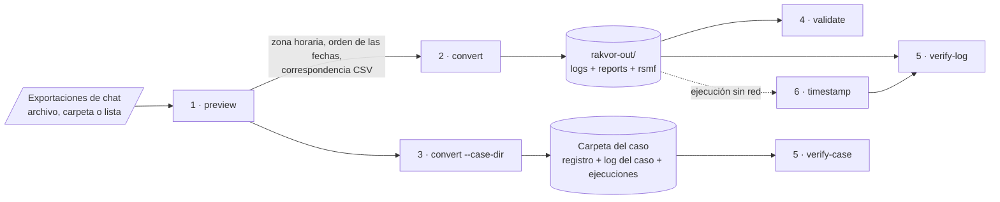
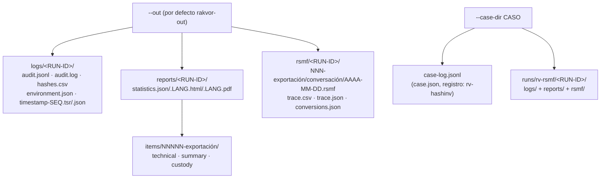

> La versión de referencia es la inglesa ([quick-guide.md](quick-guide.md)); esta traducción la sigue.

# Guía rápida

RV RSMF convierte exportaciones de chat (WhatsApp `.txt`/`.zip`, `result.json` de Telegram Desktop, archivos `.msg`
de Microsoft Teams de Purview y archivos CSV de herramientas forenses móviles) en archivos RSMF 2.0 para Relativity.
Lee cada exportación que se le entrega sin cambiarla, calcula el hash de cada archivo, convierte las horas locales a
UTC con la zona horaria que usted elige, escribe un `.rsmf` por conversación y por día, comprueba cada archivo contra
el esquema oficial RSMF 2.0 y reglas más estrictas, lo relee y escribe `trace.csv`, que lleva de cada mensaje a su
línea o id en la exportación. Escribe informes para el perito y para el cliente, y registra cada acción en un log de
auditoría encadenado por hashes. Sus hallazgos son **señales, no veredictos**: cada uno dice lo que muestra y lo que
no demuestra. La herramienta convierte, no autentica: una exportación es un archivo editable, el RSMF muestra lo que
contiene la exportación (no el teléfono), y los mensajes borrados o los archivos multimedia que no están en la
exportación no se recuperan. Esta página cubre las seis tareas habituales. La guía completa es
[usage.es.md](usage.es.md), y cada opción está en [usage-cli.md](usage-cli.md) (en inglés).



## Dos formas de usarla

| Modo | Programa | Cuándo usarlo |
| --- | --- | --- |
| Aplicación de escritorio (GUI) | `rv-rsmf-gui.exe` (menú Inicio: *RV RSMF*) | Windows 10/11. Agrega las exportaciones, indica cómo se leen, pulsa **Vista previa** para comprobar las fechas y luego **Iniciar revisión**. |
| Línea de comandos (CLI) | `rv-rsmf.exe` | Scripts, lotes, revisar primero una exportación (`preview`), comprobar cualquier archivo `.rsmf` (`validate`) y los comandos de verificación (`verify-log`, `verify-case`, `timestamp`). |

Las dos usan el mismo motor. Con las mismas exportaciones y opciones escriben los mismos archivos `.rsmf` (byte a
byte), los mismos hashes y los mismos hallazgos.

## Aplicación de escritorio: qué hace cada botón

No se escribe nada en el disco hasta que pulsa **Iniciar revisión**. Cada cambio que haga antes se guarda en memoria
y se escribe en el log de auditoría de la ejecución como una entrada `ui_*` cuando la ejecución empieza.

| Botón o casilla | Qué hace | Qué escribe |
| --- | --- | --- |
| **Agregar archivos…** | Abre el selector de archivos de Windows y agrega los archivos elegidos a la lista de evidencia. | `ui_input_added` (una por archivo) |
| **Agregar carpeta…** | Agrega una carpeta completa (indique la carpeta de la exportación, para que sus archivos multimedia vengan con ella). | `ui_input_added` |
| **Agregar ruta** | Agrega la ruta escrita en el cuadro de al lado (pulsar Enter hace lo mismo). | `ui_input_added` |
| Arrastrar y soltar | Los archivos o carpetas soltados en la ventana se agregan a la lista de evidencia, como con **Agregar archivos…**. | `ui_input_added` |
| **x** (junto a una entrada) | Quita esa entrada de la lista de evidencia. | `ui_input_removed` |
| **Incluir subcarpetas** | Activada por defecto: las carpetas se leen con sus subcarpetas. | `ui_recursive_changed` |
| **Examinar…** junto a **Carpeta del caso** | Elige la carpeta compartida del caso. La carpeta de salida pasa a ser `<case>/runs/rv-rsmf/<RUN-ID>` y ya no se puede editar. | `ui_case_dir_changed` |
| **Registrar primero la evidencia con RV HashInv** | Aparece cuando hay una carpeta del caso. Ejecuta rv-hashinv sobre la misma evidencia antes de la conversión, para que el caso tenga su registro de evidencias (Tarea 3). La línea de al lado muestra la versión de rv-hashinv encontrada o, en rojo, por qué no se puede usar ninguna. | `ui_intake_changed` |
| **Origen** (Exportación de chat) | *Detectar automáticamente* (por defecto), o fuerza el lector: WhatsApp, Telegram Desktop, Microsoft Teams (.msg) o CSV. | `ui_source_changed` |
| **Zona horaria del dispositivo** (Exportación de chat) | El nombre IANA de la zona que usaba el teléfono (`Europe/Paris`), escrito o elegido en **Zonas habituales**. Obligatoria para las exportaciones de WhatsApp y CSV. Un nombre desconocido se muestra en rojo y se rechaza. | `ui_timezone_changed` (`ui_timezone_rejected` para un nombre desconocido) |
| **Orden de las fechas** (Exportación de chat) | *Detectar en el archivo* (por defecto), o día/mes/año, mes/día/año, año/mes/día. Obligatorio cuando todas las fechas de la exportación pueden leerse de las dos maneras. | `ui_date_order_changed` |
| **Custodio (propietario del dispositivo)** (Exportación de chat) | El nombre o el número del propietario tal como lo escribe la exportación, escrito o elegido en **Participantes encontrados** (lo llena la vista previa). | `ui_custodian_changed` |
| **Perfil CSV** y **Archivo de correspondencia CSV (.toml)** con **Examinar…** (Exportación de chat) | Aparecen cuando una entrada es un archivo CSV: el perfil de columnas integrado, o su propia correspondencia TOML, que lo sustituye. | `ui_csv_profile_changed`, `ui_csv_map_changed` |
| **Nombre de la plataforma** (Exportación de chat) | El nombre de la plataforma que muestra Relativity (por defecto WhatsApp, Telegram, Microsoft Teams o Mobile export). | `ui_platform_name_changed` |
| **Vista previa** | Lee las exportaciones con estos ajustes sin escribir nada, y muestra los primeros mensajes con la hora tal como está escrita junto a la hora UTC. Un ajuste que la exportación necesita aparece enmarcado en ámbar y marcado como *obligatorio*. | `ui_preview_run` (se escribe con la ejecución) |
| Casillas de los algoritmos de hash (md5 … blake3) | Uno o dos algoritmos (por defecto sha256). Con dos marcados, los demás se desactivan. | `ui_hash_selection_changed` |
| **Idioma de los informes** | English, Español, Français o los tres. | `ui_language_changed` |
| **Examinar…** junto a **Carpeta de salida** | Elige dónde se escriben `logs/`, `reports/` y `rsmf/` (por defecto `rakvor-out`). | Nada hasta la ejecución: la carpeta usada se registra en `environment.json` |
| **Perito** e **ID del caso** (campos de texto) | El nombre del perito (por defecto, su usuario de Windows) y una referencia de caso opcional. | Nada hasta la ejecución: el perito se escribe en cada entrada de auditoría y en cada informe, el ID del caso en los informes |
| **Formato de custodia** | Colombia (Fiscalía) o Francia (scellés); siempre se agrega una copia en inglés. | `ui_jurisdiction_changed` |
| **Sello de tiempo confiable** (casilla y dirección) | Activado por defecto. Pide a la autoridad RFC 3161 de esa dirección un sello de tiempo para el log de auditoría. | `ui_timestamp_changed` |
| **Examinar…** junto a **Certificado de firma (.p12/.pfx)** | Elige su certificado. Cada informe PDF se firma entonces con él. Escriba la **Contraseña del certificado** en el campo de debajo. La contraseña solo se guarda en memoria y nunca se registra. | `ui_signing_certificate_changed` (solo la ruta) |
| **Iniciar revisión** | Inicia la ejecución con los ajustes mostrados. Si no se hizo una vista previa con los ajustes actuales, primero lee las exportaciones como **Vista previa**; se niega a iniciar mientras falte una decisión. | `ui_start_clicked` (después de `ui_preview_run` cuando hizo la vista previa) y luego toda la ejecución (ver [Dónde van las salidas](#dónde-van-las-salidas)) |
| **Cancelar** | Se detiene tras el bloque, la exportación o el archivo en curso y escribe informes parciales. | `item_cancelled`, `run_cancelled` |
| **Abrir informe** | Abre el informe de estadísticas (`statistics.<LANG>.html`) de la ejecución terminada. | Nada |
| **Abrir carpeta de logs** | Abre la carpeta de logs de la ejecución. | Nada |
| **Abrir carpeta RSMF** | Abre la carpeta de los archivos `.rsmf` y de `trace.csv` de la ejecución. | Nada |
| **Abrir informe de hashes** | Tras una ejecución con **Registrar primero la evidencia con RV HashInv**: abre el informe de estadísticas de rv-hashinv. | Nada |
| **ID de evidencia** (panel de resultado) | Tras una ejecución en una carpeta del caso, lista el ID de evidencia de cada elemento (E0001…) y su control contra el registro. Solo lectura. | Nada |
| **Advertencias** (panel de resultado) | Lista los errores encontrados durante la ejecución. Solo lectura. | Nada aquí: la ejecución registra cada error como `item_error` |

El sello de tiempo solo es cualificado en el sentido de eIDAS si la dirección de la TSA es la de un prestador
cualificado de servicios de confianza (QTSP) inscrito en una lista de confianza de la UE; la dirección por defecto
(DigiCert) no lo es.

El selector **Idioma de la interfaz** (arriba a la derecha) cambia todas las etiquetas a la vez y se registra como
`ui_interface_language_changed`. Cuando RV Hub abre la aplicación sobre una carpeta del caso, el log empieza con
`ui_case_dir_from_launcher`.

## Tarea 1: Revisar una exportación antes de convertirla

1. Ejecute `preview` sobre la exportación. Lee la exportación exactamente como lo haría `convert`, y no escribe ni
   registra nada:

   ```powershell
   rv-rsmf preview -i evidence\whatsapp-ambiguous.txt --timezone Europe/Madrid
   ```

2. Lea la respuesta. Cuando la exportación no decide la zona horaria, el orden de las fechas o las columnas CSV,
   `preview` se detiene con el código de salida 2 y dice qué decisión le corresponde a usted. Aquí todos los días y
   meses de la muestra son 12 o menos (`preview` imprime la ruta completa de la exportación; abajo, la carpeta desde
   la que se ejecutaron los comandos se abrevia como `…`):

   ```text
   error: …\evidence\whatsapp-ambiguous.txt: the day/month order of the dates cannot be decided from the file (possible: dmy, mdy); give --date-order. Lines: line 1: 03/04/26, 9:05 AM - Carla Méndez: Buenos días | line 3: 05/04/26, 1:30 PM - Carla Méndez: Yes: 10 AM at the office
   ```

3. Decida a partir de la configuración de idioma y región del teléfono, del contenido ("see you on 05/06?") o de otro
   registro de la misma conversación, y vuelva a hacer la vista previa con su elección:

   ```powershell
   rv-rsmf preview -i evidence\whatsapp-ambiguous.txt --timezone Europe/Madrid --date-order dmy
   ```

   ```text
   …\evidence\whatsapp-ambiguous.txt [whatsapp]
     chat_file: whatsapp-ambiguous.txt
     date_order: dmy
     date_order_basis: examiner choice (--date-order): every day and month is 12 or less
     date_order_option: dmy
     date_order_option_used: yes
     lines_read: 4
     timezone: Europe/Madrid
     variant: android
     conversations: 1  participants: 2  events: 4
     finding: DATE_ORDER_CHOSEN (info)
     as written             UTC                    from                 text
     03/04/26, 9:05 AM      2026-04-03T07:05:00Z   Carla Méndez         Buenos días
     03/04/26, 9:06 AM      2026-04-03T07:06:00Z   Diego Torres         Hi Carla, see you on 05/06?
     05/04/26, 12:00 AM     2026-04-04T22:00:00Z   Diego Torres         Midnight test
     05/04/26, 1:30 PM      2026-04-05T11:30:00Z   Carla Méndez         Yes: 10 AM at the office
   ```

4. Compare algunas líneas con la exportación y con lo que dice el custodio. Luego use las mismas opciones con
   `convert` (Tarea 2).

**Qué escribe:** nada. Solo lee.

**Cómo leer el resultado:** el código de salida 0 significa que cada exportación se puede convertir con estas
opciones; 1, que una exportación no se puede leer (o que no se encontró ninguna exportación de chat); 2, que hace falta
una decisión. La columna `as written` es la hora en la exportación; `UTC`, la hora tras la conversión con su zona
horaria. Indique la zona del **teléfono**, con su nombre IANA, no un desfase fijo como `UTC+1` (no tiene en cuenta el
horario de verano).

Opciones de la vista previa (`convert` acepta las mismas opciones de chat):

| Opción | Qué fija |
| --- | --- |
| `--input` (`-i`) | Un archivo o una carpeta de exportación. Repítala para varios. |
| `--recursive` (`-r`) | Buscar también en las subcarpetas. |
| `--limit` | Mensajes mostrados por exportación (por defecto 20). |
| `--json` | Un objeto JSON por exportación, para scripts. |
| `--source` | Fuerza el lector: whatsapp, telegram, teams-msg o csv (para un archivo renombrado). |
| `--timezone` (`-z`) | La zona horaria IANA del dispositivo. Obligatoria para las exportaciones de WhatsApp y CSV. |
| `--date-order` | dmy, mdy o ymd, cuando todas las fechas pueden leerse de las dos maneras. |
| `--custodian` | El propietario del dispositivo tal como lo nombra la exportación: custodio RSMF, y autor de los mensajes escritos como "You"/"Tú"/"Vous". |
| `--csv-map` | Su correspondencia de columnas TOML para un archivo CSV. |
| `--csv-profile` | Perfil CSV integrado: generic (por defecto), xry-draft o cellebrite-draft (borradores, aún no cotejados con exportaciones reales). |
| `--platform-name` | El nombre de la plataforma que muestra Relativity. |

## Tarea 2: Convertir exportaciones

1. Compruebe la compilación una vez en este PC: `rv-rsmf self-test` debe imprimir `PASS` para cada algoritmo (código
   de salida 0).
2. Ejecute la conversión sobre una copia verificada de las exportaciones, nunca sobre la única copia. Indique la
   carpeta de la exportación con `-r`, para que sus archivos multimedia vengan con ella. Quite `--no-timestamp` cuando
   el PC pueda llegar a la TSA: la ejecución obtiene entonces también el sello de tiempo (`timestamp: ok …`).

   ```powershell
   rv-rsmf convert -i evidence -r --timezone Europe/Paris --date-order dmy --hash sha256,md5 --lang es --case CASE-2026-014 --actor "Ana Ruiz" --no-timestamp
   ```

3. Lea el resumen. Sobre una copia de las exportaciones de muestra (`examples\sample\evidence`, 8 exportaciones en 16
   archivos) en `evidence`, sin red (`--no-timestamp`), el comando anterior imprime:

   ```text
   DONE  run 20261126T211547Z-357716
     items: 16  bytes: 99559  errors: 0  elapsed: 0.7 s
     findings: high 0, medium 10, low 2, info 24
     timestamp: off
     report: rakvor-out\reports\20261126T211547Z-357716\statistics.es.html
     logs:   rakvor-out\logs\20261126T211547Z-357716
     rsmf:   8 export(s), 10 conversation(s), 49 event(s), 17 file(s) -> rakvor-out\rsmf\20261126T211547Z-357716
   ```

4. Abra el archivo de `report:`. Luego, para cada exportación, abra `technical.<LANG>.html` (para el perito) o
   `summary.<LANG>.html` (para el cliente), y coteje algunos mensajes con la exportación mediante `trace.csv` (en la
   carpeta de `rsmf:`). Cargue los archivos `.rsmf` en Relativity.

**Qué escribe:** `rakvor-out/logs/<RUN-ID>/` (log de auditoría, `hashes.csv`, `environment.json`),
`rakvor-out/reports/<RUN-ID>/` (informe de estadísticas y, por exportación, una revisión técnica, un resumen y un
formato de custodia) y `rakvor-out/rsmf/<RUN-ID>/` (los archivos `.rsmf`, `trace.csv`, `trace.json`,
`conversions.json`).

**Cómo leer el resultado:** `DONE` con código de salida 0 significa que no hay hallazgos de severidad alta.
`DONE (high-severity findings)` con código de salida 3 significa que una exportación no se pudo leer (`PARSER_FAILED`)
o que un archivo RSMF no pasó la validación o la relectura: no cargue ese archivo. El código de salida 2 antes de
escribir nada significa que falta una decisión (Tarea 1). Cada hallazgo dice lo que muestra y lo que no demuestra;
[usage.es.md](usage.es.md#4-interpretar-cada-hallazgo) indica qué comprobar después para cada código.
`timestamp: pending` significa que no se pudo llegar a la autoridad (ver Tarea 6). `--progress jsonl` imprime un
evento JSON por línea para scripts; **Ctrl+C** detiene la ejecución y escribe informes parciales (código de salida
130).

Opciones de la conversión:

| Opción | Qué fija |
| --- | --- |
| `--input` (`-i`) | Un archivo o una carpeta que convertir. Repítala para varios. |
| `--input-list` (`-L`) | Un archivo de texto con una ruta por línea. |
| `--recursive` (`-r`) | Leer también las subcarpetas. |
| `--hash` (`-H`) | Uno o dos de md5, sha1, sha256, sha512, sha3-256, blake3 (por defecto sha256). |
| `--out` (`-o`) | Carpeta de salida (por defecto `rakvor-out`). |
| `--lang` (`-l`) | Idioma de los informes: en, es, fr o all. |
| `--actor` (`-a`) | Nombre del perito en el log de auditoría y en los informes. |
| `--case` (`-c`) | Identificador del caso impreso en los informes. |
| `--progress` (`-p`) | bar, jsonl (un evento JSON por línea) o none. |
| `--jurisdiction` (`-j`) | Formato de custodia: co (Colombia) o fr (Francia). |
| `--tsa-url` | Autoridad RFC 3161 (por defecto `http://timestamp.digicert.com`). |
| `--no-timestamp` | Sin solicitud de sello de tiempo (laboratorios sin red). |
| `--sign-cert` | Su certificado `.p12`/`.pfx`: cada informe PDF se firma con él. |
| `--sign-pass-env` | La variable de entorno que contiene su contraseña (por defecto `RV_SIGN_PASSWORD`). |
| `--source`, `--timezone` (`-z`), `--date-order`, `--custodian`, `--csv-map`, `--csv-profile`, `--platform-name` | Cómo se leen las exportaciones (Tarea 1). |
| `--case-dir` | La carpeta compartida del caso (Tarea 3). |
| `--evidence` (`-E`) | ID de evidencia registrados que convertir (Tarea 3). |
| `--intake` | hashinv: registrar primero la evidencia con rv-hashinv (Tarea 3). |
| `--hashinv-exe` | El programa rv-hashinv que se usa con `--intake hashinv` (Tarea 3). |

## Tarea 3: Convertir exportaciones en una carpeta del caso

1. Elija una carpeta para el caso, en el volumen del caso, por ejemplo `cases\CASE-2026-014`. En la carpeta del caso,
   rv-rsmf es una herramienta de análisis: verifica cada archivo contra el registro de evidencias que escribe la
   herramienta de recepción, rv-hashinv. Nunca escribe el registro.
2. Registre y convierta en un solo paso: `--intake hashinv` ejecuta primero rv-hashinv sobre la misma evidencia (crea
   el caso, así que indique `--case` y `--jurisdiction`). rv-hashinv se busca en `--hashinv-exe`, `RV_HASHINV`, junto
   a rv-rsmf, en la carpeta de instalación de RV HashInv y luego en el `PATH`. Si el caso ya se registró antes, quite
   `--intake hashinv`.

   ```powershell
   rv-rsmf convert -i evidence -r --case-dir cases\CASE-2026-014 --case CASE-2026-014 --jurisdiction co --timezone Europe/Paris --date-order dmy --intake hashinv --no-timestamp
   ```

3. Lea la última línea del resumen:

   ```text
     case:   CASE-2026-014 (analysis) registered 0 (new 0), verified 16, mismatched 0, not in registry 0
   ```

4. Más adelante, para volver a convertir algunos elementos registrados, indique sus ID (aquí el archivo CSV y su
   correspondencia):

   ```powershell
   rv-rsmf convert --case-dir cases\CASE-2026-014 --evidence E0001,E0002 --timezone Europe/Madrid --no-timestamp
   ```

**Qué escribe:** la ejecución en `runs/rv-rsmf/<RUN-ID>/logs`, `/reports` y `/rsmf`, y sus entradas `run_started` y
`run_finished` en `case-log.jsonl` (con `--intake hashinv`, rv-hashinv escribe además `case.json`, el registro
`evidence/registry.json` y `.csv` y su propia ejecución en `runs/rv-hashinv/`).

**Cómo leer el resultado:** `verified` cuenta los archivos cuyos hashes coinciden con el registro. Un archivo que
difiere del registro recibe el hallazgo alto `EVIDENCE_HASH_MISMATCH_WITH_CASE` (se convierte igualmente); un archivo
que no está en el registro recibe `EVIDENCE_NOT_IN_CASE_REGISTRY` (medio). El código de salida 3 antes de leer nada
significa que la carpeta del caso no pasó la verificación: no se escribió nada en ella (ejecute la Tarea 5). El código
de salida 2 significa un error de uso o una decisión que falta, por ejemplo una carpeta que pertenece a otro caso o un
ID de evidencia desconocido. Con `--evidence`, o sin `-i`, una decisión que falta se detecta durante la ejecución
(`PARSER_FAILED`) y no antes: haga primero la vista previa.

## Tarea 4: Validar archivos RSMF

1. Ejecute `validate` sobre la carpeta `rsmf` de una ejecución (se recorre de forma recursiva), o sobre cualquier
   archivo `.rsmf`, nuestro o de otra herramienta:

   ```powershell
   rv-rsmf validate rakvor-out\rsmf\20261126T211547Z-357716
   ```

2. Lea la salida: una línea por archivo (se muestran las primeras; la ejecución de la Tarea 2 tiene 17 archivos):

   ```text
   OK       rakvor-out\rsmf\20261126T211547Z-357716\001-generic-csv-000001\Grupo-obra-aae949\2026-10-24.rsmf  (1 events, 0 attachments)
   OK       rakvor-out\rsmf\20261126T211547Z-357716\001-generic-csv-000001\Grupo-obra-aae949\2026-10-25.rsmf  (2 events, 1 attachments)
   OK       rakvor-out\rsmf\20261126T211547Z-357716\002-xry-like-csv-000004\chat-001-1ad5d4\2026-03-14.rsmf  (3 events, 0 attachments)
   ```

3. Vuelva a ejecutarlo sobre la copia que entrega, después de cada transferencia.

**Qué escribe:** nada. Solo lee.

**Cómo leer el resultado:** `OK` (código de salida 0 cuando todos los archivos lo están) significa que el archivo pasa
el esquema oficial RSMF 2.0 y las comprobaciones estrictas (claves desconocidas, referencias, horas UTC, conteos,
presencia de cada adjunto). `INVALID` (código de salida 3) va seguido de una línea por problema (`schema: …`,
`strict: …`). `ERROR` (código de salida 1) significa que un archivo no se pudo leer (no es un mensaje RSMF, no tiene
`rsmf.zip`). No muestra cómo presenta el archivo una versión concreta de Relativity.

## Tarea 5: Verificar una ejecución y un caso

1. Indique a `verify-log` la carpeta de logs de la ejecución (o el `audit.jsonl` que contiene):

   ```powershell
   rv-rsmf verify-log rakvor-out\logs\20261126T211547Z-357716
   ```

2. Lea la salida:

   ```text
   OK  131 entries, chain intact: rakvor-out\logs\20261126T211547Z-357716\audit.jsonl
       truncation not detectable without a timestamp or case record
       outputs: 201 verified of 201 recorded (md5, sha256)
   ```

3. Si la ejecución tiene sello de tiempo, agregue `--tsa-ca <raíces de la TSA.pem>` para comprobar también la cadena
   de certificados de la TSA contra los certificados raíz de la propia TSA.
4. Para una carpeta del caso, ejecute `verify-case` sobre la carpeta que contiene `case.json`; `--rehash` vuelve a
   leer además cada elemento registrado:

   ```powershell
   rv-rsmf verify-case cases\CASE-2026-014 --rehash
   ```

   Después de la Tarea 3 (la ejecución de recepción de rv-hashinv y las dos ejecuciones de rv-rsmf):

   ```text
   OK  case CASE-2026-014: 8 case-log entries, 16 registered items, 3 runs verified: cases\CASE-2026-014
       outputs: 414 verified of 414 recorded by the runs' audit logs
       re-hashed 16 of 16 registered items: 16 match the registry
   ```

**Qué escribe:** nada. Los dos comandos solo leen.

**Cómo leer el resultado:** `OK` (código de salida 0) de `verify-log` significa que ninguna entrada se editó, borró ni
reordenó, que cada token de sello de tiempo coincide, y que cada archivo `.rsmf`, cada traza, cada informe,
`hashes.csv` y `environment.json` conservan el hash que registró el log. La línea `truncation` dice qué ancla el final
del log: una ejecución sin sello de tiempo y fuera de una carpeta del caso no puede demostrar que no se quitó ninguna
entrada de su final. `OK` de `verify-case` significa que el log del caso, el registro, el log de auditoría de cada
ejecución (de cada herramienta Rakvor) y las salidas registradas de las ejecuciones están intactos. `BROKEN` (código
de salida 3) lista un problema por línea. El código de salida 1 significa que el log o el archivo `--tsa-ca` no se
pueden leer, o que la carpeta no es una carpeta de caso (no tiene `case.json`). La revocación del certificado de la TSA
nunca se comprueba.

## Tarea 6: Agregar el sello de tiempo después de trabajar sin red

1. Sin red, ejecute la conversión como de costumbre, o con `--no-timestamp` (o `RV_NO_TIMESTAMP=1`) para que no se
   envíe ninguna solicitud. Sin `--no-timestamp`, el resumen muestra `timestamp: pending`.

   ```powershell
   rv-rsmf convert -i evidence\telegram -r -o offline --no-timestamp
   ```

2. Cuando vuelva la red, agregue el sello de tiempo a la carpeta de logs de la ejecución:

   ```powershell
   rv-rsmf timestamp offline\logs\20261126T211626Z-5dc7c2
   ```

3. Lea el resultado: `OK  timestamp 2026-11-26T21:16:34Z by http://timestamp.digicert.com covers entry #31`. Use
   `--tsa-url` para elegir otra autoridad y `--actor` para nombrar al perito en la nueva entrada de auditoría.
4. Haga la Tarea 5 sobre la misma carpeta. Ahora muestra la línea del sello de tiempo y `TSA signature valid`:

   ```text
   OK  32 entries, chain intact: offline\logs\20261126T211626Z-5dc7c2\audit.jsonl
       timestamp 2026-11-26T21:16:34Z by http://timestamp.digicert.com covers entry #31: TSA signature valid (signer: CN=DigiCert SHA256 RSA4096 Timestamp Responder 2026 1,O=DigiCert\, Inc.,C=US); chain not checked (pass --tsa-ca <CA bundle> to validate it)
       truncation: entries up to #31 are anchored by the RFC 3161 timestamp (timestamp-00031.json); 1 entry after it (timestamp_obtained) cannot be proven complete
       outputs: 43 verified of 44 recorded (sha256), 1 skipped
       not re-hashed: logs/timestamp-00031.tsr (RFC 3161 token: checked by the timestamp verification)
   ```

**Qué escribe:** `timestamp-<SEQ>.tsr` (el token RFC 3161) y `timestamp-<SEQ>.json` en la carpeta de logs, y la
entrada `timestamp_obtained` en `audit.jsonl`.

**Cómo leer el resultado:** el código de salida 0 significa que el sello de tiempo se obtuvo y se registró. El código
de salida 1 significa que no se pudo llegar a la autoridad; nada cambió, así que vuelva a intentarlo más tarde. El
código de salida 3 significa que el log falta o está roto; no se agrega ningún sello de tiempo a un log roto. El sello
de tiempo demuestra cuándo existía el log, no que la exportación sea auténtica.

## Otros comandos

| Comando | Qué hace |
| --- | --- |
| `rv-rsmf self-test` | Comprueba cada algoritmo de hash contra valores de prueba publicados. |
| `rv-rsmf update-check` | Indica si hay publicada una versión más reciente. Solo avisa: no se descarga nada. `RV_NO_UPDATE_CHECK=1` lo desactiva. |
| `rv-rsmf describe --json` | Imprime la descripción de la herramienta para RV Hub. No lee ni escribe nada. |

## Códigos de salida

| Código | Significado | Lo devuelve |
| --- | --- | --- |
| 0 | Terminado; ningún hallazgo de severidad alta (`preview`: cada exportación se puede convertir; comandos de verificación: todo lo comprobado está intacto). | todos los comandos |
| 1 | Error de ejecución: entrada inexistente, salida no escribible, log del caso bloqueado, contraseña del certificado incorrecta, rv-hashinv no encontrado o fallido, una exportación o un archivo `.rsmf` que no se puede leer, TSA inaccesible (solo `timestamp`; `convert` muestra `timestamp: pending` y continúa), carpeta que no es de caso, self-test fallido, o una comprobación de versiones que no se pudo hacer. | `convert`, `preview`, `validate`, `verify-log`, `verify-case`, `timestamp`, `self-test`, `update-check` |
| 2 | Error de uso (opción desconocida, valor incorrecto, más de dos algoritmos, carpeta de otro caso, ID de evidencia desconocido), o una decisión que solo el perito puede tomar: `--timezone`, `--date-order` o una correspondencia CSV. | todos los comandos (opción desconocida); `convert`, `preview` |
| 3 | Al menos un hallazgo de severidad alta, un archivo RSMF no válido, un log roto, una verificación del caso fallida o (para `update-check`) una versión más reciente. | `convert`, `validate`, `verify-log`, `verify-case`, `timestamp`, `update-check` |
| 130 | Cancelado con Ctrl+C: se escriben informes parciales y la cancelación consta en el log de auditoría. | `convert` |

## Dónde van las salidas



Sin `--case-dir`, cada ejecución crea `logs/<RUN-ID>/`, `reports/<RUN-ID>/` y `rsmf/<RUN-ID>/` dentro de `--out` (por
defecto `.\rakvor-out`, relativo a la carpeta actual). Con `--case-dir`, van a `<CASE>/runs/rv-rsmf/<RUN-ID>/`.
Conserve la carpeta de logs con los informes y los archivos `.rsmf`: es la prueba de lo que se hizo.
