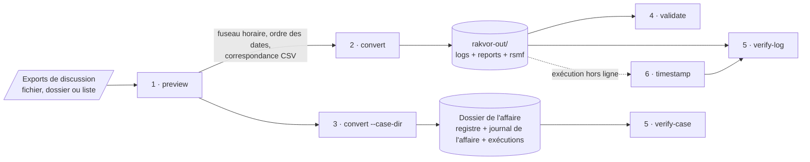
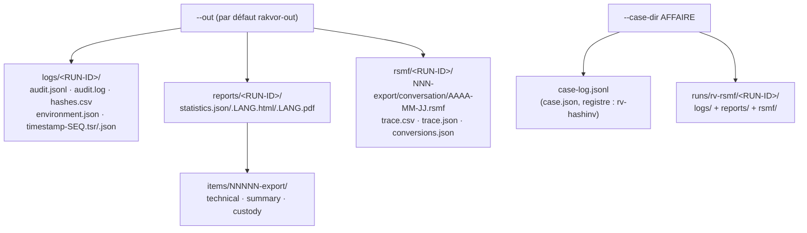

> La version de référence est la version anglaise ([quick-guide.md](quick-guide.md)) ; cette traduction la suit.

# Guide rapide

RV RSMF convertit des exports de discussion (WhatsApp `.txt`/`.zip`, `result.json` de Telegram Desktop, fichiers
`.msg` de Microsoft Teams issus de Purview, et fichiers CSV d'outils d'extraction mobile) en fichiers RSMF 2.0 pour
Relativity. Il lit chaque export que vous lui donnez sans le modifier, calcule l'empreinte de chaque fichier, convertit
les heures locales en UTC avec le fuseau horaire que vous choisissez, écrit un `.rsmf` par conversation et par jour,
contrôle chaque fichier avec le schéma officiel RSMF 2.0 et des règles plus strictes, le relit, et écrit `trace.csv`,
qui ramène chaque message à sa ligne ou à son identifiant dans l'export. Il écrit des rapports pour l'expert et pour le
client, et consigne chaque action dans un journal d'audit chaîné par empreintes. Ses constatations sont des
**signaux, pas des verdicts** : chacune dit ce qu'elle montre et ce qu'elle ne prouve pas. L'outil convertit, il n'authentifie
pas : un export est un fichier modifiable, le RSMF montre ce que contient l'export (pas le téléphone), et les messages
supprimés ou les médias absents de l'export ne sont pas récupérés. Cette page couvre les six tâches courantes. Le guide
complet est [usage.fr.md](usage.fr.md), et chaque option figure dans [usage-cli.md](usage-cli.md) (en anglais).



## Deux façons de l'utiliser

| Mode | Programme | Quand l'utiliser |
| --- | --- | --- |
| Application de bureau (GUI) | `rv-rsmf-gui.exe` (menu Démarrer : *RV RSMF*) | Windows 10/11. Vous ajoutez les exports, réglez leur lecture, appuyez sur **Aperçu** pour contrôler les dates, puis sur **Lancer l'analyse**. |
| Ligne de commande (CLI) | `rv-rsmf.exe` | Scripts, lots, examen préalable d'un export (`preview`), contrôle de n'importe quel fichier `.rsmf` (`validate`) et les commandes de vérification (`verify-log`, `verify-case`, `timestamp`). |

Les deux utilisent le même moteur. Avec les mêmes exports et les mêmes options, elles écrivent les mêmes fichiers
`.rsmf` (octet pour octet), les mêmes empreintes et les mêmes constatations.

## Application de bureau : ce que fait chaque bouton

Rien n'est écrit sur le disque avant que vous appuyiez sur **Lancer l'analyse**. Chaque changement fait avant est
gardé en mémoire, puis écrit dans le journal d'audit de l'exécution comme une entrée `ui_*` quand l'exécution démarre.

| Bouton ou case | Ce qu'il fait | Ce qu'il écrit |
| --- | --- | --- |
| **Ajouter des fichiers…** | Ouvre le sélecteur de fichiers de Windows et ajoute les fichiers choisis à la liste des éléments. | `ui_input_added` (une par fichier) |
| **Ajouter un dossier…** | Ajoute un dossier entier (donnez le dossier de l'export, pour que ses médias l'accompagnent). | `ui_input_added` |
| **Ajouter le chemin** | Ajoute le chemin saisi dans la zone voisine (la touche Entrée fait de même). | `ui_input_added` |
| Glisser-déposer | Les fichiers ou dossiers déposés sur la fenêtre sont ajoutés à la liste des éléments, comme avec **Ajouter des fichiers…**. | `ui_input_added` |
| **x** (à côté d'une entrée) | Retire cette entrée de la liste des éléments. | `ui_input_removed` |
| **Inclure les sous-dossiers** | Coché par défaut : les dossiers sont lus avec leurs sous-dossiers. | `ui_recursive_changed` |
| **Parcourir…** à côté de **Dossier de l'affaire** | Choisit le dossier partagé de l'affaire. Le dossier de sortie devient alors `<case>/runs/rv-rsmf/<RUN-ID>` et n'est plus modifiable. | `ui_case_dir_changed` |
| **Enregistrer d'abord les éléments de preuve avec RV HashInv** | Affiché dès qu'un dossier de l'affaire est défini. Lance rv-hashinv sur les mêmes éléments avant la conversion, pour que l'affaire ait son registre des éléments (Tâche 3). La ligne voisine indique la version de rv-hashinv trouvée ou, en rouge, pourquoi aucune n'est utilisable. | `ui_intake_changed` |
| **Source** (Export de discussion) | *Détecter automatiquement* (par défaut), ou impose le lecteur : WhatsApp, Telegram Desktop, Microsoft Teams (.msg) ou CSV. | `ui_source_changed` |
| **Fuseau horaire de l'appareil** (Export de discussion) | Le nom IANA du fuseau utilisé par le téléphone (`Europe/Paris`), saisi ou choisi dans **Fuseaux courants**. Obligatoire pour les exports WhatsApp et CSV. Un nom inconnu s'affiche en rouge et est refusé. | `ui_timezone_changed` (`ui_timezone_rejected` pour un nom inconnu) |
| **Ordre des dates** (Export de discussion) | *Détecter dans le fichier* (par défaut), ou jour/mois/année, mois/jour/année, année/mois/jour. Obligatoire quand toutes les dates de l'export se lisent dans les deux sens. | `ui_date_order_changed` |
| **Détenteur (propriétaire de l'appareil)** (Export de discussion) | Le nom ou le numéro du propriétaire tel que l'export l'écrit, saisi ou choisi dans **Participants trouvés** (rempli par l'aperçu). | `ui_custodian_changed` |
| **Profil CSV** et **Fichier de correspondance CSV (.toml)** avec **Parcourir…** (Export de discussion) | Affichés quand une entrée est un fichier CSV : le profil de colonnes intégré, ou votre propre correspondance TOML, qui le remplace. | `ui_csv_profile_changed`, `ui_csv_map_changed` |
| **Nom de la plateforme** (Export de discussion) | Le nom de plateforme affiché dans Relativity (par défaut WhatsApp, Telegram, Microsoft Teams ou Mobile export). | `ui_platform_name_changed` |
| **Aperçu** | Lit les exports avec ces réglages sans rien écrire, et affiche les premiers messages avec l'heure telle qu'elle est écrite à côté de l'heure UTC. Un réglage dont l'export a besoin est encadré en orange et marqué *obligatoire*. | `ui_preview_run` (écrit avec l'exécution) |
| Cases des algorithmes d'empreinte (md5 … blake3) | Un ou deux algorithmes (par défaut sha256). Quand deux sont cochés, les autres sont désactivés. | `ui_hash_selection_changed` |
| **Langue des rapports** | English, Español, Français, ou les trois. | `ui_language_changed` |
| **Parcourir…** à côté de **Dossier de sortie** | Choisit où sont écrits `logs/`, `reports/` et `rsmf/` (par défaut `rakvor-out`). | Rien avant l'exécution : le dossier utilisé est consigné dans `environment.json` |
| **Expert** et **Référence du dossier** (champs de texte) | Le nom de l'expert (par défaut votre utilisateur Windows) et une référence d'affaire facultative. | Rien avant l'exécution : l'expert est écrit dans chaque entrée d'audit et chaque rapport, la référence sur les rapports |
| **Fiche de possession** | Le modèle de la fiche de traçabilité : Colombie (Fiscalía) ou France (scellés) ; une copie en anglais est toujours ajoutée. | `ui_jurisdiction_changed` |
| **Horodatage qualifié** (case et adresse) | Coché par défaut. Demande à l'autorité RFC 3161 de cette adresse d'horodater le journal d'audit. | `ui_timestamp_changed` |
| **Parcourir…** à côté de **Certificat de signature (.p12/.pfx)** | Choisit votre certificat. Chaque rapport PDF est alors signé avec lui. Saisissez le **Mot de passe du certificat** dans le champ en dessous. Le mot de passe est gardé en mémoire uniquement et n'est jamais journalisé. | `ui_signing_certificate_changed` (le chemin seulement) |
| **Lancer l'analyse** | Démarre l'exécution avec les réglages affichés. Si aucun aperçu n'a été fait avec les réglages actuels, elle lit d'abord les exports comme **Aperçu** ; elle refuse de démarrer tant qu'une décision manque. | `ui_start_clicked` (après `ui_preview_run` quand elle a fait l'aperçu), puis toute l'exécution (voir [Où vont les sorties](#où-vont-les-sorties)) |
| **Annuler** | S'arrête après le bloc, l'export ou le fichier en cours et écrit des rapports partiels. | `item_cancelled`, `run_cancelled` |
| **Ouvrir le rapport** | Ouvre le rapport de statistiques (`statistics.<LANG>.html`) de l'exécution terminée. | Rien |
| **Ouvrir le dossier des journaux** | Ouvre le dossier des journaux de l'exécution. | Rien |
| **Ouvrir le dossier RSMF** | Ouvre le dossier des fichiers `.rsmf` et de `trace.csv` de l'exécution. | Rien |
| **Ouvrir le rapport d'empreintes** | Après une exécution avec **Enregistrer d'abord les éléments de preuve avec RV HashInv** : ouvre le rapport de statistiques de rv-hashinv. | Rien |
| **ID des éléments** (panneau de résultat) | Après une exécution dans un dossier de l'affaire, liste l'identifiant de chaque élément (E0001…) et son contrôle avec le registre. Lecture seule. | Rien |
| **Avertissements** (panneau de résultat) | Liste les erreurs rencontrées pendant l'exécution. Lecture seule. | Rien ici : l'exécution journalise chaque erreur comme `item_error` |

Malgré son libellé, cet horodatage n'est qualifié au sens d'eIDAS que si l'adresse est celle d'un prestataire de
services de confiance qualifié (QTSP) inscrit sur une liste de confiance de l'UE ; l'adresse par défaut (DigiCert) ne
l'est pas.

Le sélecteur **Langue de l'interface** (en haut à droite) change tous les libellés d'un coup et est journalisé comme
`ui_interface_language_changed`. Quand RV Hub ouvre l'application sur un dossier de l'affaire, le journal commence par
`ui_case_dir_from_launcher`.

## Tâche 1 : Examiner un export avant de le convertir

1. Lancez `preview` sur l'export. Il lit l'export exactement comme le ferait `convert`, et n'écrit ni ne journalise
   rien :

   ```powershell
   rv-rsmf preview -i evidence\whatsapp-ambiguous.txt --timezone Europe/Madrid
   ```

2. Lisez la réponse. Quand l'export ne tranche pas le fuseau horaire, l'ordre des dates ou les colonnes CSV,
   `preview` s'arrête avec le code de sortie 2 et dit quelle décision vous revient. Ici, tous les jours et tous les
   mois de l'échantillon valent 12 ou moins (`preview` affiche le chemin complet de l'export ; ci-dessous, le dossier
   depuis lequel les commandes ont été lancées est abrégé en `…`) :

   ```text
   error: …\evidence\whatsapp-ambiguous.txt: the day/month order of the dates cannot be decided from the file (possible: dmy, mdy); give --date-order. Lines: line 1: 03/04/26, 9:05 AM - Carla Méndez: Buenos días | line 3: 05/04/26, 1:30 PM - Carla Méndez: Yes: 10 AM at the office
   ```

3. Décidez d'après les réglages de langue et de région du téléphone, le contenu (« see you on 05/06? ») ou un autre
   enregistrement de la même conversation, puis refaites l'aperçu avec votre choix :

   ```powershell
   rv-rsmf preview -i evidence\whatsapp-ambiguous.txt --timezone Europe/Madrid --date-order dmy
   ```

   ```text
   …\evidence\whatsapp-ambiguous.txt [whatsapp]
     chat_file: whatsapp-ambiguous.txt
     date_order: dmy
     date_order_basis: examiner choice (--date-order): every day and month is 12 or less
     date_order_option: dmy
     date_order_option_used: yes
     lines_read: 4
     timezone: Europe/Madrid
     variant: android
     conversations: 1  participants: 2  events: 4
     finding: DATE_ORDER_CHOSEN (info)
     as written             UTC                    from                 text
     03/04/26, 9:05 AM      2026-04-03T07:05:00Z   Carla Méndez         Buenos días
     03/04/26, 9:06 AM      2026-04-03T07:06:00Z   Diego Torres         Hi Carla, see you on 05/06?
     05/04/26, 12:00 AM     2026-04-04T22:00:00Z   Diego Torres         Midnight test
     05/04/26, 1:30 PM      2026-04-05T11:30:00Z   Carla Méndez         Yes: 10 AM at the office
   ```

4. Comparez quelques lignes avec l'export et avec ce que dit le détenteur. Utilisez ensuite les mêmes options avec
   `convert` (Tâche 2).

**Ce qu'elle écrit :** rien. Elle lit seulement.

**Comment lire le résultat :** le code de sortie 0 signifie que chaque export peut être converti avec ces options ;
1, qu'un export ne peut pas être lu (ou qu'aucun export de discussion n'a été trouvé) ; 2, qu'une décision est
nécessaire. La colonne `as written` est l'heure dans l'export, `UTC` l'heure après conversion avec votre fuseau. Donnez
le fuseau du **téléphone**, par son nom IANA, pas un décalage fixe comme `UTC+1` (il ignore l'heure d'été).

Options de l'aperçu (`convert` accepte les mêmes options de discussion) :

| Option | Ce qu'elle règle |
| --- | --- |
| `--input` (`-i`) | Un fichier ou un dossier d'export. Répétez-la pour plusieurs. |
| `--recursive` (`-r`) | Chercher aussi dans les sous-dossiers. |
| `--limit` | Messages affichés par export (par défaut 20). |
| `--json` | Un objet JSON par export, pour les scripts. |
| `--source` | Impose le lecteur : whatsapp, telegram, teams-msg ou csv (pour un fichier renommé). |
| `--timezone` (`-z`) | Le fuseau horaire IANA de l'appareil. Obligatoire pour les exports WhatsApp et CSV. |
| `--date-order` | dmy, mdy ou ymd, quand toutes les dates se lisent dans les deux sens. |
| `--custodian` | Le propriétaire de l'appareil tel que l'export le nomme : custodian RSMF, et auteur des messages écrits « You »/« Tú »/« Vous ». |
| `--csv-map` | Votre correspondance de colonnes TOML pour un fichier CSV. |
| `--csv-profile` | Profil CSV intégré : generic (par défaut), xry-draft ou cellebrite-draft (brouillons, pas encore contrôlés sur de vrais exports). |
| `--platform-name` | Le nom de plateforme affiché dans Relativity. |

## Tâche 2 : Convertir des exports

1. Vérifiez la version une fois sur ce PC : `rv-rsmf self-test` doit afficher `PASS` pour chaque algorithme (code de
   sortie 0).
2. Lancez la conversion sur une copie vérifiée des exports, jamais sur la seule copie. Donnez le dossier de l'export
   avec `-r`, pour que ses médias l'accompagnent. Retirez `--no-timestamp` quand le PC peut joindre la TSA :
   l'exécution obtient alors aussi l'horodatage (`timestamp: ok …`).

   ```powershell
   rv-rsmf convert -i evidence -r --timezone Europe/Paris --date-order dmy --hash sha256,md5 --lang es --case CASE-2026-014 --actor "Ana Ruiz" --no-timestamp
   ```

3. Lisez le résumé. Sur une copie des exports d'exemple (`examples\sample\evidence`, 8 exports en 16 fichiers) dans
   `evidence`, hors ligne (`--no-timestamp`), la commande ci-dessus affiche :

   ```text
   DONE  run 20261126T211547Z-357716
     items: 16  bytes: 99559  errors: 0  elapsed: 0.7 s
     findings: high 0, medium 10, low 2, info 24
     timestamp: off
     report: rakvor-out\reports\20261126T211547Z-357716\statistics.es.html
     logs:   rakvor-out\logs\20261126T211547Z-357716
     rsmf:   8 export(s), 10 conversation(s), 49 event(s), 17 file(s) -> rakvor-out\rsmf\20261126T211547Z-357716
   ```

4. Ouvrez le fichier `report:`. Puis, pour chaque export, ouvrez `technical.<LANG>.html` (pour l'expert) ou
   `summary.<LANG>.html` (pour le client), et comparez quelques messages avec l'export grâce à `trace.csv` (dans le
   dossier `rsmf:`). Chargez les fichiers `.rsmf` dans Relativity.

**Ce qu'elle écrit :** `rakvor-out/logs/<RUN-ID>/` (journal d'audit, `hashes.csv`, `environment.json`),
`rakvor-out/reports/<RUN-ID>/` (rapport de statistiques et, par export, un rapport technique, un résumé et une fiche
de traçabilité) et `rakvor-out/rsmf/<RUN-ID>/` (les fichiers `.rsmf`, `trace.csv`, `trace.json`, `conversions.json`).

**Comment lire le résultat :** `DONE` avec le code de sortie 0 signifie aucune constatation de gravité élevée.
`DONE (high-severity findings)` avec le code de sortie 3 signifie qu'un export n'a pas pu être lu (`PARSER_FAILED`)
ou qu'un fichier RSMF a échoué à la validation ou à la relecture : ne chargez pas ce fichier. Le code de sortie 2
avant toute écriture signifie qu'une décision manque (Tâche 1). Chaque constatation dit ce qu'elle montre et ce
qu'elle ne prouve pas ; [usage.fr.md](usage.fr.md#4-interpréter-chaque-constatation) indique quoi vérifier ensuite
pour chaque code. `timestamp: pending` signifie que l'autorité n'a pas pu être jointe (voir la Tâche 6).
`--progress jsonl` affiche un événement JSON par ligne pour les scripts ; **Ctrl+C** arrête l'exécution et écrit des
rapports partiels (code de sortie 130).

Options de la conversion :

| Option | Ce qu'elle règle |
| --- | --- |
| `--input` (`-i`) | Un fichier ou un dossier à convertir. Répétez-la pour plusieurs. |
| `--input-list` (`-L`) | Un fichier texte avec un chemin par ligne. |
| `--recursive` (`-r`) | Lire aussi les sous-dossiers. |
| `--hash` (`-H`) | Un ou deux parmi md5, sha1, sha256, sha512, sha3-256, blake3 (par défaut sha256). |
| `--out` (`-o`) | Dossier de sortie (par défaut `rakvor-out`). |
| `--lang` (`-l`) | Langue des rapports : en, es, fr ou all. |
| `--actor` (`-a`) | Nom de l'expert dans le journal d'audit et les rapports. |
| `--case` (`-c`) | Référence de l'affaire imprimée sur les rapports. |
| `--progress` (`-p`) | bar, jsonl (un événement JSON par ligne) ou none. |
| `--jurisdiction` (`-j`) | Fiche de traçabilité : co (Colombie) ou fr (France). |
| `--tsa-url` | Autorité RFC 3161 (par défaut `http://timestamp.digicert.com`). |
| `--no-timestamp` | Aucune demande d'horodatage (laboratoires hors ligne). |
| `--sign-cert` | Votre certificat `.p12`/`.pfx` : chaque rapport PDF est signé avec lui. |
| `--sign-pass-env` | La variable d'environnement qui contient son mot de passe (par défaut `RV_SIGN_PASSWORD`). |
| `--source`, `--timezone` (`-z`), `--date-order`, `--custodian`, `--csv-map`, `--csv-profile`, `--platform-name` | La façon de lire les exports (Tâche 1). |
| `--case-dir` | Le dossier partagé de l'affaire (Tâche 3). |
| `--evidence` (`-E`) | Identifiants des éléments enregistrés à convertir (Tâche 3). |
| `--intake` | hashinv : enregistrer d'abord les éléments avec rv-hashinv (Tâche 3). |
| `--hashinv-exe` | Le programme rv-hashinv à utiliser avec `--intake hashinv` (Tâche 3). |

## Tâche 3 : Convertir des exports dans un dossier de l'affaire

1. Choisissez un dossier pour l'affaire, sur le volume de l'affaire, par exemple `cases\CASE-2026-014`. Dans le dossier
   de l'affaire, rv-rsmf est un outil d'analyse : il vérifie chaque fichier avec le registre des éléments qu'écrit
   l'outil de réception, rv-hashinv. Il n'écrit jamais le registre lui-même.
2. Enregistrez et convertissez en une seule étape : `--intake hashinv` lance d'abord rv-hashinv sur les mêmes éléments
   (il crée l'affaire, donnez donc `--case` et `--jurisdiction`). rv-hashinv est cherché dans `--hashinv-exe`,
   `RV_HASHINV`, à côté de rv-rsmf, dans le dossier d'installation de RV HashInv, puis dans le `PATH`. Si l'affaire a
   déjà été enregistrée, retirez `--intake hashinv`.

   ```powershell
   rv-rsmf convert -i evidence -r --case-dir cases\CASE-2026-014 --case CASE-2026-014 --jurisdiction co --timezone Europe/Paris --date-order dmy --intake hashinv --no-timestamp
   ```

3. Lisez la dernière ligne du résumé :

   ```text
     case:   CASE-2026-014 (analysis) registered 0 (new 0), verified 16, mismatched 0, not in registry 0
   ```

4. Plus tard, pour convertir de nouveau certains éléments enregistrés, donnez leurs identifiants (ici le fichier CSV et
   sa correspondance) :

   ```powershell
   rv-rsmf convert --case-dir cases\CASE-2026-014 --evidence E0001,E0002 --timezone Europe/Madrid --no-timestamp
   ```

**Ce qu'elle écrit :** l'exécution sous `runs/rv-rsmf/<RUN-ID>/logs`, `/reports` et `/rsmf`, et ses entrées
`run_started` et `run_finished` dans `case-log.jsonl` (avec `--intake hashinv`, rv-hashinv écrit aussi `case.json`, le
registre `evidence/registry.json` et `.csv` et sa propre exécution sous `runs/rv-hashinv/`).

**Comment lire le résultat :** `verified` compte les fichiers dont les empreintes correspondent au registre. Un fichier
qui diffère du registre reçoit la constatation élevée `EVIDENCE_HASH_MISMATCH_WITH_CASE` (il est quand même
converti) ; un fichier absent du registre reçoit `EVIDENCE_NOT_IN_CASE_REGISTRY` (moyenne). Le code de sortie 3 avant
toute lecture signifie que le dossier de l'affaire a échoué à la vérification : rien n'y a été écrit (lancez la
Tâche 5). Le code de sortie 2 signifie une erreur d'utilisation ou une décision manquante, par exemple un dossier qui
appartient à une autre affaire ou un identifiant d'élément inconnu. Avec `--evidence`, ou sans `-i`, une décision
manquante est détectée pendant l'exécution (`PARSER_FAILED`) et non avant : faites d'abord l'aperçu.

## Tâche 4 : Valider des fichiers RSMF

1. Lancez `validate` sur le dossier `rsmf` d'une exécution (il est parcouru récursivement), ou sur n'importe quel
   fichier `.rsmf`, le nôtre ou celui d'un autre outil :

   ```powershell
   rv-rsmf validate rakvor-out\rsmf\20261126T211547Z-357716
   ```

2. Lisez la sortie : une ligne par fichier (premières lignes ; l'exécution de la Tâche 2 compte 17 fichiers) :

   ```text
   OK       rakvor-out\rsmf\20261126T211547Z-357716\001-generic-csv-000001\Grupo-obra-aae949\2026-10-24.rsmf  (1 events, 0 attachments)
   OK       rakvor-out\rsmf\20261126T211547Z-357716\001-generic-csv-000001\Grupo-obra-aae949\2026-10-25.rsmf  (2 events, 1 attachments)
   OK       rakvor-out\rsmf\20261126T211547Z-357716\002-xry-like-csv-000004\chat-001-1ad5d4\2026-03-14.rsmf  (3 events, 0 attachments)
   ```

3. Relancez-le sur la copie que vous remettez, après chaque transfert.

**Ce qu'elle écrit :** rien. Elle lit seulement.

**Comment lire le résultat :** `OK` (code de sortie 0 quand tous les fichiers le sont) signifie que le fichier passe le
schéma officiel RSMF 2.0 et les contrôles stricts (clés inconnues, références, heures UTC, comptes, présence de chaque
pièce jointe). `INVALID` (code de sortie 3) est suivi d'une ligne par problème (`schema: …`, `strict: …`). `ERROR`
(code de sortie 1) signifie qu'un fichier n'a pas pu être lu (pas un message RSMF, pas de `rsmf.zip`). Elle ne montre
pas comment une version donnée de Relativity affiche le fichier.

## Tâche 5 : Vérifier une exécution et une affaire

1. Indiquez à `verify-log` le dossier des journaux de l'exécution (ou le `audit.jsonl` qu'il contient) :

   ```powershell
   rv-rsmf verify-log rakvor-out\logs\20261126T211547Z-357716
   ```

2. Lisez la sortie :

   ```text
   OK  131 entries, chain intact: rakvor-out\logs\20261126T211547Z-357716\audit.jsonl
       truncation not detectable without a timestamp or case record
       outputs: 201 verified of 201 recorded (md5, sha256)
   ```

3. Si l'exécution est horodatée, ajoutez `--tsa-ca <racines de la TSA.pem>` pour vérifier aussi la chaîne de
   certificats de la TSA avec les certificats racines de la TSA elle-même.
4. Pour un dossier de l'affaire, lancez `verify-case` sur le dossier qui contient `case.json` ; `--rehash` relit en
   plus chaque élément enregistré :

   ```powershell
   rv-rsmf verify-case cases\CASE-2026-014 --rehash
   ```

   Après la Tâche 3 (l'exécution de réception de rv-hashinv et les deux exécutions de rv-rsmf) :

   ```text
   OK  case CASE-2026-014: 8 case-log entries, 16 registered items, 3 runs verified: cases\CASE-2026-014
       outputs: 414 verified of 414 recorded by the runs' audit logs
       re-hashed 16 of 16 registered items: 16 match the registry
   ```

**Ce qu'elle écrit :** rien. Les deux commandes lisent seulement.

**Comment lire le résultat :** `OK` (code de sortie 0) de `verify-log` signifie qu'aucune entrée n'a été modifiée,
supprimée ni réordonnée, que chaque jeton d'horodatage correspond, et que chaque fichier `.rsmf`, chaque trace, chaque
rapport, `hashes.csv` et `environment.json` ont toujours l'empreinte consignée par le journal. La ligne `truncation` dit
ce qui ancre la fin du journal : une exécution sans horodatage et hors d'un dossier de l'affaire ne peut pas prouver
qu'aucune entrée n'a été retirée de sa fin. `OK` de `verify-case` signifie que le journal de l'affaire, le registre, le
journal d'audit de chaque exécution (de chaque outil Rakvor) et les sorties consignées des exécutions sont intacts.
`BROKEN` (code de sortie 3) liste un problème par ligne. Le code de sortie 1 signifie que le journal ou le fichier
`--tsa-ca` ne peut pas être lu, ou que le dossier n'est pas un dossier d'affaire (pas de `case.json`). La révocation du
certificat de la TSA n'est jamais vérifiée.

## Tâche 6 : Ajouter l'horodatage après un travail hors ligne

1. Hors ligne, lancez la conversion comme d'habitude, ou avec `--no-timestamp` (ou `RV_NO_TIMESTAMP=1`) pour
   qu'aucune demande ne soit envoyée. Sans `--no-timestamp`, le résumé affiche `timestamp: pending`.

   ```powershell
   rv-rsmf convert -i evidence\telegram -r -o offline --no-timestamp
   ```

2. Une fois le réseau revenu, horodatez le dossier des journaux de l'exécution :

   ```powershell
   rv-rsmf timestamp offline\logs\20261126T211626Z-5dc7c2
   ```

3. Lisez le résultat : `OK  timestamp 2026-11-26T21:16:34Z by http://timestamp.digicert.com covers entry #31`.
   Utilisez `--tsa-url` pour choisir une autre autorité, et `--actor` pour nommer l'expert dans la nouvelle entrée
   d'audit.
4. Faites la Tâche 5 sur le même dossier. Elle affiche maintenant la ligne d'horodatage et `TSA signature valid` :

   ```text
   OK  32 entries, chain intact: offline\logs\20261126T211626Z-5dc7c2\audit.jsonl
       timestamp 2026-11-26T21:16:34Z by http://timestamp.digicert.com covers entry #31: TSA signature valid (signer: CN=DigiCert SHA256 RSA4096 Timestamp Responder 2026 1,O=DigiCert\, Inc.,C=US); chain not checked (pass --tsa-ca <CA bundle> to validate it)
       truncation: entries up to #31 are anchored by the RFC 3161 timestamp (timestamp-00031.json); 1 entry after it (timestamp_obtained) cannot be proven complete
       outputs: 43 verified of 44 recorded (sha256), 1 skipped
       not re-hashed: logs/timestamp-00031.tsr (RFC 3161 token: checked by the timestamp verification)
   ```

**Ce qu'elle écrit :** `timestamp-<SEQ>.tsr` (le jeton RFC 3161) et `timestamp-<SEQ>.json` dans le dossier des
journaux, et l'entrée `timestamp_obtained` dans `audit.jsonl`.

**Comment lire le résultat :** le code de sortie 0 signifie que l'horodatage a été obtenu et journalisé. Le code de
sortie 1 signifie que l'autorité n'a pas pu être jointe ; rien n'a changé, réessayez plus tard. Le code de sortie 3
signifie que le journal manque ou est rompu ; aucun horodatage n'est ajouté à un journal rompu. L'horodatage prouve
quand le journal existait, pas que l'export est authentique.

## Autres commandes

| Commande | Ce qu'elle fait |
| --- | --- |
| `rv-rsmf self-test` | Vérifie chaque algorithme d'empreinte avec des valeurs de test publiées. |
| `rv-rsmf update-check` | Indique si une version plus récente est publiée. Elle ne fait que prévenir : rien n'est téléchargé. `RV_NO_UPDATE_CHECK=1` la désactive. |
| `rv-rsmf describe --json` | Affiche la description de l'outil pour RV Hub. Elle ne lit et n'écrit rien. |

## Codes de sortie

| Code | Signification | Renvoyé par |
| --- | --- | --- |
| 0 | Terminé ; aucune constatation de gravité élevée (`preview` : chaque export peut être converti ; commandes de vérification : tout ce qui est vérifié est intact). | toutes les commandes |
| 1 | Erreur d'exécution : entrée introuvable, sortie non inscriptible, journal de l'affaire verrouillé, mauvais mot de passe du certificat, rv-hashinv introuvable ou en échec, export ou fichier `.rsmf` illisible, TSA injoignable (`timestamp` seulement ; `convert` affiche `timestamp: pending` et continue), dossier qui n'est pas une affaire, autotest en échec, ou vérification des mises à jour impossible. | `convert`, `preview`, `validate`, `verify-log`, `verify-case`, `timestamp`, `self-test`, `update-check` |
| 2 | Erreur d'utilisation (option inconnue, valeur incorrecte, plus de deux algorithmes, dossier d'une autre affaire, identifiant d'élément inconnu), ou une décision que seul l'expert peut prendre : `--timezone`, `--date-order` ou une correspondance CSV. | toutes les commandes (option inconnue) ; `convert`, `preview` |
| 3 | Au moins une constatation de gravité élevée, un fichier RSMF invalide, un journal rompu, un contrôle de l'affaire en échec ou (pour `update-check`) une version plus récente. | `convert`, `validate`, `verify-log`, `verify-case`, `timestamp`, `update-check` |
| 130 | Annulé avec Ctrl+C : des rapports partiels sont écrits et l'annulation figure dans le journal d'audit. | `convert` |

## Où vont les sorties



Sans `--case-dir`, chaque exécution crée `logs/<RUN-ID>/`, `reports/<RUN-ID>/` et `rsmf/<RUN-ID>/` sous `--out` (par
défaut `.\rakvor-out`, relatif au dossier courant). Avec `--case-dir`, ils vont dans `<CASE>/runs/rv-rsmf/<RUN-ID>/`.
Gardez le dossier des journaux avec les rapports et les fichiers `.rsmf` : c'est la preuve de ce qui a été fait.
