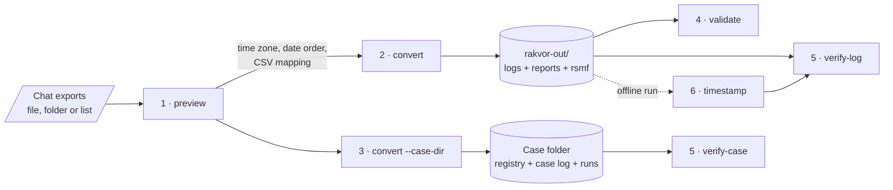
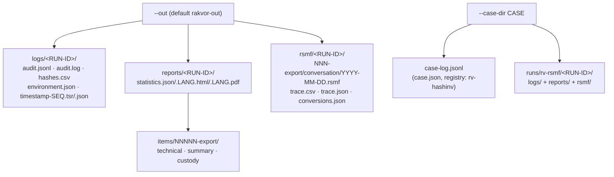

# Quick guide

RV RSMF converts chat exports (WhatsApp `.txt`/`.zip`, Telegram Desktop `result.json`, Microsoft Teams `.msg` files
from Purview, and CSV files of mobile forensic tools) into RSMF 2.0 files for Relativity. It reads each export you
give it without changing it, hashes every file, converts the local times to UTC with the time zone you choose, writes
one `.rsmf` per conversation per day, checks each file against the official RSMF 2.0 schema and stricter rules, reads
it back, and writes `trace.csv`, which leads from every message back to its line or id in the export. It writes
reports for the examiner and for the client, and records every action in a hash-chained audit log. Its findings are
**signals, not verdicts**: each one says what it shows and what it does not prove. The tool converts, it does not
authenticate: an export is an editable file, the RSMF shows what the export contains (not the phone), and deleted
messages or media left out of the export are not recovered. This page covers the six common tasks. The full guide is
[usage.md](usage.md), and every option is in [usage-cli.md](usage-cli.md).



## Two ways to use it

| Mode | Program | When to use it |
| --- | --- | --- |
| Desktop app (GUI) | `rv-rsmf-gui.exe` (Start menu: *RV RSMF*) | Windows 10/11. You add the exports, set how they are read, press **Preview** to check the dates, then **Start review**. |
| Command line (CLI) | `rv-rsmf.exe` | Scripts, batches, checking an export first (`preview`), checking any `.rsmf` file (`validate`) and the verification commands (`verify-log`, `verify-case`, `timestamp`). |

Both use the same engine. With the same exports and options they write the same `.rsmf` files (byte for byte), the
same hashes and the same findings.

## Desktop app: what each button does

Nothing is written to disk until you press **Start review**. Each change you make before that is kept in memory,
then written to the run's audit log as a `ui_*` entry when the run starts.

| Button or box | What it does | What it writes |
| --- | --- | --- |
| **Add files…** | Opens the Windows file picker and adds the chosen files to the evidence list. | `ui_input_added` (one per file) |
| **Add folder…** | Adds a whole folder (give the export's folder, so that its media come with it). | `ui_input_added` |
| **Add path** | Adds the path typed in the box next to it (pressing Enter does the same). | `ui_input_added` |
| Drag and drop | Files or folders dropped onto the window are added to the evidence list, as with **Add files…**. | `ui_input_added` |
| **x** (next to an entry) | Removes that entry from the evidence list. | `ui_input_removed` |
| **Include subfolders** | On by default: the folders are read with their subfolders. | `ui_recursive_changed` |
| **Browse…** next to **Case folder** | Chooses the shared case folder. The output folder then becomes `<case>/runs/rv-rsmf/<RUN-ID>` and you can no longer edit it. | `ui_case_dir_changed` |
| **Register the evidence with RV HashInv first** | Shown once a case folder is set. Runs rv-hashinv on the same evidence before the conversion, so the case gets its evidence registry (Task 3). The line next to it shows the rv-hashinv version found, or in red why none can be used. | `ui_intake_changed` |
| **Source** (Chat export) | *Detect automatically* (default), or forces the reader: WhatsApp, Telegram Desktop, Microsoft Teams (.msg) or CSV. | `ui_source_changed` |
| **Device time zone** (Chat export) | The IANA name of the zone the phone used (`Europe/Paris`), typed or chosen from **Common zones**. Required for WhatsApp and CSV exports. An unknown name is shown in red and refused. | `ui_timezone_changed` (`ui_timezone_rejected` for an unknown name) |
| **Date order** (Chat export) | *Detect from the file* (default), or day/month/year, month/day/year, year/month/day. Required when every date of the export can be read both ways. | `ui_date_order_changed` |
| **Custodian (device owner)** (Chat export) | The owner's name or number as the export writes it, typed or chosen from **Participants found** (filled by the preview). | `ui_custodian_changed` |
| **CSV profile** and **CSV mapping file (.toml)** with **Browse…** (Chat export) | Shown when an input is a CSV file: the built-in column profile, or your own TOML mapping, which overrides it. | `ui_csv_profile_changed`, `ui_csv_map_changed` |
| **Platform name** (Chat export) | The platform name shown in Relativity (default WhatsApp, Telegram, Microsoft Teams or Mobile export). | `ui_platform_name_changed` |
| **Preview** | Reads the exports with these settings without writing anything, and shows the first messages with the time as written next to UTC. A setting the export needs is framed in amber and marked *required*. | `ui_preview_run` (written with the run) |
| Hash algorithm tick boxes (md5 … blake3) | One or two algorithms (default sha256). With two ticked, the others are disabled. | `ui_hash_selection_changed` |
| **Report language** | English, Español, Français, or all three. | `ui_language_changed` |
| **Browse…** next to **Output folder** | Chooses where `logs/`, `reports/` and `rsmf/` are written (default `rakvor-out`). | Nothing until the run: the folder used is recorded in `environment.json` |
| **Examiner** and **Case ID** (text fields) | The examiner's name (default: your Windows user) and an optional case reference. | Nothing until the run: the examiner is written in every audit entry and report, the case ID on the reports |
| **Custody form** | Colombia (Fiscalía) or France (scellés); an English copy is always added. | `ui_jurisdiction_changed` |
| **Trusted timestamp** (tick box and address) | On by default. Asks the RFC 3161 authority at that address to timestamp the audit log. | `ui_timestamp_changed` |
| **Browse…** next to **Signing certificate (.p12/.pfx)** | Chooses your certificate. Each PDF report is then signed with it. Type the **Certificate password** in the field below it. The password is kept in memory only and is never logged. | `ui_signing_certificate_changed` (the path only) |
| **Start review** | Starts the run with the settings shown. When no preview was made for the current settings, it first reads the exports as **Preview** does; it refuses to start while a decision is missing. | `ui_start_clicked` (after `ui_preview_run` when it previewed), then the whole run (see [Where the outputs go](#where-the-outputs-go)) |
| **Cancel** | Stops after the current chunk, export or file and writes partial reports. | `item_cancelled`, `run_cancelled` |
| **Open report** | Opens the statistics report (`statistics.<LANG>.html`) of the finished run. | Nothing |
| **Open log folder** | Opens the run's log folder. | Nothing |
| **Open RSMF folder** | Opens the folder of the run's `.rsmf` files and `trace.csv`. | Nothing |
| **Open hash report** | After a run with **Register the evidence with RV HashInv first**: opens rv-hashinv's statistics report. | Nothing |
| **Evidence IDs** (result panel) | After a run in a case folder, lists each item's evidence id (E0001…) and its registry check. Read-only. | Nothing |
| **Warnings** (result panel) | Lists the errors met during the run. Read-only. | Nothing here: the run logs each error as `item_error` |

The timestamp is eIDAS-qualified only if the TSA address is that of a qualified trust service provider (QTSP) on an EU
trusted list; the default address (DigiCert) is not one.

The **Interface language** selector (top right) changes every label at once and is recorded as
`ui_interface_language_changed`. When RV Hub opens the app on a case folder, the log starts with
`ui_case_dir_from_launcher`.

## Task 1: Look at an export before converting

1. Run `preview` on the export. It reads the export exactly as `convert` would, and writes and logs nothing:

   ```powershell
   rv-rsmf preview -i evidence\whatsapp-ambiguous.txt --timezone Europe/Madrid
   ```

2. Read the answer. When the export does not settle the time zone, the date order or the CSV columns, `preview` stops
   with exit code 2 and says which decision is yours. Here every day and month of the sample is 12 or less (`preview`
   prints the full path of the export; below, the folder the commands were run from is shortened to `…`):

   ```text
   error: …\evidence\whatsapp-ambiguous.txt: the day/month order of the dates cannot be decided from the file (possible: dmy, mdy); give --date-order. Lines: line 1: 03/04/26, 9:05 AM - Carla Méndez: Buenos días | line 3: 05/04/26, 1:30 PM - Carla Méndez: Yes: 10 AM at the office
   ```

3. Decide from the phone's language and region settings, the content ("see you on 05/06?") or another record of the
   same conversation, then preview again with your choice:

   ```powershell
   rv-rsmf preview -i evidence\whatsapp-ambiguous.txt --timezone Europe/Madrid --date-order dmy
   ```

   ```text
   …\evidence\whatsapp-ambiguous.txt [whatsapp]
     chat_file: whatsapp-ambiguous.txt
     date_order: dmy
     date_order_basis: examiner choice (--date-order): every day and month is 12 or less
     date_order_option: dmy
     date_order_option_used: yes
     lines_read: 4
     timezone: Europe/Madrid
     variant: android
     conversations: 1  participants: 2  events: 4
     finding: DATE_ORDER_CHOSEN (info)
     as written             UTC                    from                 text
     03/04/26, 9:05 AM      2026-04-03T07:05:00Z   Carla Méndez         Buenos días
     03/04/26, 9:06 AM      2026-04-03T07:06:00Z   Diego Torres         Hi Carla, see you on 05/06?
     05/04/26, 12:00 AM     2026-04-04T22:00:00Z   Diego Torres         Midnight test
     05/04/26, 1:30 PM      2026-04-05T11:30:00Z   Carla Méndez         Yes: 10 AM at the office
   ```

4. Compare a few lines with the export and with what the custodian says. Then use the same options with `convert`
   (Task 2).

**What it writes:** nothing. It only reads.

**How to read the result:** exit code 0 means that every export can be converted with these options; 1 that an export
cannot be read (or no chat export was found); 2 that a decision is needed. The `as written` column is the time in the
export, `UTC` the time after conversion with your time zone. Give the zone of the **phone**, as an IANA name, not a
fixed offset such as `UTC+1` (it ignores daylight-saving time).

Preview options (`convert` takes the same chat options):

| Option | What it sets |
| --- | --- |
| `--input` (`-i`) | An export file or folder. Repeat it for several. |
| `--recursive` (`-r`) | Also look in subfolders. |
| `--limit` | Messages shown per export (default 20). |
| `--json` | One JSON object per export, for scripts. |
| `--source` | Forces the reader: whatsapp, telegram, teams-msg or csv (for a renamed file). |
| `--timezone` (`-z`) | The IANA time zone of the device. Required for WhatsApp and CSV exports. |
| `--date-order` | dmy, mdy or ymd, when every date can be read both ways. |
| `--custodian` | The device owner as the export names them: RSMF custodian, and the author of messages written as "You"/"Tú"/"Vous". |
| `--csv-map` | Your TOML column mapping for a CSV file. |
| `--csv-profile` | Built-in CSV profile: generic (default), xry-draft or cellebrite-draft (drafts, not yet checked against real exports). |
| `--platform-name` | The platform name shown in Relativity. |

## Task 2: Convert exports

1. Check the build once on this PC: `rv-rsmf self-test` must print `PASS` for every algorithm (exit code 0).
2. Run the conversion on a verified copy of the exports, never on the only copy. Give the export's folder with `-r`,
   so that its media come with it. Leave out `--no-timestamp` when the PC can reach the TSA: the run then also
   obtains the timestamp (`timestamp: ok …`).

   ```powershell
   rv-rsmf convert -i evidence -r --timezone Europe/Paris --date-order dmy --hash sha256,md5 --lang es --case CASE-2026-014 --actor "Ana Ruiz" --no-timestamp
   ```

3. Read the summary. On a copy of the sample exports (`examples\sample\evidence`, 8 exports in 16 files) in
   `evidence`, offline (`--no-timestamp`), the command above prints:

   ```text
   DONE  run 20261126T211547Z-357716
     items: 16  bytes: 99559  errors: 0  elapsed: 0.7 s
     findings: high 0, medium 10, low 2, info 24
     timestamp: off
     report: rakvor-out\reports\20261126T211547Z-357716\statistics.es.html
     logs:   rakvor-out\logs\20261126T211547Z-357716
     rsmf:   8 export(s), 10 conversation(s), 49 event(s), 17 file(s) -> rakvor-out\rsmf\20261126T211547Z-357716
   ```

4. Open the `report:` file. Then, for each export, open `technical.<LANG>.html` (for the examiner) or
   `summary.<LANG>.html` (for the client), and check a few messages against the export with `trace.csv` (in the
   `rsmf:` folder). Load the `.rsmf` files into Relativity.

**What it writes:** `rakvor-out/logs/<RUN-ID>/` (audit log, `hashes.csv`, `environment.json`),
`rakvor-out/reports/<RUN-ID>/` (statistics report, and per export a technical review, a summary and a custody form)
and `rakvor-out/rsmf/<RUN-ID>/` (the `.rsmf` files, `trace.csv`, `trace.json`, `conversions.json`).

**How to read the result:** `DONE` with exit code 0 means no high-severity finding. `DONE (high-severity findings)`
with exit code 3 means that an export could not be read (`PARSER_FAILED`) or that an RSMF file failed validation or
read-back: do not load that file. Exit code 2 before anything is written means that a decision is missing (Task 1).
Each finding states what it shows and what it does not prove; [usage.md](usage.md#4-interpreting-each-finding) says
what to check next for each code. `timestamp: pending` means that the authority could not be reached (see Task 6).
`--progress jsonl` prints one JSON event per line for scripts; **Ctrl+C** stops the run and writes partial reports
(exit code 130).

Conversion options:

| Option | What it sets |
| --- | --- |
| `--input` (`-i`) | A file or folder to convert. Repeat it for several. |
| `--input-list` (`-L`) | A text file with one path per line. |
| `--recursive` (`-r`) | Also read subfolders. |
| `--hash` (`-H`) | One or two of md5, sha1, sha256, sha512, sha3-256, blake3 (default sha256). |
| `--out` (`-o`) | Output folder (default `rakvor-out`). |
| `--lang` (`-l`) | Report language: en, es, fr or all. |
| `--actor` (`-a`) | Examiner name in the audit log and the reports. |
| `--case` (`-c`) | Case identifier printed on the reports. |
| `--progress` (`-p`) | bar, jsonl (one JSON event per line) or none. |
| `--jurisdiction` (`-j`) | Custody form: co (Colombia) or fr (France). |
| `--tsa-url` | RFC 3161 authority (default `http://timestamp.digicert.com`). |
| `--no-timestamp` | No timestamp request (offline labs). |
| `--sign-cert` | Your `.p12`/`.pfx` certificate: each PDF report is signed with it. |
| `--sign-pass-env` | The environment variable that holds its password (default `RV_SIGN_PASSWORD`). |
| `--source`, `--timezone` (`-z`), `--date-order`, `--custodian`, `--csv-map`, `--csv-profile`, `--platform-name` | How the exports are read (Task 1). |
| `--case-dir` | The shared case folder (Task 3). |
| `--evidence` (`-E`) | Registered evidence ids to convert (Task 3). |
| `--intake` | hashinv: register the evidence with rv-hashinv first (Task 3). |
| `--hashinv-exe` | The rv-hashinv program to use with `--intake hashinv` (Task 3). |

## Task 3: Convert exports in a case folder

1. Choose one folder for the case, on the case volume, for example `cases\CASE-2026-014`. rv-rsmf is an analysis
   tool in the case folder: it verifies each file against the evidence registry that the intake tool, rv-hashinv,
   writes. It never writes the registry itself.
2. Register and convert in one step: `--intake hashinv` runs rv-hashinv on the same evidence first (it creates the
   case, so give `--case` and `--jurisdiction`). rv-hashinv is searched in `--hashinv-exe`, `RV_HASHINV`, next to
   rv-rsmf, the RV HashInv install folder, then `PATH`. If the case was registered before, leave out
   `--intake hashinv`.

   ```powershell
   rv-rsmf convert -i evidence -r --case-dir cases\CASE-2026-014 --case CASE-2026-014 --jurisdiction co --timezone Europe/Paris --date-order dmy --intake hashinv --no-timestamp
   ```

3. Read the last line of the summary:

   ```text
     case:   CASE-2026-014 (analysis) registered 0 (new 0), verified 16, mismatched 0, not in registry 0
   ```

4. Later, to convert some registered items again, give their ids (here the CSV file and its mapping):

   ```powershell
   rv-rsmf convert --case-dir cases\CASE-2026-014 --evidence E0001,E0002 --timezone Europe/Madrid --no-timestamp
   ```

**What it writes:** the run under `runs/rv-rsmf/<RUN-ID>/logs`, `/reports` and `/rsmf`, and its `run_started` and
`run_finished` entries in `case-log.jsonl` (with `--intake hashinv`, rv-hashinv also writes `case.json`, the registry
`evidence/registry.json` and `.csv` and its own run under `runs/rv-hashinv/`).

**How to read the result:** `verified` counts the files whose hashes match the registry. A file that differs from the
registry gets the high finding `EVIDENCE_HASH_MISMATCH_WITH_CASE` (it is still converted); a file not in the registry
gets `EVIDENCE_NOT_IN_CASE_REGISTRY` (medium). Exit code 3 before anything is read means that the case folder failed
verification: nothing was written to it (run Task 5). Exit code 2 means a usage error or a missing decision, for
example a folder that belongs to another case or an unknown evidence id. With `--evidence`, or with no `-i`, a missing
decision is found during the run (`PARSER_FAILED`) rather than before it: preview first.

## Task 4: Validate RSMF files

1. Run `validate` on a run's `rsmf` folder (it is searched recursively), or on any `.rsmf` file, ours or another
   tool's:

   ```powershell
   rv-rsmf validate rakvor-out\rsmf\20261126T211547Z-357716
   ```

2. Read the output: one line per file (first lines shown; the run of Task 2 has 17 files):

   ```text
   OK       rakvor-out\rsmf\20261126T211547Z-357716\001-generic-csv-000001\Grupo-obra-aae949\2026-10-24.rsmf  (1 events, 0 attachments)
   OK       rakvor-out\rsmf\20261126T211547Z-357716\001-generic-csv-000001\Grupo-obra-aae949\2026-10-25.rsmf  (2 events, 1 attachments)
   OK       rakvor-out\rsmf\20261126T211547Z-357716\002-xry-like-csv-000004\chat-001-1ad5d4\2026-03-14.rsmf  (3 events, 0 attachments)
   ```

3. Run it again on the copy you deliver, after any transfer.

**What it writes:** nothing. It only reads.

**How to read the result:** `OK` (exit code 0 when every file is) means that the file passes the official RSMF 2.0
schema and the strict checks (unknown keys, references, UTC times, counts, every attachment present). `INVALID`
(exit code 3) is followed by one line per problem (`schema: …`, `strict: …`). `ERROR` (exit code 1) means that a file
could not be read (not an RSMF message, no `rsmf.zip`). It does not show how a given Relativity version displays the
file.

## Task 5: Verify a run and a case

1. Point `verify-log` at the run's log folder (or at the `audit.jsonl` in it):

   ```powershell
   rv-rsmf verify-log rakvor-out\logs\20261126T211547Z-357716
   ```

2. Read the output:

   ```text
   OK  131 entries, chain intact: rakvor-out\logs\20261126T211547Z-357716\audit.jsonl
       truncation not detectable without a timestamp or case record
       outputs: 201 verified of 201 recorded (md5, sha256)
   ```

3. If the run has a timestamp, add `--tsa-ca <TSA roots.pem>` to also check the TSA certificate chain against the
   TSA's own root certificates.
4. For a case folder, run `verify-case` on the folder that holds `case.json`; `--rehash` also reads every registered
   item again:

   ```powershell
   rv-rsmf verify-case cases\CASE-2026-014 --rehash
   ```

   After Task 3 (the rv-hashinv intake run and the two rv-rsmf runs):

   ```text
   OK  case CASE-2026-014: 8 case-log entries, 16 registered items, 3 runs verified: cases\CASE-2026-014
       outputs: 414 verified of 414 recorded by the runs' audit logs
       re-hashed 16 of 16 registered items: 16 match the registry
   ```

**What it writes:** nothing. Both commands only read.

**How to read the result:** `OK` (exit code 0) from `verify-log` means that no entry was edited, deleted or
re-ordered, that each timestamp token matches, and that each `.rsmf` file, trace, report, `hashes.csv` and
`environment.json` still has the digest the log recorded. The `truncation` line says what anchors the end of the log:
a run without a timestamp and outside a case folder cannot prove that no entry was removed from its end. `OK` from
`verify-case` means that the case log, the registry, every run's audit log (of every Rakvor tool) and the runs'
recorded outputs are intact. `BROKEN` (exit code 3) lists one problem per line. Exit code 1 means that the log or the
`--tsa-ca` file cannot be read, or that the folder is not a case folder (no `case.json`). Revocation of the TSA
certificate is never checked.

## Task 6: Add the timestamp after offline work

1. Offline, run the conversion as usual, or with `--no-timestamp` (or `RV_NO_TIMESTAMP=1`) so that no request is
   sent. Without `--no-timestamp`, the summary shows `timestamp: pending`.

   ```powershell
   rv-rsmf convert -i evidence\telegram -r -o offline --no-timestamp
   ```

2. Once the network is back, timestamp the run's log folder:

   ```powershell
   rv-rsmf timestamp offline\logs\20261126T211626Z-5dc7c2
   ```

3. Read the result: `OK  timestamp 2026-11-26T21:16:34Z by http://timestamp.digicert.com covers entry #31`. Use
   `--tsa-url` to choose another authority, and `--actor` to name the examiner in the new audit entry.
4. Run Task 5 on the same folder. It now shows the timestamp line and `TSA signature valid`:

   ```text
   OK  32 entries, chain intact: offline\logs\20261126T211626Z-5dc7c2\audit.jsonl
       timestamp 2026-11-26T21:16:34Z by http://timestamp.digicert.com covers entry #31: TSA signature valid (signer: CN=DigiCert SHA256 RSA4096 Timestamp Responder 2026 1,O=DigiCert\, Inc.,C=US); chain not checked (pass --tsa-ca <CA bundle> to validate it)
       truncation: entries up to #31 are anchored by the RFC 3161 timestamp (timestamp-00031.json); 1 entry after it (timestamp_obtained) cannot be proven complete
       outputs: 43 verified of 44 recorded (sha256), 1 skipped
       not re-hashed: logs/timestamp-00031.tsr (RFC 3161 token: checked by the timestamp verification)
   ```

**What it writes:** `timestamp-<SEQ>.tsr` (the RFC 3161 token) and `timestamp-<SEQ>.json` in the log folder, and
the `timestamp_obtained` entry in `audit.jsonl`.

**How to read the result:** exit code 0 means that the timestamp was obtained and logged. Exit code 1 means that the
authority could not be reached; nothing changed, so try again later. Exit code 3 means that the log is missing or
broken; no timestamp is added to a broken log. The timestamp proves when the log existed, not that the export is
authentic.

## Other commands

| Command | What it does |
| --- | --- |
| `rv-rsmf self-test` | Checks every hash algorithm against published test values. |
| `rv-rsmf update-check` | Tells you whether a newer release is published. It only notifies: nothing is downloaded. `RV_NO_UPDATE_CHECK=1` turns it off. |
| `rv-rsmf describe --json` | Prints the tool's description for RV Hub. It reads and writes nothing. |

## Exit codes

| Code | Meaning | Returned by |
| --- | --- | --- |
| 0 | Completed; no high-severity finding (`preview`: every export can be converted; verification commands: everything checked is intact). | every command |
| 1 | Runtime error: input not found, output not writable, case log locked, wrong certificate password, rv-hashinv not found or failed, an export or `.rsmf` file that cannot be read, TSA unreachable (`timestamp` only; `convert` shows `timestamp: pending` and goes on), not a case folder, a failed self-test, or an update check that could not be made. | `convert`, `preview`, `validate`, `verify-log`, `verify-case`, `timestamp`, `self-test`, `update-check` |
| 2 | Usage error (unknown option, bad value, more than two algorithms, case folder of another case, unknown evidence id), or a decision only the examiner can make: `--timezone`, `--date-order` or a CSV mapping. | every command (unknown option); `convert`, `preview` |
| 3 | At least one high-severity finding, an invalid RSMF file, a broken log, a failed case check, or (for `update-check`) a newer release. | `convert`, `validate`, `verify-log`, `verify-case`, `timestamp`, `update-check` |
| 130 | Cancelled with Ctrl+C: partial reports are written and the cancellation is in the audit log. | `convert` |

## Where the outputs go



Without `--case-dir`, each run creates `logs/<RUN-ID>/`, `reports/<RUN-ID>/` and `rsmf/<RUN-ID>/` under `--out`
(default `.\rakvor-out`, relative to the current folder). With `--case-dir`, they go to
`<CASE>/runs/rv-rsmf/<RUN-ID>/`. Keep the log folder with the reports and the `.rsmf` files: it is the proof of what
was done.
