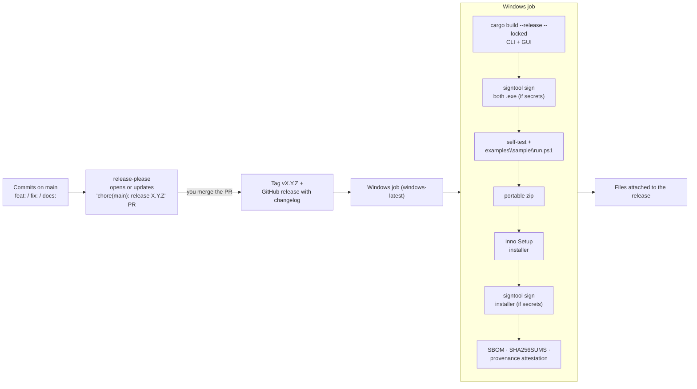

# Release process: Windows packages, code signing and GitHub releases

This page explains how RV RSMF goes from a commit on `main` to signed Windows packages (CLI + GUI, portable zip and
installer) attached to a GitHub release — what happens automatically, what you do by hand, and how to do every step
yourself on a Windows machine if GitHub Actions is not available. It describes
[.github/workflows/release.yml](../.github/workflows/release.yml) at this commit.



## 1. The pieces

| Piece | Where | What it does |
| --- | --- | --- |
| Conventional Commits | every commit message | `feat:` → minor version, `fix:` → patch, `feat!:` / `BREAKING CHANGE:` → major; `docs:`, `test:`, `chore:`, `ci:`, `build:` → no release |
| release-please | `release.yml` job `release-please`, `release-please-config.json`, `.release-please-manifest.json` | keeps a release PR open that bumps `version.txt` and writes `CHANGELOG.md`; merging it creates the tag and the GitHub release |
| Product version | `version.txt` | read by the build (`--version`, `X-RSMF-Generator` in every `.rsmf`, installer, file names). Crate versions in `Cargo.toml` never change, so `Cargo.lock` stays valid for `--locked` builds |
| Windows job | `release.yml` job `windows` | builds, signs, tests, packages, hashes and uploads (§4) |
| Installer script | `packaging/windows/installer.iss` | Inno Setup: per-user install (no admin), Windows 10+, Start-menu shortcuts, optional "add CLI to PATH" |
| Signing certificate | GitHub secrets `SIGN_PFX_BASE64`, `SIGN_PFX_PASSWORD` | Rakvor's internal code-signing certificate (PFX); signing is skipped when the secret is missing |
| Root certificate | `packaging/signing/rakvor-code-signing-root.cer` (the same file in every Rakvor tool's repository) | "Rakvor Internal Code Signing Root CA"; installed on Rakvor machines so Windows trusts the signature |

## 2. One-time setup (per repository)

1. **Let release-please open PRs.** GitHub → repository → *Settings → Actions → General → Workflow permissions*:
   select *Read and write permissions* and tick *Allow GitHub Actions to create and approve pull requests*.
2. **Add the signing secrets.** *Settings → Secrets and variables → Actions → New repository secret*:

   | Name | Value |
   | --- | --- |
   | `SIGN_PFX_BASE64` | the PFX file encoded as one line of base64 |
   | `SIGN_PFX_PASSWORD` | the PFX password |

   With the GitHub CLI: `base64 -w0 sign.pfx | gh secret set SIGN_PFX_BASE64 --repo Panacota96/rv-rsmf` and
   `gh secret set SIGN_PFX_PASSWORD --repo Panacota96/rv-rsmf` (it prompts for the value). In PowerShell:
   `[Convert]::ToBase64String([IO.File]::ReadAllBytes("sign.pfx")) | gh secret set SIGN_PFX_BASE64 --repo Panacota96/rv-rsmf`.
3. **Install the root on every Rakvor machine** that runs the tool ([installation.md §4](installation.md#4-verify-the-authenticode-signature-signed-releases)):
   check the fingerprint `DC9BA1A2FCD4F0633C5214B7CCEB25BED8F3F7D9EBAF111590250CBCAA83DF60`, then
   `Import-Certificate -FilePath .\rakvor-code-signing-root.cer -CertStoreLocation Cert:\CurrentUser\Root`.
   For all users of a machine use `Cert:\LocalMachine\Root` from an administrator PowerShell; for many machines,
   deploy it with Group Policy (*Computer Configuration → Windows Settings → Security Settings → Public Key Policies
   → Trusted Root Certification Authorities*).

## 3. Everyday release (what you actually do)

1. Work on branches, merge to `main` with Conventional Commit messages. CI must be green on Linux and Windows
   ([development.md](development.md#continuous-integration)).
2. After each push to `main`, release-please updates the PR **"chore(main): release X.Y.Z"**. Read the proposed
   `CHANGELOG.md` entry; edit commit messages or the PR text if something is wrong.
3. **Merge the release PR.** That creates tag `vX.Y.Z` and the GitHub release, and starts the Windows job.
4. The release then has `rv-rsmf-X.Y.Z-windows-x64.zip`, `rv-rsmf-X.Y.Z-windows-x64-setup.exe`, `SHA256SUMS` and
   `sbom.cdx.json`; the provenance attestation is stored by GitHub.
5. Smoke-test on Windows 10 and 11: verify the hashes, install, `rv-rsmf self-test`, the sample conversion
   ([installation.md §6](installation.md#6-first-run-self-test-and-sample-conversion)), open the GUI, uninstall.

### Test package without a release

*Actions → Release → Run workflow* with the **tag field empty**: the Windows job builds (and signs, if the secrets
exist) everything and uploads it as a workflow **artifact**, without creating a release.

### Rebuild an existing release (e.g. to add signatures)

*Actions → Release → Run workflow* with **tag = `vX.Y.Z`**: the job checks out that tag, rebuilds, and replaces the
files on that release (`gh release upload --clobber`). The tag and changelog stay the same.

## 4. What the Windows job does, step by step

| Step | Command (simplified) | Fails the release when |
| --- | --- | --- |
| Toolchain | `rustup toolchain install` (reads `rust-toolchain.toml`, 1.97.0) | — |
| Build | `cargo build --release --locked -p rv-rsmf-cli -p rv-rsmf-gui` (static CRT) | compile error or lockfile out of date |
| Sign executables | `signtool sign /f sign.pfx /p *** /fd SHA256 /tr http://timestamp.digicert.com /td SHA256 rv-rsmf.exe rv-rsmf-gui.exe` (only when `SIGN_PFX_BASE64` exists) | bad certificate or password |
| Self-test | `rv-rsmf.exe self-test` + `examples\sample\run.ps1` (conversion of every sample, `verify-log`, `validate`, `hashes.csv` vs `expected_hashes.csv`) | wrong hashes, invalid RSMF, a high finding, broken log |
| Portable zip | executables + README, LICENSE, NOTICE, CHANGELOG, `docs\`, `examples\` (without `examples\sample\out`) | — |
| Installer | `ISCC.exe /DAppVersion=X.Y.Z /DSourceDir=. /Odist packaging\windows\installer.iss` | Inno Setup script error |
| Sign installer | same signtool command on `dist\*-setup.exe` | as above |
| SBOM | `cargo cyclonedx --format json --spec-version 1.5` → `sbom.cdx.json` | — |
| Checksums | `sha256sum *.zip *.exe sbom.cdx.json > SHA256SUMS` | — |
| Provenance | `actions/attest-build-provenance` on the zip and installer | — |
| Upload | workflow artifact; `gh release upload vX.Y.Z … --clobber` when a tag is set | — |

Signing happens **before** zipping and hashing, so the hashes in `SHA256SUMS` are those of the signed files.

After each signing step the job imports `packaging/signing/rakvor-code-signing-root.cer` on the runner and runs
`signtool verify /pa /tw` on every signed file, so a release whose signatures do not chain to the Rakvor root fails.
There is no third-party binary to fetch (unlike rv-pdfauth's PDFium).

## 5. The signing certificate

### What it is

An **internal** certificate: "Rakvor Code Signing (internal)" issued by "Rakvor Internal Code Signing Root CA".
Windows trusts it only where the root is installed — Rakvor's own machines, which is where the tool runs. On any
other PC the signature shows as untrusted; auditors and customers verify releases with `SHA256SUMS` and
`gh attestation verify` instead ([installation.md §2–3](installation.md#2-verify-the-download)).

### Create or renew it

The root CA key lives **offline** (encrypted USB stick or password manager), never in a repository or in GitHub.
To issue a new signing certificate (before the current one expires, or if its key leaks), on a trusted machine
with OpenSSL:

```bash
# leaf.cnf: [req] distinguished_name=dn, prompt=no; [dn] CN=Rakvor Code Signing (internal), O=Rakvor
#           [v3] basicConstraints=critical,CA:FALSE  keyUsage=critical,digitalSignature  extendedKeyUsage=codeSigning
#                subjectKeyIdentifier=hash  authorityKeyIdentifier=keyid
openssl pkcs12 -in rakvor-root-ca-PRIVATE.pfx -nodes -out root.pem            # asks for the root password
openssl req -new -newkey rsa:3072 -nodes -keyout leaf.key -config leaf.cnf -out leaf.csr
openssl x509 -req -in leaf.csr -CA root.pem -CAkey root.pem -CAcreateserial -sha256 -days 1095 \
        -extfile leaf.cnf -extensions v3 -out leaf.crt
openssl pkcs12 -export -inkey leaf.key -in leaf.crt -certfile root.pem -keypbe AES-256-CBC -certpbe AES-256-CBC \
        -macalg sha256 -out sign.pfx                                          # choose a new password
shred -u root.pem leaf.key                                                    # do not leave keys on disk
```

Then replace the two GitHub secrets (§2) and rebuild the latest release (§3) if you want it re-signed. Files signed
earlier stay valid after the certificate expires, because every signature carries an RFC 3161 timestamp (`/tr`).

### If the signing key leaks

Remove the GitHub secrets, issue a new signing certificate, rebuild the affected releases, and tell Rakvor staff.
Because the root is private, removing trust means deleting the root from machines and installing a new one if the
**root** key is compromised.

### Moving to a publicly trusted signature

Needed only if the tool is ever installed outside Rakvor, or to stop SmartScreen warnings. Since June 2023 a publicly
trusted code-signing key must be held in hardware (token or cloud HSM), so it cannot be stored as a GitHub secret.
Options: **Azure Artifact Signing** (requires a registered organisation in an eligible country and identity
validation; use `azure/artifact-signing-action` in place of the signtool steps) or a commercial certificate with
cloud signing.

## 6. Doing it by hand on Windows (no GitHub Actions)

Prerequisites: Git, Rust (the version in `rust-toolchain.toml`), the Windows SDK (for `signtool.exe`), Inno Setup 6,
and the signing PFX.

```powershell
git clone https://github.com/Panacota96/rv-rsmf; cd rv-rsmf
git checkout vX.Y.Z                                   # the release you are packaging
cargo build --release --locked -p rv-rsmf-cli -p rv-rsmf-gui

$signtool = (Get-ChildItem "${env:ProgramFiles(x86)}\Windows Kits\10\bin\*\x64\signtool.exe" | Sort-Object FullName | Select-Object -Last 1).FullName
& $signtool sign /f C:\secure\sign.pfx /p (Read-Host -AsSecureString | ConvertFrom-SecureString -AsPlainText) `
    /fd SHA256 /tr http://timestamp.digicert.com /td SHA256 target\release\rv-rsmf.exe target\release\rv-rsmf-gui.exe
& $signtool verify /pa target\release\rv-rsmf.exe

.\target\release\rv-rsmf.exe self-test
.\examples\sample\run.ps1 -Bin .\target\release\rv-rsmf.exe
$v = (Get-Content version.txt -Raw).Trim()
& "${env:ProgramFiles(x86)}\Inno Setup 6\ISCC.exe" /DAppVersion=$v /DSourceDir=$PWD /O$PWD\dist packaging\windows\installer.iss
& $signtool sign /f C:\secure\sign.pfx /p (Read-Host -AsSecureString | ConvertFrom-SecureString -AsPlainText) `
    /fd SHA256 /tr http://timestamp.digicert.com /td SHA256 dist\rv-rsmf-$v-windows-x64-setup.exe
Get-FileHash dist\* -Algorithm SHA256 | Format-Table Hash, Path
```

(`ConvertFrom-SecureString -AsPlainText` needs PowerShell 7.) Build the portable zip as the workflow does (copy the
two executables, README, LICENSE, NOTICE, CHANGELOG, `docs\`, `examples\` without `examples\sample\out`, then
`Compress-Archive`). Upload with `gh release upload vX.Y.Z dist\* --clobber`. A hand-made build has no provenance
attestation.

## 7. Troubleshooting

| Symptom | Cause | Fix |
| --- | --- | --- |
| No release PR appears | workflow permissions (§2.1), or only non-releasing commit types since the last release | enable the setting; use `feat:`/`fix:` for user-visible changes |
| Release PR CI shows "action required" | PRs created by `GITHUB_TOKEN` do not trigger workflows | normal: the same code passed CI on `main`; merge |
| Files on the release are not signed | secrets missing when the job ran | add the secrets, then rebuild with tag = `vX.Y.Z` (§3) |
| `signtool sign` fails "invalid password" / "no certificates" | wrong `SIGN_PFX_PASSWORD` or a PEM pasted instead of a PFX | re-encode the `.pfx` file itself as base64 |
| `run.ps1` fails in the job | a sample no longer converts as expected, or `expected_hashes.csv` is out of date after regenerating samples | fix the code or regenerate the expectations ([development.md](development.md#samples-and-expected-results)) |
| `Get-AuthenticodeSignature` says `UnknownError` on a PC | Rakvor root not installed there | install the root (§2.3) — or verify with SHA256SUMS |
| SmartScreen still warns | internal certificate is not publicly trusted / no reputation | expected outside Rakvor machines; public signing in §5 |
| `cargo build --locked` fails in the release job | `Cargo.lock` out of date | commit the updated lock from a normal build |
