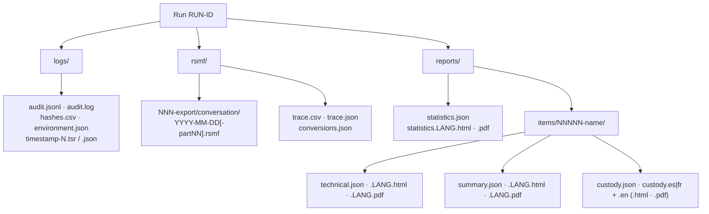
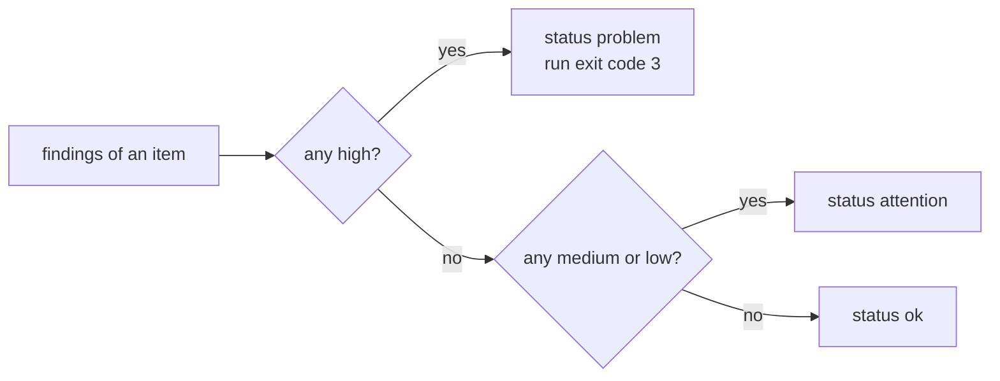

# Reports and output files

A run writes three folders: **logs** (the audit record), **rsmf** (the converted files and the trace map) and
**reports** (statistics per run, and per input file a technical review, a customer summary and a custody form).
Every file below is hashed and its digests are written to the audit log, so a file changed after the run can be
detected ([forensic-audit.md](forensic-audit.md)).

## Where the folders are

| Run kind | logs | rsmf | reports |
| --- | --- | --- | --- |
| Standalone (`--out OUT`, default `./rakvor-out`) | `OUT/logs/<RUN-ID>/` | `OUT/rsmf/<RUN-ID>/` | `OUT/reports/<RUN-ID>/` |
| Case folder (`--case-dir CASE`) | `CASE/runs/rv-rsmf/<RUN-ID>/logs/` | `CASE/runs/rv-rsmf/<RUN-ID>/rsmf/` | `CASE/runs/rv-rsmf/<RUN-ID>/reports/` |

`<RUN-ID>` is `YYYYMMDDTHHMMSSZ-` (UTC start) plus 6 hexadecimal characters, e.g. `20261027T164952Z-750c58`.

## Every output file

### logs/

| File | Content | Logged as |
| --- | --- | --- |
| `audit.jsonl` | One JSON object per action, hash-chained (authoritative) — [forensic-audit.md](forensic-audit.md) | — (it is the log) |
| `audit.log` | The same actions as readable text (convenience copy, not chained) | — |
| `environment.json` | Tool name, version, front-end, `rustc`, target; OS, host, OS user, working folder, command line (or GUI settings), every `Cargo.lock` package | `environment_recorded` (digests) |
| `hashes.csv` | Hash register of every input file: `index,path,size,<algo1>[,<algo2>],status,error`; `status` = `ok` / `attention` / `problem` | `hash_register_written` (digests) |
| `timestamp-<N>.tsr` / `.json` | RFC 3161 response for the chain head at entry N, and its readable summary (tsa, gen_time, covers_seq, head, token_sha256) | `timestamp_obtained` |

### rsmf/

| File | Content | Logged as |
| --- | --- | --- |
| `<NNN>-<export>/<conversation>/<YYYY-MM-DD>[-partNN].rsmf` | One RSMF 2.0 file per conversation per day (`undated.rsmf` for events without a time); `NNN` = export number in the run. Structure: [theory.md B8](theory.md#b8-the-rsmf-20-file-we-write) | `rsmf_written` (SHA-256 + selected digests, events, attachments, collection id), `attachment_packed` per attachment, `rsmf_validated` |
| `trace.csv` | One row per converted event: `export,source_file,line,line_end,native_id,source_time,utc,rsmf_file,event_id,conversation,kind,attachments` — [theory.md B12](theory.md#b12-the-trace-map) | `trace_written` |
| `trace.json` | The same rows as a JSON array | `trace_written` |
| `conversions.json` | `totals` (exports, exports_failed, conversations, events, files, files_invalid, attachments_packed, attachments_missing); `exports[]` (export, source, item_index, conversations, events, `files[]` with file, conversation, day, part, events, attachments, missing_attachments, valid, sha256); `shortcode_table`; `rsmf_version` | `trace_written` |

### reports/

| File | For | Content |
| --- | --- | --- |
| `statistics.json`, `statistics.<LANG>.html`, `.pdf` | the run | run identity, totals, throughput, findings by severity and by code, items by status and detected type, duplicate groups, case-folder counts, **RSMF conversion** totals (exports by source, failed exports, conversations, events, RSMF files and invalid ones, attachments packed and missing), limitations, audit head, timestamp |
| `items/<NNNNN>-<name>/technical.json`, `.LANG.html`, `.pdf` | examiners, lawyers, opposing experts | the input file (path, size, modified time, extension, detected type, all digests, case status), every finding with **what it shows / what it does not prove**, and for an export's main file the **RSMF conversion** section: source type, conversations, participants, events, every fact the parser recorded (date order and its basis, time zone, variant, CSV columns…), the table of RSMF files (day, part, events, attachments, missing, validation, SHA-256; first 200 rows in HTML/PDF, all in JSON and `conversions.json`), method, limitations, audit entries `#first–#last` |
| `items/…/summary.json`, `.LANG.html`, `.pdf` | the customer | status in plain words, the primary fingerprint, findings as sentences, a one-line conversion summary, next step |
| `items/…/custody.json`, `custody.es.*` or `custody.fr.*`, `custody.en.*` | the chain of custody | pre-filled custody form for the jurisdiction (`--jurisdiction co` → Spanish, `fr` → French) plus English — [theory.md B18](theory.md#b18-custody-forms) |

Item folders exist for **every input file** — the export's main file carries the conversion section; media and
other members of an export carry `PART_OF_EXPORT`; files that belong to no export carry `NOT_A_CHAT_EXPORT`.
`<NNNNN>` is the item number (sorted paths), `<name>` the file name with characters other than letters, digits,
`.`, `-`, `_` replaced by `_` (60 characters at most).

**Known display defect.** In the technical report's RSMF file table, a file that passed validation shows the
column title ("Validation" / "Validación") in its row instead of a pass mark; a failed file shows `INVALID`. The
JSON (`valid: true|false`) is correct.

### Facts recorded per source

The conversion section lists the parser's facts (also in `technical.json` → `conversion.facts` and in the
`export_parsed` audit entry):

| Source | Facts |
| --- | --- |
| WhatsApp | `variant` (android/ios), `date_order`, `date_order_basis`, `date_order_option`, `date_order_option_used`, `lines_read`, `timezone`, `chat_file`, `encoding` (only when the file was not valid UTF-8) |
| Telegram | `variant` (full-export/single-chat), `chats`, `messages_read`, `time_basis`, `export_owner` |
| Teams | `teams.msg_files`, `teams.messages`, `teams.system_messages`, `teams.files_skipped`, `teams.time_property`, `teams.property_mapping` |
| CSV | `mapping`, `mapping_source` (option/sibling/profile:NAME), `profile_detected`, `csv.encoding`, `csv.delimiter`, `csv.header_line`, `csv.columns`, `csv.optional_columns_not_found`, `csv.timestamp_format`, `csv.date_order`, `csv.timezones_applied`, `csv.rows`, `csv.rows_blank`, `csv.rows_unparsed` |

`csv.rows` over-counts: it adds the unparsed rows to the parsed rows, but a row rejected for its time is in both,
so it is counted twice (the sample `xry-like.csv` has 5 data rows and reports `csv.rows` = 6). Use
`csv.rows_unparsed` and the number of events instead.

## Status, severity and exit code

| Severity | Conversion examples | Item status |
| --- | --- | --- |
| High | `PARSER_FAILED`, `RSMF_SCHEMA_INVALID`, `RSMF_ROUNDTRIP_MISMATCH`, `EVIDENCE_HASH_MISMATCH_WITH_CASE` | `problem` (exit code 3) |
| Medium | `UNPARSED_LINES`, `DST_AMBIGUOUS_OR_MISSING_TIME`, `ATTACHMENT_REFERENCED_NOT_FOUND`, `CSV_MAPPING_DRAFT_PROFILE` | `attention` |
| Low | `MEDIA_OMITTED_IN_EXPORT`, `TELEGRAM_FILE_NOT_INCLUDED`, `DUPLICATE_MESSAGES` | `attention` |
| Informational | `DATE_ORDER_INFERRED`, `TIMEZONE_APPLIED`, `DELETED_MESSAGES_NOT_IN_EXPORT`, `PART_OF_EXPORT` | `ok` |

## Findings catalogue

Every finding code the tool can report, with its severity (from the code) and the exact English text printed in
the reports (from [i18n/en.json](../i18n/en.json) → `findings`; `%{name}` is replaced by the finding's parameter of
that name). The Spanish and French texts have the same keys (enforced by a test). How each conversion finding is
decided: [theory.md B20](theory.md#b20-how-each-finding-is-decided). `REGISTRY_PATH_CONTENT_CHANGED` belongs to the
intake role and is never raised by rv-rsmf (an analysis tool); it is listed because the catalogue is shared.

| Code | Severity | Shows | Does not prove |
| --- | --- | --- | --- |
| `EMPTY_FILE` — Empty file | info | The file contains no data (0 bytes). | It does not show whether the file was emptied deliberately or created empty. |
| `EXTENSION_MISMATCH` — Extension does not match content | medium | The name ends in .%{extension} but the content starts with the signature of a %{detected} file. | Renaming is common and often innocent; it does not by itself prove an attempt to hide content. |
| `EXECUTABLE_CONTENT` — Executable content under another name | high | The content is a %{detected} program although the name ends in .%{extension}. | It does not show that the program is malicious; analyse it in an isolated environment. |
| `DUPLICATE` — Duplicate content | info | Identical content (same %{algorithm}) appears in %{count} files: %{others}. | Identical hashes show identical content, not who copied the file or when. |
| `UNREADABLE` — File could not be read | high | Reading failed: %{error}. | It does not show that the file is damaged; permissions or locks can cause this. |
| `EVIDENCE_HASH_MISMATCH_WITH_CASE` — Differs from the evidence registered in the case | high | The %{algorithm} of this file is %{actual}, but evidence %{evidence_id} was registered at intake with %{expected}: the file examined is not bit-identical to the registered item. | Who changed the file, when, or whether the change was deliberate; the analysis still ran so the examiner can decide. |
| `EVIDENCE_NOT_IN_CASE_REGISTRY` — Not registered in the case | medium | No item of case %{case_id} was registered with this path or this content, so its continuity from intake cannot be shown. | That the file is altered or irrelevant; it may simply not have gone through intake. |
| `REGISTRY_PATH_CONTENT_CHANGED` — Registered path now holds different content | medium | This path was registered earlier as %{previous_id} with other content; the current content gets a new evidence ID. | Which version is the original or why the content changed. |
| `DATE_ORDER_INFERRED` — Date order inferred from the export | info | Numeric dates were read as %{order}: line %{line} ("%{example}") can only be read that way. | It does not show that every line was written with the same phone settings; mixed exports are reported as unparsed lines. |
| `DATE_ORDER_CHOSEN` — Date order chosen by the examiner | info | The dates in this export fit more than one order; the examiner chose %{order} (--date-order). | The choice is the examiner's; the export itself does not say which order the phone used. |
| `TIMEZONE_APPLIED` — Local times converted with the examiner's time zone | info | The export's times carry no UTC offset; they were read as %{timezone} and stored in UTC. The original text of each time is kept in the event's custom field source_time. | It does not show that the phone was set to %{timezone}; a wrong zone shifts every time by the same amount. |
| `DST_AMBIGUOUS_OR_MISSING_TIME` — Times at a daylight-saving change | medium | %{count} time(s) fall in a clock change in %{timezone} (repeated hour: earlier instant used; skipped hour: moved forward): %{examples}. | It does not show which of the two instants was meant for a repeated hour. |
| `NON_MONOTONIC_TIMESTAMPS` — Messages out of time order | medium | %{count} message(s) have an earlier time than the message before them in the export (first at %{first}). | Clock changes, network delays and edits all cause this; it does not show that messages were inserted. |
| `UNPARSED_LINES` — Lines that could not be read | medium | %{count} line(s) or record(s) matched no known format and are not in the RSMF output; first: %{examples}. | It does not show that content is missing from the conversation; these may be headers or damaged lines. Review them in the export. |
| `MEDIA_OMITTED_IN_EXPORT` — Media not included in the export | low | %{count} message(s) say the media was omitted when the chat was exported ("without media"). | It does not show what the media contained, or that it was deleted from the phone. |
| `ATTACHMENT_REFERENCED_NOT_FOUND` — Referenced file not found | medium | %{count} attachment(s) are named in the export but the file is not in it: %{examples}. | It does not show that the file was removed on purpose; exports can be incomplete. |
| `TELEGRAM_FILE_NOT_INCLUDED` — Telegram files left out of the export | low | %{count} file(s) were not exported (the export settings excluded them, or they were too large or unavailable). | It does not show what the files contained. |
| `REACTION_NOT_SUPPORTED_BY_RELATIVITY` — Reactions Relativity will show as text | info | These reactions have no Relativity shortcode and are stored as text: %{values}. | It does not change the reaction; only how the viewer displays it. |
| `EDIT_HISTORY_NOT_IN_EXPORT` — Edited messages without their earlier text | info | %{count} message(s) are marked as edited, but the export contains only the last version. | It does not show what the earlier text said. |
| `DELETED_MESSAGES_NOT_IN_EXPORT` — Deleted messages are not exported | info | %{source} exports leave out messages deleted before the export; the RSMF can only contain what the export contains. | It does not show whether any messages were deleted. |
| `POSSIBLE_EXPORT_LIMIT` — Export may be truncated | medium | The export holds %{count} messages, close to the limit WhatsApp is reported to apply to chat exports (about 40,000 without media, 10,000 with media; not confirmed by WhatsApp). | It does not show that messages are missing; compare with a forensic extraction of the phone. |
| `PARTICIPANT_IDENTIFIED_BY_NUMBER_ONLY` — Participants known only by phone number | info | %{count} participant(s) appear only as a number (not in the exporting phone's contacts): %{examples}. | A number does not identify a person; establish who used it from other evidence. |
| `DAY_SPLIT_OVER_10000_EVENTS` — Busy day split into several files | info | %{conversation} has more than 10,000 events on %{day}; that day was written as %{parts} files (Relativity's limit per file). | It does not change any message; all parts share the same event collection id. |
| `DUPLICATE_MESSAGES` — Repeated messages | low | %{count} message(s) repeat an earlier one exactly (same sender, time and text). | Re-sends and export glitches cause this; it does not show manipulation. All copies are kept. |
| `CSV_MAPPING_DRAFT_PROFILE` — Column mapping not yet validated | medium | The CSV was read with the %{profile} column profile, which has not been checked against real exports of that tool. | It does not show that the mapping is wrong; check a few messages against the source tool before relying on the RSMF. |
| `RSMF_SCHEMA_INVALID` — RSMF file failed validation | high | %{file} does not pass the RSMF 2.0 schema or rv-rsmf's stricter checks: %{errors}. | It does not show that the export is wrong; it shows this output must not be loaded into Relativity until fixed. |
| `RSMF_ROUNDTRIP_MISMATCH` — RSMF file does not read back as written | high | Reading %{file} back gave different content from what was written: %{problems}. | It does not show where the difference comes from (disk, antivirus, software fault); the file must be regenerated. |
| `PARSER_FAILED` — Export could not be converted | high | The %{source} reader stopped on this export: %{error}. No RSMF was written for it; the rest of the run continued. | It does not show that the export was tampered with; it may be damaged or in a format not yet supported. |
| `PART_OF_EXPORT` — File belongs to a chat export | info | This file is part of the export %{export} (media or attachment) and was converted with it. | It does not show which message refers to it; see the trace map. |
| `NOT_A_CHAT_EXPORT` — Not recognised as a chat export | info | The file is not a WhatsApp, Telegram, Teams .msg or CSV chat export and is not inside one; it was hashed but not converted. | It does not show that the file is irrelevant; force the source type with --source if it is a chat export. |

## Limitations printed in every report

From `LIMITATIONS` in [report/mod.rs](../src/core/src/report/mod.rs), wording from [i18n/en.json](../i18n/en.json)
→ `limitations`:

| Key | Text |
| --- | --- |
| `CONVERSION_REPRESENTS_THE_EXPORT_NOT_THE_DEVICE` | The RSMF files reproduce the export as delivered, not the phone or account: messages deleted before the export, unexported media and edit history are not in them. |
| `EXPORT_CONTENT_NOT_AUTHENTICATED` | rv-rsmf converts; it does not authenticate. A chat export is a text or JSON file that can be edited before it reaches the examiner; corroborate it with a forensic extraction or the other party's copy. |
| `RELATIVITY_RENDERING_NOT_VERIFIED` | Files are checked against the published RSMF 2.0 schema and read back; how a given Relativity version displays them was not tested by this run. |
| `SHORTCODE_TABLE_VERSION` | Reactions are mapped with a fixed table of Relativity emoji shortcodes (checked 2026-10-27); other reactions are kept as text. |
| `SIGNATURE_TABLE_LIMITED` | Type detection uses a limited table of common file signatures; unknown types are reported as unknown, not as suspicious. |
| `TIMESTAMPS_FROM_FILESYSTEM` | Modification times come from the file system of the examined copy and may differ from the original source. |
| `CLEAN_RESULT_IS_NOT_AUTHENTICITY` | A result without findings does not prove that a file is authentic or unaltered before acquisition. |
| `TIMESTAMP_PROVES_EXISTENCE_ONLY` | A trusted timestamp proves the audit log existed in this exact form at the stated time; it does not prove that the examined copy matches the original source. |

## Brand, signatures, languages

HTML and PDF reports carry the Rakvor header band (RV mark, descriptor and tagline in the report language) on a
printable page. With `--sign-cert`, every report shows the signer's certificate subject and SHA-256 fingerprint
(also `run.pdf_signer_certificate_sha256` in the JSON) and every PDF carries a digital signature that Acrobat or
`pyhanko sign validate` can check. The statistics report shows the trusted timestamp or a warning that it is
pending. With `--case-dir` every report shows the item's evidence id and the statistics report adds a case-folder
section. `--lang en|es|fr|all` selects the HTML/PDF languages; JSON is language-neutral.

PDFs come from a built-in writer (A4, Helvetica/Courier, WinAnsi): English, Spanish and French text is exact;
characters outside WinAnsi (emoji, non-Latin scripts in names or bodies) print as `?` in the PDF only — the HTML,
the JSON and the RSMF files keep them.

## JSON schemas

| File | `schema` value | Schema |
| --- | --- | --- |
| `statistics.json` | `rakvor.statistics/1` | [schemas/statistics.schema.json](../schemas/statistics.schema.json) |
| `technical.json` | `rakvor.item-technical/1` | [schemas/item-technical.schema.json](../schemas/item-technical.schema.json) |
| `summary.json` | `rakvor.item-summary/1` | [schemas/item-summary.schema.json](../schemas/item-summary.schema.json) |
| `custody.json` | `rakvor.item-custody/1` | [schemas/item-custody.schema.json](../schemas/item-custody.schema.json) |
| `rsmf_manifest.json` (inside every `.rsmf`) | `version` `2.0.0` | [schemas/rsmf_schema_2_0_0.json](../schemas/rsmf_schema_2_0_0.json) (Relativity's official schema) |

`python tests/validate_reports.py <reports folder or case folder>` validates the report JSON files;
`rv-rsmf validate <rsmf folder>` and `python tests/oracle_rsmf.py` check the RSMF files. `trace.json` and
`conversions.json` have no published schema yet (their fields are listed above).
