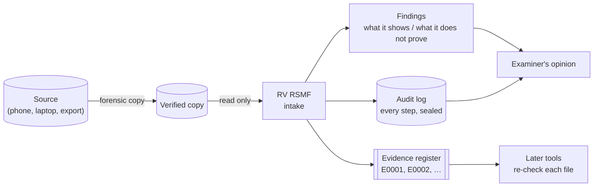
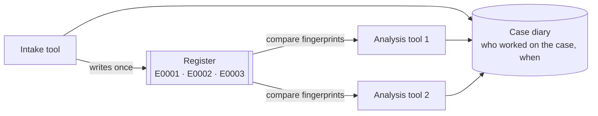
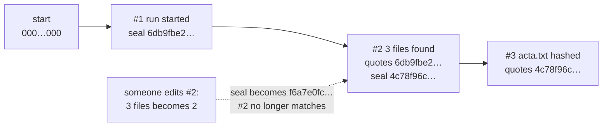
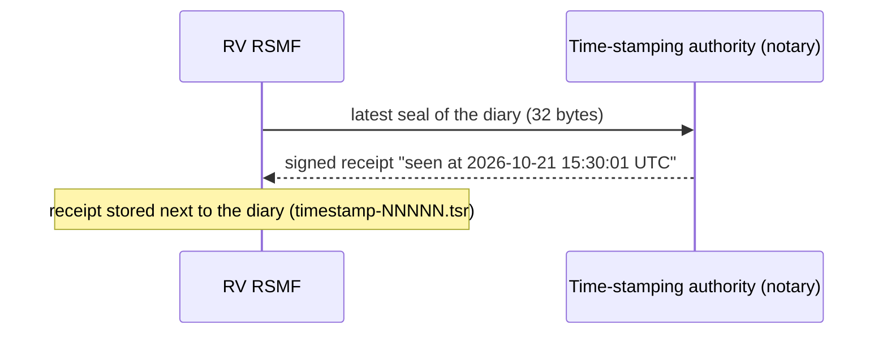
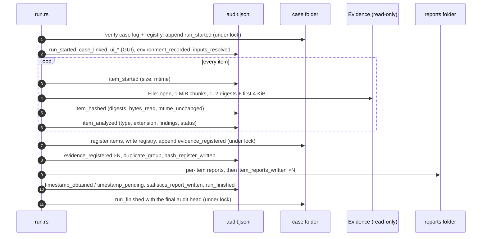
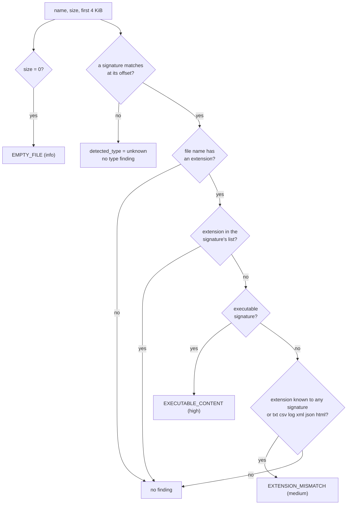
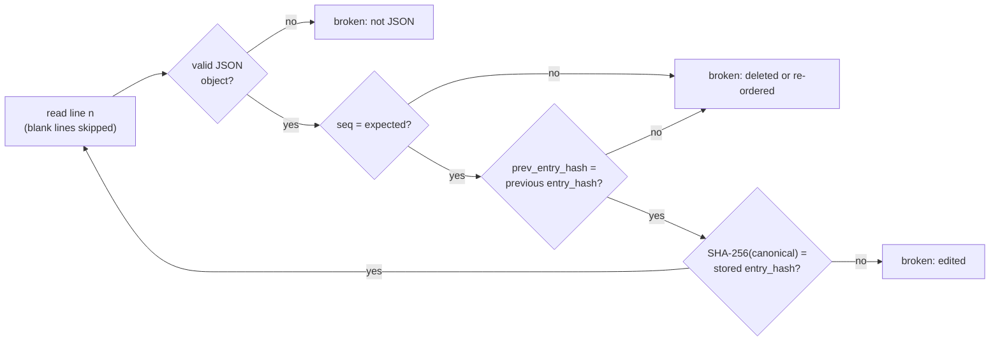
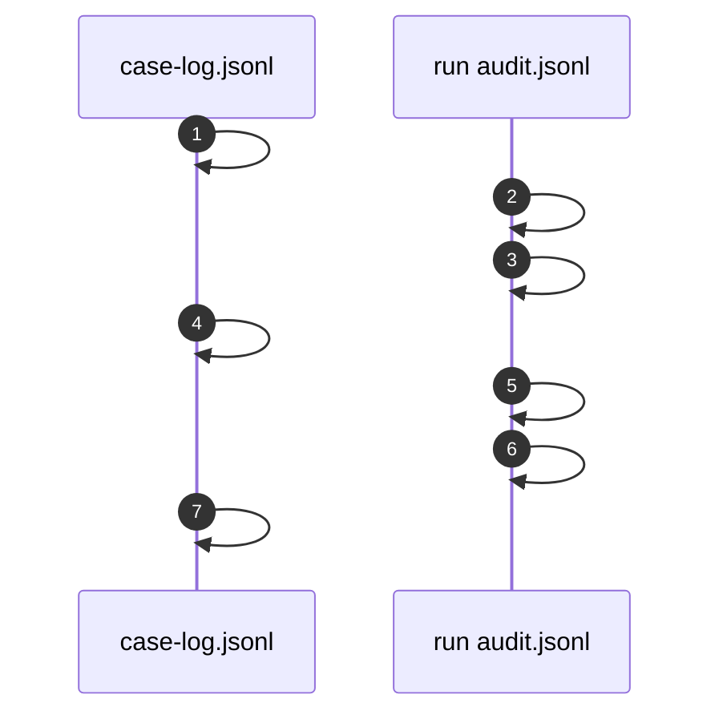
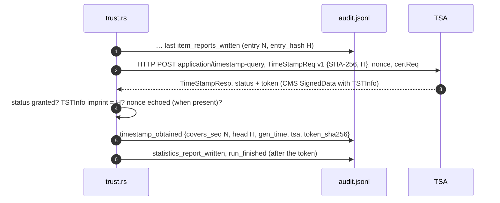

<!--
  Template note for the docs agent of a tool scaffolded from rv-rsmf:
  sections between forge:domain markers describe what THIS tool does (inventory, file types, duplicates,
  intake role) and must be rewritten for the new tool. Everything outside the markers (hashing, audit chain,
  case folder, RFC 3161, signed PDFs, custody forms, determinism) is shared code: keep it, and re-check the
  numbers against the code. The scaffold replaces the tool name everywhere, so re-read any sentence that
  names the intake tool.
-->

# Theory of operation

This page explains **why** each step of RV RSMF works, at two levels:

- **[Part A — For clients, lawyers and judges](#part-a--for-clients-lawyers-and-judges)**: plain language,
  analogies and pictures. No knowledge of computing or cryptography is needed.
- **[Part B — For examiners and opposing experts](#part-b--for-examiners-and-opposing-experts)**: algorithms,
  data structures, exact constants, the source file that implements each one, and the standards behind them.
  Every number in Part B is taken from the code of this commit or computed for this page with the tool itself;
  where the code and a standard or another page differ, Part B says so.

It describes what the tool **does**, not what it should do. Known weaknesses are stated where they apply and
collected in [admissibility.md](admissibility.md#consolidated-gap-list). How to run the tool:
[usage.md](usage.md). How to install and verify it: [installation.md](installation.md).

## Contents

- Part A: [A1 What the tool is](#a1-what-the-tool-is-and-is-not) ·
  [A2 Digital fingerprints](#a2-digital-fingerprints-hashes) ·
  [A3 Two fingerprints, one reading](#a3-two-fingerprints-one-reading) ·
  [A4 What a file really is](#a4-what-a-file-really-is-its-first-bytes) ·
  [A5 Identical copies](#a5-identical-copies) ·
  [A6 The case folder](#a6-the-case-folder-one-register-for-the-whole-case) ·
  [A7 The tool's own diary](#a7-the-tools-own-diary-the-audit-log) ·
  [A8 Proving when](#a8-proving-when-trusted-timestamps) ·
  [A9 Signed reports](#a9-signed-reports) ·
  [A10 Custody forms](#a10-custody-forms) ·
  [A11 Reading a clean result](#a11-what-no-findings-means)
- Part B: [B1 Source map](#b1-source-map-and-constants) ·
  [B2 Pipeline](#b2-pipeline-and-reads-of-the-evidence) ·
  [B3 Hashing](#b3-single-pass-dual-hashing) ·
  [B4 Type detection](#b4-type-detection-by-magic-bytes-and-extension-mismatch) ·
  [B5 Duplicates](#b5-duplicate-detection-by-digest) ·
  [B6 Audit chain](#b6-the-audit-hash-chain) ·
  [B7 Case folder](#b7-the-case-folder) ·
  [B8 RFC 3161](#b8-rfc-3161-trusted-timestamp) ·
  [B9 Signed reports](#b9-signed-pdf-reports) ·
  [B10 Custody forms](#b10-custody-forms) ·
  [B11 Determinism](#b11-determinism-and-repeatability) ·
  [B12 What findings do not prove](#b12-what-each-finding-does-not-prove) ·
  [B13 References](#b13-references)

---

# Part A — For clients, lawyers and judges

<!-- forge:domain -->
## A1 What the tool is (and is not)

RV RSMF is the **intake desk** of a digital investigation. Before anyone examines a file, the tool writes down
what was received: every file's exact digital fingerprint, its size, what kind of file it really is, and whether
anything looks wrong (a photo that is really a PDF, a program hidden under another name, an empty file, two
identical copies). In a case folder it gives each file an evidence number (`E0001`, `E0002`, …) so that every
later tool can prove it looked at exactly the same bytes.

It never says "this file is genuine" or "this file is fake". Each observation is written as a **finding** that
says, in plain words, **what it shows** and **what it does not prove**. The conclusion belongs to a human
examiner.



| The tool can tell you | The tool cannot tell you |
| --- | --- |
| The exact fingerprint of every file it received, and that later copies are identical | That the copy it received equals the original source |
| That a file's content does not match its name (e.g. a PDF called `.jpg`) | Why it was renamed, or by whom |
| That two files have identical content | Who copied them, or when |
| Every action it performed, in a log that shows any later edit | Whether the workstation's clock was right |
<!-- /forge:domain -->

## A2 Digital fingerprints (hashes)

A **hash** is a short code computed from every byte of a file — a fingerprint. Change one character and the
fingerprint changes completely; keep the file identical and the fingerprint is the same on any computer, with any
correct program.

Real example (SHA-256), using the sample file `examples/sample/evidence/acta.txt` (61 bytes):

| Text (last line of the file) | SHA-256 fingerprint |
| --- | --- |
| `Firmado: Ana Ruiz` | `80e089ad6704c831e386b430adf92c5f5b72ec4428566d3580660e103c183c3c` |
| `Firmado: Ana Ruis` | `590570db76a9735f7b3782c73679fc6af6ac4041be4c41bcba1df0b648115523` |

One letter differs; the two fingerprints share nothing recognisable. This is why a hash proves that a file was
**not** changed: if today's fingerprint equals the one written down at intake, the file is the same, bit for bit.

## A3 Two fingerprints, one reading

The examiner may choose **one or two** fingerprint methods (for example SHA-256, the modern standard, plus MD5,
which older case files often use). The tool reads each file **once** and feeds every piece it reads to both
methods at the same time, like a cashier who scans each item once while two tills add it up. Both fingerprints
therefore describe exactly the same bytes. More than two methods at once are refused, so that the work stays
fast on very large folders.

<!-- forge:domain -->
## A4 What a file really is: its first bytes

The name of a file (`holiday.jpg`) is a label anyone can change. The **first bytes** of the content are harder to
fake by accident: most formats start with a fixed "signature" — PDF documents start with `%PDF-`, JPEG photos with
the bytes `FF D8 FF`, Windows programs with `MZ`. The tool compares the label with the signature.

The sample `foto-vacaciones.jpg` ("holiday photo") starts with `%PDF-1.4`: it is a PDF renamed as a photo, so the
tool reports *Extension does not match content*. A program hidden under a document name is reported with higher
severity, because opening it could run it.

Limits a court should know: the tool knows 15 common signatures (unknown types are reported as unknown, not as
suspicious); a file without an extension is not compared; and some signatures are very short (2 bytes), so an
ordinary text that happens to start with `MZ` would be reported as a program.

## A5 Identical copies

When two files have the same fingerprint, their contents are identical, whatever their names. The tool groups
them and reports *Duplicate content*. In the sample, `acta.txt` and `acta-copia.txt` are one such pair. A
duplicate is information, not a problem: copies are normal. It does not say which copy came first.
<!-- /forge:domain -->

## A6 The case folder: one register for the whole case

In a real case several Rakvor tools work one after the other. They share **one case folder**, which holds a
register of the evidence. The intake tool writes each file into it once, with its fingerprints and an evidence
number. Every later tool, before examining a file, takes its fingerprint again and compares it with the register:
same fingerprint, same evidence; different fingerprint, a high-severity warning.



The case folder also keeps a **case diary** in which every tool notes when it started and finished and the final
seal of its own diary (A7). The two diaries quote each other, so one cannot be edited without breaking the other.

## A7 The tool's own diary (the audit log)

Everything the tool does is written to a diary, `audit.jsonl`. Each line carries the seal (hash) of the line
before it, like numbered pages where every page quotes the seal of the previous page. Editing, inserting,
deleting or reordering a page breaks the seals from that point on, and `rv-rsmf verify-log` (or an independent
Python script) detects it.



One honest limit: if the **last** pages are torn out, the remaining pages still agree with each other. That is
why the diary's final seal is also written in the case diary, printed in the reports and sent to a notary (A8).

## A8 Proving when: trusted timestamps

The diary proves its own consistency, not *when* it was written. For that, the tool sends the latest seal to a
**time-stamping authority** — an independent online notary — which signs "I saw this seal at 15:30:01 UTC on
21 October 2026". The notary never sees the evidence, only a 32-byte seal.



Without internet the run still finishes; the receipt can be requested later with `rv-rsmf timestamp`. A
timestamp proves the diary existed at that time — not that its content is true.

## A9 Signed reports

With the examiner's certificate, every PDF report is digitally signed, so any later change to a report is
detectable with Adobe Reader or another validator. The HTML and JSON reports are not signed, but their
fingerprints are written in the diary, which is timestamped.

## A10 Custody forms

For every file the tool pre-fills a **chain-of-custody form** — Colombian style (Spanish) or French style (French),
always with an English copy — with the case number, the evidence number, the fingerprints and the times of the
work, and leaves empty rows for the people who hand over and receive the evidence to sign. It is an internal
record that accompanies, but does not replace, the official form of the police, prosecutor or court.

<!-- forge:domain -->
## A11 What "no findings" means

A file without findings is **not** proven authentic. It only means that the checks this tool applies found
nothing. Every report prints these limitations:

- Type detection uses a limited table of common file signatures; unknown types are reported as unknown, not as
  suspicious.
- Modification times come from the file system of the examined copy and may differ from the original source.
- A result without findings does not prove that a file is authentic or unaltered before acquisition.
- A trusted timestamp proves the audit log existed in this exact form at the stated time; it does not prove that
  the examined copy matches the original source.
<!-- /forge:domain -->

---

# Part B — For examiners and opposing experts

## B1 Source map and constants

| Process | Implementation | Key constants (value in this commit) |
| --- | --- | --- |
| Input collection | [src/core/src/input.rs](../src/core/src/input.rs) | folders 1 level unless `--recursive`; symbolic links never followed; paths made absolute and lexically normalised, de-duplicated, sorted by that string bytewise (UTF-8; same rule as the Python profile), numbered from 1; a UTF-8 BOM at the start of an `--input-list` file is ignored |
| Log verification | [src/core/src/verify.rs](../src/core/src/verify.rs) | chain + timestamps + truncation anchors (timestamp `covers_seq`, case log `run_finished`) |
| Hashing | [src/core/src/hash.rs](../src/core/src/hash.rs) | `CHUNK` = 1 MiB (1 048 576 bytes); `MAX_SELECTED` = 2; head kept for detection = first 4 096 bytes; known answers for `"abc"` |
| Pipeline | [src/core/src/run.rs](../src/core/src/run.rs) | progress events every 150 ms; run id = `YYYYMMDDTHHMMSSZ-` + 6 hex of SHA-256(clock, pid, host) |
| Audit chain | [src/core/src/audit.rs](../src/core/src/audit.rs), [tests/verify_chain.py](../tests/verify_chain.py) | genesis = 64 zeros; SHA-256 over canonical JSON |
| Case folder | [src/core/src/case.rs](../src/core/src/case.rs) | schemas `rakvor.case/1`, `rakvor.registry/1`; lock wait 30 s; stale lock 600 s; ids `E%04d` |
| Timestamp, report signing | [src/core/src/trust.rs](../src/core/src/trust.rs) | default TSA `http://timestamp.digicert.com`; HTTP timeout 15 s; response ≤ 1 MiB; nonce 8 bytes |
| PDF writer | [src/core/src/report/pdf.rs](../src/core/src/report/pdf.rs) | A4 595 × 842 pt; signature placeholder 16 384 bytes |
| Reports | [src/core/src/report/mod.rs](../src/core/src/report/mod.rs) | duplicate partners listed ≤ 10, duplicate paths ≤ 20 per group; 6 blank custody transfer rows; item folder name ≤ 60 characters |
| Environment record | [src/core/src/env.rs](../src/core/src/env.rs), [src/core/build.rs](../src/core/build.rs) | compiler, target and every `Cargo.lock` package embedded at build time; product version from `version.txt` |

<!-- forge:domain -->
| Domain process | Implementation | Key constants |
| --- | --- | --- |
| Type detection, extension mismatch, executables, empty files | [src/core/src/analyzer.rs](../src/core/src/analyzer.rs) | 15 signatures; text extensions `txt csv log xml json html` |
| Duplicates, intake registration | [src/core/src/report/mod.rs](../src/core/src/report/mod.rs) `duplicate_groups`; [src/core/src/run.rs](../src/core/src/run.rs) `register_items` | primary (first) algorithm; size > 0 |
| Role in the case folder | [src/core/src/lib.rs](../src/core/src/lib.rs) `CASE_ROLE` | `Intake` |
<!-- /forge:domain -->

The core never prints; the CLI ([src/cli/src/main.rs](../src/cli/src/main.rs)) and the GUI
([src/gui/src/state.rs](../src/gui/src/state.rs)) render the same event stream, so both front-ends produce the
same audit actions, findings and reports.

<!-- forge:domain -->
## B2 Pipeline and reads of the evidence



The evidence is read **once**, sequentially, with `File::open` (read-only access). The type check uses the first
4 096 bytes kept during that same read, so there is no second read and no window in which the bytes hashed and
the bytes examined could differ. The modification time is read before and after hashing and compared
(`mtime_unchanged` in `item_hashed`); a change means the file was being written during the read.

Ordering facts an opposing expert may test:

- Registration happens **after** all items are hashed and **before** duplicates are computed, so a cancelled run
  still registers the items it finished.
- The timestamp is requested after the last `item_reports_written` and **before** the statistics report, so the
  token covers every evidence digest, finding and item-report digest, but not the statistics report or
  `run_finished` (both are written after it; see [B8](#b8-rfc-3161-trusted-timestamp)).
- A wrong certificate password stops the run (`run_failed`) before any evidence byte is read.
<!-- /forge:domain -->

## B3 Single-pass dual hashing

| Algorithm | Standard | Output | Status for evidence |
| --- | --- | --- | --- |
| `md5` | RFC 1321 | 128 bit | Practical collisions since 2004–2005 (Wang & Yu); legacy matching only |
| `sha1` | FIPS 180-4 | 160 bit | Practical collision 2017 (Stevens et al., "SHAttered"); legacy matching only |
| `sha256` | FIPS 180-4 | 256 bit | Default; recommended primary |
| `sha512` | FIPS 180-4 | 512 bit | Recommended |
| `sha3-256` | FIPS 202 | 256 bit | Sound; less familiar to courts |
| `blake3` | BLAKE3 specification (2020) | 256 bit | Sound; not a NIST-approved hash |

Implementations: RustCrypto `md-5`, `sha1`, `sha2`, `sha3` and the official `blake3` crate (exact versions in each
run's `environment.json` → `dependencies`).

```text
hash_reader(r, algos)                                        src/core/src/hash.rs
  validate_selection: 1 ≤ len ≤ 2, the two different        → else usage error (exit 2)
  loop:
    n = r.read(buf[0 .. 1 048 576])                          Interrupted → retry; other error → UNREADABLE
    if n = 0: break
    head += buf[0 .. min(n, 4096 − len(head))]               first 4 KiB, for type detection
    for each hasher h: h.update(buf[0 .. n])                 the same slice feeds both digests
    total += n
    if on_chunk(total) = false: return cancelled             cancel granularity = one chunk
  return (digests in selection order, total, head)
```

- **Same bytes for both digests.** Each chunk is passed to every hasher before the next read, so the two digests
  can only describe the same byte stream. The unit test `one_pass_feeds_two_digests_identically_to_separate_passes`
  checks a 3 MiB + 17-byte stream against separate one-shot digests.
- **Primary algorithm.** The first selected algorithm is the primary: it groups duplicates, is shown as the
  customer's "digital fingerprint" and is compared first with the case registry.
- **`self-test`** checks every algorithm against the published digest of `"abc"` (e.g. SHA-256
  `ba7816bf…f20015ad`, FIPS 180-4 example). It proves the build computes correct digests; it does not test type
  detection or reports.
- **Avalanche, measured** for [A2](#a2-digital-fingerprints-hashes): the two inputs differ in one character
  (`'z'` = 0x7A, `'s'` = 0x73, 2 bits); their SHA-256 digests differ in **136 of 256 bits** (≈ 128 expected for an
  ideal function), and only 4 of the 64 hexadecimal positions coincide.
- **No hash policy.** The tool accepts `md5,sha1` without any SHA-2/SHA-3/BLAKE3 algorithm. Choosing at least
  one collision-resistant algorithm is the examiner's job ([admissibility.md](admissibility.md#consolidated-gap-list), G11).
- **Size.** `item_started` records the size from the file system; `item_hashed` records `bytes_read`. The reports
  use `bytes_read`. A difference between the two means the file changed size while it was being read.

<!-- forge:domain -->
## B4 Type detection by magic bytes and extension mismatch

### Signature table ([analyzer.rs](../src/core/src/analyzer.rs) `SIGNATURES`, first match wins)

| # | Detected type | Offset | Magic bytes | Expected extensions | Executable |
| --: | --- | --: | --- | --- | :-: |
| 1 | PDF document | 0 | `25 50 44 46 2D` (`%PDF-`) | pdf | |
| 2 | PNG image | 0 | `89 50 4E 47 0D 0A 1A 0A` | png | |
| 3 | JPEG image | 0 | `FF D8 FF` | jpg jpeg jpe jfif | |
| 4 | GIF image | 0 | `47 49 46 38` (`GIF8`) | gif | |
| 5 | ZIP / Office Open XML | 0 | `50 4B 03 04` (`PK..`) | zip docx xlsx pptx odt ods jar apk epub | |
| 6 | OLE2 (legacy Office, MSG) | 0 | `D0 CF 11 E0 A1 B1 1A E1` | doc xls ppt msg | |
| 7 | Windows executable (PE) | 0 | `4D 5A` (`MZ`) | exe dll sys scr com efi | yes |
| 8 | Linux executable (ELF) | 0 | `7F 45 4C 46` | so bin elf o | yes |
| 9 | SQLite database | 0 | `SQLite format 3` + `00` | db sqlite sqlite3 | |
| 10 | 7-Zip archive | 0 | `37 7A BC AF 27 1C` | 7z | |
| 11 | RAR archive | 0 | `52 61 72 21 1A 07` | rar | |
| 12 | GZIP archive | 0 | `1F 8B` | gz tgz | |
| 13 | Windows event log (EVTX) | 0 | `ElfFile` + `00` | evtx | |
| 14 | Windows registry hive | 0 | `72 65 67 66` (`regf`) | dat hve | |
| 15 | MP4 / QuickTime video | 4 | `66 74 79 70` (`ftyp`) | mp4 m4v mov m4a 3gp heic | |

### Annotated example: `examples/sample/evidence/foto-vacaciones.jpg` (112 bytes)

```text
offset  bytes                                            text
     0  25 50 44 46 2D 31 2E 34 0A 25 20 73 61 6D 70 6C  %PDF-1.4.% sampl   ◄ bytes 0–4 = signature #1 "PDF document"
    16  65 3A 20 61 20 50 44 46 20 72 65 6E 61 6D 65 64  e: a PDF renamed
    32  20 61 73 20 61 20 70 68 6F 74 6F 0A 31 20 30 20   as a photo.1 0
   ...
    96  20 31 20 30 20 52 20 3E 3E 0A 25 25 45 4F 46 0A   1 0 R >>.%%EOF.
name "foto-vacaciones.jpg" → extension "jpg" (lower-cased text after the last dot)
"jpg" ∉ {pdf}  and  "jpg" is a known extension (signature #3)  → EXTENSION_MISMATCH (medium)
                                                                 detected = "PDF document", extension = "jpg"
```

### Decision ([analyzer.rs](../src/core/src/analyzer.rs) `analyze`)



Consequences that matter in court (all from the code, all tested or testable with the samples):

- A program **without an extension** (`invoice`) or with an unlisted one (`notes.md`) gets no finding: the
  comparison needs an extension, and non-executable mismatches need a known or text extension.
- The PE test is only 2 bytes (`MZ`) and GZIP only 2 bytes (`1F 8B`): a text file `notes.txt` that begins with
  `MZ` is reported as `EXECUTABLE_CONTENT` (false positive). Confirm with a PE parser before relying on it.
- Containers are typed by their outer signature: a `.docx` and a `.jar` are both "ZIP / Office Open XML", so a
  `.jar` renamed `.docx` gives no finding. HEIC and MP4 share `ftyp`.
- Matching is on the content's first bytes only; the extension is case-insensitive (`.JPG` = `.jpg`).
- No error rates have been measured on a labelled corpus ([admissibility.md](admissibility.md#consolidated-gap-list), G5).

## B5 Duplicate detection by digest

```text
duplicate_groups(items)                                     src/core/src/report/mod.rs
  key = primary digest (first selected algorithm)
  only items that were hashed (no UNREADABLE) and have size > 0 (empty files are all identical)
  groups = items sharing a key, if 2 or more            → audit: duplicate_group {algorithm, hash, items}
  each member gets DUPLICATE (info) {algorithm, count, others}, others capped at 10 names + "… (+N)"
```

Two different files with the same SHA-256 would require a collision; no SHA-256 collision is publicly known, and
the generic birthday bound for 256-bit digests is about 2¹²⁸ operations. With `md5` or `sha1` as the primary,
deliberately colliding files can be produced (B3), so a duplicate group computed on MD5 alone proves less. The
complete groups (paths, not only names) are in `statistics.json` and `hashes.csv`.
<!-- /forge:domain -->

## B6 The audit hash chain

Each line of `audit.jsonl` is one JSON object: `seq`, `ts_utc`, `run_id`, `actor`, `action`, optional `item`,
`details`, `prev_entry_hash`, `entry_hash` ([audit.rs](../src/core/src/audit.rs)). `audit.log` is a readable copy of
the same actions; it is not chained and not authoritative.

```text
canonical(e)      = JSON of e without "entry_hash"; keys sorted at every level; no whitespace; UTF-8,
                    non-ASCII not escaped; integers only
                    (Python: json.dumps(e, sort_keys=True, separators=(",", ":"), ensure_ascii=False))
entry_hash_n      = SHA-256( canonical(e_n) )                 hex, lower case
prev_entry_hash_1 = 64 × "0";   prev_entry_hash_n = entry_hash_(n-1);   seq_n = n
```

**Worked example** (computed for this page with the rule above; `rv-rsmf verify-log` accepts these three lines):

```text
#1 canonical (287 bytes)
{"action":"run_started","actor":"Ana Ruiz","details":{"algorithms":["sha256","md5"],"tool":"rv-rsmf",
"version":"0.1.0"},"prev_entry_hash":"0000000000000000000000000000000000000000000000000000000000000000",
"run_id":"20261021T152805Z-e8fd7a","seq":1,"ts_utc":"2026-10-21T15:28:05.817Z"}
   entry_hash = 6db9fbe2ebb025947fc663b32c09cab8d2ed072e7ae5d7ec3250671c34ee71c9

#2 canonical (245 bytes)
{"action":"inputs_resolved","actor":"Ana Ruiz","details":{"bytes":234,"items":3},
"prev_entry_hash":"6db9fbe2…34ee71c9","run_id":"20261021T152805Z-e8fd7a","seq":2,"ts_utc":"2026-10-21T15:28:05.819Z"}
   entry_hash = 4c78f96cb3e945d2705676d5bafa1942cad3146342a9fff9bf94e89f905754aa

#3 canonical (381 bytes)
{"action":"item_hashed","actor":"Ana Ruiz","details":{"bytes_read":61,"hashes":{"sha256":"80e089ad…183c3c"},
"index":2,"mtime_unchanged":true},"item":"D:\\ev\\acta.txt","prev_entry_hash":"4c78f96c…905754aa", …,"seq":3,…}
   entry_hash = 558b0ea25f29bcc8af1cbbcbbc191d1511ad8d040fffea1db6d1a79f76376223

#2 edited ("items":2) → f6a7e0fc0991175781ba340d8a338b11060c28db304e3e33bcf12f3e30a04264 ≠ stored
```

What `verify-log` prints for the three variants (real output):

```text
original           OK  3 entries, chain intact: ./audit.jsonl                                        exit 0
#2 edited          BROKEN  - line 2: entry_hash does not match its content (edited entry)            exit 3
#2 deleted         BROKEN  - line 2: sequence 3 where 2 was expected (deleted or re-ordered entry)
                           - line 2: prev_entry_hash does not link to the previous entry             exit 3
#3 removed (end)   OK  2 entries, chain intact                                                       exit 0
                       truncation not detectable without a timestamp or case record
```

The last variant is why `verify-log` also compares the end of the log with records kept outside it (next
paragraphs): on a standalone log with no timestamp it can only say so.



| Proves | Does not prove, on its own |
| --- | --- |
| No entry was edited, inserted, deleted or reordered **before the last entry present** | That entries were not removed **from the end**: a shorter chain is still valid (see the last line above). Only an anchor outside the log shows that |
| The order of work equals the order of entries | That the whole chain was not recomputed by someone who rewrote it from scratch |
| Report and output digests are bound to the run | When the entries were written (host clock, `ts_utc`) |

External anchors close those gaps: a complete run ends with `run_finished` (or `run_failed` / `run_cancelled`);
the case log records the run's final entry count and head ([B7](#b7-the-case-folder)); the RFC 3161 token binds
entry *N* ([B8](#b8-rfc-3161-trusted-timestamp)); the statistics report prints the head and entry count at the
time it was written; a signed PDF report binds that head to the examiner's key.

`verify-log` uses the first two automatically ([src/core/src/verify.rs](../src/core/src/verify.rs)):

| Anchor found | Check | Result line |
| --- | --- | --- |
| `timestamp-<K>.json` | entry `#K` exists and its hash is the token's imprint; every `timestamp_obtained` entry still has its token file | `truncation: entries up to #K are anchored by the RFC 3161 timestamp (…); n entries after it (…) cannot be proven complete` |
| run in `<CASE>/runs/<tool>/<RUN-ID>/logs` | `run_finished` in the case log: entry `#M` = `audit_entries` exists with hash `audit_head`; only `timestamp_obtained` after it | `truncation: the final entry #M is anchored by the case log (run_finished)` |
| neither | — | `truncation not detectable without a timestamp or case record` |

A log that ends before `#K` or `#M` is reported as `truncated: …` (exit 3). The highest anchor wins; when it is
the final entry, the log is complete as far as anything outside it can tell.

Independent check: [tests/verify_chain.py](../tests/verify_chain.py) re-implements the chain in Python (standard
library) and re-hashes the evidence listed in `hashes.csv` (it needs that file: it is a run checker, not a case-log
checker). The append-only file is opened with `create_new` + `append`: an existing log is never overwritten; only
the `timestamp` command re-opens a log, after verifying it.

## B7 The case folder

Layout and contract: [case-folder.md](case-folder.md). This section explains why the design holds.

```text
<CASE>/case.json               {"schema":"rakvor.case/1","case_id","jurisdiction","created_utc","created_by":{…}}
<CASE>/case-log.jsonl          same chain rule as audit.jsonl; first entry case_created (carries case_json_sha256)
<CASE>/case-log.lock           exists only while a tool appends (created with create_new, removed on drop)
<CASE>/evidence/registry.json  {"schema":"rakvor.registry/1","items":[{evidence_id, path, size, hashes,
                               registered_by:{tool, version, run_id, audit_seq}, registered_utc}]}
<CASE>/evidence/registry.csv   evidence_id,path,size,<algorithms present>,run_id
<CASE>/runs/<tool>/<RUN-ID>/{logs,reports}/
```

Real registry entry from an intake of the sample (path shortened):

```json
{
  "evidence_id": "E0003",
  "hashes": { "md5": "d0532b1672c85a82f561ad2de7e9a57a",
              "sha256": "42503ebb0f9892b30b72e11cfa0cbf5bcb5d60f667d611fa9598c9b4e835c643" },
  "path": "D:\\export\\foto-vacaciones.jpg",
  "registered_by": { "audit_seq": 12, "run_id": "20261021T152805Z-e8fd7a", "tool": "rv-rsmf", "version": "0.1.0" },
  "registered_utc": "2026-10-21T15:28:05.909Z",
  "size": 112
}
```

`registered_by.audit_seq` = 12 points at the `item_hashed` entry of that run's `audit.jsonl` that holds the same
digests, so every registry row can be traced to a sealed log entry.

### Rules

| Rule | Code | Why |
| --- | --- | --- |
| A broken case is never extended | every append re-runs `verify_log_and_registry` under the lock: case-log chain, first entry `case_created`, `case.json` digest, registry digest = last `registry_sha256` in the log | a tool cannot silently build on an edited case |
| One writer at a time | `case-log.lock` created exclusively; wait ≤ 30 s; a lock older than 600 s is reported as stale and **never deleted automatically** | two tools never interleave entries |
| Only the intake role writes the registry | `register` (intake); analysis tools only read it | the reference values cannot drift |
| Paths are compared normalised | `normalize_path`: absolute, lexically normalised (`.`/`..` removed); `same_path`: case-insensitive on Windows (`to_lowercase`), exact elsewhere | the same file is found again by path; `D:\Evidence\a.pdf` = `d:\evidence\A.PDF` on Windows |
| A case run always shares an algorithm with the registry | `ensure_case_algorithm`: if the selection is disjoint from the algorithms present in **every** registered item, add SHA-256 (or the registry's first algorithm), replacing the second choice if two were selected; audited as `case_algorithm_added` | comparison is always possible |
| Evidence ids are never reused | next id = highest number + 1; same path **and** same content keeps its id | an id means one content forever |

### Matching an item against the registry (analysis role)


<!-- forge:domain -->
This tool is the **intake** role (`CASE_ROLE = Intake`): it does not run the matching above. It registers every
item that was hashed: same path and same content keeps the existing id (`already_registered`); a registered path
with other content gets a **new** id and the finding `REGISTRY_PATH_CONTENT_CHANGED` (medium); anything else gets
a new id. Unreadable items are not registered. The analysis matching is in the same code and runs in every tool
scaffolded from this one.
<!-- /forge:domain -->

### Cross-linking of the two chains



(Values from a real intake of the sample.) `verify-case` checks, for every `run_started` in the case log: the run's
`audit.jsonl` chain and timestamp tokens; that its `case_linked` names this case and quotes the `run_started` hash;
and that entry `audit_entries` of the run has hash `audit_head`, with only `timestamp_obtained` allowed after it.
It also warns about run folders the case log never announced. Editing either chain therefore breaks a link, and
truncating a finished run's audit log is detected here (and by `verify-log` on that run, which finds the case log
from the run folder's location, [B6](#b6-the-hash-chained-audit-log)).

With `--rehash`, `verify-case` also re-hashes the evidence: every registry entry whose path is still a file is
read once with the entry's own algorithms (at most two, standard order) and compared with the registry. A path
registered more than once (its content changed between intakes, so it received a new id) is compared with its
latest registration; the earlier ids are listed as superseded. A difference is a problem (exit 3); an unreachable
or unreadable file is a warning, because evidence copies often live on another workstation.

What `verify-case` does **not** do: verify TSA signatures (B8), or prove that the registry's first content equals
the original source.

## B8 RFC 3161 trusted timestamp



The **message imprint is the chain head itself**: the 32 bytes of `entry_hash` of entry *N*, declared as a SHA-256
value. It is not hashed again, so `openssl ts -verify -digest <H>` works directly. Request layout (69 bytes; head
from the worked example of B6, example nonce):

```text
30 43                                   TimeStampReq SEQUENCE, 67 bytes
   02 01 01                             version v1
   30 31                                messageImprint
      30 0D 06 09 60 86 48 01 65 03 04 02 01 05 00     hashAlgorithm sha256 (2.16.840.1.101.3.4.2.1), NULL
      04 20 55 8B 0E A2 … 37 62 23      hashedMessage = entry_hash (32 bytes)
   02 08 1F 3A 5C 7E 9B 2D 4F 60        nonce (8 bytes, high bit cleared: positive INTEGER)
   01 01 FF                             certReq TRUE
```

- Nonce: first 8 bytes of SHA-256(clock, process id), high bit cleared. It detects a replayed response; it is not
  a secret.
- The response is limited to 1 MiB and 15 s. `TSTInfo` is read by a minimal DER walk because many TSAs write
  fractional seconds in `genTime`, which strict decoders reject; `gen_time` is stored to the second. Example: the
  test TSA's token said `15:30:01.367038`, the log says `2026-10-21T15:30:01Z`.
- Stored next to the log: `timestamp-<NNNNN>.tsr` (the DER **TimeStampResp**, not only the token) and
  `timestamp-<NNNNN>.json` (tsa, gen_time, covers_seq, head, token_sha256, file).
- Offline → `timestamp_pending` and the run completes; `rv-rsmf timestamp <log>` later re-verifies the chain and
  appends `timestamp_obtained` for the then-current head (earlier entries are never rewritten).
- `verify-log` and `verify-case` re-check: that entry `covers_seq` is still in the log (otherwise: `truncated`), the
  `.tsr` SHA-256 against `token_sha256`, the TSA status, and that the imprint equals the `entry_hash` of
  `covers_seq`. They do **not** verify the TSA's signature, certificate chain,
  policy OID or accuracy. Do that with OpenSSL against the TSA's published chain
  ([usage.md](usage.md#6-timestamps)) before relying on the time in court (gap G18). Real check of the test token:
  `openssl ts -verify -digest 53b0de42…a91a61 -in timestamp-00018.tsr -CAfile ca.pem -untrusted tsa.pem` →
  `Verification: OK`.
- The default TSA URL is plain HTTP; integrity rests on the TSA's signature, which is why the OpenSSL check
  matters. eIDAS qualified status depends on the TSA chosen ([admissibility.md](admissibility.md)).

Standards: RFC 3161 (Time-Stamp Protocol), RFC 5816 (ESSCertIDv2 update), RFC 5652 (CMS).

## B9 Signed PDF reports

<!-- forge:domain -->
Reports are written by a small built-in PDF writer ([report/pdf.rs](../src/core/src/report/pdf.rs)): PDF 1.4,
A4, the standard Helvetica, Helvetica-Bold and Courier fonts with WinAnsiEncoding (English, Spanish and French
characters; anything else becomes `?`), no embedded fonts, one cross-reference table, one `%%EOF`.
<!-- /forge:domain -->

With `--sign-cert`, the file is written **once** with a signature placeholder and then signed in place (no
incremental update):

```text
technical.en.pdf of the sample (39 620 bytes), real values
… 9 0 obj << /Type /Sig /Filter /Adobe.PPKLite /SubFilter /adbe.pkcs7.detached
             /ByteRange [0 0000006359 0000039129 0000000491] /Contents <3082…000> /M (D:…) /Reason (…) >>
  widget /FT /Sig /T (RakvorExaminerSignature), invisible, on page 1;  catalog /AcroForm /SigFlags 3
0                  6359                                   39129              39620
├──── signed ──────┤<── /Contents: 32 770 bytes ─────────>├──── signed ──────┤
                     "<" + 32 768 hex digits + ">"  = room for 16 384 bytes of CMS (2 086 used here)
```

1. Write the whole PDF with `/ByteRange [0 0000000000 0000000000 0000000000]` and `/Contents <000…0>`, and keep
   the offset at which the signature dictionary object was written (the xref offset of `9 0 obj` above).
2. Locate both placeholders **inside that object only** — page text that happens to contain `/Contents <0000` or
   the byte-range marker is never touched (unit test `placeholder_bytes_in_page_text_are_left_alone`) — and fill
   the byte range with fixed-width (10-digit) numbers, so no offset moves.
3. Sign `file[0 .. 6359] ‖ file[39129 .. 39620]` ([trust.rs](../src/core/src/trust.rs) `PdfSigner`): CMS
   SignedData, detached, SHA-256, RSA PKCS #1 v1.5, signed attributes content-type, signing-time and
   message-digest, certificates from the `.p12`/`.pfx`. RSA keys only.
4. Write the DER as upper-case hex into the placeholder.

Independent check of the file above with pyHanko: `INTACT:UNTRUSTED,UNTOUCHED`, coverage `ENTIRE_FILE`, digest
SHA-256 (untrusted only because the test certificate has no trusted root). The trust test does the same on every
signed PDF of a run ([tests/validate_pdf_signature.py](../tests/validate_pdf_signature.py), through
`RV_TEST_PYTHON`): each must be intact and cryptographically valid; an untrusted chain is expected with the test CA.

This is a plain ISO 32000-1 CMS signature. It is not a PAdES baseline signature (ETSI EN 319 142-1: SubFilter
`ETSI.CAdES.detached` and a signing-certificate-v2 attribute), it carries no signature timestamp and no revocation
data. Its legal weight depends on the certificate ([admissibility.md](admissibility.md), gap G3). The certificate
subject and SHA-256 fingerprint are logged as `signing_certificate_loaded` and printed on every report (HTML, PDF,
and `run.pdf_signer_certificate_sha256` in the JSON); the password is never logged, and the interactive prompt does
not echo it.

## B10 Custody forms

One form per item, `custody.json` plus HTML and PDF in the jurisdiction's language and in English
([report/mod.rs](../src/core/src/report/mod.rs) `custody_*`, [templates/custody.html](../templates/custody.html),
[schemas/item-custody.schema.json](../schemas/item-custody.schema.json)).

| Field | Colombia (`co`, Spanish) | France (`fr`, French) | Filled from |
| --- | --- | --- | --- |
| Title and legal basis | Ley 906 de 2004 arts. 254–266, Fiscalía manual, Ley 527 de 1999 | CPP arts. 156 ff.; seal number refers to the judicial *scellé* | i18n catalogue |
| Case | Case number (NUNC) | Case / procedure reference | `case_id` |
| Item code | Evidence item (EMP/EF) code | Seal number | evidence id `E0001…` in a case folder, else `<RUN-ID>-<NNNNN>` |
| Registered at intake | date and time (UTC) | same | registry `registered_utc` (case folder only) |
| Description, location | file name · size · detected type; path of the examined copy | same | the run |
| Integrity values | every digest of the run | same | `item_hashed` |
| Operations | tool, version, run id, start and end (UTC), audit entries `#first–#last` | same | the run |
| Transfers | 6 blank rows: date and time, delivered by, received by (name, ID, signature), purpose, condition of packaging / media | same | to sign by hand |
| Signatures | examiner, receiver | same | to sign by hand |

`custody.json` lists `transfers: []`: the tool never invents a transfer; the physical chain is completed by
people. The form is a working aid, not the official Fiscalía *Registro de Cadena de Custodia* or a French
*scellé* record ([admissibility.md](admissibility.md#consolidated-gap-list), G9).

## B11 Determinism and repeatability

| Same input + same build gives the same … | Varies between runs |
| --- | --- |
| evidence digests, `bytes_read`, detected types, findings and their parameters | `run_id`, `ts_utc`, every `entry_hash` (they include time) |
| item order and numbering (sorted paths), duplicate groups | absolute paths of the outputs, host, OS user (in `environment.json`) |
| `hashes.csv` rows | report digests (reports print run id, times, the audit head); PDF `/CreationDate` |
| evidence ids for an unchanged path and content (case folder) | the RFC 3161 token and nonce |

Measured for this page: the Rust and Python builds of this tool, run on the sample with the same algorithms, gave
identical digests, detected types and findings (compared on every `technical.json`). Item numbers are identical
too: both profiles make each path absolute and lexically normalised and sort by that string **bytewise (UTF-8)**,
so `a-b/x.txt` comes before `a/x.txt` ('-' 0x2D < '/' 0x2F) and `B.txt` before `a.txt`. The cross-profile test
compares the numbering of such a folder ([input.rs](../src/core/src/input.rs) `items_are_sorted_by_normalised_path_bytes`;
`cross_language_case_verification` with `RV_CROSS_PROJECT`), and CI verifies a case folder written by the Python
profile ([tests/golden/](../tests/golden/regenerate.py)). File names that are not valid UTF-8 are outside this
contract.

`environment.json` records the tool version, `rustc` version, target triple, every package and version listed in
`Cargo.lock` (495 entries at this commit, for all platforms — not only those compiled into this binary), OS,
host, OS user, working directory and command line (or the GUI settings), so a second examiner can rebuild the same
version and repeat the run (ISO/IEC 27037 repeatability and reproducibility, [admissibility.md](admissibility.md#61-isoiec-270372012--identification-collection-acquisition-and-preservation-of-digital-evidence)).

<!-- forge:domain -->
## B12 What each finding does not prove

| Finding (severity) | Rule (code) | Shows | Does not prove |
| --- | --- | --- | --- |
| `EMPTY_FILE` (info) | bytes read = 0 | The file has 0 bytes | Whether it was emptied on purpose or created empty |
| `EXTENSION_MISMATCH` (medium) | signature found; extension not in its list; extension known or textual ([B4](#b4-type-detection-by-magic-bytes-and-extension-mismatch)) | Name and content signature disagree | An attempt to hide content; renaming is common and often innocent |
| `EXECUTABLE_CONTENT` (high) | PE or ELF signature; extension not an executable one | A program stored under a non-program name | That the program is malicious; a 2-byte `MZ` match can be a false positive |
| `DUPLICATE` (info) | same primary digest, size > 0 ([B5](#b5-duplicate-detection-by-digest)) | Identical content in several files | Who copied the file, when, or which copy is the original |
| `UNREADABLE` (high) | open or read error | The OS error text | That the file is damaged; permissions and locks cause this |
| `REGISTRY_PATH_CONTENT_CHANGED` (medium) | intake: registered path, other content | The path now holds other content (new evidence id) | Which version is the original, or why it changed |
<!-- /forge:domain -->

Case-folder findings (shared by every tool in the analysis role):

| Finding (severity) | Rule (code) | Shows | Does not prove |
| --- | --- | --- | --- |
| `EVIDENCE_HASH_MISMATCH_WITH_CASE` (high) | matched entry, a common algorithm differs ([B7](#matching-an-item-against-the-registry-analysis-role)) | The file examined is not bit-identical to the registered item | Who changed it, when, or whether deliberately |
| `EVIDENCE_NOT_IN_CASE_REGISTRY` (medium) | no entry by id, path or content | Continuity from intake cannot be shown for this file | That the file is altered or irrelevant |

The exact wording printed in reports is in [i18n/en.json](../i18n/en.json) (`findings`; also es, fr); a test
enforces the same keys in all three languages.

## B13 References

Standards and specifications

- NIST FIPS 180-4 (Secure Hash Standard, 2015); NIST FIPS 202 (SHA-3, 2015); RFC 1321 (MD5, 1992).
- J. O'Connor, J.-P. Aumasson, S. Neves, Z. Wilcox-O'Hearn, *BLAKE3: one function, fast everywhere* (2020).
- RFC 3161 (Time-Stamp Protocol, 2001); RFC 5816 (ESSCertIDv2 update for RFC 3161, 2010); RFC 5652
  (Cryptographic Message Syntax, 2009); RFC 8017 (PKCS #1 v2.2, 2016); RFC 5280 (X.509 PKI profile, 2008).
- ISO 32000-1:2008, *PDF 1.7* (§12.8 digital signatures); ETSI EN 319 142-1 (PAdES baseline signatures).
- ISO/IEC 27037:2012 (identification, collection, acquisition and preservation of digital evidence) — see
  [admissibility.md](admissibility.md) for what was verified of it.

Academic and practitioner literature

- X. Wang, H. Yu, "How to Break MD5 and Other Hash Functions", EUROCRYPT 2005.
- M. Stevens, E. Bursztein, P. Karpman, A. Albertini, Y. Markov, "The first collision for full SHA-1",
  CRYPTO 2017.

<!-- forge:domain -->
- G. Kessler, *File Signatures Table* (garykessler.net) and the `file(1)` / libmagic database — practitioner
  references for magic numbers (to be verified against the entries of [B4](#b4-type-detection-by-magic-bytes-and-extension-mismatch)).
- Format specifications for the signatures used: ISO 32000-1 (PDF header), ISO/IEC 15948 (PNG), ITU-T T.81
  (JPEG SOI marker), PKWARE APPNOTE (ZIP local file header), RFC 1952 (GZIP), ISO/IEC 14496-12 (`ftyp` box),
  Microsoft PE/COFF specification (`MZ` DOS header).
<!-- /forge:domain -->

Independent oracles used to cross-check this tool: Python `hashlib`/`blake3` for
[examples/sample/expected_hashes.csv](../examples/sample/expected_hashes.csv) and
[tests/verify_chain.py](../tests/verify_chain.py) (both in CI); JSON Schemas via
[tests/validate_reports.py](../tests/validate_reports.py) (in CI); pyHanko for signed PDFs
([tests/validate_pdf_signature.py](../tests/validate_pdf_signature.py), in CI); OpenSSL for RFC 3161 tokens
(manual, see above); the Python profile of this tool: a committed case folder it wrote
([tests/golden/](../tests/golden/regenerate.py), in CI) and the live cross-profile test (case folders and item
numbering, run when `RV_CROSS_PROJECT` is set).
