# Theory of operation

This page explains **what RV RSMF does to the data and why each step can be trusted**, at two levels:

- **[Part A — For clients, lawyers and judges](#part-a--for-clients-lawyers-and-judges)**: plain language,
  analogies and pictures. No knowledge of computing is needed.
- **[Part B — For examiners and opposing experts](#part-b--for-examiners-and-opposing-experts)**: file formats,
  parsing rules, exact constants, the source file that implements each one, and the standards and sources behind
  them. Every number in Part B is taken from the code of this commit or produced for this page with the tool
  itself (the synthetic samples in [examples/](../examples/README.md)); where the code and a specification or
  another page differ, Part B says so.

It describes what the tool **does**, not what it should do. Facts about the export formats that are not confirmed
by a primary specification or real exports are marked **unverified**. Known weaknesses are stated where they apply
and collected in [admissibility.md](admissibility.md#consolidated-gap-list). How to run the tool:
[usage.md](usage.md). Every output file and finding: [reports.md](reports.md).

## Contents

- Part A: [A1 What the tool is](#a1-what-the-tool-is-and-is-not) ·
  [A2 What an RSMF file is](#a2-what-an-rsmf-file-is) ·
  [A3 One message at a time, with its address](#a3-one-message-at-a-time-with-its-address) ·
  [A4 Clocks and time zones](#a4-clocks-and-time-zones) ·
  [A5 Dates that read two ways](#a5-dates-that-read-two-ways) ·
  [A6 What an export leaves out](#a6-what-an-export-leaves-out) ·
  [A7 Digital fingerprints](#a7-digital-fingerprints-hashes) ·
  [A8 The case folder](#a8-the-case-folder-one-register-for-the-whole-case) ·
  [A9 The tool's own diary](#a9-the-tools-own-diary-the-audit-log) ·
  [A10 Proving when](#a10-proving-when-trusted-timestamps) ·
  [A11 Signed reports and custody forms](#a11-signed-reports-and-custody-forms) ·
  [A12 What a clean result means](#a12-what-a-clean-result-means)
- Part B: [B1 Source map](#b1-source-map-and-constants) ·
  [B2 Pipeline](#b2-pipeline-and-reads-of-the-evidence) ·
  [B3 Exports](#b3-recognising-and-grouping-exports) ·
  [B4 Model](#b4-the-neutral-chat-model) ·
  [B5 Sources](#b5-how-each-source-is-read) ·
  [B6 Time](#b6-time-local-time-to-utc-and-the-date-order) ·
  [B7 Slicing](#b7-slicing-conversation--day-and-the-10000-event-rule) ·
  [B8 RSMF structure](#b8-the-rsmf-20-file-we-write) ·
  [B9 Reactions](#b9-reactions-and-relativity-shortcodes) ·
  [B10 Determinism](#b10-deterministic-writing) ·
  [B11 Validation](#b11-validation-and-read-back) ·
  [B12 Trace map](#b12-the-trace-map) ·
  [B13 Hashing](#b13-single-pass-dual-hashing) ·
  [B14 Audit chain](#b14-the-audit-hash-chain) ·
  [B15 Case folder](#b15-the-case-folder) ·
  [B16 RFC 3161](#b16-rfc-3161-trusted-timestamp) ·
  [B17 Signed PDFs](#b17-signed-pdf-reports) ·
  [B18 Custody forms](#b18-custody-forms) ·
  [B19 Repeatability](#b19-determinism-and-repeatability-of-a-whole-run) ·
  [B20 Findings](#b20-how-each-finding-is-decided) ·
  [B21 References](#b21-references)

---

# Part A — For clients, lawyers and judges

## A1 What the tool is (and is not)

People hand over chat conversations as **exports**: WhatsApp's "Export chat" file, Telegram Desktop's "Export chat
history", Microsoft Teams messages exported from Microsoft Purview, or the spreadsheet (CSV) a mobile forensic
tool produces. Review platforms such as Relativity cannot read those files as conversations. RV RSMF **converts**
them into Relativity's chat format, RSMF, without changing what the messages say, and writes down where every
converted message came from.

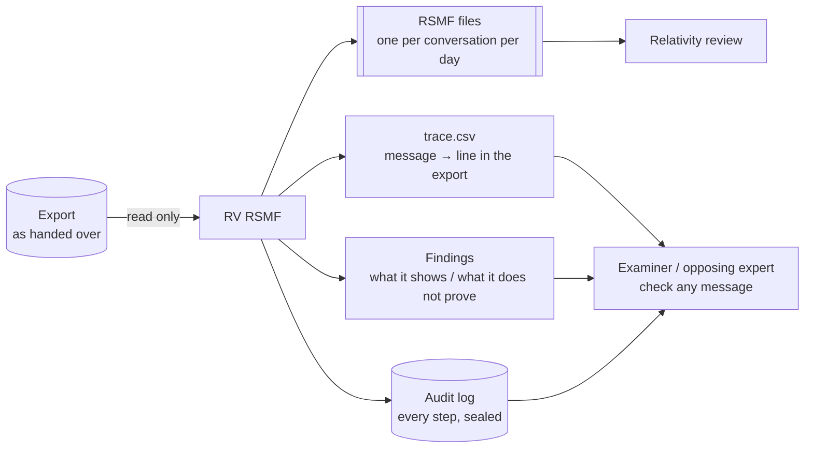

| The tool can tell you | The tool cannot tell you |
| --- | --- |
| Exactly which export (by its fingerprint) each RSMF file came from, and the line or message id of every converted message | That the export is genuine: an export is a text or JSON file that anyone could have edited before it was handed over |
| The time of every message in UTC, given the time zone the examiner chose, with the original wording of the time kept next to it | Which time zone the phone really used, if the export does not say so |
| What the export left out that it says it left out (media omitted, files not included, edited messages without their earlier text) | What deleted messages or omitted media contained |
| That every RSMF file follows Relativity's published format and reads back exactly as written | How a particular Relativity version will display it |

The tool never decides what a conversation means. Each observation is written as a **finding** that says, in
plain words, **what it shows** and **what it does not prove**.

## A2 What an RSMF file is

An RSMF file is built like an **e-mail with one attachment**. The e-mail's text holds the words of all the
messages (so they can be searched); the attachment, `rsmf.zip`, holds a **manifest** — a structured list of the
people, the conversation and every message with its time, sender, replies and reactions — plus the photos and
files that were sent. Relativity reads the manifest and shows the messages as a chat.

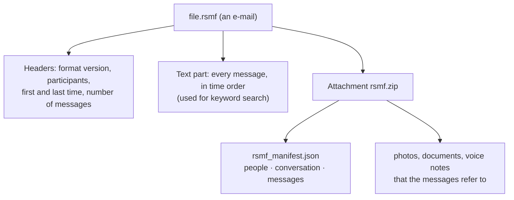

RV RSMF writes **one file per conversation per day**, because Relativity limits a file to 10,000 messages and
reviewers work by day. A very busy day is split into parts. All the files of one conversation carry the same
"collection" number, so Relativity knows they belong together.

## A3 One message at a time, with its address

The tool reads the export the way a clerk would copy a ledger: line by line, noting for each message **where it
was written** (file and line number, or the message number the app gave it) and the time **exactly as written**.
These "addresses" go into each converted message and into a table, `trace.csv`, with one row per message:

| export | line | time as written | UTC | RSMF file | message id |
| --- | --: | --- | --- | --- | --- |
| `WhatsApp Chat with Ana Ruiz.txt` | 4–6 | `02/03/2026, 10:00` | `2026-03-02T09:00:00Z` | `…/Ana-Ruiz-aa3173/2026-03-02.rsmf` | `e-000004` |

(A real row from the sample.) With this table anyone can pick a message in Relativity, open the export at the
stated line and compare. Lines the tool could not read are not silently dropped: they are counted and quoted in a
finding.

## A4 Clocks and time zones

A WhatsApp export writes times **as the phone's clock showed them** — "10:00" — without saying in which country.
10:00 in Paris and 10:00 in Bogotá are seven hours apart in March. Relativity needs one common clock, UTC. So the
examiner must state the phone's time zone (`--timezone Europe/Paris`); the tool never guesses it, and stops if it
is missing. Telegram and Teams exports already contain UTC times and need no choice.

Twice a year, daylight-saving time makes some clock readings odd: in spring one hour **does not exist** (02:30 on
29 March 2026 in Paris), in autumn one hour **happens twice** (02:30 on 25 October 2026). The tool converts these
by a fixed rule (moved forward one hour; the earlier of the two), reports every such message, and keeps the
original text, so nobody is misled.

## A5 Dates that read two ways

"03/04/26" is 3 April in Colombia and France, but 4 March in the United States. The export does not say which. The
tool looks at **all** the dates in the file: if any of them has a number above 12 in the first position
("25/04/26"), the file must be day-first; above 12 in the second position, month-first. Only when every date
could be read both ways does the tool stop and ask the examiner to decide (`--date-order`). The decision, or the
line that settled it, is printed in the report.

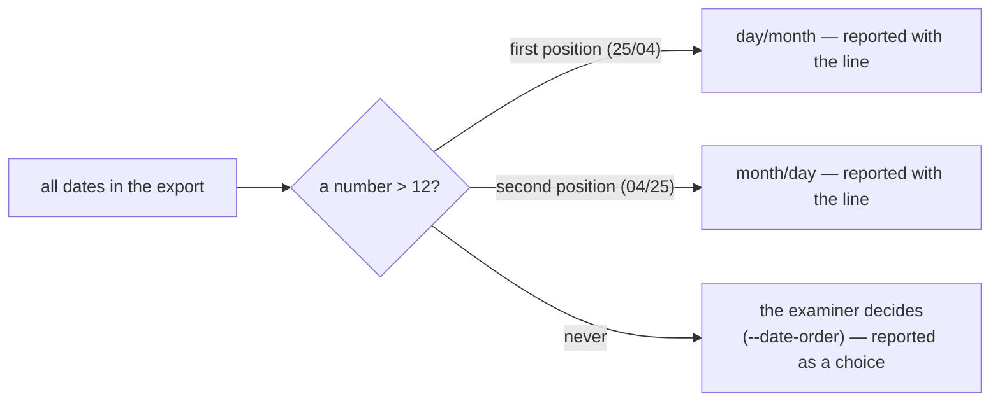

## A6 What an export leaves out

An export is **not** the phone. WhatsApp leaves out messages deleted before the export and, when exported
"without media", every photo; Telegram may skip large files; no export carries the earlier text of an edited
message. The RSMF can only contain what the export contains. Where the export itself says something is missing
(`<Media omitted>`, "File not included"), the converted message says so in its text — `[attachment not in export:
… — …]` — and a finding counts the cases. It does not show what was missing or why.

## A7 Digital fingerprints (hashes)

A **hash** is a short code computed from every byte of a file — a fingerprint. Change one character and the
fingerprint changes completely; keep the file identical and the fingerprint is the same on any computer.

| One line of an export | SHA-256 fingerprint |
| --- | --- |
| `… Ana Ruiz: Note: the deadline is 20/03 at 17:00` | `df836b349608cc3840e3da99be448593d6f563ce2f771352c103363e3243d81a` |
| `… Ana Ruiz: Note: the deadline is 20/03 at 18:00` | `775582dc9ce31c68f7785783560fae4c53407d7e8e6a6132208edb63e0b41df2` |

One digit differs; the fingerprints share nothing recognisable. The tool fingerprints every export it receives,
every RSMF file it writes and every attachment it packs, so anyone can later prove that the files in Relativity are
the ones this run produced from that export.

## A8 The case folder: one register for the whole case

In a real case several Rakvor tools work one after the other in **one case folder**. The intake tool, RV HashInv,
registers each evidence file once with its fingerprints and an evidence number (`E0001`, …). RV RSMF, before it
converts anything, fingerprints each file again and compares: same fingerprint, same evidence; different, a
high-severity warning. Both tools write in a shared **case diary**.

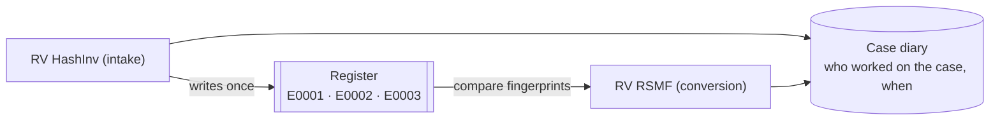

## A9 The tool's own diary (the audit log)

Everything the tool does — each file fingerprinted, each export read, each RSMF file written and checked — is
written to a diary, `audit.jsonl`. Each line carries the seal (hash) of the line before it, like numbered pages
where every page quotes the seal of the previous page. Editing, inserting, deleting or reordering a page breaks
the seals from that point on, and `rv-rsmf verify-log` (or an independent Python script) detects it.

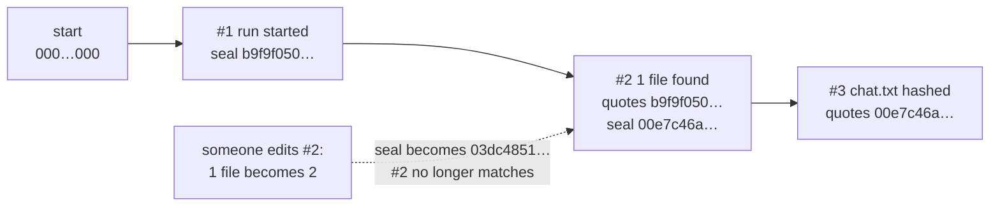

One honest limit: if the **last** pages are torn out, the remaining pages still agree with each other. That is why
the final seal is also written in the case diary, printed in the reports and sent to a notary (A10).

## A10 Proving when: trusted timestamps

The diary proves its own consistency, not *when* it was written. For that, the tool sends the latest seal to a
**time-stamping authority** — an independent online notary — which signs "I saw this seal at this time". The
notary never sees the evidence, only a 32-byte seal. Without internet the run still finishes; the receipt can be
requested later with `rv-rsmf timestamp`. A timestamp proves the diary existed at that time — not that its content
is true.

## A11 Signed reports and custody forms

With the examiner's certificate, every PDF report is digitally signed, so any later change is detectable. For every
file the tool also pre-fills a **chain-of-custody form** — Colombian style (Spanish) or French style (French),
always with an English copy — with the case number, the evidence number, the fingerprints and the times of the
work, and leaves rows for the people who hand over and receive the evidence to sign. It accompanies, but does not
replace, the official form of the police, prosecutor or court.

## A12 What a clean result means

An RSMF file that passes every check is **a faithful conversion of the export**, not proof that the conversation
happened as shown. Every report prints these limitations:

- The RSMF files reproduce the export as delivered, not the phone or account: messages deleted before the export,
  unexported media and edit history are not in them.
- rv-rsmf converts; it does not authenticate. A chat export can be edited before it reaches the examiner;
  corroborate it with a forensic extraction or the other party's copy.
- Files are checked against the published RSMF 2.0 schema and read back; how a given Relativity version displays
  them was not tested.
- Reactions are mapped with a fixed table of Relativity emoji shortcodes; other reactions are kept as text.
- A trusted timestamp proves the audit log existed at the stated time, not that the export matches the original
  source.

---

# Part B — For examiners and opposing experts

## B1 Source map and constants

| Process | Implementation | Key constants (value in this commit) |
| --- | --- | --- |
| Input collection | [src/core/src/input.rs](../src/core/src/input.rs) | folders 1 level unless `--recursive`; symbolic links never followed; paths made absolute and lexically normalised, de-duplicated, sorted bytewise (UTF-8), numbered from 1 |
| Hashing | [src/core/src/hash.rs](../src/core/src/hash.rs) | `CHUNK` = 1 MiB; `MAX_SELECTED` = 2; first 4 096 bytes kept for type detection; known answers for `"abc"` |
| Type check of every input file | [src/core/src/analyzer.rs](../src/core/src/analyzer.rs) | 15 magic-byte signatures; `EMPTY_FILE`, `EXTENSION_MISMATCH`, `EXECUTABLE_CONTENT` |
| Export detection and grouping | [src/core/src/sources/mod.rs](../src/core/src/sources/mod.rs) | detection reads the first 64 KiB; see [B3](#b3-recognising-and-grouping-exports) |
| Neutral model | [src/core/src/model.rs](../src/core/src/model.rs) | ids `p-`/`c-` + 12 hex of SHA-256; events `e-NNNNNN` |
| Parsers | [whatsapp.rs](../src/core/src/sources/whatsapp.rs), [telegram.rs](../src/core/src/sources/telegram.rs), [teams.rs](../src/core/src/sources/teams.rs), [csvmap.rs](../src/core/src/sources/csvmap.rs) | [B5](#b5-how-each-source-is-read) |
| Local time → UTC | [src/core/src/rsmf/mod.rs](../src/core/src/rsmf/mod.rs) `local_to_utc` | IANA zones from `chrono-tz` 0.10.4 (data compiled in) |
| Slicing, writing, reading, validation | [src/core/src/rsmf/mod.rs](../src/core/src/rsmf/mod.rs) | `RSMF_VERSION` = `2.0.0`; `MAX_EVENTS` = 10 000; split windows 12 h then 8 h; zip time 1980-01-01, deflate level 6 |
| Official schema | [schemas/rsmf_schema_2_0_0.json](../schemas/rsmf_schema_2_0_0.json) | draft-07, Relativity (`$id` `http://relativity.com/RSMF/2.0.0/schema.json`) |
| Reaction shortcodes | [src/core/src/rsmf/shortcodes.rs](../src/core/src/rsmf/shortcodes.rs) | 52 entries, `TABLE_VERSION` "relativity-supported-emoji checked 2026-10-27 (Server 2024 page)"; 30-character limit |
| Conversion stage, trace map | [src/core/src/convert.rs](../src/core/src/convert.rs) | `trace.csv`, `trace.json`, `conversions.json` |
| Pipeline | [src/core/src/run.rs](../src/core/src/run.rs) | progress every 150 ms; run id `YYYYMMDDTHHMMSSZ-` + 6 hex |
| Audit chain | [src/core/src/audit.rs](../src/core/src/audit.rs), [tests/verify_chain.py](../tests/verify_chain.py) | genesis = 64 zeros; SHA-256 over canonical JSON |
| Log verification | [src/core/src/verify.rs](../src/core/src/verify.rs) | chain + timestamps + truncation anchors |
| Case folder, intake delegation | [src/core/src/case.rs](../src/core/src/case.rs), [src/core/src/intake.rs](../src/core/src/intake.rs) | `rakvor.case/1`, `rakvor.registry/1`; lock wait 30 s, stale lock 600 s; rv-hashinv ≥ 0.3.0 |
| Timestamp, report signing | [src/core/src/trust.rs](../src/core/src/trust.rs) | default TSA `http://timestamp.digicert.com`; HTTP timeout 15 s; response ≤ 1 MiB; 8-byte nonce |
| Reports | [src/core/src/report/mod.rs](../src/core/src/report/mod.rs), [report/pdf.rs](../src/core/src/report/pdf.rs) | A4 595 × 842 pt; signature placeholder 16 384 bytes; file table ≤ 200 rows per export |
| Environment record | [src/core/src/env.rs](../src/core/src/env.rs), [src/core/build.rs](../src/core/build.rs) | compiler, target and every `Cargo.lock` package (538 at this commit) embedded at build time |

The core never prints; the CLI ([src/cli/src/main.rs](../src/cli/src/main.rs)) and the GUI
([src/gui/src/state.rs](../src/gui/src/state.rs)) render the same event stream, so both produce the same audit
actions, RSMF files, findings and reports.

## B2 Pipeline and reads of the evidence

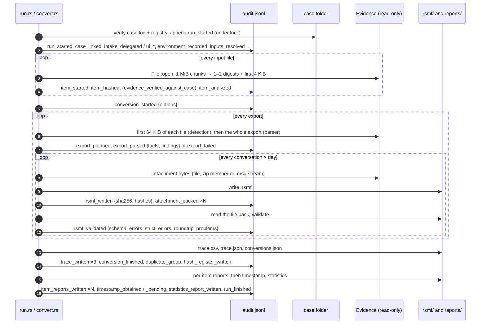

**Reads of the evidence.** Every input file is opened with `File::open` (read-only). It is read **more than once**:
the hashing pass reads it completely; export detection reads its first 64 KiB again; the parser reads the export
again; attachments are read again when packed. The bytes the parser reads are **not** re-hashed and compared with
the digests of the hashing pass, so a file modified between the passes would be detected only by its modification
time (`mtime_unchanged` in `item_hashed` covers the hashing pass only) — work on a write-protected copy
([admissibility.md](admissibility.md#consolidated-gap-list), G20).

Ordering facts an opposing expert may test:

- In a case folder each item is verified against the registry right after it is hashed, before any conversion.
- The conversion runs after **all** items are hashed. The cancel flag is checked before each export and each
  slice: a cancel during hashing means no export is converted; a cancel during conversion stops before the next
  export or file (the trace files are still written for what was converted).
- The trusted timestamp is requested after the last `item_reports_written`, so the token covers every evidence
  digest, every `.rsmf` digest, `trace.csv` and every item-report digest, but not the statistics report or
  `run_finished` ([B16](#b16-rfc-3161-trusted-timestamp)).
- A wrong certificate password stops the run (`run_failed`) before any evidence byte is read.
- An attachment that cannot be read while writing an RSMF file (e.g. a corrupt zip member) stops the **whole run**
  with exit code 1 (`convert_items` returns the error) instead of failing one export.

## B3 Recognising and grouping exports

Detection ([sources/mod.rs](../src/core/src/sources/mod.rs) `detect`) looks at the extension and the first 64 KiB:

| Source | Recognised when |
| --- | --- |
| WhatsApp | `.txt` whose first 10 non-empty lines include a WhatsApp header ([B5.1](#b51-whatsapp-txt-or-zip-android-and-ios)); or `.zip` starting `PK\x03\x04` that contains such a `.txt` (`_chat.txt` first, else the first `.txt` by name that sniffs; at most 50 tried; `__MACOSX` ignored) |
| Telegram | `.json` named `result.json` or containing `"messages"`, **and** containing `"date` or `"chats"` |
| Teams | `.msg` starting with the OLE2 signature `D0 CF 11 E0 A1 B1 1A E1` |
| CSV | any `.csv` or `.tsv` |

`--source` forces a type for files that look like that type's primary: `whatsapp` → `.txt`/`.zip`, `telegram` →
`.json`, `csv` → `.csv`/`.tsv`/`.txt`, `teams-msg` → `.msg`.

Grouping ([sources/mod.rs](../src/core/src/sources/mod.rs) `plan_exports`):

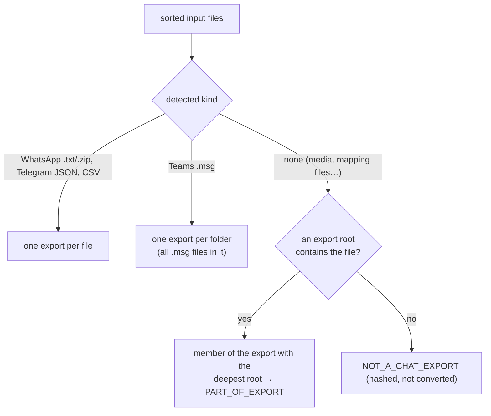

The **root** of an export is the folder of its primary file. When two exports share a folder (two CSV files side
by side), a non-export file in that folder is attached to the **last** of them in path order, so its
`PART_OF_EXPORT` finding can name the wrong export (in the sample, `csv/media/plano-0001.png` is reported as part of
`xry-like.csv` although `generic.csv` refers to it). Conversion is not affected: parsers resolve attachment paths
against the export root themselves.

## B4 The neutral chat model

Every parser produces the same structure ([model.rs](../src/core/src/model.rs)), and the RSMF writer only reads
that structure:

```text
ParsedExport
  participants  [{ id, display, email?, account_id?, custom{} }]
  conversations [{ id, display, kind: direct|channel, participants[ids], custom{} }]
  events        [{ id, kind: message|disclaimer|join|leave|history|unknown, conversation, participant?,
                   timestamp (UTC, or none), source_time (text as written), body, parent?, deleted,
                   direction?: incoming|outgoing, attachments[{display, data}], reactions[{value, count?,
                   participants[]}], edits[], custom{}, source{file, line, line_end, native_id?} }]
  findings      [ … ]          facts { key: value }      (both go into the technical report)
```

| Identifier | Rule |
| --- | --- |
| Participant id | `p-` + first 12 hex of SHA-256 of a key: WhatsApp the display name; Telegram `from_id` (else `name:<from>`); Teams `email:<address>` (else `name:<display>`); CSV `tel:<digits>`, `email:<address>` or `name:<name>` |
| Conversation id | `c-` + 12 hex of SHA-256 of: WhatsApp the export file name; Telegram the chat `id` (`#2`, `#3`… appended on a collision); Teams `teams:<topic>`; CSV `csv:<conversation value>` |
| Event id | `e-` + 6-digit sequence in export order, unique per export (not across exports: `trace.csv` names the export) |

Attachment data is one of: a file on disk, a member of a zip, bytes held in memory (Teams), or **missing** with a
reason. `edits` is part of the model and of the RSMF writer, but **no parser fills it** in this version (no source
exports earlier versions of a message).

## B5 How each source is read

### B5.1 WhatsApp (`.txt` or `.zip`, Android and iOS)

WhatsApp publishes no export format. The header shapes follow the test corpus of the MIT-licensed
whatsapp-chat-parser (Pustur); the regular expressions are rv-rsmf's own
([whatsapp.rs](../src/core/src/sources/whatsapp.rs)).

```text
DATE  = (d1: 1–4 digits) [-/.] optional space (d2: 1–2 digits) [-/.] optional space (d3: 2–4 digits) optional "."
TIME  = (h: 1–2) [:.] (mm: 2) optionally [:.] (ss: 2), optionally  [aApP] "."? space? [mM] "."?
Android header:  ^ DATE ","? spaces TIME " - " or " – " rest$          02/03/2026, 10:00 - Ana Ruiz: Hola!
iOS header:      ^ "[" DATE ","? spaces TIME "]" space? rest$           [4/3/26, 9:15:02 p. m.] Lucía: Hola
```

Leading U+200E, U+200F and U+FEFF are removed before matching; `\s` is Unicode-aware, so U+00A0 and U+202F (iOS 17
and later, before AM/PM) count as spaces. A file is "iOS" when more than half of its headers are bracketed (fact
`variant`).

| Rule | Behaviour |
| --- | --- |
| Lines | A header starts a message; any other line is appended (with `\n`) to the previous message (`source.line`–`line_end`). Non-empty lines before the first header → `UNPARSED_LINES` (they are not converted). |
| Author | Text before the first `": "` (or a trailing `:`), if 1–80 characters and without quote characters (`"` `“` `”` `«` `»` `„`); bidi controls (U+200E/F, U+202A–202E, U+2066–2069) removed. Otherwise the line is a system line. |
| System lines | Without author: kind by keywords in EN/ES/FR/DE/PT/IT — `end-to-end`… → `disclaimer`; "created group"… → `history`; "left", "removed"… → `leave`; "added", "joined"… → `join`; anything else → `history`. iOS writes system text **under the chat's name** after a U+200E: such a line becomes a system event with custom `attributed_to`. |
| Device owner | Authors `You`, `Tú`, `Vous`, `Du`, `Você`, `Tu` are the exporting phone. With `--custodian NAME` they are shown as NAME (custom `author_in_export` keeps the original). |
| Direction | Set only when the owner is known (a "You" author exists or `--custodian` is given): `outgoing` for the owner, `incoming` for everyone else. |
| Participants | Message authors only (people only named in system lines are not participants). A name that is only a phone number (≥ 5 digits, `+ - ( )` and spaces) is also the `account_id` → `PARTICIPANT_IDENTIFIED_BY_NUMBER_ONLY`. |
| Conversation | One per export; name from the file name after "WhatsApp Chat with ", "WhatsApp Chat - ", "Chat de WhatsApp con ", "Discussion WhatsApp avec " (and DE/PT/IT forms), else the file stem; `direct` with ≤ 2 authors, else `channel`. |
| Media omitted | A message that is exactly `<Media omitted>` or a localised form (Android, commonly reported) or `image omitted`, `imagen omitida`… (iOS, **unverified**) → missing attachment, `MEDIA_OMITTED_IN_EXPORT`. |
| Attachments | First line `<attached: NAME>` (also `adjunto`, `pièce jointe`, `Anhang`, `anexo`, `allegato`) or `NAME (file attached)` (also `archivo adjunto`, `fichier joint`, `Datei angehängt`, `arquivo anexado`, `file allegato`). NAME is looked up by base name in the zip, or among the export's members, else as a file next to the `.txt`; names containing `/` or `\`, and the names `.` and `..`, are refused. Not found → `ATTACHMENT_REFERENCED_NOT_FOUND`. |
| Encoding | UTF-8; invalid bytes are replaced by U+FFFD and recorded as the fact `encoding` (no finding). |
| Size | ≥ 39 000 messages → `POSSIBLE_EXPORT_LIMIT` (WhatsApp is reported to cap exports at about 40 000 messages without media, 10 000 with media — **unverified**). |
| Failure | No header at all, a date impossible in the decided order (`31/02/26`), an hour outside 1–12 with AM/PM, or contradictory date evidence → the whole export fails (`PARSER_FAILED`, high). |

Two-digit years are read as 20YY. Times have minute (or second) precision. Exports carry no message ids, reply
links, reactions or edit history (research brief; nothing of the kind is parsed).

### B5.2 Telegram Desktop (`result.json`)

Field names follow Telegram Desktop's exporter (`export_output_json.cpp`, read for reference only)
([telegram.rs](../src/core/src/sources/telegram.rs)).

| Rule | Behaviour |
| --- | --- |
| Shapes | Full export `{chats:{list:[…]}, left_chats:{list:[…]}}` (fact `variant` = `full-export`; left chats get custom `left_chat`) or one chat `{name, type, id, messages:[…]}` (`single-chat`; this shape is **unverified** against real exports). A UTF-8 BOM is ignored. |
| Time | `date_unixtime` (epoch seconds, number or string) = UTC. Only when it is absent is `date` (`YYYY-MM-DDTHH:MM:SS`, local) used, which then needs `--timezone` (fact `time_basis` says which). |
| Conversation | One per chat; `direct` for `personal_chat`, `bot_chat`, `saved_messages`, else `channel`; custom `chat_type`, `chat_id`; nameless chat → "Saved Messages". |
| Participant | From `from_id` (`user123`) with `from` as display; service messages use `actor`/`actor_id`; reaction senders from `recent[]`. |
| Direction | When `personal_information.user_id` is present: `outgoing` if `from_id` = `user<user_id>`, else `incoming`. |
| Text | `text` as string, or array of strings and `{type, text, href}` pieces; a link whose target differs from its text becomes `text [href]`. Location, venue, contact and poll content are added as lines (`Location: lat, lon`, `Poll: …`). |
| Service messages | `create_group`, `create_channel`, `migrate_*`, `pin_message`, calls, title/photo changes, `clear_history` → `history`; `invite_members`, `join_group_by_link`, `join_group_by_request` → `join`; `remove_members` → `leave`; a readable sentence is generated ("Ana invited Bob"). Other message types → `unknown`, custom `telegram_type`. |
| Media | `photo`, `file`, `contact_vcard`: path relative to the folder of `result.json`, only plain relative components accepted. `(File not included…)` placeholders → missing, `TELEGRAM_FILE_NOT_INCLUDED`; a named file absent from the folder → `ATTACHMENT_REFERENCED_NOT_FOUND`; when a file is missing but its `thumbnail` exists, the thumbnail is packed instead, as an extra attachment. |
| Replies | `reply_to_message_id` → `parent` when the replied message is in the same chat; otherwise custom `reply_to_message_id`. |
| Edits | `edited_unixtime` (or `edited` with a zone) → custom `edited_utc`; the earlier text is not in the export → `EDIT_HISTORY_NOT_IN_EXPORT`. |
| Reactions | `type: emoji` → the emoji; `custom_emoji` → the text `custom_emoji`; `paid` → `paid`; `count` kept; `recent[]` senders as participants. |
| Other fields | `forwarded_from`, `via_bot`, `author` (as `signature`), `media_type`, `mime_type`, `duration_seconds`, `sticker_emoji`, `reply_to_peer_id` → event custom fields. |
| Trace | No line numbers; `source.native_id` = the message `id`. |

### B5.3 Microsoft Teams (`.msg` from Purview)

A `.msg` is an OLE compound file ([MS-OXMSG]): variable-size MAPI properties are streams
`__substg1.0_IIIITTTT` (`001F` UTF-16LE, `001E` 8-bit decoded as windows-1252, `0102` binary), fixed-size ones are
16-byte records in `__properties_version1.0` (header 32 bytes for the message, 8 for attachments and recipients)
([teams.rs](../src/core/src/sources/teams.rs)).

**Unverified:** the property choices follow Microsoft's MAPI reference ([MS-OXPROPS], [MS-OXOMSG], [MS-OXCMSG]).
Which of them a real Purview Teams export fills — e.g. whether `PR_CONVERSATION_TOPIC` holds the chat or channel
name, whether replies carry `PR_IN_REPLY_TO_ID` — has not been confirmed on real exports; the fact
`teams.property_mapping` says so in every technical report.

| Element | Property used |
| --- | --- |
| Accepted classes | `PR_MESSAGE_CLASS` starting `IPM.SkypeTeams.Message` (→ `message`) or `IPM.SkypeTeams.SystemMessage` (→ `history`); other classes and unreadable files are skipped and listed in `UNPARSED_LINES`; no Teams message at all → `PARSER_FAILED` |
| Conversation | `PR_CONVERSATION_TOPIC`, else `PR_SUBJECT`, else "Teams conversation" (custom `topic_source`); `channel` when more than 2 participants |
| Sender | `PR_SENDER_NAME`; address from `PR_SENDER_SMTP_ADDRESS`, else `PR_SENDER_EMAIL_ADDRESS` (X.500 `/O=` addresses ignored) |
| Recipients | recipient storages (`PR_DISPLAY_NAME`, `PR_SMTP_ADDRESS`/`PR_EMAIL_ADDRESS`) plus names in `PR_DISPLAY_TO`; a name seen with exactly one address is linked to it everywhere |
| Body | `PR_BODY`; else `PR_HTML` (string, or binary decoded by `PR_INTERNET_CPID`: 1252/28591/20127 → windows-1252, 1200 → UTF-16LE, else UTF-8) with tags removed: `<br>` and block ends become line breaks, `<script>/<style>/<head>/<title>` dropped, entities decoded, at most one blank line in a row (custom `body_source`) |
| Time | `PR_CLIENT_SUBMIT_TIME`, else `PR_MESSAGE_DELIVERY_TIME` — FILETIMEs, UTC by definition; `source_time` = `2026-03-02T09:15:00.0000000Z = FILETIME 134169165000000000 (PR_CLIENT_SUBMIT_TIME)` |
| Ids, replies | `PR_INTERNET_MESSAGE_ID` = `source.native_id`; `PR_IN_REPLY_TO_ID` → `parent` (also when the reply precedes its parent in file order), else custom `in_reply_to` |
| Attachments | `PR_ATTACH_DATA_BIN` (bytes); name from `PR_ATTACH_LONG_FILENAME`, `PR_ATTACH_FILENAME`, `PR_DISPLAY_NAME`; no data → missing (method 5: embedded message; 2–4, 7: linked file) → `ATTACHMENT_REFERENCED_NOT_FOUND` |

All `.msg` files of one folder form one export; a panic inside the compound-file reader is contained to that file.

### B5.4 CSV / TSV with a column mapping

[csvmap.rs](../src/core/src/sources/csvmap.rs). The mapping is, in this order: the TOML file given with
`--csv-map`; a file `<csv stem>.map.toml` next to the CSV; the built-in profile chosen with `--csv-profile`
(`generic` by default). With no explicit mapping and a header that lacks the `generic` columns, the `xry-draft`
then the `cellebrite-draft` profiles are tried (fact `profile_detected` = `yes`). The two tool profiles are
**drafts**: their column names are best guesses, not checked against real XRY/XAMN or Cellebrite exports; using one
always adds `CSV_MAPPING_DRAFT_PROFILE`. Every key of the mapping is documented in
[usage.md](usage.md#csv-column-mapping-reference).

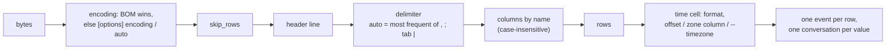

| Rule | Behaviour |
| --- | --- |
| Encoding | A BOM always decides (UTF-8, UTF-16LE/BE). `auto`: UTF-16LE when ≥ 30 % of the odd bytes are NUL, else UTF-8, else windows-1252. A declared encoding is applied **strictly**: invalid bytes stop the conversion (exit 2), never replaced silently. |
| Columns | Required: `timestamp`, `conversation`, `sender`, `body`; a missing one stops with the list of missing columns and the header found (exit 2). With your own mapping, a named optional column that is missing is also an error; with a built-in profile it is noted (fact `csv.optional_columns_not_found`). |
| Rows | Blank rows are counted (`csv.rows_blank`); a row with fewer fields than the highest required column, an unreadable record, an unreadable time, an invalid date or an unknown zone is **not converted** and listed in `UNPARSED_LINES`. |
| Time formats | `auto`/`iso`: RFC 3339 first (offset → instant), else numeric `d/m/y`, `m/d/y`, `y-m-d` with optional seconds, fraction, `a.m./p.m.` and an offset (`Z`, `+02:00`, `UTC+2`, `(UTC-05:00)`, `GMT`); `iso` refuses non-year-first dates. `epoch_s` (fraction allowed), `epoch_ms`. Any other value is a chrono `strftime` pattern (with `%z` → an instant; without → local; a date-only pattern → midnight). |
| Zones | Local times take the row's `timezone_column` (IANA name or UTC offset; custom `source_timezone_column`), else `--timezone`; neither → exit 2. |
| Participants | `Name`, `+57 300 000 0001`, `a@b.c` or `Name <+57 300 000 0001>`; `sender_number` overrides the number; a name seen once with a number or address is linked to it where it appears alone. An empty sender on an `outgoing` row becomes `--custodian`. |
| Conversations | One per distinct `conversation` value (empty → the CSV file stem); `channel` when more than 2 participants; the `application` values become custom `application`. |
| Direction / deleted | Values in `[direction]` (default `incoming in received inbox rx entrante` / `outgoing out sent outbox tx saliente`), case-insensitive; anything else kept as custom `direction_raw`. `deleted` true when the cell is in `[deleted] values` (default `1 true yes y x deleted si sí oui vrai`). |
| Attachments | Paths relative to the CSV folder, several separated by `;` or a line break; absolute paths, drive letters and `..` refused; missing → `ATTACHMENT_REFERENCED_NOT_FOUND`. |
| Trace | `source.native_id` = data row number (1 = first row after the header); `line`–`line_end` = physical lines of the record. **Known defect:** for files with CRLF line ends the reported line is one less than the real line (measured: a CRLF file reports its first data row at line 1, the LF file at line 2) — use the row number (`native_id`) to locate CSV rows. |

## B6 Time: local time to UTC, and the date order

Which sources need an examiner decision:

| Source | Times in the export | `--timezone` | `--date-order` |
| --- | --- | --- | --- |
| WhatsApp | local wall-clock, no offset | **required** | only when the file cannot decide |
| CSV | depends on the format: offset/epoch → none needed; local → zone column or `--timezone` | when local times have no zone column | only for numeric non-year-first dates the file cannot decide (or `[options] date_order`) |
| Telegram | `date_unixtime` = UTC (local `date` only as fallback) | only if a message lacks `date_unixtime` | never |
| Teams | FILETIME = UTC | never | never |

`--timezone` is **also** the zone in which days are cut ([B7](#b7-slicing-conversation--day-and-the-10000-event-rule))
for every source; without it, days are cut in UTC.

**Local → UTC** ([rsmf/mod.rs](../src/core/src/rsmf/mod.rs) `local_to_utc`):

```text
tz.from_local_datetime(local)
  Single(t)          → t in UTC                                   (normal case)
  Ambiguous(a, b)    → a (the EARLIER instant), flag "ambiguous"  (autumn: the repeated hour)
  None               → local + 1 hour, earliest, flag "nonexistent"  (spring: the skipped hour)
every flagged event gets custom local_time_issue = ambiguous|nonexistent
the export gets DST_AMBIGUOUS_OR_MISSING_TIME {count, timezone, examples (original text)}
```

Real values from `examples/sample/evidence/whatsapp-dst.txt` with `--timezone Europe/Paris`:

| As written | Rule | UTC written |
| --- | --- | --- |
| `29.03.26, 02:30` (does not exist) | +1 h → 03:30 CEST | `2026-03-29T01:30:00Z` |
| `25.10.26, 02:30` (happens twice) | earlier = 02:30 CEST | `2026-10-25T00:30:00Z` |
| `25.10.26, 04:00` | normal | `2026-10-25T03:00:00Z` |

The "+1 hour" rule assumes a one-hour gap; the code comment says "shifted forward by the gap". For a zone with a
30-minute daylight-saving shift (e.g. `Australia/Lord_Howe`) the result is 30 minutes later than the end of the
gap. The time-zone rules are those compiled into `chrono-tz` 0.10.4; the IANA release they come from is not
recorded in the run (only the crate version in `environment.json`).

**Day/month order — WhatsApp** ([whatsapp.rs](../src/core/src/sources/whatsapp.rs) `decide_order`), over **all**
headers of the file:

1. A header whose first number has 3–4 digits → year-first (`ymd`); if another header does not start with a year,
   the export fails (mixed formats).
2. Else, a first number > 12 somewhere → `dmy`; a second number > 12 somewhere → `mdy`; both → the export fails
   (contradictory dates). The finding `DATE_ORDER_INFERRED` names the line that decided it.
3. Else (every first and second number ≤ 12): `--date-order dmy|mdy` is used (`DATE_ORDER_CHOSEN`); without it, or
   with `ymd`, the tool stops with exit 2 and quotes up to 3 header lines with different dates.

When the file decides, a contradicting `--date-order` is **not** used; facts `date_order_option` and
`date_order_option_used = no` record it, so one run can convert exports from phones with different settings. The
date order is decided before the time zone is asked for.

**Day/month order — CSV** ([csvmap.rs](../src/core/src/sources/csvmap.rs)): only cells read as numeric
non-year-first dates take part. Precedence differs from WhatsApp: `--date-order` **always wins** when given (even
when the file would decide otherwise, rows that do not fit become `UNPARSED_LINES` "invalid date"), then
`[options] date_order` of the mapping, then inference (> 12 in first / second position); both or neither →
exit 2. `ymd` is accepted here. The basis is recorded in the fact `csv.date_order`.

## B7 Slicing: conversation × day, and the 10,000-event rule

([rsmf/mod.rs](../src/core/src/rsmf/mod.rs) `slice`)

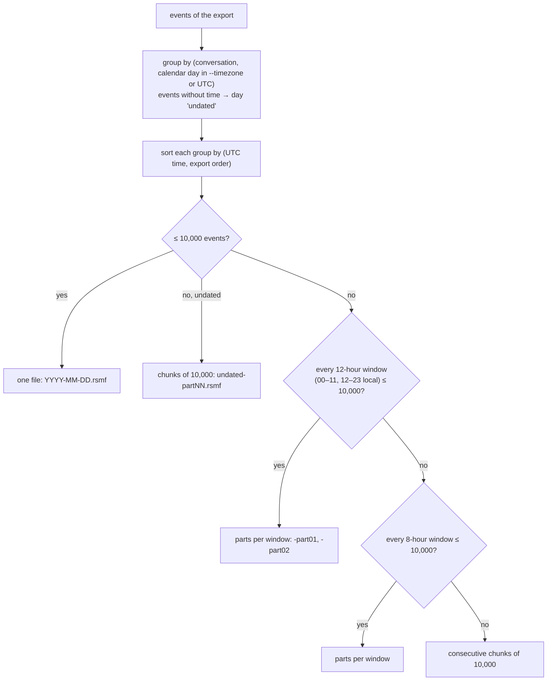

Each split day gives `DAY_SPLIT_OVER_10000_EVENTS` (info) with the number of parts. Windows are cut on the local
hour, so a 23- or 25-hour daylight-saving day still splits at the stated hours. Relativity's limit (10,000 events
per file) and the 24-hour / 12-hour / 8-hour practice come from Relativity's short-message workflow guide
([B21](#b21-references)). Every file of a conversation in one export carries the same event collection id
([B8](#b8-the-rsmf-20-file-we-write)).

**Replies across files.** A `parent` is written as given by the parser. When a reply and the message it answers
fall on different days (or parts), the parent is not in the reply's file, the strict check fails
(`parent … is not an event in this file`), the file gets `RSMF_SCHEMA_INVALID` (high) and the run exits 3.
Measured with a two-message Telegram export (reply the next day). This affects Telegram and Teams exports, which
have reply links; WhatsApp and CSV exports carry none.

## B8 The RSMF 2.0 file we write

Format: RSMF 2.0 as published by Relativity (Relativity Short Message Format guide, *Creating an RSMF file*,
Server 2024 and RelativityOne; the sample generator `relativity-rsmf-gen-sample`; the schema in
`relativitydev/rsmf-validator-samples`) — see [B21](#b21-references). An `.rsmf` file is an RFC 5322 message with
CRLF line ends, a `text/plain` body and exactly one attachment `rsmf.zip`
([rsmf/mod.rs](../src/core/src/rsmf/mod.rs) `eml_bytes`).

### Headers, in the order written

| Header | Written when | Value |
| --- | --- | --- |
| `From` | `--custodian` matches a participant's display name or `account_id` | that participant as `"Display" <email>` |
| `To` | always | every participant of the file, `"Display" <email>`, comma-separated; `<>` when no address is known; folded at `, ` beyond 76 characters |
| `X-RSMF-Version` | always | `2.0.0` (required by RSMF) |
| `X-RSMF-Generator` | always | `rv-rsmf <version>` |
| `X-RSMF-Application` | always | platform: `WhatsApp`, `Telegram`, `Microsoft Teams`, `Mobile export` (CSV), or `--platform-name` |
| `X-RSMF-Custodian` | `--custodian` given | the text given |
| `X-RSMF-Participants` | always | display names, `, `-separated (the separator is **unverified** against Relativity's documentation), folded |
| `X-RSMF-BeginDate` / `X-RSMF-EndDate` | the file has timed events | earliest / latest event time, `YYYY-MM-DDTHH:MM:SSZ` |
| `X-RSMF-EventCount` | always | number of events in the manifest |
| `X-RSMF-AttachmentCount` | always | number of attachments packed in `rsmf.zip` |
| `X-RSMF-EventCollectionID` | always | the collection id (below) |
| `MIME-Version`, `Content-Type` | always | `multipart/mixed; boundary="rsmf-<first 32 hex of SHA-256 of rsmf.zip>"` |

Non-ASCII header text is written as an RFC 2047 encoded word (`=?UTF-8?B?…?=`). No `Subject`, `Date` or
`Message-ID` is written (Relativity's sample generator omits them too). Two points an opposing expert may raise:
without `--custodian` (or when it matches nobody) the message has **no `From` header**, which RFC 5322 requires;
and `<>` is not a valid RFC 5322 address. Relativity's behaviour with either is **unverified**; the files pass the
schema, the strict checks and Python's `email` parser in CI.

Real headers of `…/Ana-Ruiz-aa3173/2026-03-02.rsmf` (sample, `--timezone Europe/Paris`, no custodian):

```text
To: "Ana Ruiz" <>, "Bruno Diaz" <>, "+33 6 00 00 00 01" <>
X-RSMF-Version: 2.0.0
X-RSMF-Generator: rv-rsmf 0.1.0
X-RSMF-Application: WhatsApp
X-RSMF-Participants: Ana Ruiz, Bruno Diaz, +33 6 00 00 00 01
X-RSMF-BeginDate: 2026-03-02T08:58:00Z
X-RSMF-EndDate: 2026-03-02T09:03:00Z
X-RSMF-EventCount: 7
X-RSMF-AttachmentCount: 1
X-RSMF-EventCollectionID: 235a0f32-156f-5cfe-147e-76b5e251dc68
MIME-Version: 1.0
Content-Type: multipart/mixed; boundary="rsmf-144667883d81c74b927ef19515a6f20d"
```

### Body (extracted text)

Part 1, `text/plain; charset=utf-8`, base64 in 76-character lines. For each event in time order: the sender's
display name and a blank line (when there is a sender), the body (line breaks as CRLF), a blank line, each
reaction value followed by a blank line, then a blank line — the layout of Relativity's reference generator, so
search hits follow the conversation. Times are not in the body (they are in the manifest).

### `rsmf.zip`

Part 2, `application/zip; name="rsmf.zip"`, `Content-Disposition: attachment; filename="rsmf.zip"`, base64. It holds
`rsmf_manifest.json` and every packed attachment, named `<event id>-<n>-<display name>` (characters other than
letters, digits, `.`, `-`, `_` replaced by `_`; the last 80 characters kept), e.g.
`e-000005-1-IMG-20260302-WA0001.jpg`.

### Manifest fields we write

```text
{ "version": "2.0.0",
  "eventcollectionid": "<id>",
  "participants": [ { "id", "display"?, "email"?, "account_id"?, "custom"? } ],      every member of the conversation
                                                                                   + every sender / reactor in the file
  "conversations": [ { "id", "display", "platform", "type": "direct"|"channel",
                       "participants": [ids], "custodian"?, "custom"? } ],          exactly one
  "events": [ { "id", "type", "conversation", "participant"?, "timestamp"?, "body"?, "attachments"?: [{"id","display","size"}],
                "parent"?, "deleted"?: true, "direction"?, "reactions"?: [{"value","count"?,"participants"?}],
                "edits"?, "custom": [{"name","value"}] } ] }
```

| Field | Rule |
| --- | --- |
| `timestamp` | UTC, `YYYY-MM-DDTHH:MM:SSZ` — sub-second precision (Teams FILETIME, CSV fractions) is **truncated** to the second; ordering uses the full value |
| `body` | the text of the export; for every attachment that is not in the export a line `[attachment not in export: NAME — REASON]` is **appended** (so a reviewer sees it in Relativity) |
| `custodian` | id of the participant whose display or `account_id` equals `--custodian` |
| conversation `custom` | parser custom fields (e.g. `export_file`, `chat_type`, `topic_source`, `application`) + `source_timezone` = `--timezone` (or UTC) for WhatsApp and CSV exports |
| event `custom` | parser custom fields + `source_time` (time exactly as written), `source_file`, `source_lines` (`4` or `4-6`, text sources only), `source_id` (message id, CSV row) |
| `custom` entries | sorted by name; entries with an empty name or value omitted |
| `edits`, `read_receipts`, `importance`, `avatar`, `icon` | not written (no source provides them) |

The manifest is pretty-printed JSON with keys sorted at every level, plus a final `\n`.

**Event collection id** (`collection_id`): `SHA-256(seed ␟ conversation id)` (␟ = U+001F) formatted as
`8-4-"5"+3-4-12` hex digits, where seed = `<case id> ␟ <primary digest of the export's main file>` (the digest of
the **first** `--hash` algorithm; the case id is empty outside a case). It is a GUID-shaped label, not an RFC 4122
UUID (the variant bits are not set). The same export with the same case id and first algorithm always gets the
same id; every file of a conversation shares it.

**Folders**: `rsmf/<RUN-ID>/<NNN>-<export slug>/<conversation slug>/<YYYY-MM-DD>[-partNN].rsmf`, where NNN is the
export's position, a slug keeps letters and digits, joins the rest with `-` (max 48 characters) and appends the last
6 characters of the item index or conversation id (e.g. `006-WhatsApp-Chat-with-Ana-Ruiz-txt-000014/Ana-Ruiz-aa3173/`).

## B9 Reactions and Relativity shortcodes

Relativity renders a reaction only when its value is a shortcode on its "RSMF-supported emoji" page; anything else
is shown as text. [shortcodes.rs](../src/core/src/rsmf/shortcodes.rs) maps the commonly used ones (each confirmed
present on that page on 2026-10-27, Server 2024 version):

| Emoji → value | | | |
| --- | --- | --- | --- |
| 👍 `:+1:` | 👎 `:-1:` | ❤️ / ❤ `<3` | 💔 `</3` |
| 😂 `:joy:` | 😮 `:open_mouth:` | 😯 `:hushed:` | 😢 `:cry:` |
| 😭 `:sob:` | 🙏 `:pray:` | 🔥 `:fire:` | 🎉 `:tada:` |
| 👏 `:clap:` | 😁 `:grin:` | 🤔 `:thinking_face:` | 😡 `:rage:` |
| 😠 `:angry:` | 💯 `:100:` | 😍 `:heart_eyes:` | 🤣 `:rolling_on_the_floor_laughing:` |
| 👌 `:ok_hand:` | 😊 `:blush:` | 🤯 `:exploding_head:` | ✅ `:white_check_mark:` |
| 🙌 `:raised_hands:` | 😆 `:laughing:` | 😱 `:scream:` | 🤝 `:handshake:` |
| 😘 `:kissing_heart:` | 😎 `:sunglasses:` | 👀 `:eyes:` | 🤷 `:shrug:` |
| 😄 `:smile:` | 🙂 `:slightly_smiling_face:` | 😉 `:wink:` | 😃 `:smiley:` |
| 🤨 `:face_with_raised_eyebrow:` | 😐 `:neutral_face:` | 🤗 `:hugging_face:` | 💪 `:muscle:` |
| 🚀 `:rocket:` | 💩 `:poop:` | 💀 `:skull:` | 😅 `:sweat_smile:` |
| 🙃 `:upside_down_face:` | 🤪 `:zany_face:` | 💖 `:sparkling_heart:` | 💜 `:purple_heart:` |
| 💛 `:yellow_heart:` | 💕 `:two_hearts:` | | |

`:heart:` is not on Relativity's page; the red heart maps to the `<3` emoticon, which the page lists as "red heart".
Skin-tone modifiers (U+1F3FB–U+1F3FF) and the variation selector U+FE0F are ignored for the lookup. A value already
written as `:name:`, `<3` or `</3` is kept (supported if it is in the table). Any other value is kept as text, cut
to 30 characters (the schema's intended limit, which its `maximum` keyword does not enforce on strings), and
listed in `REACTION_NOT_SUPPORTED_BY_RELATIVITY`. In this version only Telegram exports carry reactions.

## B10 Deterministic writing

The same export, the same options and the same tool version always give **byte-identical** `.rsmf` files:

| Source of variation | How it is removed |
| --- | --- |
| Zip entry order and times | entries sorted by name; every entry dated 1980-01-01 00:00 (the zip epoch); permissions 0644; deflate level 6 |
| JSON key order | serde_json maps are sorted (no insertion order) at every level |
| MIME boundary | derived from the content: `rsmf-` + first 32 hex of SHA-256(rsmf.zip) |
| Event order | sorted by (UTC time, export order) |
| Ids | participant/conversation ids from SHA-256 of stable keys; event ids from export order; collection id from case id + export digest |
| Header dates | only event times; no `Date` header, no write time anywhere in the file |

What **does** change the bytes: the tool version (`X-RSMF-Generator`), `--timezone` (UTC values, days, the
`source_timezone` field), `--date-order` when used, `--custodian`, `--platform-name`, the case id and the first
hash algorithm (collection id). `tests/run_samples.py` converts every sample twice and fails if any `.rsmf`
differs (in CI on Linux and Windows).

## B11 Validation and read-back

After writing, each file is **read back from disk** with rv-rsmf's own reader and checked
([rsmf/mod.rs](../src/core/src/rsmf/mod.rs) `validate_file`, `roundtrip`):

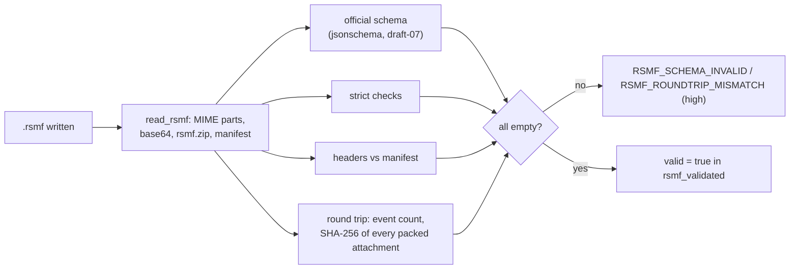

| Check | Rule |
| --- | --- |
| Schema | the bundled `rsmf_schema_2_0_0.json` (Relativity, draft-07); every violation listed with its JSON path |
| Unknown keys | only the keys the schema defines are accepted at root, participant, conversation and event level (the schema itself allows any extra key, so a typo would validate) |
| References | conversation participants, conversation `custodian`, event `participant`, event `conversation`, reaction participants must exist; event ids unique; every `parent` must be an event **of the same file** |
| Times | every event `timestamp` ends in `Z` and parses as RFC 3339 |
| Files | every attachment `id` and participant `avatar` is an entry of `rsmf.zip` (conversation `icon` is **not** checked, although the `validate` help text says it is) |
| Limits | reaction values ≤ 30 characters; ≤ 10,000 events per file |
| Headers | `X-RSMF-Version` present and equal to the manifest's `version`; `X-RSMF-EventCount` and `X-RSMF-AttachmentCount`, when present, equal the manifest |
| Round trip | events read = events written; each packed attachment present with the same SHA-256 |

The read-back compares counts and attachment digests, **not** each body or time with the model; the independent
oracle in CI ([B21](#b21-references)) re-parses every file with Python's `email` package and re-validates the
manifest with the official schema downloaded at a pinned commit. `rv-rsmf validate` applies the same checks (not the
round trip, which needs the run's record) to any `.rsmf`, including other vendors' files.

## B12 The trace map

`trace.csv` (and the same rows in `trace.json`) has one row per converted event, in file order
([convert.rs](../src/core/src/convert.rs)):

| Column | Content |
| --- | --- |
| `export` | file name of the export's main file |
| `source_file` | file inside the export (`_chat.txt`, `result.json`, `0002.msg`, the CSV path relative to its folder) |
| `line`, `line_end` | 1-based physical lines (WhatsApp, CSV); 0 for JSON and `.msg` |
| `native_id` | Telegram message id, Teams `PR_INTERNET_MESSAGE_ID`, CSV data row number |
| `source_time` | the time exactly as written in the export |
| `utc` | the UTC value written to the RSMF (seconds) |
| `rsmf_file` | path of the `.rsmf` under the run's `rsmf/` folder |
| `event_id`, `conversation` | ids in the manifest |
| `kind` | event type |
| `attachments` | attachments of the event in the model (packed or missing) |

Real rows (sample):

```text
export,source_file,line,line_end,native_id,source_time,utc,rsmf_file,event_id,conversation,kind,attachments
generic.csv,generic.csv,2,2,1,2026-10-24 22:10:00,2026-10-24T20:10:00Z,001-generic-csv-000001/Grupo-obra-aae949/2026-10-24.rsmf,e-000001,c-2502baaae949,message,0
generic.csv,generic.csv,3,3,2,2026-10-25 02:30:00,2026-10-25T00:30:00Z,001-generic-csv-000001/Grupo-obra-aae949/2026-10-25.rsmf,e-000002,c-2502baaae949,message,0
```

What is **not** in the trace: lines and rows that were not converted. They appear only in the `UNPARSED_LINES`
finding, which quotes the first 3 of them and the total count; there is no complete list in the outputs, so review
those parts of the export by hand. `trace.csv` itself is hashed and logged (`trace_written`).

## B13 Single-pass dual hashing

| Algorithm | Standard | Output | Status for evidence |
| --- | --- | --- | --- |
| `md5` | RFC 1321 | 128 bit | Practical collisions since 2004–2005 (Wang & Yu); legacy matching only |
| `sha1` | FIPS 180-4 | 160 bit | Practical collision 2017 (Stevens et al.); legacy matching only |
| `sha256` | FIPS 180-4 | 256 bit | Default; recommended primary |
| `sha512` | FIPS 180-4 | 512 bit | Recommended |
| `sha3-256` | FIPS 202 | 256 bit | Sound; less familiar to courts |
| `blake3` | BLAKE3 specification (2020) | 256 bit | Sound; not a NIST-approved hash |

```text
hash_reader(r, algos)                                        src/core/src/hash.rs
  validate_selection: 1 ≤ len ≤ 2, the two different        → else usage error (exit 2)
  loop:
    n = r.read(buf[0 .. 1 048 576])                          other error → UNREADABLE (high)
    if n = 0: break
    head += buf[0 .. min(n, 4096 − len(head))]               first 4 KiB, for the type check
    for each hasher h: h.update(buf[0 .. n])                 the same slice feeds both digests
    if on_chunk(total) = false: return cancelled
```

Both digests describe exactly the same bytes (unit test `one_pass_feeds_two_digests_identically_to_separate_passes`).
The first selected algorithm is the **primary**: it groups duplicates, is the customer's "fingerprint", is compared
first with the case registry and seeds the event collection id. Every `.rsmf`, `trace.*`, `conversions.json` and
report file is hashed with the selected algorithms (`rsmf_written.hashes`, `trace_written`, `item_reports_written`);
`rsmf_written.sha256` and `attachment_packed.sha256` are always SHA-256. The A7 example differs in one character (`7` → `8`); the two SHA-256 digests differ in 133 of 256
bits. No hash policy is enforced: `md5,sha1` is accepted (gap G11).

## B14 The audit hash chain

Each line of `audit.jsonl` is one JSON object: `seq`, `ts_utc`, `run_id`, `actor`, `action`, optional `item`,
`details`, `prev_entry_hash`, `entry_hash` ([audit.rs](../src/core/src/audit.rs)). `audit.log` is a readable copy,
not chained and not authoritative. Every action is listed in [forensic-audit.md](forensic-audit.md#actions-recorded).

```text
canonical(e)      = JSON of e without "entry_hash"; keys sorted at every level; no whitespace; UTF-8,
                    non-ASCII not escaped (Python: json.dumps(e, sort_keys=True, separators=(",", ":"), ensure_ascii=False))
entry_hash_n      = SHA-256( canonical(e_n) )                 hex, lower case
prev_entry_hash_1 = 64 × "0";   prev_entry_hash_n = entry_hash_(n-1);   seq_n = n
```

**Worked example** (computed for this page with the rule above; `rv-rsmf verify-log` of this commit accepts the
three lines):

```text
#1 canonical (284 bytes)
{"action":"run_started","actor":"Ana Ruiz","details":{"algorithms":["sha256","md5"],"tool":"rv-rsmf","version":"0.1.0"},
"prev_entry_hash":"0000000000000000000000000000000000000000000000000000000000000000","run_id":"20261027T101500Z-3f9a1c",
"seq":1,"ts_utc":"2026-10-27T10:15:00.104Z"}
   entry_hash = b9f9f0502986a9a3abe60b0dc649baa5cdfcd34e9206ec48a21cbbd1c08873a3

#2 canonical (245 bytes)
{"action":"inputs_resolved","actor":"Ana Ruiz","details":{"bytes":773,"items":1},"prev_entry_hash":"b9f9f050…c08873a3",
"run_id":"20261027T101500Z-3f9a1c","seq":2,"ts_utc":"2026-10-27T10:15:00.106Z"}
   entry_hash = 00e7c46ac2e44a1898b32765674cc5f5ed9b355e2955d77d305c7ea76010559b

#3 canonical (386 bytes)
{"action":"item_hashed","actor":"Ana Ruiz","details":{"bytes_read":773,"hashes":{"sha256":"0642f460…2cbdb71d"},"index":1,
"mtime_unchanged":true},"item":"D:\\export\\chat.txt","prev_entry_hash":"00e7c46a…6010559b", …,"seq":3,…}
   entry_hash = 13f572015ce9043c4af5f75a3b3f14b3f735bb4264522654e1aaac7b3ea7dea8

#2 edited ("items":2) → 03dc48518ea342e0de872a31391c6d669926094fcdbe51be6995d20b42f02743 ≠ stored
```

What `verify-log` prints for the variants (real output of this commit):

```text
original           OK  3 entries, chain intact                                                       exit 0
                       truncation not detectable without a timestamp or case record
#2 edited          BROKEN  - line 2: entry_hash does not match its content (edited entry)            exit 3
#2 deleted         BROKEN  - line 2: sequence 3 where 2 was expected (deleted or re-ordered entry)
                           - line 2: prev_entry_hash does not link to the previous entry             exit 3
#3 removed (end)   OK  2 entries, chain intact                                                       exit 0
                       truncation not detectable without a timestamp or case record
```

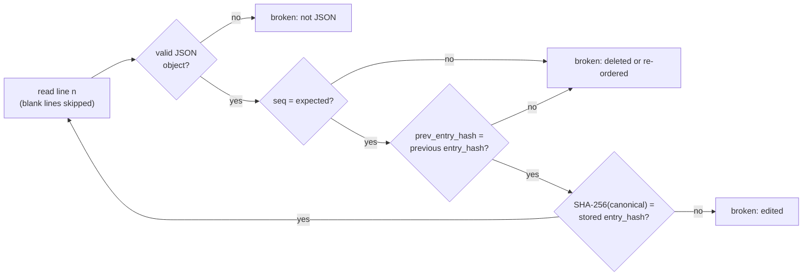

| Proves | Does not prove, on its own |
| --- | --- |
| No entry was edited, inserted, deleted or reordered before the last entry present | That entries were not removed from the end — only an anchor outside the log shows that |
| The order of work equals the order of entries | That the whole chain was not recomputed from scratch by someone rewriting it |
| `.rsmf`, trace and report digests are bound to the run | When the entries were written (host clock, `ts_utc`) |

External anchors, used automatically by `verify-log` ([verify.rs](../src/core/src/verify.rs)):

| Anchor found | Check | Result line |
| --- | --- | --- |
| `timestamp-<K>.json` | entry `#K` exists and its hash is the token's imprint; every `timestamp_obtained` entry still has its token file | `truncation: entries up to #K are anchored by the RFC 3161 timestamp (…)` |
| run in `<CASE>/runs/<tool>/<RUN-ID>/logs` | `run_finished` in the case log: entry `#M` = `audit_entries` exists with hash `audit_head`; only `timestamp_obtained` after it | `truncation: the final entry #M is anchored by the case log (run_finished)` |
| neither | — | `truncation not detectable without a timestamp or case record` |

A log that ends before `#K` or `#M` is reported as truncated (exit 3). Independent check:
[tests/verify_chain.py](../tests/verify_chain.py) re-implements the chain in Python (standard library) and
re-hashes the files listed in `hashes.csv`. The log file is opened with `create_new` + `append`; only the
`timestamp` command re-opens a log, after verifying it.

## B15 The case folder

Layout and contract: [case-folder.md](case-folder.md). rv-rsmf is an **analysis** tool (`CASE_ROLE = Analysis` in
[lib.rs](../src/core/src/lib.rs)): it reads the registry written by rv-hashinv and never writes it.

| Rule | Code | Why |
| --- | --- | --- |
| A broken case is never extended | every append re-runs `verify_log_and_registry` under the lock: case-log chain, first entry `case_created`, `case.json` digest, registry digest = last `registry_sha256` in the log | a tool cannot silently build on an edited case |
| One writer at a time | `case-log.lock` created exclusively; wait ≤ 30 s; a lock older than 600 s is reported as stale and never deleted automatically | two tools never interleave entries |
| Paths compared normalised | absolute, lexically normalised; case-insensitive on Windows | the same file is found again by path |
| A case run always shares an algorithm with the registry | `ensure_case_algorithm`: if the selection is disjoint from the algorithms present in every registered item, SHA-256 (or the registry's first algorithm) is added, replacing the second choice if two were selected; audited as `case_algorithm_added` | comparison is always possible |

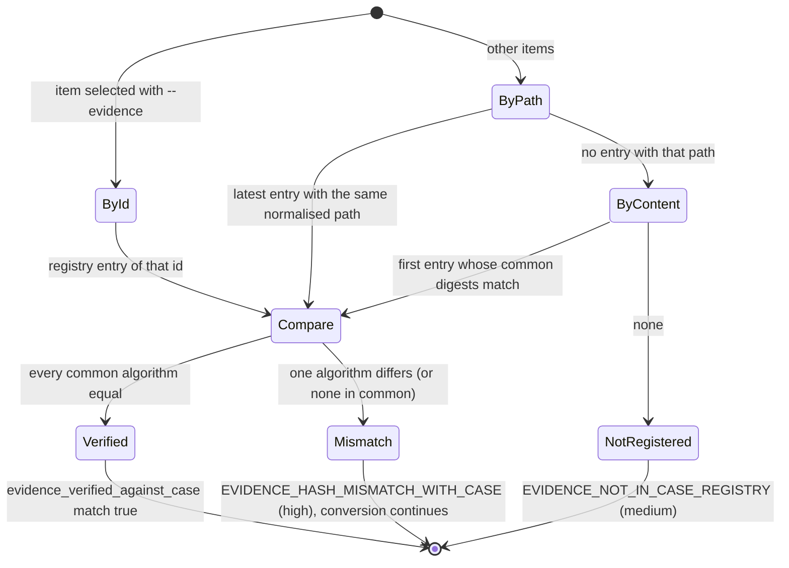

Cross-linking: the run's `case_linked` entry quotes the hash of its `run_started` entry in the case log; the case
log's `run_finished` records the run's final `audit_head` and `audit_entries`. `verify-case` checks both directions
for every run, so editing either chain breaks a link. With `--rehash` it re-reads every registered file still
reachable and compares it with the registry.

## B16 RFC 3161 trusted timestamp

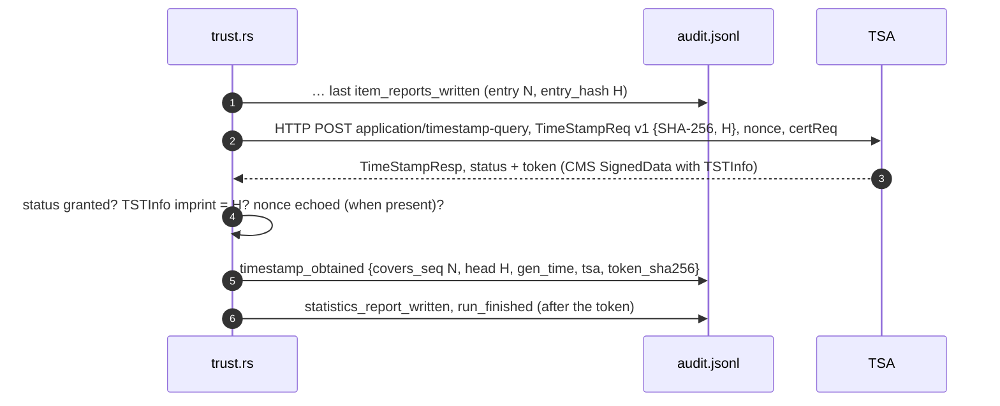

The message imprint is the chain head itself: the 32 bytes of `entry_hash` of entry *N*, declared as a SHA-256
value (not hashed again), so `openssl ts -verify -digest <H>` works directly. The nonce is 8 bytes derived from
SHA-256(clock, process id), high bit cleared. The response is limited to 1 MiB and 15 s; `genTime` is stored to the
second. Stored next to the log: `timestamp-<NNNNN>.tsr` (the DER TimeStampResp) and `timestamp-<NNNNN>.json` (tsa,
gen_time, covers_seq, head, token_sha256, file). Offline → `timestamp_pending`; `rv-rsmf timestamp <log>` later
re-verifies the chain and appends `timestamp_obtained` for the then-current head.

`verify-log` and `verify-case` re-check that entry `covers_seq` still exists, the `.tsr` SHA-256 against
`token_sha256`, the TSA status and that the imprint equals the `entry_hash` of `covers_seq`. They do **not** verify
the TSA's signature, certificate chain, policy OID or accuracy: do that with OpenSSL against the TSA's published
chain ([usage.md](usage.md#timestamps-signing-and-verifying-a-run)) before relying on the time in court (gap G18).
The default TSA URL is plain HTTP; integrity rests on the TSA's signature. Standards: RFC 3161, RFC 5816, RFC 5652.

## B17 Signed PDF reports

Reports are written by a built-in PDF writer ([report/pdf.rs](../src/core/src/report/pdf.rs)): PDF 1.4, A4, the
standard Helvetica, Helvetica-Bold and Courier fonts with WinAnsiEncoding (characters outside it — e.g. emoji in a
conversation name — become `?` in the PDF; the HTML and JSON keep them), no embedded fonts. With `--sign-cert`
each PDF is written once with a placeholder and signed in place:

```text
… /Type /Sig /Filter /Adobe.PPKLite /SubFilter /adbe.pkcs7.detached /ByteRange [0 a b c] /Contents <…> …
0                 a                                        b                  b+c
├──── signed ─────┤<── /Contents: "<" + 32 768 hex digits + ">" ──>├──── signed ─────┤
```

1. Write the PDF with a zero `/ByteRange` (fixed-width 10-digit numbers) and `/Contents <000…0>` (room for 16 384
   bytes of CMS), remembering the offset of the signature dictionary object.
2. Fill the byte range inside that object only (page text containing similar bytes is never touched; unit test
   `placeholder_bytes_in_page_text_are_left_alone`).
3. Sign the two ranges ([trust.rs](../src/core/src/trust.rs) `PdfSigner`): CMS SignedData, detached, SHA-256,
   RSA PKCS #1 v1.5, signed attributes content-type, signing-time and message-digest, certificates from the
   `.p12`/`.pfx`. RSA keys only.
4. Write the DER as hex into the placeholder.

The CLI trust test validates every signed PDF of a run with pyHanko
([tests/validate_pdf_signature.py](../tests/validate_pdf_signature.py)). This is a plain ISO 32000-1 CMS
signature, not PAdES; it carries no signature timestamp or revocation data; its legal weight depends on the
certificate (gap G3). The certificate subject and SHA-256 fingerprint are logged (`signing_certificate_loaded`) and
printed on every report; the password is never logged.

## B18 Custody forms

One form per input file, `custody.json` plus HTML and PDF in the jurisdiction's language and in English
([report/mod.rs](../src/core/src/report/mod.rs) `custody_*`, [templates/custody.html](../templates/custody.html),
[schemas/item-custody.schema.json](../schemas/item-custody.schema.json)).

| Field | Colombia (`co`, Spanish) | France (`fr`, French) | Filled from |
| --- | --- | --- | --- |
| Title and legal basis | Ley 906 de 2004 arts. 254–266, Fiscalía manual, Ley 527 de 1999 | CPP arts. 156 ff. | i18n catalogue |
| Case | Case number (NUNC) | Case / procedure reference | `case_id` |
| Item code | EMP/EF code | Seal number | evidence id in a case folder, else `<RUN-ID>-<NNNNN>` |
| Description | file name · size · detected type; path of the examined copy | same | the run |
| Integrity values | every digest of the run | same | `item_hashed` |
| Operations | tool, version, run id, start and end (UTC), audit entries `#first–#last` | same | the run |
| Transfers | 6 blank rows to sign by hand | same | people |

`custody.json` lists `transfers: []`: the tool never invents a transfer. The form is a working aid, not the official
Fiscalía *Registro de Cadena de Custodia* or a French *scellé* record (gap G9).

## B19 Determinism and repeatability of a whole run

| Same input + same options + same build gives the same … | Varies between runs |
| --- | --- |
| evidence digests, export grouping, events, UTC values, findings and their parameters | `run_id`, `ts_utc`, every `entry_hash` |
| every `.rsmf` byte for byte ([B10](#b10-deterministic-writing)), hence its digest | absolute output paths, host, OS user (in `environment.json`) |
| `trace.csv` rows (paths relative to the run's `rsmf/` folder) | report digests (reports print run id, times, the audit head); PDF `/CreationDate` |
| item order and numbering (sorted paths) | the RFC 3161 token and nonce |

`environment.json` records the tool version, `rustc` version, target triple, every package and version listed in
`Cargo.lock`, OS, host, OS user, working directory and command line (or the GUI settings), so a second examiner can
rebuild the same version and repeat the run (ISO/IEC 27037 repeatability and reproducibility).

## B20 How each finding is decided

What each finding shows and does not prove, word for word, is in [reports.md](reports.md#findings-catalogue). The
rule behind each conversion finding:

| Finding (severity) | Raised when (code) |
| --- | --- |
| `DATE_ORDER_INFERRED` (info) | WhatsApp: the file settled the day/month order ([B6](#b6-time-local-time-to-utc-and-the-date-order)) |
| `DATE_ORDER_CHOSEN` (info) | WhatsApp: every date ambiguous, `--date-order` used |
| `TIMEZONE_APPLIED` (info) | a WhatsApp or CSV export was converted with `--timezone` (also when every CSV time carried its own offset) |
| `DST_AMBIGUOUS_OR_MISSING_TIME` (medium) | a local time fell in a skipped or repeated hour (WhatsApp, CSV, Telegram local fallback) |
| `NON_MONOTONIC_TIMESTAMPS` (medium) | within a conversation, a timed event is earlier than the previous timed event in export order |
| `UNPARSED_LINES` (medium) | WhatsApp lines before the first header; CSV rows not converted; Teams `.msg` files skipped |
| `MEDIA_OMITTED_IN_EXPORT` (low) | WhatsApp media-omitted placeholders |
| `ATTACHMENT_REFERENCED_NOT_FOUND` (medium) | a named file is not in the export (all sources) |
| `TELEGRAM_FILE_NOT_INCLUDED` (low) | Telegram `(File …)` placeholders |
| `EDIT_HISTORY_NOT_IN_EXPORT` (info) | Telegram messages with an edit time |
| `DELETED_MESSAGES_NOT_IN_EXPORT` (info) | always, for WhatsApp and Telegram exports |
| `POSSIBLE_EXPORT_LIMIT` (medium) | WhatsApp export with ≥ 39 000 messages |
| `PARTICIPANT_IDENTIFIED_BY_NUMBER_ONLY` (info) | a participant's display name is its phone number (WhatsApp, CSV) |
| `DUPLICATE_MESSAGES` (low) | message events with the same conversation, sender, UTC time and non-empty body |
| `DAY_SPLIT_OVER_10000_EVENTS` (info) | a conversation-day exceeded 10,000 events ([B7](#b7-slicing-conversation--day-and-the-10000-event-rule)) |
| `REACTION_NOT_SUPPORTED_BY_RELATIVITY` (info) | a reaction without shortcode ([B9](#b9-reactions-and-relativity-shortcodes)) |
| `CSV_MAPPING_DRAFT_PROFILE` (medium) | the CSV was read with `xry-draft` or `cellebrite-draft` |
| `RSMF_SCHEMA_INVALID` (high) | a written file fails the schema, strict or header checks ([B11](#b11-validation-and-read-back)) |
| `RSMF_ROUNDTRIP_MISMATCH` (high) | read-back differs, or the file cannot be read back |
| `PARSER_FAILED` (high) | the export could not be read; no RSMF for it; the run continues |
| `PART_OF_EXPORT` (info) | a media or other file belongs to an export ([B3](#b3-recognising-and-grouping-exports)) |
| `NOT_A_CHAT_EXPORT` (info) | an input file belongs to no export |

Shared findings (`EMPTY_FILE`, `EXTENSION_MISMATCH`, `EXECUTABLE_CONTENT`, `DUPLICATE`, `UNREADABLE`) come from the
type check and duplicate grouping of every input file; the case-folder findings from [B15](#b15-the-case-folder).

## B21 References

RSMF and Relativity

- Relativity, *Relativity Short Message Format* and *Creating an RSMF file* (RelativityOne and Server 2024 help):
  <https://help.relativity.com/RelativityOne/Content/System_Guides/Relativity_Short_Message_Format/Relativity_short_message_format.htm>,
  <https://help.relativity.com/Server2024/Content/System_Guides/Relativity_Short_Message_Format/Creating_an_RSMF_File.htm>
- Relativity, *RSMF-supported emoji, emoticons and attachments* (checked 2026-10-27):
  <https://help.relativity.com/Server2024/Content/System_Guides/Relativity_Short_Message_Format/RSMF-supported_Emoji_Emoticons_and_Attachments.htm>
- Relativity, *Short message investigative workflow* (10,000 events per file; 24 h / 12 h / 8 h slices):
  <https://help.relativity.com/RelativityOne/Content/System_Guides/Relativity_Short_Message_Format/Short_message_investigative_workflow.htm>
- relativitydev/rsmf-validator-samples, `RSMFManifestSchema/rsmf_schema_2_0_0.json` (BSD-3-style, © 2016 kCura),
  pinned in CI at commit `c717cd322264b46115d27d034a6107c8c91043d8`: <https://github.com/relativitydev/rsmf-validator-samples>
- relativitydev/relativity-rsmf-gen-sample (reference EML assembly): <https://github.com/relativitydev/relativity-rsmf-gen-sample>

Export formats

- WhatsApp: no published format; header shapes from Pustur, *whatsapp-chat-parser* (MIT):
  <https://github.com/Pustur/whatsapp-chat-parser>. Export limits (~40 000 / ~10 000 messages): **unverified**.
- Telegram Desktop exporter, `export_output_json.cpp` (GPL; read for field names only): <https://github.com/telegramdesktop/tdesktop>
- Microsoft, [MS-OXMSG] (.msg file format), [MS-OXPROPS], [MS-OXOMSG], [MS-OXCMSG]; Purview eDiscovery document
  metadata fields: <https://learn.microsoft.com/en-us/purview/edisc-ref-document-metadata-fields>
- XRY/XAMN and Cellebrite CSV layouts: not publicly documented (hence the draft profiles).

Time and text

- IANA Time Zone Database (via the `chrono-tz` crate); RFC 3339 (date and time on the Internet).
- RFC 5322 (Internet Message Format); RFC 2045–2047 (MIME, encoded words); PKWARE APPNOTE (ZIP).
- JSON Schema draft-07.

Cryptography and signatures

- NIST FIPS 180-4, FIPS 202; RFC 1321; J. O'Connor et al., *BLAKE3* (2020).
- RFC 3161, RFC 5816, RFC 5652, RFC 8017, RFC 5280; ISO 32000-1 §12.8; ETSI EN 319 142-1 (PAdES).
- X. Wang, H. Yu, "How to Break MD5 and Other Hash Functions", EUROCRYPT 2005; M. Stevens et al., "The first
  collision for full SHA-1", CRYPTO 2017.
- ISO/IEC 27037:2012 — see [admissibility.md](admissibility.md) for what was verified of it.

Independent oracles used to cross-check this tool: [tests/oracle_rsmf.py](../tests/oracle_rsmf.py) (Python
`email` + the official schema downloaded at the pinned commit, file digests against the audit log, trace rows;
in CI); [tests/run_samples.py](../tests/run_samples.py) (every sample against hand-counted expectations, a second
conversion byte-identical; in CI); Python `hashlib`/`blake3` for
[examples/sample/expected_hashes.csv](../examples/sample/expected_hashes.csv); [tests/verify_chain.py](../tests/verify_chain.py);
[tests/validate_reports.py](../tests/validate_reports.py); pyHanko for signed PDFs; OpenSSL for RFC 3161 tokens
(manual).
