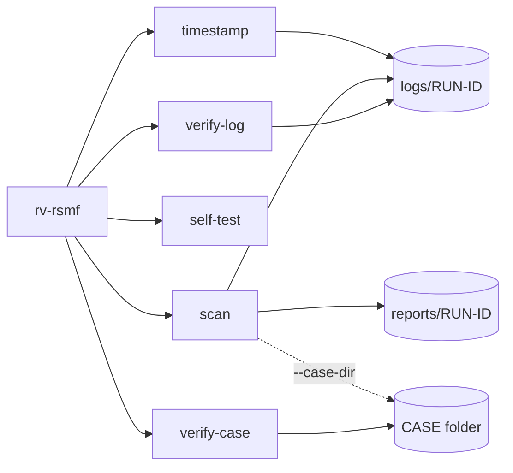

# Command-line reference

<!-- Generated by `rv-rsmf docs-cli`. Do not edit by hand: CI fails if this file differs. -->



## rv-rsmf

```text
DESCRIPTION:
  rv-rsmf converts chat exports into RSMF 2.0 (Relativity Short Message Format) files. It:
    1. opens every input file read-only and hashes it with one or two algorithms (and, in a case
       folder, checks it against the evidence registry);
    2. groups the files into exports: a WhatsApp .txt/.zip, a Telegram Desktop result.json, a folder
       of Microsoft Teams .msg files (Purview), or a CSV with a column mapping; media next to an
       export belong to it;
    3. reads each export into one model: participants, conversations, messages, attachments,
       reactions, with the line or id each message came from; local times are converted to UTC
       with --timezone (required when the export has no UTC offset);
    4. writes one .rsmf per conversation per day (days over 10,000 events are split), byte-for-byte
       reproducible, then checks each file against the official RSMF 2.0 schema plus stricter rules
       and reads it back;
    5. writes trace.csv (source line -> RSMF file and event), and per-export technical reports,
       customer summaries and custody forms (HTML, PDF and JSON).
  It does NOT authenticate the export or recover deleted messages: the RSMF shows what the export
  contains. Every action is appended to a hash-chained log that `rv-rsmf verify-log` checks.

  CASE FOLDER (--case-dir): Rakvor tools share one folder per case. rv-rsmf is an analysis tool: it
  re-hashes every file and compares it with evidence/registry.json, written by the intake tool
  rv-hashinv (add --intake hashinv to run rv-hashinv first). `rv-rsmf verify-case <CASE>` checks it
  all.

Usage: rv-rsmf <COMMAND>

Commands:
  convert      Convert chat exports to RSMF 2.0 files (validated, traced, with reports and custody
               forms)
  preview      Show how an export will be read (source, date order, time zone, first messages)
               without writing anything
  validate     Check .rsmf files against the RSMF 2.0 schema and rv-rsmf's stricter rules, and read
               them back
  verify-log   Verify an audit log (audit.jsonl): edited, deleted or re-ordered entries, and
               truncation
  self-test    Check every hash algorithm against known-answer test vectors
  timestamp    Add an RFC 3161 timestamp to a finished run (e.g. after working offline)
  verify-case  Verify a whole case folder: case log, evidence registry and every run's audit log
  help         Print this message or the help of the given subcommand(s)

Options:
  -h, --help
          Print help (see a summary with '-h')

  -V, --version
          Print version

Run `rv-rsmf <COMMAND> --help` for the options, examples and exit codes of each command.
```

## rv-rsmf convert

```text
DESCRIPTION:
  rv-rsmf converts chat exports into RSMF 2.0 (Relativity Short Message Format) files. It:
    1. opens every input file read-only and hashes it with one or two algorithms (and, in a case
       folder, checks it against the evidence registry);
    2. groups the files into exports: a WhatsApp .txt/.zip, a Telegram Desktop result.json, a folder
       of Microsoft Teams .msg files (Purview), or a CSV with a column mapping; media next to an
       export belong to it;
    3. reads each export into one model: participants, conversations, messages, attachments,
       reactions, with the line or id each message came from; local times are converted to UTC
       with --timezone (required when the export has no UTC offset);
    4. writes one .rsmf per conversation per day (days over 10,000 events are split), byte-for-byte
       reproducible, then checks each file against the official RSMF 2.0 schema plus stricter rules
       and reads it back;
    5. writes trace.csv (source line -> RSMF file and event), and per-export technical reports,
       customer summaries and custody forms (HTML, PDF and JSON).
  It does NOT authenticate the export or recover deleted messages: the RSMF shows what the export
  contains. Every action is appended to a hash-chained log that `rv-rsmf verify-log` checks.

  CASE FOLDER (--case-dir): Rakvor tools share one folder per case. rv-rsmf is an analysis tool: it
  re-hashes every file and compares it with evidence/registry.json, written by the intake tool
  rv-hashinv (add --intake hashinv to run rv-hashinv first). `rv-rsmf verify-case <CASE>` checks it
  all.

Usage: rv-rsmf convert [OPTIONS]

Options:
  -i, --input <PATH>
          File or folder to review. Repeat for several.
          
          Folders are reviewed one level deep unless --recursive is given. Symbolic links are not
          followed.
          Default: none (required unless --input-list, --case-dir or --evidence is given).
          Example: --input D:\evidence --input E:\phone-export\chat.txt

  -L, --input-list <FILE>
          Text file with one path per line (bulk review). Lines starting with # are ignored.
          
          Relative paths are resolved from the list file's folder.
          Default: none. Example: --input-list case-014-files.txt

  -r, --recursive
          Also review files in subfolders.
          
          Default: off (only the first level of each folder). Example: -i D:\evidence --recursive

  -H, --hash <ALGO>
          Hash algorithm(s): one or two of md5, sha1, sha256, sha512, sha3-256, blake3.
          
          Both are computed in the same read of each file. More than two is refused (exit code 2).
          Default: sha256. Example: --hash sha256,md5   or   --hash sha256 --hash blake3

  -o, --out <DIR>
          Folder where logs/ and reports/ are created. Created if missing. Ignored with --case-dir.
          
          Default: ./rakvor-out. Example: --out E:\case-014\rv-rsmf

  -l, --lang <LANG>
          Report language: en, es, fr, or all (one HTML and PDF per language). JSON is
          language-neutral.
          
          Default: en. Example: --lang es   or   --lang all

  -a, --actor <NAME>
          Name of the examiner, written in every audit entry and report.
          
          Default: the operating-system user name. Example: --actor "Ana Ruiz"

  -c, --case <ID>
          Case or engagement identifier printed on the reports. With --case-dir it names the case
          when the folder is created, and must match case.json afterwards (it can be left out).
          Default: none. Example: --case CASE-2026-014

  -p, --progress <MODE>
          How progress is shown: bar, jsonl or none.
          
          Default: bar (hidden automatically when stderr is not a terminal).
          Example: --progress jsonl

          Possible values:
          - bar:   Progress bar with elapsed time, throughput and ETA on stderr
          - jsonl: One JSON event per line on stdout (for scripts and other tools)
          - none:  No progress output; only the final summary

  -j, --jurisdiction <CC>
          Chain-of-custody form per item: co (Colombia, Fiscalía style, Spanish) or fr (France,
          scellés, French).
          An English copy is always added. With --case-dir the case's jurisdiction applies.
          Default: co
          Example: --jurisdiction fr

      --tsa-url <URL>
          RFC 3161 time-stamping authority for the audit chain head.
          Default: http://timestamp.digicert.com
          Example: --tsa-url https://freetsa.org/tsr

      --no-timestamp
          Do not request a trusted timestamp (offline labs). Also set by RV_NO_TIMESTAMP=1.
          Default: off (a timestamp is requested)
          Example: --no-timestamp

      --sign-cert <P12>
          Examiner's certificate (.p12/.pfx, RSA) used to sign every PDF report. The password is
          read from
          the environment variable named by --sign-pass-env, or asked for interactively.
          Default: none (PDFs are not signed)
          Example: --sign-cert C:\certs\ana-ruiz.p12

      --sign-pass-env <VAR>
          Environment variable holding the certificate password.
          Default: RV_SIGN_PASSWORD
          Example: --sign-pass-env CERT_PASS

      --case-dir <DIR>
          Shared case folder that links the Rakvor tools of one case (created with --case if
          missing).
          Outputs go to <DIR>/runs/rv-rsmf/<RUN-ID>/; every hashed file is registered in
          <DIR>/evidence/registry.json; the run is recorded in <DIR>/case-log.jsonl.
          With no --input, every registered item is examined again.
          Default: none (standalone run in --out)
          Example: --case-dir E:\CASE-014 --case CASE-014

  -E, --evidence <IDS>
          Registered evidence ids to examine (needs --case-dir), comma-separated or repeated.
          Default: none (the --input files, or every registered item)
          Example: --evidence E0001,E0007

      --source <TYPE>
          Export type: whatsapp, telegram, teams-msg or csv. Forces the reader for files that would
          otherwise not be recognised (e.g. a renamed WhatsApp .txt).
          Default: detected from each file's name and content. Example: --source whatsapp

  -z, --timezone <TZ>
          Time zone the phone or tool used when the export was made (IANA name). Required for
          WhatsApp and CSV exports, whose times have no UTC offset; also used to cut the days.
          Default: none (UTC for slicing exports whose times carry an offset). Example: --timezone
          Europe/Paris

      --date-order <ORDER>
          Order of day, month and year in numeric dates: dmy, mdy or ymd. Needed only when the
          export does not decide it (every day and month <= 12); otherwise inferred and reported.
          Default: inferred from the file. Example: --date-order dmy

      --custodian <NAME>
          Device owner as named in the export (or their number). Becomes the RSMF custodian and From
          header; WhatsApp authors written as "You"/"Tú"/"Vous" are given this name.
          Default: none. Example: --custodian "Ana Ruiz"

      --csv-map <TOML>
          CSV column mapping (TOML: [columns] timestamp, timestamp_format, conversation, sender,
          body,
          …; [options] delimiter, encoding). See docs/usage.md.
          Default: none (the --csv-profile columns). Example: --csv-map xry.toml

      --csv-profile <PROFILE>
          Built-in CSV column profile: generic, xry-draft or cellebrite-draft. The two tool profiles
          are drafts (not yet checked against real exports) and are reported as such.
          Default: generic. Example: --csv-profile xry-draft

      --platform-name <NAME>
          Name shown as the platform in Relativity (RSMF platform / X-RSMF-Application).
          Default: WhatsApp, Telegram, Microsoft Teams or Mobile export. Example: --platform-name
          "WhatsApp Business"

      --intake <INTAKE>
          Register the evidence with the intake tool first: hashinv runs RV HashInv
          (`rv-hashinv scan --case-dir`) on the same --input/--input-list, so the case gets its hash
          inventory, hash reports and evidence registry from rv-hashinv itself; then every export is
          converted and verified against that registry. Needs --case-dir; not with --evidence.
          rv-hashinv is searched in: --hashinv-exe, RV_HASHINV, next to rv-rsmf, the RV HashInv
          install folder, PATH. Its path, version and SHA-256 go into this run's audit log.
          Default: none. Example: --case-dir E:\CASE-014 --case CASE-014 -i D:\export -r --intake
          hashinv

      --hashinv-exe <EXE>
          rv-hashinv executable for --intake hashinv (needs version 0.3.0 or later).
          Default: searched (see --intake). Example: --hashinv-exe "C:\Tools\RV
          HashInv\rv-hashinv.exe"

  -h, --help
          Print help (see a summary with '-h')

EXAMPLES:
  Convert an Android WhatsApp export (phone set to Paris time), Spanish reports:
    rv-rsmf convert -i "D:\export\WhatsApp Chat with Ana.txt" --timezone Europe/Paris --lang es
  Check the dates first, then convert an ambiguous export (all days <= 12) read as day/month/year:
    rv-rsmf preview -i chat.txt --timezone America/Bogota
    rv-rsmf convert -i chat.txt --timezone America/Bogota --date-order dmy --custodian "Ana Ruiz"
  Convert a Telegram Desktop export (times are UTC in the export) and a folder of Teams .msg files:
    rv-rsmf convert -i D:\telegram\result.json -i D:\purview\teams -r
  Convert an XRY-style CSV with your own column mapping:
    rv-rsmf convert -i chats.csv --csv-map xry.toml --timezone Europe/Madrid
  In a case folder, registering the evidence with rv-hashinv first, then verify the case:
    rv-rsmf convert -i D:\export -r --case-dir E:\CASE-014 --case CASE-014 --timezone Europe/Paris
    --intake hashinv
    rv-rsmf verify-case E:\CASE-014
  Check any .rsmf file (ours or another tool's):
    rv-rsmf validate out\rsmf\<RUN-ID>\001-chat\Ana-Bob-1a2b3c\2026-03-02.rsmf

EXIT CODES:
  0    Completed; no high-severity finding.
  1    Runtime error (input not found, output not writable, case log locked, ...).
       See the audit log.
  2    Usage error (unknown option, more than two hash algorithms, unsupported language), or a
       decision only the examiner can make: --timezone missing for an export without UTC
       offsets, --date-order needed for ambiguous dates, CSV columns not mapped.
       With --case-dir: folder of another case or schema, --case missing when creating the
       case, unknown evidence id.
  3    Completed with at least one high-severity finding (an export that could not be read, an
       RSMF file that fails validation or read-back, evidence that differs from the case
       registry), or the case folder fails verification (nothing is written to it).
  130  Cancelled with Ctrl+C. Partial reports and the cancellation are written to the audit log.

FILES WRITTEN:
  <OUT>/logs/<RUN-ID>/audit.jsonl         Hash-chained log of every action (one JSON object per
  line).
  <OUT>/logs/<RUN-ID>/audit.log           The same actions, human-readable.
  <OUT>/logs/<RUN-ID>/hashes.csv          Hash register: index, path, size, digests, status.
  <OUT>/logs/<RUN-ID>/environment.json    Tool and dependency versions, OS, host, user, command
  line.
  <OUT>/reports/<RUN-ID>/statistics.json  Run statistics (+ statistics.<LANG>.html and .pdf).
  <OUT>/reports/<RUN-ID>/items/<NNNNN>-<NAME>/technical.json|.<LANG>.html|.<LANG>.pdf   Technical
  review.
  <OUT>/reports/<RUN-ID>/items/<NNNNN>-<NAME>/summary.json|.<LANG>.html|.<LANG>.pdf     Customer
  summary.
  <OUT>/reports/<RUN-ID>/items/<NNNNN>-<NAME>/custody.json|.<es|fr>.html|.pdf|.en.html|.pdf  Custody
  form.
  <OUT>/logs/<RUN-ID>/timestamp-<SEQ>.tsr|.json  RFC 3161 token for the audit chain head.
  <OUT>/rsmf/<RUN-ID>/<NNN>-<EXPORT>/<CONVERSATION>/<YYYY-MM-DD>[-partNN].rsmf  RSMF 2.0 files.
  <OUT>/rsmf/<RUN-ID>/trace.csv|.json     Every message: source file and line -> RSMF file and event
  id.
  <OUT>/rsmf/<RUN-ID>/conversions.json    Exports, conversations, files, validation results.
  With --case-dir <CASE>, logs/, reports/ and rsmf/ go to <CASE>/runs/rv-rsmf/<RUN-ID>/, plus:
  <CASE>/case.json                        Case id, jurisdiction, creation (written once).
  <CASE>/case-log.jsonl                   Hash-chained case log of every tool: case_created,
                                          run_started, evidence_registered, run_finished.
  <CASE>/evidence/registry.json|.csv      Evidence registry: E0001..., path, size, hashes.

FORENSIC NOTES:
  - Evidence is opened read-only and never modified; modification times are compared before and
  after.
  - Work on a verified copy (write-blocked image or export), not on original media.
  - Each audit entry stores the SHA-256 of the previous one; editing, deleting or re-ordering any
    line is detected by `verify-log`. Removing the last lines is detected only against a record
    kept outside the log: the RFC 3161 timestamp or, with --case-dir, the case log. Keep the log
    folder with the reports.
  - A chat export is an editable text/JSON file: rv-rsmf converts, it does not authenticate. The
    RSMF reproduces the export, not the phone: deleted messages and unexported media are absent.
  - Times without a UTC offset are converted with --timezone; the original text of every time is
    kept in the event's custom field source_time and in trace.csv. DST changes are reported.
  - The same export and options always produce byte-identical .rsmf files (sorted zip entries,
    fixed zip times, content-derived MIME boundary): anyone can re-run and compare the SHA-256.
  - Each .rsmf is checked against the official RSMF 2.0 JSON schema (Relativity, BSD-3) plus
    stricter rules (unknown keys, references, UTC times, counts) and read back before reporting.
  - MD5 and SHA-1 are accepted for compatibility with older case files; pair them with SHA-256 or
  BLAKE3.
  - The chain head is timestamped by an RFC 3161 authority (proves when the log existed). Offline?
  The run
    finishes with `timestamp_pending`; run `rv-rsmf timestamp <LOG>` later.
  - With --sign-cert every PDF is signed with the examiner's certificate; the password is never
  logged.
  - Case folder: every tool re-verifies case-log.jsonl and the registry digest before
    writing, and refuses a broken case (exit 3). Appends happen under case-log.lock; a lock
    older than 10 minutes is reported as stale and never deleted automatically.
  - Each run's audit.jsonl records case_linked (the case-log entry it started from); the case
    log records the run's final audit head, so the two chains vouch for each other.
```

## rv-rsmf preview

```text
Show how an export will be read (source, date order, time zone, first messages) without writing
anything

Usage: rv-rsmf preview [OPTIONS] --input <PATH>

Options:
  -i, --input <PATH>
          Export file or folder to preview. Repeat for several.
          Default: none (required). Example: -i chat.txt

  -r, --recursive
          Also look in subfolders.
          Default: off. Example: -i D:\export -r

      --limit <N>
          Messages to show per export.
          Default: 20. Example: --limit 50

      --json
          Print JSON (one object per export) instead of text.
          Default: off. Example: --json

      --source <TYPE>
          Export type: whatsapp, telegram, teams-msg or csv. Forces the reader for files that would
          otherwise not be recognised (e.g. a renamed WhatsApp .txt).
          Default: detected from each file's name and content. Example: --source whatsapp

  -z, --timezone <TZ>
          Time zone the phone or tool used when the export was made (IANA name). Required for
          WhatsApp and CSV exports, whose times have no UTC offset; also used to cut the days.
          Default: none (UTC for slicing exports whose times carry an offset). Example: --timezone
          Europe/Paris

      --date-order <ORDER>
          Order of day, month and year in numeric dates: dmy, mdy or ymd. Needed only when the
          export does not decide it (every day and month <= 12); otherwise inferred and reported.
          Default: inferred from the file. Example: --date-order dmy

      --custodian <NAME>
          Device owner as named in the export (or their number). Becomes the RSMF custodian and From
          header; WhatsApp authors written as "You"/"Tú"/"Vous" are given this name.
          Default: none. Example: --custodian "Ana Ruiz"

      --csv-map <TOML>
          CSV column mapping (TOML: [columns] timestamp, timestamp_format, conversation, sender,
          body,
          …; [options] delimiter, encoding). See docs/usage.md.
          Default: none (the --csv-profile columns). Example: --csv-map xry.toml

      --csv-profile <PROFILE>
          Built-in CSV column profile: generic, xry-draft or cellebrite-draft. The two tool profiles
          are drafts (not yet checked against real exports) and are reported as such.
          Default: generic. Example: --csv-profile xry-draft

      --platform-name <NAME>
          Name shown as the platform in Relativity (RSMF platform / X-RSMF-Application).
          Default: WhatsApp, Telegram, Microsoft Teams or Mobile export. Example: --platform-name
          "WhatsApp Business"

  -h, --help
          Print help (see a summary with '-h')

EXAMPLES:
  rv-rsmf preview -i chat.txt --timezone Europe/Paris
  rv-rsmf preview -i D:\telegram\result.json --limit 5 --json

EXIT CODES:
  0  Every export can be converted with these options.
  1  An export could not be read (damaged or unsupported format).
  2  A decision is needed: --timezone, --date-order or a CSV mapping (the message says which).

FORENSIC NOTES:
  - Nothing is written and nothing is logged: preview is for choosing options before `convert`,
    which records every choice in its audit log.
```

## rv-rsmf validate

```text
Check .rsmf files against the RSMF 2.0 schema and rv-rsmf's stricter rules, and read them back

Usage: rv-rsmf validate <FILE>...

Arguments:
  <FILE>...
          .rsmf files (ours or another tool's). Folders are searched recursively for *.rsmf.
          Default: none (required). Example: rv-rsmf validate out\rsmf\<RUN-ID>

Options:
  -h, --help
          Print help (see a summary with '-h')

EXAMPLES:
  rv-rsmf validate out\rsmf\<RUN-ID>
  rv-rsmf validate other-vendor.rsmf

EXIT CODES:
  0  Every file passes the RSMF 2.0 schema and the strict checks.
  1  A file could not be read (not an RSMF message, no rsmf.zip, damaged zip).
  3  At least one file fails validation (each problem is printed).

FORENSIC NOTES:
  - Checks: the official RSMF 2.0 JSON schema (bundled, from Relativity's rsmf-validator-samples);
    unknown keys; participant, conversation and parent references; UTC timestamps; every
    attachment, avatar and icon present in rsmf.zip; X-RSMF-Version/EventCount/AttachmentCount
    agree with the manifest; at most 10,000 events per file.
  - It does not check how a given Relativity version displays the file.
```

## rv-rsmf verify-log

```text
Verify an audit log (audit.jsonl): edited, deleted or re-ordered entries, and truncation

Usage: rv-rsmf verify-log <LOG>

Arguments:
  <LOG>
          Path to audit.jsonl, or to the run's log folder that contains it.
          
          Example: rakvor-out/logs/20261019T101500Z-a1b2c3

Options:
  -h, --help
          Print help (see a summary with '-h')

CHECKS:
  - every entry links to the previous one (hash chain): an edited, deleted or re-ordered entry
    breaks it;
  - every timestamp token (timestamp-<SEQ>.tsr) covers the hash of the entry it names, and every
    timestamp_obtained entry still has its token file;
  - truncation: a chain alone cannot show that entries were removed from its end. The log must
    still contain the entry covered by its RFC 3161 timestamp (covers_seq) and, for a run inside
    a case folder (<CASE>/runs/<TOOL>/<RUN-ID>/logs), end with the audit head that the case log
    recorded at run_finished (only timestamp_obtained may follow). Entries after the last
    anchored one are listed as not provable; with neither record the output says
    "truncation not detectable without a timestamp or case record".

EXAMPLES:
  rv-rsmf verify-log rakvor-out/logs/20261019T101500Z-a1b2c3/audit.jsonl
  rv-rsmf verify-log rakvor-out/logs/20261019T101500Z-a1b2c3
  rv-rsmf verify-log E:\CASE-014\runs\rv-rsmf\20261019T101500Z-a1b2c3\logs

EXIT CODES:
  0  The chain is intact and agrees with its timestamps and case record (if any).
  1  The log cannot be read.
  3  The chain is broken (an entry was edited, deleted or re-ordered), a timestamp does not
     match, or the log is shorter than its timestamp or case record says (truncated).
```

## rv-rsmf self-test

```text
Check every hash algorithm against known-answer test vectors

Usage: rv-rsmf self-test

Options:
  -h, --help
          Print help (see a summary with '-h')

EXAMPLES:
  rv-rsmf self-test

EXIT CODES:
  0  All algorithms give the published answer for the input "abc".
  1  At least one algorithm failed: do not use this build for evidence.
```

## rv-rsmf timestamp

```text
Add an RFC 3161 timestamp to a finished run (e.g. after working offline)

Usage: rv-rsmf timestamp [OPTIONS] <LOG>

Arguments:
  <LOG>
          The run's log folder (or its audit.jsonl).
          
          Example: rakvor-out/logs/20261019T101500Z-a1b2c3

Options:
      --tsa-url <URL>
          RFC 3161 time-stamping authority.
          Default: http://timestamp.digicert.com
          Example: --tsa-url https://freetsa.org/tsr

  -a, --actor <NAME>
          Name written in the new audit entry.
          Default: the operating-system user name
          Example: --actor "Ana Ruiz"

  -h, --help
          Print help (see a summary with '-h')

EXAMPLES:
  rv-rsmf timestamp rakvor-out/logs/20261019T101500Z-a1b2c3
  rv-rsmf timestamp rakvor-out/logs/20261019T101500Z-a1b2c3 --tsa-url https://freetsa.org/tsr

EXIT CODES:
  0  Timestamp obtained and logged.
  1  The TSA could not be reached (nothing changed; try again).
  3  The log is missing or broken: no timestamp is added.
```

## rv-rsmf verify-case

```text
Verify a whole case folder: case log, evidence registry and every run's audit log

Usage: rv-rsmf verify-case [OPTIONS] <CASE>

Arguments:
  <CASE>
          The case folder (the one that holds case.json).
          
          Example: E:\CASE-014

Options:
      --rehash
          Also re-hash every registered item still reachable and compare it with the registry.
          Default: off (only the registry's digest is checked)
          Example: --rehash

  -h, --help
          Print help (see a summary with '-h')

CHECKS:
  - case-log.jsonl is an intact hash chain starting with case_created; case.json is unchanged;
  - evidence/registry.json has the SHA-256 recorded at the last registry change;
  - every run announced in the case log has an intact audit.jsonl (and valid timestamp
    tokens), its case_linked entry points to its run_started entry, and the audit head
    recorded at run_finished is its final entry (only timestamp_obtained may follow);
  - with --rehash: every registered item still reachable at its registered path is read again
    and its digests are compared with the registry (the latest registration of a path).

EXAMPLES:
  rv-rsmf verify-case E:\CASE-014
  rv-rsmf verify-case E:\CASE-014 --rehash

EXIT CODES:
  0  The case folder is intact (warnings, e.g. a run still in progress or an item not
     reachable for --rehash, are printed).
  1  The folder is not a case folder (no case.json).
  3  At least one check failed: the case was edited, truncated or re-ordered, or (--rehash)
     an evidence file differs from the registry.
```

