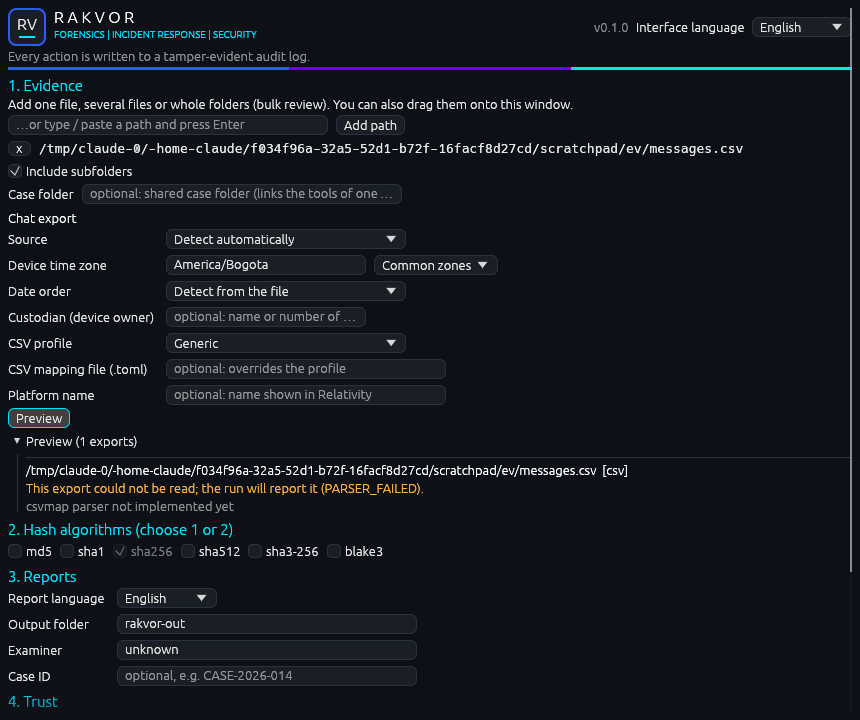
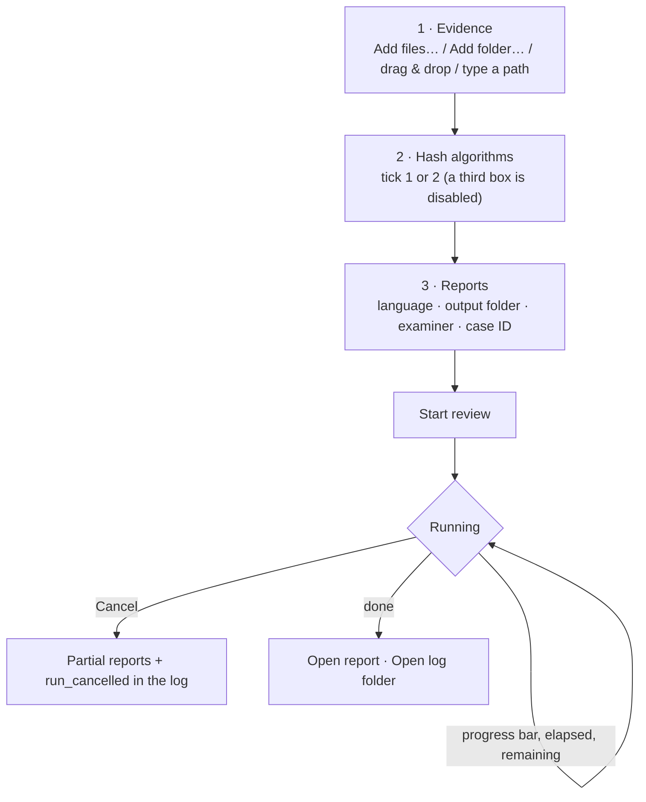

# Using the desktop app (Windows 10/11)

Start **RV RSMF** from the Start menu (installer) or double-click `rv-rsmf-gui.exe` (portable zip).
No installation of other software is required; the app also runs on virtual machines without a graphics
driver (software rendering).

## Workflow

## The window

| Area | What it does |
| --- | --- |
| **1. Evidence** | *Add files…* and *Add folder…* open the Windows pickers. You can also drag files or folders onto the window (or onto the `rv-rsmf-gui.exe` icon before it starts), or paste a path and press Enter. *Include subfolders* is on by default. Remove an entry with **x**. |
| **2. Hash algorithms** | Tick one or two. When two are ticked, the others are disabled; you cannot untick the last one. |
| **3. Reports** | Language (English, Español, Français, or all three), output folder, examiner name (defaults to your Windows user), optional case ID. |
| **4. Trust** | *Trusted timestamp* (on by default; TSA address editable), *Certificate…* to pick your `.p12`/`.pfx` and its password (kept in memory only, never logged) so every PDF is signed, and *Jurisdiction* (Colombia / France) for the custody form. |
| **Interface language** | Top-right selector: English, Español, Français. Changes every label immediately; independent of the report language. |
| **Start review / Cancel** | Start is enabled once evidence is added. During a run the settings are locked and the button becomes *Cancel*. |
| **Progress** | Bar by bytes processed, `files done / total`, elapsed time (always moving) and estimated time remaining. The file being read is shown below. |
| **Result** | Counts by severity, **Open report** (statistics page in your language) and **Open log folder**. |

## Case folder

Fill **Case folder** in section 1 to work inside a shared case folder (see [case-folder.md](case-folder.md)).
For a new folder, also fill **Case ID** (and the custody form's jurisdiction): they are written once to
`case.json`. While a case folder is set, the **Output folder** shows `<case>/runs/rv-rsmf/<RUN-ID>` and cannot
be edited, and you may start without adding evidence (every registered item is examined). After the run, the
result panel lists the **evidence id** of every item (E0001…) and its status (registered, verified, mismatch, not in
registry). The change is audited as `ui_case_dir_changed`.

RV Hub opens the app with the case folder already filled: `rv-rsmf-gui.exe --case-dir <CASE> [FILES...]` (or
`--case-dir=<CASE>`). The audit log then starts with `ui_case_dir_from_launcher` (the path and `at_utc`); a
`--case-dir` without a folder is ignored, shown in the window and logged as `ui_launch_argument_ignored`.

## What the GUI records

Your choices are part of the evidence record. Before the run starts, the GUI writes them to the audit log:

| Action | Logged as |
| --- | --- |
| Add / remove evidence | `ui_input_added`, `ui_input_removed` |
| Change hash selection | `ui_hash_selection_changed` |
| Change language / subfolders | `ui_language_changed`, `ui_recursive_changed` |
| Opened by RV Hub with `--case-dir` | `ui_case_dir_from_launcher`, `ui_case_dir_changed` (or `ui_launch_argument_ignored`) |
| Press Start | `ui_start_clicked` (final settings) |
| Press Cancel | `item_cancelled`, `run_cancelled` |

Errors during the run appear under **Warnings** and in the log as `item_error`.
Validation messages shown *before* a run (e.g. "Add at least one file or folder") are not logged, because no run — and
therefore no log — exists yet.

## Same results as the command line

The GUI calls the same engine as `rv-rsmf scan`. A GUI run with the same evidence, algorithms and language gives
identical hashes and findings; `environment.json` records `"frontend": "gui"` and the settings used.
