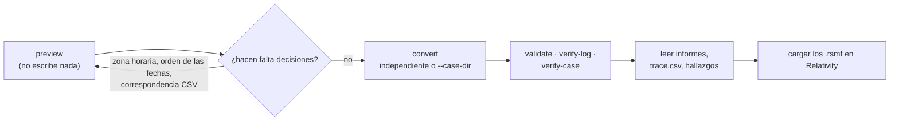

> La versión de referencia es la inglesa ([usage.md](usage.md)); esta traducción la sigue.

# Guía de uso: de una exportación a archivos RSMF verificados

Esta página recorre una conversión de principio a fin: revisar una exportación con `preview`, tomar las decisiones que
solo el perito puede tomar (zona horaria, orden de las fechas, custodio, correspondencia CSV), convertir de forma
independiente o en una carpeta del caso, validar, leer las salidas y `trace.csv`, verificar una ejecución y resolver
problemas. Cada opción de cada comando está en [usage-cli.md](usage-cli.md) (generado a partir de `--help`, en
inglés); la aplicación de escritorio, en [usage-gui.es.md](usage-gui.es.md); lo que la herramienta hace con los datos,
en [theory.md](theory.md) (en inglés). Las tareas habituales en breve: [quick-guide.es.md](quick-guide.es.md).



Las salidas de los comandos que siguen proceden de ejecuciones reales de las muestras sintéticas de
[examples/](../examples/README.md) (en inglés); las rutas están abreviadas.

## 1. Antes de empezar

| Verificación | Por qué | Cómo |
| --- | --- | --- |
| Trabaje sobre una **copia verificada** de la exportación, nunca sobre la única copia | La herramienta es de solo lectura por software, no es un bloqueador de escritura, y lee la exportación más de una vez | Cópiela al volumen del caso y regístrela con rv-hashinv (o `--intake hashinv`) |
| Mantenga la exportación **completa** | Los archivos multimedia junto a un `.txt` de WhatsApp, las carpetas `photos/`, `files/`… de Telegram, cada `.msg` de Teams | Indique la carpeta de la exportación con `-r`, no solo el archivo principal |
| Sepa cómo se hizo la exportación | El RSMF reproduce la exportación, no el teléfono | Anote quién la exportó, en qué dispositivo, con qué versión de la aplicación y con qué opciones ("con/sin multimedia") |
| La **zona horaria** del teléfono en el momento de los mensajes | WhatsApp y la mayoría de los CSV dan horas sin desfase | Configuración del dispositivo, declaración del custodio, un informe de extracción; un viaje puede cambiarla |
| La herramienta instalada es la versión auténtica | "¿Cómo sabe qué ejecutó?" | [installation.es.md](installation.es.md), pasos 2–4 y 6 |
| Política de hash | MD5/SHA-1 solos no resisten colisiones | Incluya siempre `sha256` (o `sha512`) |
| Reloj | Las horas de auditoría vienen del reloj del puesto | Compruebe la sincronización horaria de Windows |
| Jurisdicción, sello de tiempo, certificado | Formato de custodia, prueba del momento, PDF firmados | `--jurisdiction co\|fr`, `--tsa-url` / `--no-timestamp`, `--sign-cert` |

## 2. Recorrido

### 2.1 Vista previa: ¿cómo se leerá la exportación?

`preview` lee las exportaciones exactamente como lo haría `convert`, imprime el tipo de origen, los datos que encontró
el lector (orden de las fechas y su motivo, zona horaria, variante), los hallazgos y los primeros mensajes con la hora
**tal como está escrita** junto al valor UTC. No escribe nada ni registra nada.

```powershell
rv-rsmf preview -i "E:\export\whatsapp-android-en" --timezone Europe/Paris --limit 4
```

```text
E:\export\whatsapp-android-en\WhatsApp Chat with Ana Ruiz.txt [whatsapp]
  chat_file: WhatsApp Chat with Ana Ruiz.txt
  date_order: dmy
  date_order_basis: line 11: first component 13 > 12
  lines_read: 13
  timezone: Europe/Paris
  variant: android
  conversations: 1  participants: 3  events: 10
  finding: DATE_ORDER_INFERRED (info)
  finding: MEDIA_OMITTED_IN_EXPORT (low)
  finding: ATTACHMENT_REFERENCED_NOT_FOUND (medium)
  finding: PARTICIPANT_IDENTIFIED_BY_NUMBER_ONLY (info)
  as written             UTC                    from                 text
  02/03/2026, 09:58      2026-03-02T08:58:00Z   -                    Messages and calls are end-to-end encrypted. No one outside
  02/03/2026, 09:59      2026-03-02T08:59:00Z   -                    Ana Ruiz created group "Proyecto Faro"
  02/03/2026, 09:59      2026-03-02T08:59:00Z   -                    Ana Ruiz added ‪+33 6 00 00 00 01‬
  02/03/2026, 10:00      2026-03-02T09:00:00Z   Ana Ruiz             Hola! Plan for the 14th: 1. Kick-off at 10:00 2. Review: bud
```

Compare algunas líneas con la exportación y con lo que dice el custodio. `--json` imprime un objeto JSON por
exportación (para scripts); `--limit N` fija el número de mensajes (por defecto 20). Códigos de salida: 0 cada
exportación se puede convertir con estas opciones, 1 una exportación no se puede leer, 2 hace falta una decisión.

### 2.2 Elegir `--timezone`

```text
error: …\whatsapp-dst.txt: the export's times have no UTC offset; give the device's time zone with --timezone (IANA name, e.g. Europe/Paris)
```

Indique el nombre IANA de la zona que usaba el **teléfono** (`Europe/Paris`, `America/Bogota`, `Europe/Madrid`), no
la suya, y no un desfase fijo como `UTC+1` (un desfase fijo ignora el horario de verano). Una ejecución usa una sola
zona para todas las exportaciones: convierta las exportaciones de teléfonos de zonas distintas en ejecuciones
separadas. La zona es también la zona en la que los días se cortan en archivos, para todos los orígenes (las horas de
Telegram y de Teams son UTC en la exportación; sin `--timezone`, sus días se cortan en UTC).

La elección se registra en `conversion_started`, en cada conversación RSMF (`source_timezone`) y como
`TIMEZONE_APPLIED`; cada evento conserva la hora tal como está escrita (`source_time`). Las horas en un cambio de
horario de verano se convierten con una regla fija y se informan (`DST_AMBIGUOUS_OR_MISSING_TIME`,
[theory.md B6](theory.md#b6-time-local-time-to-utc-and-the-date-order), en inglés): compruebe esos mensajes frente al
orden de la conversación.

### 2.3 Elegir `--date-order`

```text
error: …\whatsapp-ambiguous.txt: the day/month order of the dates cannot be decided from the file (possible: dmy, mdy); give --date-order. Lines: line 1: 03/04/26, 9:05 AM - Carla Méndez: Buenos días | line 3: 05/04/26, 1:30 PM - Carla Méndez: Yes: 10 AM at the office
```

Solo se pide cuando **todas** las fechas de una exportación de WhatsApp pueden leerse con el día o con el mes primero.
Decida a partir de la configuración de idioma y región del teléfono, del contenido ("see you on 05/06?") o de otro
registro de la misma conversación; luego `--date-order dmy` o `mdy`. La decisión se informa como `DATE_ORDER_CHOSEN`.
Cuando el archivo decide por sí mismo (un número mayor que 12), gana el archivo y su opción solo se registra
(`date_order_option_used = no`), de modo que una ejecución puede convertir varias exportaciones. Para los archivos CSV,
`--date-order` se aplica **siempre** que se indique (las filas que no encajan pasan a "invalid date" en
`UNPARSED_LINES`): indíquelo solo para el CSV que lo necesita, o ponga `date_order` en la correspondencia de ese CSV.

### 2.4 Elegir `--custodian`

`--custodian "Ana Ruiz"` nombra al propietario del dispositivo. Con ello:

- pasa a ser el `custodian` de la conversación RSMF y la cabecera `From` cuando un participante tiene ese nombre visible
  o ese número (si no, solo se escribe `X-RSMF-Custodian` y no hay cabecera `From`);
- se renombran los autores de WhatsApp escritos como `You` / `Tú` / `Vous` / `Du` / `Você` / `Tu` (el campo
  personalizado `author_in_export` conserva el original) y sus mensajes pasan a ser `outgoing`;
- se completa un remitente CSV vacío en una fila `outgoing`.

Escríbalo exactamente como la exportación nombra al propietario (o su número). Se aplica a todas las exportaciones de
la ejecución.

### 2.5 Otras opciones

| Opción | Uso |
| --- | --- |
| `--source whatsapp\|telegram\|teams-msg\|csv` | Forzar el lector para archivos que no se reconocen (p. ej. un `.txt` de WhatsApp renombrado) |
| `--platform-name "WhatsApp Business"` | Plataforma que muestra Relativity (`platform` de RSMF, `X-RSMF-Application`) |
| `--csv-map FILE.toml` / `--csv-profile` | Correspondencia de columnas CSV ([referencia](#referencia-de-la-correspondencia-de-columnas-csv)) |
| `--hash sha256,md5` | Uno o dos algoritmos; el primero es el principal (y genera el id de la colección de eventos) |
| `--lang en\|es\|fr\|all` | Idiomas de los informes |
| `-i`, `-r`, `--input-list` | Entradas; las carpetas se leen a un nivel salvo con `-r` |

### 2.6 Convertir (de forma independiente)

```powershell
rv-rsmf convert -i E:\export -r --timezone Europe/Paris --date-order dmy --hash sha256,md5 `
    --case DEMO-001 --actor "Ana Ruiz" --lang all --out D:\work\rsmf-demo
```

```text
DONE  run 20261027T164952Z-750c58
  items: 16  bytes: 99559  errors: 0  elapsed: 0.3 s
  findings: high 0, medium 10, low 2, info 24
  timestamp: off
  report: D:\work\rsmf-demo\reports\20261027T164952Z-750c58\statistics.en.html
  logs:   D:\work\rsmf-demo\logs\20261027T164952Z-750c58
  rsmf:   8 export(s), 10 conversation(s), 49 event(s), 17 file(s) -> D:\work\rsmf-demo\rsmf\20261027T164952Z-750c58
```

(La carpeta de muestras completa, ejecutada con `--no-timestamp`; con una TSA accesible, la línea dice
`timestamp: ok <hora>`. Antes de escribir nada, cada exportación se comprueba por si falta alguna decisión: código de
salida 2 si hace falta una). Qué ocurrió: se calculó el hash de cada archivo; los archivos se agruparon en 8
exportaciones (los archivos multimedia y la correspondencia CSV pasaron a ser miembros); cada exportación se leyó, se
dividió por conversación y por día, se escribió como `.rsmf`, se validó y se releyó; se escribió `trace.csv`; siguieron
los informes, el sello de tiempo y las estadísticas. Código de salida 0 = ningún hallazgo de severidad alta; 3 = al
menos uno (busque `PARSER_FAILED`, `RSMF_SCHEMA_INVALID`, `RSMF_ROUNDTRIP_MISMATCH`,
`EVIDENCE_HASH_MISMATCH_WITH_CASE`).

`--progress jsonl` imprime un evento JSON por línea en stdout para scripts (`run_started`, `item_started`,
`item_hashed`, `progress`, `export_started`, `rsmf_written`, `export_finished`, `evidence_linked`, `intake_*`,
`error`, `timestamp`, `report_written`, `run_finished`…). **Ctrl+C** se detiene tras el bloque, la exportación o el
archivo en curso: se escriben informes parciales, se registra `run_cancelled`, código de salida 130.

### 2.7 Convertir en una carpeta del caso

```powershell
# rv-hashinv registra primero las exportaciones, luego rv-rsmf las verifica y las convierte (un solo comando)
rv-rsmf convert -i E:\export -r --case-dir D:\cases\CASE-2026-014 --case CASE-2026-014 --jurisdiction co `
    --timezone Europe/Paris --intake hashinv --actor "Ana Ruiz"
# o, cuando el registro ya existe: cada elemento registrado, o algunos de ellos
rv-rsmf convert --case-dir D:\cases\CASE-2026-014 --timezone Europe/Paris
rv-rsmf convert --case-dir D:\cases\CASE-2026-014 --evidence E0003,E0004 --timezone Europe/Paris
```

Las salidas van a `D:\cases\CASE-2026-014\runs\rv-rsmf\<RUN-ID>\{logs,reports,rsmf}`; el resumen termina con
`case: CASE-2026-014 (analysis) … verified N, mismatched 0, not in registry 0`. Cada archivo se vuelve a hashear y se
compara con el registro antes de la conversión; una discrepancia es un hallazgo alto y la conversión se hace
igualmente. Con `--evidence` o sin `-i`, las decisiones que faltan se detectan durante la ejecución (`PARSER_FAILED`) y
no antes: haga primero la vista previa. Detalles: [case-folder.md](case-folder.md) (en inglés).

### 2.8 Validar

```powershell
rv-rsmf validate D:\work\rsmf-demo\rsmf\20261027T164952Z-750c58
```

```text
OK       …\001-generic-csv-000001\Grupo-obra-aae949\2026-10-24.rsmf  (1 events, 0 attachments)
OK       …\006-WhatsApp-Chat-with-Ana-Ruiz-txt-000014\Ana-Ruiz-aa3173\2026-03-02.rsmf  (7 events, 1 attachments)
…
```

Aplica el esquema oficial y las comprobaciones estrictas ([theory.md B11](theory.md#b11-validation-and-read-back), en
inglés) a cualquier `.rsmf`, nuestro o de otro proveedor, e imprime cada problema (`schema: …`, `strict: …`). Salida 0
todos válidos, 3 al menos uno no válido, 1 un archivo no se pudo leer. La conversión ya hizo las mismas comprobaciones
más una relectura; vuelva a ejecutar `validate` sobre la copia que entrega, después de cada transferencia.

### Inicio desde RV Hub: `--case-dir` y `describe --json`

RV Hub (el lanzador de Rakvor) encuentra las herramientas instaladas, las abre sobre una carpeta del caso y sugiere
cuál conviene para un archivo. Se apoya en dos puntos de entrada de RV RSMF:

- **`rv-rsmf-gui.exe --case-dir <CASE> [FILES...]`** inicia la aplicación de escritorio con **Carpeta del caso** ya
  completada (`--case-dir=<CASE>` también funciona). Los demás argumentos se cargan como evidencia, como cuando se
  sueltan archivos sobre el icono. El ajuste previo se escribe en el log de auditoría de la ejecución como
  `ui_case_dir_from_launcher` (ruta y `at_utc`) seguido de `ui_case_dir_changed`. Un `--case-dir` sin carpeta se
  ignora: la ventana lo indica y el log de auditoría registra `ui_launch_argument_ignored`.
- **`rv-rsmf describe --json`** imprime un objeto JSON (claves ordenadas) que lee RV Hub; está oculto en
  `rv-rsmf --help` pero aparece en [usage-cli.md](usage-cli.md). No lee ni escribe nada. Esquema:
  [`schemas/describe.schema.json`](../schemas/describe.schema.json) (`rakvor.describe/1`, idéntico en toda
  herramienta Rakvor).

| Campo | Significado |
| --- | --- |
| `schema` | `rakvor.describe/1` |
| `tool`, `title`, `version` | `rv-rsmf`, `RV RSMF`, la versión del producto (`version.txt`) |
| `role` | `conversion`. En una carpeta del caso, rv-rsmf sigue actuando como herramienta de *análisis* (su papel en el caso, `CASE_ROLE` en el código): verifica cada elemento contra el registro de evidencias y no registra nada. `conversion` le dice a RV Hub lo que produce la herramienta (archivos RSMF); el papel en el caso le dice a la carpeta del caso cómo trata la herramienta la evidencia |
| `main_verb` | `convert`: el comando que hace el trabajo principal |
| `accepts` | `extensions` (en minúsculas, sin punto) y `signatures` de contenido (`format` + `match`: bytes hexadecimales en un desplazamiento); `"*"` = cualquier archivo |
| `case_formats`, `log_formats` | `rakvor.case/1`; `rakvor.audit/1` = `logs/audit.jsonl`, `rakvor.review/1` = `logs/review.jsonl` |
| `cli_exe`, `gui_exe` | `rv-rsmf.exe`, `rv-rsmf-gui.exe` |
| `exit_codes` | El significado de 0, 1, 2, 3 y 130 (la tabla de códigos de salida en Solución de problemas) |

```powershell
rv-rsmf describe --json
```

## Referencia de la correspondencia de columnas CSV

Una correspondencia es un archivo TOML. rv-rsmf usa, en este orden: `--csv-map FILE`; un archivo `<raíz del
csv>.map.toml` junto al CSV (así una ejecución puede convertir varios CSV con correspondencias distintas); el perfil
integrado (`--csv-profile`, por defecto `generic`; sin ninguna correspondencia y con una cabecera sin las columnas
genéricas, se prueban `xry-draft` y luego `cellebrite-draft`). Las claves desconocidas se rechazan
(`deny_unknown_fields`), así que una errata detiene la ejecución con el código de salida 2 en lugar de ignorarse.

```toml
[columns]                       # un nombre de columna, o una lista de nombres alternativos; sin distinguir mayúsculas
timestamp = "Time"              # OBLIGATORIO
timestamp_format = "auto"       # "auto" (por defecto), "iso", "epoch_s", "epoch_ms", o un patrón strftime de chrono
timezone_column = "Zone"        # opcional: nombre IANA o desfase UTC por fila
conversation = "Chat ID"        # OBLIGATORIO: una conversación RSMF por valor distinto
sender = "From"                 # OBLIGATORIO: "Nombre", "+57 300 000 0001", "a@b.c" o "Nombre <+57 300 000 0001>"
sender_number = "From number"   # opcional: sustituye el número del remitente
recipients = "To"               # opcional: varios separados por ';'
body = "Body"                   # OBLIGATORIO
direction = "Direction"         # opcional: valores asignados por [direction]
application = "Source"          # opcional: se conserva como el campo personalizado "application" de la conversación
deleted = "Deleted"             # opcional: true cuando el valor está en [deleted] values
attachment = "Attachment(s)"    # opcional: ruta(s) relativa(s) a la carpeta del CSV, separadas por ';' o un salto de línea

[direction]                     # opcional; sustituye las listas por defecto si se indica
incoming = ["Incoming", "Received"]
outgoing = ["Outgoing", "Sent"]

[deleted]                       # opcional; sustituye la lista por defecto si se indica
values = ["yes", "true", "1", "deleted"]

[options]
delimiter = "auto"              # "auto" (por defecto), o un carácter ASCII como "," ";" "|", o "tab" / "\t"
encoding = "auto"               # "auto" (por defecto), "utf-8", "utf-16le", "utf-16be", "windows-1252", u otra
                                # etiqueta WHATWG; un BOM siempre gana; una codificación declarada se aplica estrictamente
skip_rows = 0                   # líneas antes de la línea de cabecera
date_order = "dmy"              # "dmy", "mdy" o "ymd": fechas numéricas en formato "auto" (--date-order gana)
```

| Clave | Valor por defecto si falta | Notas |
| --- | --- | --- |
| `timestamp_format` | `auto` | `auto`: RFC 3339; si no, fecha numérica + hora con segundos, fracción, `am/pm` y desfase opcionales (`Z`, `+02:00`, `UTC+2`, `(UTC-05:00)`, `GMT`). `iso`: lo mismo pero solo con el año primero. `epoch_s` (fracción admitida), `epoch_ms`. Si no, un patrón `strftime` de chrono, p. ej. `%d/%m/%Y %H:%M:%S`; con `%z`/`%:z` la celda es un instante; un patrón solo de fecha da la medianoche |
| `delimiter` | `auto` | el más frecuente de `,` `;` tabulador `\|` en la línea de cabecera; si no hay ninguno, tabulador para `.tsv`, coma en los demás casos |
| `encoding` | `auto` | UTF-16LE cuando ≥ 30 % de los bytes impares son NUL; si no, UTF-8; si no, windows-1252 |
| `[direction]` | `incoming in received inbox rx entrante` / `outgoing out sent outbox tx saliente` | sin distinguir mayúsculas; un valor desconocido se conserva como el campo personalizado `direction_raw` |
| `[deleted] values` | `1 true yes y x deleted si sí oui vrai` | sin distinguir mayúsculas |
| columnas opcionales | no se usan | con su propia correspondencia (archivo o archivo hermano), una columna opcional nombrada que falta en la cabecera es un **error**; con un perfil integrado solo se anota |

Perfiles integrados ([csvmap.rs](../src/core/src/sources/csvmap.rs)):

| Perfil | Columnas | Estado |
| --- | --- | --- |
| `generic` | `timestamp`, `timezone`, `conversation`, `sender`, `sender_number`, `recipients`, `body`, `direction`, `application`, `deleted`, `attachment` | los nombres de columna propios de rv-rsmf |
| `xry-draft` | timestamp `Time\|Date\|Timestamp\|Date/Time`; conversation `Chat ID\|Chat\|Conversation\|Thread`; sender `From\|Sender`; recipients `To\|Recipients\|Recipient`; body `Body\|Text\|Message`; direction; application `Source\|Application\|App`; deleted `Deleted\|Deleted?`; attachment `Attachment(s)\|Attachments\|Attachment` | **BORRADOR, sin verificar**: los formatos de MSAB XRY/XAMN no están documentados públicamente; se informa como `CSV_MAPPING_DRAFT_PROFILE` |
| `cellebrite-draft` | timestamp `Timestamp: Time\|Timestamp\|Time\|Date`; conversation `Chat ID\|Chat #\|Chat\|Identifier`; sender `From\|Sender\|Participant`; recipients `To\|Participants\|Recipients`; body `Body\|Message\|Text`; direction; application `Source\|Source App\|Application`; deleted `Deleted\|Deleted - Instant Message`; attachment `Attachment(s)\|Attachments\|Attachment #1` | **BORRADOR, sin verificar**: la misma advertencia |

Antes de confiar en un perfil borrador, o en su propia correspondencia, compruebe algunos mensajes convertidos frente a
la vista de la herramienta de origen (remitente, hora, texto, dirección) y conserve esa comprobación con el caso. La
muestra [generic.map.toml](../examples/sample/evidence/csv/generic.map.toml) asigna nombres de columna en español con
un formato `strftime` fijo. Un problema de correspondencia detiene la ejecución con el código de salida 2 y nombra las
columnas que faltan y la cabecera encontrada:

```text
error: …\n.csv: CSV mapping incomplete: missing columns: timestamp ("timestamp"), conversation ("conversation"), sender ("sender"), body ("body"); header has: Fecha, Chat, De, Texto
```

## 3. Leer las salidas

| Mire | Para saber |
| --- | --- |
| `reports\<RUN-ID>\statistics.<LANG>.html` | la ejecución: exportaciones por origen, conversaciones, eventos, archivos RSMF (y los no válidos), adjuntos empaquetados y que faltan, hallazgos por severidad y por código |
| `reports\…\items\<NNNNN>-<export>\technical.<LANG>.html` | una exportación: cada hallazgo con lo que muestra / no demuestra, los datos del lector (orden de las fechas y su motivo, zona horaria, variante, columnas CSV), los archivos RSMF con su SHA-256 |
| `reports\…\items\…\summary.<LANG>.html` | lo mismo para el cliente, en palabras sencillas |
| `rsmf\<RUN-ID>\trace.csv` | de dónde vino cada evento y adónde fue |
| `rsmf\<RUN-ID>\conversions.json` | cada archivo de cada exportación con su resultado de validación |
| `logs\<RUN-ID>\audit.jsonl` | cada acción, cada opción y cada hash |

Cada archivo se describe en [reports.md](reports.md) (en inglés).

**Comprobar un mensaje con `trace.csv`.** En Relativity, anote el archivo de un mensaje y su id de evento (los campos
personalizados `source_file`, `source_lines` o `source_id`, `source_time` también se muestran con el mensaje). En
`trace.csv` (ábralo en una hoja de cálculo, está en UTF-8):

```text
export,source_file,line,line_end,native_id,source_time,utc,rsmf_file,event_id,conversation,kind,attachments
WhatsApp Chat with Ana Ruiz.txt,WhatsApp Chat with Ana Ruiz.txt,4,6,,"02/03/2026, 10:00",2026-03-02T09:00:00Z,006-WhatsApp-Chat-with-Ana-Ruiz-txt-000014/Ana-Ruiz-aa3173/2026-03-02.rsmf,e-000004,c-554810aa3173,message,0
```

Abra la exportación en las líneas 4–6 y compare el autor, el texto y la hora tal como está escrita; `utc` es esa hora
en la zona elegida convertida a UTC. Para Telegram y Teams use `native_id` (el id del mensaje; `0002.msg` para Teams
está en `source_file`). Para los archivos CSV, `line` es la línea del archivo y `native_id` el número de fila de datos
([theory.md B5.4](theory.md#b54-csv--tsv-with-a-column-mapping), en inglés). Las líneas y filas que **no** se
convirtieron no están en `trace.csv`: el hallazgo `UNPARSED_LINES` da su número y las tres primeras; revise a mano el
resto de la exportación a su alrededor.

## 4. Interpretar cada hallazgo

Lo que muestra y lo que no demuestra cada hallazgo: [reports.md](reports.md#findings-catalogue) (en inglés). Qué
hacer:

| Hallazgo | Compruebe antes de confiar en el RSMF |
| --- | --- |
| `PARSER_FAILED` (alto) | Lea el error; una exportación dañada o no admitida no se convierte. Vuelva a exportar si es posible; nunca edite la exportación para que pase (si debe hacerlo, convierta una copia documentada y dígalo) |
| `RSMF_SCHEMA_INVALID` / `RSMF_ROUNDTRIP_MISMATCH` (alto) | No cargue ese archivo. Comuníquelo a ingeniería con el archivo y los logs de la ejecución |
| `EVIDENCE_HASH_MISMATCH_WITH_CASE` (alto) | Hashes esperado y real en el hallazgo; quién tuvo el archivo desde la recepción (log del caso) |
| `UNPARSED_LINES` (medio) | Abra la exportación en las líneas o filas citadas: ¿cabeceras, un formato mezclado, líneas dañadas? ¿Falta contenido en la conversación? |
| `DST_AMBIGUOUS_OR_MISSING_TIME` (medio) | ¿Es plausible el orden de esos mensajes? Para una hora repetida se usó el instante más temprano |
| `NON_MONOTONIC_TIMESTAMPS` (medio) | ¿Está la exportación en orden cronológico? Lo causan los cambios de reloj, una zona horaria o un orden de fechas equivocados, o ediciones |
| `ATTACHMENT_REFERENCED_NOT_FOUND` (medio) | ¿Se entregó la exportación completa (carpeta de multimedia, zip)? Pida los archivos que faltan |
| `CSV_MAPPING_DRAFT_PROFILE` (medio) | Compare los mensajes con la herramienta de origen, o escriba y use su propia correspondencia |
| `POSSIBLE_EXPORT_LIMIT` (medio) | Compare el primer y el último mensaje con el teléfono o con una extracción |
| `DATE_ORDER_INFERRED` / `DATE_ORDER_CHOSEN` / `TIMEZONE_APPLIED` (info) | Su decisión y su fundamento constan; repítalos en su informe |
| `DELETED_MESSAGES_NOT_IN_EXPORT`, `MEDIA_OMITTED_IN_EXPORT`, `TELEGRAM_FILE_NOT_INCLUDED`, `EDIT_HISTORY_NOT_IN_EXPORT` | Indique la limitación en su informe; corrobórelo con una extracción si importa |
| `PARTICIPANT_IDENTIFIED_BY_NUMBER_ONLY` | Establezca con otra evidencia quién usaba el número |
| `PART_OF_EXPORT`, `NOT_A_CHAT_EXPORT` | Compruebe que se reconoció cada exportación de chat (`--source` para forzarlo); la exportación que nombra `PART_OF_EXPORT` puede ser incorrecta cuando dos exportaciones comparten carpeta ([theory.md B3](theory.md#b3-recognising-and-grouping-exports), en inglés) |

## Sellos de tiempo, firma y verificación de una ejecución

**Sellos de tiempo.** Por defecto, cada ejecución pide a la TSA (`http://timestamp.digicert.com`, se cambia con
`--tsa-url`) que firme la cabeza de la cadena de auditoría antes del informe de estadísticas. Sin red, la ejecución
registra `timestamp_pending`; más tarde ejecute `rv-rsmf timestamp <carpeta de logs>`. `verify-log` comprueba la
huella del token y la firma CMS de la TSA (`TSA signature valid (signer: …)`); la cadena de certificados de la TSA solo
se valida con `--tsa-ca`:

```bash
rv-rsmf verify-log <log folder> --tsa-ca <TSA roots.pem>
# → … TSA signature valid (signer: …); chain validated to … (revocation not checked)
# sin --tsa-ca: … chain not checked (pass --tsa-ca <CA bundle> to validate it)
```

Un archivo de CA ilegible da salida 1; un fallo de firma o de cadena da salida 3; un token registrado en el log cuyo
`.tsr` o `.json` falta también da salida 3. La revocación nunca se verifica (brecha G18). Como verificación
independiente de **firma y cadena**, use OpenSSL (Git for Windows incluye `openssl.exe`); tampoco verifica la
revocación (no se le da ninguna CRL y OpenSSL no consulta OCSP):

```bash
cd <log folder>
N=00131                                                   # del nombre de archivo timestamp-00131.tsr
H=$(python -c "import json;print(json.load(open('timestamp-$N.json'))['head'])")
openssl ts -reply -in timestamp-$N.tsr -text              # genTime, policy OID, TSA name, serial, nonce, accuracy
openssl ts -reply -in timestamp-$N.tsr -token_out -out token.der
openssl pkcs7 -inform DER -in token.der -print_certs > tsa-certs.pem
openssl ts -verify -digest "$H" -in timestamp-$N.tsr -CAfile <TSA root.pem> -untrusted tsa-certs.pem
# → "Verification: OK"  (solo la firma y la cadena, no la revocación)
```

Establezca por separado el estado de revocación del certificado de la TSA, a partir de evidencia CRL/OCSP que cubra
genTime (una CRL emitida después de genTime por la CA de la TSA, o una respuesta OCSP archivada en el momento del
sellado), p. ej.
`openssl verify -crl_check -CRLfile tsa-ca.crl -CAfile <TSA root.pem> -untrusted tsa-certs.pem -attime <genTime-epoch> tsa.pem`,
o `rv-certcheck analyze --crl … --ocsp …`.

> **Fechas de la CRL y `-attime`.** OpenSSL aplica `-attime` también a la CRL, así que `openssl verify -crl_check -attime <genTime-epoch>` solo funciona con una CRL cuyo intervalo `thisUpdate`–`nextUpdate` contenga genTime; una CRL emitida después de genTime falla con "CRL is not yet valid". Para usar como evidencia una CRL posterior, verifique su firma (`openssl crl -in tsa-ca.crl -CAfile <TSA root.pem> -noout -verify`) y luego busque en ella el número de serie del certificado de la TSA (`openssl crl -in tsa-ca.crl -noout -text`): si no aparece, o aparece con una fecha de revocación posterior a genTime, no estaba revocado en genTime. Una CA puede quitar de sus CRL los certificados vencidos, así que para un certificado de TSA ya vencido un número de serie ausente no es concluyente: use una CRL anterior a su vencimiento, o una respuesta OCSP archivada en el momento del sellado.

**Firma.** `--sign-cert <archivo.p12|.pfx>` firma cada informe PDF con su certificado (solo RSA); la contraseña viene
de `RV_SIGN_PASSWORD` (o `--sign-pass-env NOMBRE`) o de una solicitud sin eco, y nunca se registra:

```powershell
$s = Read-Host "Certificate password" -AsSecureString
$env:RV_SIGN_PASSWORD = [Runtime.InteropServices.Marshal]::PtrToStringBSTR(
    [Runtime.InteropServices.Marshal]::SecureStringToBSTR($s))
rv-rsmf convert -i E:\export -r --timezone Europe/Paris --sign-cert C:\certs\ana-ruiz.p12
Remove-Item Env:RV_SIGN_PASSWORD
```

Compruebe un informe firmado con Acrobat o con `pyhanko sign validate --pretty-print --trust <CA .pem> technical.en.pdf`.

**Verificar una ejecución.** Cualquiera puede comprobar una ejecución con sus tres carpetas y la copia de la
exportación:

| Paso | Comando | Prueba |
| --- | --- | --- |
| 1 | `rv-rsmf verify-log <log>` (0 intacto, 3 roto, truncado o una salida cambiada) | Ninguna entrada se editó, borró ni reordenó; la línea `truncation:` nombra lo que ancla el final; la línea `outputs:`: cada salida registrada conserva su hash |
| 2 | `python tests/verify_chain.py <log>` (árbol de código) | Lo mismo, con una implementación independiente; además vuelve a hashear los archivos de entrada listados en `hashes.csv` y cada salida que registra el log de auditoría |
| 3 | OpenSSL (arriba) | La TSA firmó realmente esa cabeza en ese momento |
| 4 | Paso 1 (línea `outputs:`); el script de abajo para una comprobación independiente | Cada `.rsmf`, `trace.*`, `conversions.json`, informe, `environment.json` y `hashes.csv` conserva el hash que registró el log |
| 5 | `rv-rsmf validate <carpeta rsmf>` | Cada archivo RSMF sigue siendo válido |
| 6 | `rv-rsmf verify-case <CASE> --rehash` | Carpeta del caso: la ejecución es la que anunció el log del caso, con cada salida registrada sin cambios; la evidencia accesible coincide con el registro |
| 7 | `python tests/validate_reports.py <carpeta de informes o CASE>` | Cada informe JSON cumple su esquema |

Sobre la ejecución de la muestra (`examples/sample/run.sh`, con sello de tiempo):

```text
OK  132 entries, chain intact: …\audit.jsonl
    timestamp 2026-11-13T23:06:30Z by http://timestamp.digicert.com covers entry #129: TSA signature valid (…); chain not checked (…)
    truncation: entries up to #129 are anchored by the RFC 3161 timestamp (timestamp-00129.json); 3 entries after it (…) cannot be proven complete
    outputs: 333 verified of 334 recorded (md5, sha256), 1 skipped
    not re-hashed: logs/timestamp-00129.tsr (RFC 3161 token: checked by the timestamp verification)
```

La línea `outputs:` es el nuevo hash de cada archivo que, según el log, escribió la ejecución (cada archivo `.rsmf`,
`trace.csv`, `trace.json`, `conversions.json`, los informes de cada elemento, los informes de estadísticas,
`hashes.csv`, `environment.json`), con cada algoritmo que registró el log; para un archivo, gana la última entrada. Un
archivo editado, borrado o sustituido después de la ejecución deja la ejecución en `BROKEN` (código de salida 3) y se
nombra (un byte agregado a un archivo RSMF, `trace.csv` movido):

```text
BROKEN  …\audit.jsonl
  - output rsmf/004-result-json-000010/Équipe-Atlas-24d44f/2026-03-03.rsmf: md5 differs from audit entry #73 (recorded eaaf…a4c7, now fdc2…a22a): edited or replaced after the run
  - output rsmf/trace.csv: missing (recorded by audit entry #109): deleted or moved after the run
    outputs: 331 verified of 334 recorded (md5, sha256), 1 missing, 1 changed, 1 skipped
```

Una ruta registrada que es absoluta, contiene `..` o se resuelve fuera de la carpeta de la ejecución a través de un
enlace simbólico o una unión se rechaza y nunca se lee. El token de sello de tiempo aparece como `not re-hashed`
porque la comprobación del sello de tiempo ya lo verifica. Los archivos que la ejecución no registró (cualquier cosa
agregada después a la carpeta) no se comprueban.

El paso 4 está incluido en `verify-log` y `verify-case`. Para comprobarlo con un código que cabe en una pantalla (una
implementación independiente, p. ej. para un perito de la contraparte):

```bash
python - "<log folder>" "<reports folder>" "<rsmf folder>" <<'EOF'
import hashlib, json, pathlib, sys
log, rep, rsmf = (pathlib.Path(a) for a in sys.argv[1:4])
def digest(p, algo):
    h = hashlib.new({"sha3-256": "sha3_256"}.get(algo, algo)); h.update(p.read_bytes()); return h.hexdigest()
checked = bad = 0
for line in (log / "audit.jsonl").open(encoding="utf-8"):
    e = json.loads(line); a, d = e["action"], e["details"]
    if a == "item_reports_written":
        files = {rep / d["folder"] / k: v for k, v in d["files"].items()}
    elif a == "statistics_report_written":
        files = {rep / k: v for k, v in d["files"].items()}
    elif a in ("environment_recorded", "hash_register_written"):
        files = {log / e["item"]: d}
    elif a == "trace_written":
        files = {rsmf / e["item"]: d}
    elif a == "rsmf_written":
        files = {rsmf / e["item"]: {"sha256": d["sha256"]}}
    else:
        continue
    for p, digests in files.items():
        algo = next(x for x in ("sha256", "sha512", "sha3-256", "sha1", "md5") if x in digests)
        checked += 1
        got = digest(p, algo) if p.is_file() else "missing"
        if got != digests[algo]:
            bad += 1; print("MISMATCH", p, algo, got)
print(f"{checked} files checked, {bad} mismatches"); sys.exit(3 if bad else 0)
EOF
```

Sobre la ejecución anterior de la muestra completa (un idioma) comprueba 201 archivos; agregar un byte a un `.rsmf`
da `MISMATCH …/2026-03-13.rsmf sha256 …` y el código de salida 3.

## 5. Solución de problemas

### Por código de salida

| Comando | 0 | 1 | 2 | 3 | 130 |
| --- | --- | --- | --- | --- | --- |
| `convert` (alias `scan`) | terminado, ningún hallazgo alto | error de ejecución: entrada inexistente, salida no escribible, contraseña del certificado incorrecta, log del caso bloqueado, rv-hashinv no encontrado o fallido, un adjunto que no se puede leer al escribir | error de uso o decisión del perito: opción, zona horaria o algoritmo desconocidos, tres algoritmos, idioma desconocido; hace falta `--timezone` / `--date-order` / correspondencia CSV; con `--case-dir`: carpeta de otro caso, falta `--case` al crearla, ID de evidencia desconocido | terminado con ≥ 1 hallazgo alto (`PARSER_FAILED`, `RSMF_SCHEMA_INVALID`, `RSMF_ROUNDTRIP_MISMATCH`, `EVIDENCE_HASH_MISMATCH_WITH_CASE`, `UNREADABLE`, `EXECUTABLE_CONTENT`); o la carpeta del caso no pasa la verificación (no se escribe nada) | cancelado, informes parciales escritos |
| `preview` | cada exportación se puede convertir | una exportación no se puede leer; no se encontró ninguna exportación | hace falta una decisión | — | — |
| `validate` | cada archivo válido | un archivo no se pudo leer (no es un mensaje RSMF, no tiene `rsmf.zip`) | — | al menos un archivo no válido | — |
| `verify-log` | intacto | log ilegible | — | cadena rota, token que no coincide, truncado, o una salida registrada editada, borrada o sustituida | — |
| `verify-case` | caso intacto (se imprimen avisos) | no es una carpeta de caso | — | una comprobación falló (p. ej. cambió una salida registrada de una ejecución) | — |
| `timestamp` | obtenido y registrado | TSA inaccesible | — | log que falta o roto (no se agrega nada) | — |
| `self-test` | todo pasa | un fallo: no use este programa | — | — | — |
| `describe` | descripción impresa | — | error de uso (opción desconocida) | — | — |

### Mensajes

| Mensaje | Solución |
| --- | --- |
| `the export's times have no UTC offset; give the device's time zone with --timezone …` | [2.2](#22-elegir---timezone) |
| `the day/month order of the dates cannot be decided from the file (possible: dmy, mdy); give --date-order. Lines: …` | [2.3](#23-elegir---date-order) |
| `CSV mapping incomplete: missing columns: …; header has: …` | Escriba una correspondencia con esas columnas ([referencia](#referencia-de-la-correspondencia-de-columnas-csv)) o corrija `skip_rows` |
| `CSV mapping incomplete: the file is not valid windows-1252; set [options] encoding …` | Declare la codificación correcta en la correspondencia |
| `CSV mapping incomplete: mapping … is not valid: unknown field …` | Una errata en la clave TOML (la lista de claves está arriba) |
| `unknown time zone '…': use an IANA name such as Europe/Paris or America/Bogota` | Use el nombre `Región/Ciudad` |
| `no chat export found among N file(s); use --source to force the type` (`preview`) | Los archivos no se reconocieron; compruebe los nombres (`result.json`, `.txt` con líneas de WhatsApp) o fuerce `--source` |
| `mixed date formats: …` / `inconsistent dates: …` / `… not a valid date as dmy` (`PARSER_FAILED`) | El archivo de WhatsApp mezcla formatos o se editó; examine las dos líneas citadas |
| `no WhatsApp message lines found` | No es una exportación de WhatsApp, o un formato regional no admitido: envíe una muestra anonimizada a ingeniería |
| `no Teams message (IPM.SkypeTeams.*) among the .msg files` | Los archivos `.msg` son correos u otros elementos, no mensajes de Teams |
| `--intake hashinv needs the evidence to register (--input or --input-list)` / `… cannot be combined with --evidence` | [case-folder.md](case-folder.md#one-step-intake-with-rv-hashinv) (en inglés) |
| `rv-hashinv not found (install RV HashInv ≥ 0.3.0, or give its path with --hashinv-exe or RV_HASHINV). Looked in: …` | Instale RV HashInv o pase `--hashinv-exe` |
| `rv-hashinv intake failed (exit code N); nothing was analysed. …` | Lea los mensajes propios de rv-hashinv (se citan las últimas líneas) y su carpeta de ejecución |
| `the case folder … belongs to case X, not Y` / `evidence id(s) not in the case registry: …` | Carpeta o ID equivocados; vea [case-folder.md](case-folder.md) (en inglés) |
| `the case log is locked by …` / `stale case lock …` | Otra herramienta está escribiendo; para un bloqueo obsoleto, asegúrese de que no se ejecuta ninguna herramienta, borre `case-log.lock` a mano y anótelo |
| `cannot load signing certificate …` / `only RSA signing certificates are supported` | Compruebe `RV_SIGN_PASSWORD` y el tipo de certificado |
| `warning: timestamp pending (…)` | Ejecute `rv-rsmf timestamp <carpeta de logs>` cuando haya red |
| `refusing to append to a broken audit log` / `truncated: …` | El log se editó; investigue con `verify-log`; no lo repare |
