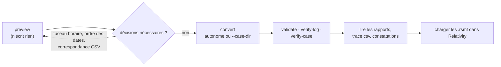

> La version de référence est la version anglaise ([usage.md](usage.md)) ; cette traduction la suit.

# Guide d'utilisation : d'un export à des fichiers RSMF vérifiés

Cette page parcourt une conversion de bout en bout : examiner un export avec `preview`, prendre les décisions que seul
l'expert peut prendre (fuseau horaire, ordre des dates, détenteur, correspondance CSV), convertir de façon autonome ou
dans un dossier de l'affaire, valider, lire les sorties et `trace.csv`, vérifier une exécution et résoudre les
problèmes. Chaque option de chaque commande figure dans [usage-cli.md](usage-cli.md) (généré à partir de `--help`, en
anglais) ; l'application de bureau, dans [usage-gui.fr.md](usage-gui.fr.md) ; ce que l'outil fait aux données, dans
[theory.md](theory.md) (en anglais). Les tâches courantes en bref : [quick-guide.fr.md](quick-guide.fr.md).



Les sorties de commande ci-dessous proviennent d'exécutions réelles des échantillons synthétiques de
[examples/](../examples/README.md) (en anglais) ; les chemins sont abrégés.

## 1. Avant de commencer

| Contrôle | Pourquoi | Comment |
| --- | --- | --- |
| Travaillez sur une **copie vérifiée** de l'export, jamais sur la seule copie | L'outil est en lecture seule par logiciel, ce n'est pas un bloqueur d'écriture, et il lit l'export plus d'une fois | Copiez-le sur le volume de l'affaire, enregistrez-le avec rv-hashinv (ou `--intake hashinv`) |
| Gardez l'export **complet** | Les médias à côté d'un `.txt` WhatsApp, les dossiers `photos/`, `files/`… de Telegram, chaque `.msg` de Teams | Donnez le dossier de l'export avec `-r`, pas seulement le fichier principal |
| Sachez comment l'export a été fait | Le RSMF reproduit l'export, pas le téléphone | Notez qui l'a exporté, sur quel appareil, avec quelle version de l'application et quelles options (« avec/sans médias ») |
| Le **fuseau horaire** du téléphone au moment des messages | WhatsApp et la plupart des CSV donnent des heures sans décalage | Réglages de l'appareil, déclaration du détenteur, un rapport d'extraction ; un voyage peut le changer |
| L'outil installé est la version authentique | « Comment savez-vous ce que vous avez exécuté ? » | [installation.fr.md](installation.fr.md), étapes 2–4 et 6 |
| Politique d'empreintes | MD5/SHA-1 seuls ne résistent pas aux collisions | Incluez toujours `sha256` (ou `sha512`) |
| Horloge | Les heures d'audit viennent de l'horloge du poste | Vérifiez la synchronisation de l'heure de Windows |
| Juridiction, horodatage, certificat | Fiche de traçabilité, preuve du moment, PDF signés | `--jurisdiction co\|fr`, `--tsa-url` / `--no-timestamp`, `--sign-cert` |

## 2. Parcours

### 2.1 Aperçu : comment l'export sera-t-il lu ?

`preview` lit les exports exactement comme le ferait `convert`, affiche le type de source, les faits relevés par le
lecteur (ordre des dates et sa raison, fuseau horaire, variante), les constatations et les premiers messages avec
l'heure **telle qu'elle est écrite** à côté de la valeur UTC. Il n'écrit rien et ne journalise rien.

```powershell
rv-rsmf preview -i "E:\export\whatsapp-android-en" --timezone Europe/Paris --limit 4
```

```text
E:\export\whatsapp-android-en\WhatsApp Chat with Ana Ruiz.txt [whatsapp]
  chat_file: WhatsApp Chat with Ana Ruiz.txt
  date_order: dmy
  date_order_basis: line 11: first component 13 > 12
  lines_read: 13
  timezone: Europe/Paris
  variant: android
  conversations: 1  participants: 3  events: 10
  finding: DATE_ORDER_INFERRED (info)
  finding: MEDIA_OMITTED_IN_EXPORT (low)
  finding: ATTACHMENT_REFERENCED_NOT_FOUND (medium)
  finding: PARTICIPANT_IDENTIFIED_BY_NUMBER_ONLY (info)
  as written             UTC                    from                 text
  02/03/2026, 09:58      2026-03-02T08:58:00Z   -                    Messages and calls are end-to-end encrypted. No one outside
  02/03/2026, 09:59      2026-03-02T08:59:00Z   -                    Ana Ruiz created group "Proyecto Faro"
  02/03/2026, 09:59      2026-03-02T08:59:00Z   -                    Ana Ruiz added ‪+33 6 00 00 00 01‬
  02/03/2026, 10:00      2026-03-02T09:00:00Z   Ana Ruiz             Hola! Plan for the 14th: 1. Kick-off at 10:00 2. Review: bud
```

Comparez quelques lignes avec l'export et avec ce que dit le détenteur. `--json` affiche un objet JSON par export (pour
les scripts) ; `--limit N` règle le nombre de messages (par défaut 20). Codes de sortie : 0 chaque export peut être
converti avec ces options, 1 un export ne peut pas être lu, 2 une décision est nécessaire.

### 2.2 Choisir `--timezone`

```text
error: …\whatsapp-dst.txt: the export's times have no UTC offset; give the device's time zone with --timezone (IANA name, e.g. Europe/Paris)
```

Donnez le nom IANA du fuseau qu'utilisait le **téléphone** (`Europe/Paris`, `America/Bogota`, `Europe/Madrid`), pas
le vôtre, et pas un décalage fixe comme `UTC+1` (un décalage fixe ignore l'heure d'été). Une exécution utilise un seul
fuseau pour tous les exports : convertissez les exports de téléphones de fuseaux différents dans des exécutions
séparées. Le fuseau est aussi celui dans lequel les jours sont découpés en fichiers, pour toutes les sources (les
heures de Telegram et de Teams sont en UTC dans l'export ; sans `--timezone`, leurs jours sont découpés en UTC).

Le choix est consigné dans `conversion_started`, dans chaque conversation RSMF (`source_timezone`) et comme
`TIMEZONE_APPLIED` ; chaque événement garde l'heure telle qu'elle est écrite (`source_time`). Les heures situées sur un
changement d'heure d'été sont converties selon une règle fixe et signalées (`DST_AMBIGUOUS_OR_MISSING_TIME`,
[theory.md B6](theory.md#b6-time-local-time-to-utc-and-the-date-order), en anglais) : contrôlez ces messages avec
l'ordre de la conversation.

### 2.3 Choisir `--date-order`

```text
error: …\whatsapp-ambiguous.txt: the day/month order of the dates cannot be decided from the file (possible: dmy, mdy); give --date-order. Lines: line 1: 03/04/26, 9:05 AM - Carla Méndez: Buenos días | line 3: 05/04/26, 1:30 PM - Carla Méndez: Yes: 10 AM at the office
```

Il n'est demandé que quand **toutes** les dates d'un export WhatsApp peuvent se lire jour d'abord ou mois d'abord.
Décidez d'après les réglages de langue et de région du téléphone, le contenu (« see you on 05/06? ») ou un autre
enregistrement de la même conversation ; puis `--date-order dmy` ou `mdy`. La décision est signalée comme
`DATE_ORDER_CHOSEN`. Quand le fichier tranche de lui-même (un nombre supérieur à 12), le fichier l'emporte et votre
option est seulement consignée (`date_order_option_used = no`), de sorte qu'une exécution peut convertir plusieurs
exports. Pour les fichiers CSV, `--date-order` s'applique **toujours** quand il est donné (les lignes qui ne
correspondent pas deviennent « invalid date » dans `UNPARSED_LINES`) : donnez-le seulement pour le CSV qui en a besoin,
ou mettez `date_order` dans la correspondance de ce CSV.

### 2.4 Choisir `--custodian`

`--custodian "Ana Ruiz"` nomme le propriétaire de l'appareil. Il :

- devient le `custodian` de la conversation RSMF et l'en-tête `From` quand un participant a ce nom affiché ou ce numéro
  (sinon, seul `X-RSMF-Custodian` est écrit et il n'y a pas d'en-tête `From`) ;
- renomme les auteurs WhatsApp écrits `You` / `Tú` / `Vous` / `Du` / `Você` / `Tu` (le champ personnalisé
  `author_in_export` garde l'original) et rend leurs messages `outgoing` ;
- remplit un expéditeur CSV vide sur une ligne `outgoing`.

Écrivez-le exactement comme l'export nomme le propriétaire (ou son numéro). Il s'applique à tous les exports de
l'exécution.

### 2.5 Autres options

| Option | Usage |
| --- | --- |
| `--source whatsapp\|telegram\|teams-msg\|csv` | Imposer le lecteur pour des fichiers non reconnus (p. ex. un `.txt` WhatsApp renommé) |
| `--platform-name "WhatsApp Business"` | Plateforme affichée dans Relativity (`platform` du RSMF, `X-RSMF-Application`) |
| `--csv-map FILE.toml` / `--csv-profile` | Correspondance de colonnes CSV ([référence](#référence-de-la-correspondance-de-colonnes-csv)) |
| `--hash sha256,md5` | Un ou deux algorithmes ; le premier est le principal (et sert de base à l'identifiant de collection d'événements) |
| `--lang en\|es\|fr\|all` | Langues des rapports |
| `-i`, `-r`, `--input-list` | Entrées ; les dossiers sont lus sur un niveau sauf avec `-r` |

### 2.6 Convertir (en autonome)

```powershell
rv-rsmf convert -i E:\export -r --timezone Europe/Paris --date-order dmy --hash sha256,md5 `
    --case DEMO-001 --actor "Ana Ruiz" --lang all --out D:\work\rsmf-demo
```

```text
DONE  run 20261027T164952Z-750c58
  items: 16  bytes: 99559  errors: 0  elapsed: 0.3 s
  findings: high 0, medium 10, low 2, info 24
  timestamp: off
  report: D:\work\rsmf-demo\reports\20261027T164952Z-750c58\statistics.en.html
  logs:   D:\work\rsmf-demo\logs\20261027T164952Z-750c58
  rsmf:   8 export(s), 10 conversation(s), 49 event(s), 17 file(s) -> D:\work\rsmf-demo\rsmf\20261027T164952Z-750c58
```

(Le dossier d'échantillons complet, lancé avec `--no-timestamp` ; avec une TSA joignable, la ligne indique
`timestamp: ok <heure>`. Avant toute écriture, chaque export est contrôlé pour les décisions manquantes : code de
sortie 2 s'il en faut une.) Ce qui s'est passé : chaque fichier a été haché ; les fichiers ont été regroupés en 8
exports (les médias et la correspondance CSV en sont devenus membres) ; chaque export a été lu, découpé par
conversation et par jour, écrit en `.rsmf`, validé et relu ; `trace.csv` a été écrit ; les rapports, l'horodatage et
les statistiques ont suivi. Code de sortie 0 = aucune constatation de gravité élevée ; 3 = au moins une (cherchez
`PARSER_FAILED`, `RSMF_SCHEMA_INVALID`, `RSMF_ROUNDTRIP_MISMATCH`, `EVIDENCE_HASH_MISMATCH_WITH_CASE`).

`--progress jsonl` affiche un événement JSON par ligne sur stdout pour les scripts (`run_started`, `item_started`,
`item_hashed`, `progress`, `export_started`, `rsmf_written`, `export_finished`, `evidence_linked`, `intake_*`,
`error`, `timestamp`, `report_written`, `run_finished`…). **Ctrl+C** s'arrête après le bloc, l'export ou le fichier en
cours : des rapports partiels sont écrits, `run_cancelled` est journalisé, code de sortie 130.

### 2.7 Convertir dans un dossier de l'affaire

```powershell
# rv-hashinv enregistre d'abord les exports, puis rv-rsmf les vérifie et les convertit (une seule commande)
rv-rsmf convert -i E:\export -r --case-dir D:\cases\CASE-2026-014 --case CASE-2026-014 --jurisdiction co `
    --timezone Europe/Paris --intake hashinv --actor "Ana Ruiz"
# ou, quand le registre existe déjà : chaque élément enregistré, ou certains d'entre eux
rv-rsmf convert --case-dir D:\cases\CASE-2026-014 --timezone Europe/Paris
rv-rsmf convert --case-dir D:\cases\CASE-2026-014 --evidence E0003,E0004 --timezone Europe/Paris
```

Les sorties vont dans `D:\cases\CASE-2026-014\runs\rv-rsmf\<RUN-ID>\{logs,reports,rsmf}` ; le résumé se termine par
`case: CASE-2026-014 (analysis) … verified N, mismatched 0, not in registry 0`. Chaque fichier est haché de nouveau et
comparé au registre avant la conversion ; une divergence est une constatation élevée et la conversion a quand même
lieu. Avec `--evidence` ou sans `-i`, les décisions manquantes sont détectées pendant l'exécution (`PARSER_FAILED`) et
non avant : faites d'abord l'aperçu. Détails : [case-folder.md](case-folder.md) (en anglais).

### 2.8 Valider

```powershell
rv-rsmf validate D:\work\rsmf-demo\rsmf\20261027T164952Z-750c58
```

```text
OK       …\001-generic-csv-000001\Grupo-obra-aae949\2026-10-24.rsmf  (1 events, 0 attachments)
OK       …\006-WhatsApp-Chat-with-Ana-Ruiz-txt-000014\Ana-Ruiz-aa3173\2026-03-02.rsmf  (7 events, 1 attachments)
…
```

Il applique le schéma officiel et les contrôles stricts ([theory.md B11](theory.md#b11-validation-and-read-back), en
anglais) à n'importe quel `.rsmf`, le nôtre ou celui d'un autre éditeur, et affiche chaque problème (`schema: …`,
`strict: …`). Sortie 0 tous valides, 3 au moins un invalide, 1 un fichier n'a pas pu être lu. La conversion a déjà fait
les mêmes contrôles plus une relecture ; relancez `validate` sur la copie que vous remettez, après chaque transfert.

### Démarrer depuis RV Hub : `--case-dir` et `describe --json`

RV Hub (le lanceur Rakvor) trouve les outils installés, les ouvre sur un dossier d'affaire et suggère celui qui
convient à un fichier. Il s'appuie sur deux points d'entrée de RV RSMF :

- **`rv-rsmf-gui.exe --case-dir <CASE> [FILES...]`** lance l'application de bureau avec le **Dossier de l'affaire**
  déjà renseigné (`--case-dir=<CASE>` fonctionne aussi). Les autres arguments sont préchargés comme éléments, comme
  lorsqu'on dépose des fichiers sur l'icône. Ce préréglage est inscrit dans le journal d'audit de l'exécution sous
  `ui_case_dir_from_launcher` (chemin et `at_utc`) suivi de `ui_case_dir_changed`. Un `--case-dir` sans dossier est
  ignoré : la fenêtre l'indique et le journal d'audit consigne `ui_launch_argument_ignored`.
- **`rv-rsmf describe --json`** affiche un objet JSON (clés triées) que lit RV Hub ; il est masqué dans
  `rv-rsmf --help` mais figure dans [usage-cli.md](usage-cli.md). Il ne lit ni n'écrit rien. Schéma :
  [`schemas/describe.schema.json`](../schemas/describe.schema.json) (`rakvor.describe/1`, identique dans chaque outil
  Rakvor).

| Champ | Signification |
| --- | --- |
| `schema` | `rakvor.describe/1` |
| `tool`, `title`, `version` | `rv-rsmf`, `RV RSMF`, la version du produit (`version.txt`) |
| `role` | `conversion`. Dans un dossier de l'affaire, rv-rsmf agit toujours comme outil d'*analyse* (son rôle dans l'affaire, `CASE_ROLE` dans le code) : il vérifie chaque élément avec le registre des éléments et n'enregistre rien. `conversion` dit à RV Hub ce que produit l'outil (des fichiers RSMF) ; le rôle dans l'affaire dit au dossier de l'affaire comment l'outil traite les éléments |
| `main_verb` | `convert` : la commande qui fait le travail principal |
| `accepts` | `extensions` (en minuscules, sans point) et `signatures` de contenu (`format` + `match` : octets hexadécimaux à un décalage) ; `"*"` = tout fichier |
| `case_formats`, `log_formats` | `rakvor.case/1` ; `rakvor.audit/1` = `logs/audit.jsonl`, `rakvor.review/1` = `logs/review.jsonl` |
| `cli_exe`, `gui_exe` | `rv-rsmf.exe`, `rv-rsmf-gui.exe` |
| `exit_codes` | La signification de 0, 1, 2, 3 et 130 (le tableau des codes de sortie dans Dépannage) |

```powershell
rv-rsmf describe --json
```

## Référence de la correspondance de colonnes CSV

Une correspondance est un fichier TOML. rv-rsmf utilise, dans cet ordre : `--csv-map FILE` ; un fichier `<nom du
csv>.map.toml` à côté du CSV (ainsi une exécution peut convertir plusieurs CSV avec des correspondances différentes) ;
le profil intégré (`--csv-profile`, par défaut `generic` ; sans aucune correspondance et avec un en-tête sans les
colonnes génériques, `xry-draft` puis `cellebrite-draft` sont essayés). Les clés inconnues sont refusées
(`deny_unknown_fields`), donc une faute de frappe arrête l'exécution avec le code de sortie 2 au lieu d'être ignorée.

```toml
[columns]                       # un nom de colonne, ou une liste de noms alternatifs ; sans distinction de casse
timestamp = "Time"              # OBLIGATOIRE
timestamp_format = "auto"       # "auto" (par défaut), "iso", "epoch_s", "epoch_ms", ou un motif strftime de chrono
timezone_column = "Zone"        # facultatif : nom IANA ou décalage UTC par ligne
conversation = "Chat ID"        # OBLIGATOIRE : une conversation RSMF par valeur distincte
sender = "From"                 # OBLIGATOIRE : "Nom", "+57 300 000 0001", "a@b.c" ou "Nom <+57 300 000 0001>"
sender_number = "From number"   # facultatif : remplace le numéro de l'expéditeur
recipients = "To"               # facultatif : plusieurs, séparés par ';'
body = "Body"                   # OBLIGATOIRE
direction = "Direction"         # facultatif : valeurs traduites par [direction]
application = "Source"          # facultatif : gardé comme champ personnalisé "application" de la conversation
deleted = "Deleted"             # facultatif : vrai quand la valeur est dans [deleted] values
attachment = "Attachment(s)"    # facultatif : chemin(s) relatif(s) au dossier du CSV, séparés par ';' ou un saut de ligne

[direction]                     # facultatif ; remplace les listes par défaut quand il est donné
incoming = ["Incoming", "Received"]
outgoing = ["Outgoing", "Sent"]

[deleted]                       # facultatif ; remplace la liste par défaut quand il est donné
values = ["yes", "true", "1", "deleted"]

[options]
delimiter = "auto"              # "auto" (par défaut), ou un caractère ASCII comme "," ";" "|", ou "tab" / "\t"
encoding = "auto"               # "auto" (par défaut), "utf-8", "utf-16le", "utf-16be", "windows-1252", ou une autre
                                # étiquette WHATWG ; un BOM l'emporte toujours ; un encodage déclaré est appliqué strictement
skip_rows = 0                   # lignes avant la ligne d'en-tête
date_order = "dmy"              # "dmy", "mdy" ou "ymd" : dates numériques au format "auto" (--date-order l'emporte)
```

| Clé | Valeur par défaut si absente | Remarques |
| --- | --- | --- |
| `timestamp_format` | `auto` | `auto` : RFC 3339, sinon date numérique + heure avec secondes, fraction, `am/pm` et décalage facultatifs (`Z`, `+02:00`, `UTC+2`, `(UTC-05:00)`, `GMT`). `iso` : pareil mais année d'abord uniquement. `epoch_s` (fraction acceptée), `epoch_ms`. Sinon un motif `strftime` de chrono, p. ex. `%d/%m/%Y %H:%M:%S` ; avec `%z`/`%:z` la cellule est un instant ; un motif de date seule donne minuit |
| `delimiter` | `auto` | le plus fréquent parmi `,` `;` tabulation `\|` dans la ligne d'en-tête ; à défaut, tabulation pour `.tsv`, virgule sinon |
| `encoding` | `auto` | UTF-16LE quand ≥ 30 % des octets impairs sont NUL, sinon UTF-8, sinon windows-1252 |
| `[direction]` | `incoming in received inbox rx entrante` / `outgoing out sent outbox tx saliente` | sans distinction de casse ; une valeur inconnue est gardée comme champ personnalisé `direction_raw` |
| `[deleted] values` | `1 true yes y x deleted si sí oui vrai` | sans distinction de casse |
| colonnes facultatives | non utilisées | avec votre propre correspondance (fichier ou fichier voisin), une colonne facultative nommée absente de l'en-tête est une **erreur** ; avec un profil intégré, elle est seulement notée |

Profils intégrés ([csvmap.rs](../src/core/src/sources/csvmap.rs)) :

| Profil | Colonnes | État |
| --- | --- | --- |
| `generic` | `timestamp`, `timezone`, `conversation`, `sender`, `sender_number`, `recipients`, `body`, `direction`, `application`, `deleted`, `attachment` | les noms de colonnes propres à rv-rsmf |
| `xry-draft` | timestamp `Time\|Date\|Timestamp\|Date/Time` ; conversation `Chat ID\|Chat\|Conversation\|Thread` ; sender `From\|Sender` ; recipients `To\|Recipients\|Recipient` ; body `Body\|Text\|Message` ; direction ; application `Source\|Application\|App` ; deleted `Deleted\|Deleted?` ; attachment `Attachment(s)\|Attachments\|Attachment` | **BROUILLON, non vérifié** : les formats MSAB XRY/XAMN ne sont pas documentés publiquement ; signalé comme `CSV_MAPPING_DRAFT_PROFILE` |
| `cellebrite-draft` | timestamp `Timestamp: Time\|Timestamp\|Time\|Date` ; conversation `Chat ID\|Chat #\|Chat\|Identifier` ; sender `From\|Sender\|Participant` ; recipients `To\|Participants\|Recipients` ; body `Body\|Message\|Text` ; direction ; application `Source\|Source App\|Application` ; deleted `Deleted\|Deleted - Instant Message` ; attachment `Attachment(s)\|Attachments\|Attachment #1` | **BROUILLON, non vérifié** : même réserve |

Avant de vous fier à un profil brouillon, ou à votre propre correspondance, comparez quelques messages convertis avec
la vue de l'outil source (expéditeur, heure, texte, sens) et gardez ce contrôle avec l'affaire. L'échantillon
[generic.map.toml](../examples/sample/evidence/csv/generic.map.toml) fait correspondre des noms de colonnes espagnols
avec un format `strftime` fixe. Un problème de correspondance arrête l'exécution avec le code de sortie 2 et nomme les
colonnes manquantes et l'en-tête trouvé :

```text
error: …\n.csv: CSV mapping incomplete: missing columns: timestamp ("timestamp"), conversation ("conversation"), sender ("sender"), body ("body"); header has: Fecha, Chat, De, Texto
```

## 3. Lire les sorties

| Regardez | Pour savoir |
| --- | --- |
| `reports\<RUN-ID>\statistics.<LANG>.html` | l'exécution : exports par source, conversations, événements, fichiers RSMF (et les invalides), pièces jointes empaquetées et manquantes, constatations par gravité et par code |
| `reports\…\items\<NNNNN>-<export>\technical.<LANG>.html` | un export : chaque constatation avec ce qu'elle montre / ne prouve pas, les faits du lecteur (ordre des dates et sa raison, fuseau horaire, variante, colonnes CSV), les fichiers RSMF avec leur SHA-256 |
| `reports\…\items\…\summary.<LANG>.html` | la même chose pour le client, en termes simples |
| `rsmf\<RUN-ID>\trace.csv` | d'où vient chaque événement et où il est allé |
| `rsmf\<RUN-ID>\conversions.json` | chaque fichier de chaque export avec son résultat de validation |
| `logs\<RUN-ID>\audit.jsonl` | chaque action, chaque option et chaque empreinte |

Chaque fichier est décrit dans [reports.md](reports.md) (en anglais).

**Contrôler un message avec `trace.csv`.** Dans Relativity, notez le fichier d'un message et son identifiant
d'événement (les champs personnalisés `source_file`, `source_lines` ou `source_id`, `source_time` sont aussi affichés
avec le message). Dans `trace.csv` (ouvrez-le dans un tableur, il est en UTF-8) :

```text
export,source_file,line,line_end,native_id,source_time,utc,rsmf_file,event_id,conversation,kind,attachments
WhatsApp Chat with Ana Ruiz.txt,WhatsApp Chat with Ana Ruiz.txt,4,6,,"02/03/2026, 10:00",2026-03-02T09:00:00Z,006-WhatsApp-Chat-with-Ana-Ruiz-txt-000014/Ana-Ruiz-aa3173/2026-03-02.rsmf,e-000004,c-554810aa3173,message,0
```

Ouvrez l'export aux lignes 4–6 et comparez l'auteur, le texte et l'heure telle qu'elle est écrite ; `utc` est cette
heure dans le fuseau choisi, convertie en UTC. Pour Telegram et Teams, utilisez `native_id` (l'identifiant du message ;
`0002.msg` pour Teams est dans `source_file`). Pour les fichiers CSV, `line` est la ligne du fichier et `native_id` le
numéro de ligne de données ([theory.md B5.4](theory.md#b54-csv--tsv-with-a-column-mapping), en anglais). Les lignes
qui n'ont **pas** été converties ne sont pas dans `trace.csv` : la constatation `UNPARSED_LINES` donne leur nombre et
les trois premières ; examinez à la main le reste de l'export autour d'elles.

## 4. Interpréter chaque constatation

Ce que chaque constatation montre et ne prouve pas : [reports.md](reports.md#findings-catalogue) (en anglais). Que
faire :

| Constatation | À vérifier avant de se fier au RSMF |
| --- | --- |
| `PARSER_FAILED` (élevée) | Lisez l'erreur ; un export endommagé ou non pris en charge n'est pas converti. Réexportez si possible ; ne modifiez jamais l'export pour qu'il passe (si vous devez le faire, convertissez une copie documentée et dites-le) |
| `RSMF_SCHEMA_INVALID` / `RSMF_ROUNDTRIP_MISMATCH` (élevée) | Ne chargez pas ce fichier. Signalez-le à l'ingénierie avec le fichier et les journaux de l'exécution |
| `EVIDENCE_HASH_MISMATCH_WITH_CASE` (élevée) | Empreintes attendue et réelle dans la constatation ; qui a eu le fichier depuis la réception (journal de l'affaire) |
| `UNPARSED_LINES` (moyenne) | Ouvrez l'export aux lignes citées : en-têtes, format mélangé, lignes endommagées ? Du contenu manque-t-il dans la conversation ? |
| `DST_AMBIGUOUS_OR_MISSING_TIME` (moyenne) | L'ordre de ces messages est-il plausible ? Pour une heure répétée, l'instant le plus tôt a été utilisé |
| `NON_MONOTONIC_TIMESTAMPS` (moyenne) | L'export est-il dans l'ordre chronologique ? Des changements d'horloge, un mauvais fuseau ou un mauvais ordre des dates, ou des modifications en sont la cause |
| `ATTACHMENT_REFERENCED_NOT_FOUND` (moyenne) | L'export complet a-t-il été remis (dossier des médias, zip) ? Demandez les fichiers manquants |
| `CSV_MAPPING_DRAFT_PROFILE` (moyenne) | Comparez les messages avec l'outil source, ou écrivez et utilisez votre propre correspondance |
| `POSSIBLE_EXPORT_LIMIT` (moyenne) | Comparez le premier et le dernier message avec le téléphone ou une extraction |
| `DATE_ORDER_INFERRED` / `DATE_ORDER_CHOSEN` / `TIMEZONE_APPLIED` (info) | Votre décision et sa base sont indiquées ; reprenez-les dans votre rapport |
| `DELETED_MESSAGES_NOT_IN_EXPORT`, `MEDIA_OMITTED_IN_EXPORT`, `TELEGRAM_FILE_NOT_INCLUDED`, `EDIT_HISTORY_NOT_IN_EXPORT` | Indiquez la limite dans votre rapport ; corroborez avec une extraction si cela compte |
| `PARTICIPANT_IDENTIFIED_BY_NUMBER_ONLY` | Établissez avec d'autres éléments qui utilisait le numéro |
| `PART_OF_EXPORT`, `NOT_A_CHAT_EXPORT` | Vérifiez que chaque export de discussion a été reconnu (`--source` pour l'imposer) ; l'export nommé par `PART_OF_EXPORT` peut être faux quand deux exports partagent un dossier ([theory.md B3](theory.md#b3-recognising-and-grouping-exports), en anglais) |

## Horodatages, signature et vérification d'une exécution

**Horodatages.** Par défaut, chaque exécution demande à la TSA (`http://timestamp.digicert.com`, à changer avec
`--tsa-url`) de signer la tête de la chaîne d'audit avant le rapport de statistiques. Hors ligne, l'exécution
journalise `timestamp_pending` ; lancez plus tard `rv-rsmf timestamp <dossier des journaux>`. `verify-log` vérifie
l'empreinte du jeton et la signature CMS de la TSA (`TSA signature valid (signer: …)`) ; la chaîne de certificats de
la TSA n'est validée qu'avec `--tsa-ca` :

```bash
rv-rsmf verify-log <log folder> --tsa-ca <TSA roots.pem>
# → … TSA signature valid (signer: …); chain validated to … (revocation not checked)
# sans --tsa-ca : … chain not checked (pass --tsa-ca <CA bundle> to validate it)
```

Un fichier d'AC illisible donne la sortie 1 ; un échec de signature ou de chaîne donne la sortie 3 ; un jeton consigné
dans le journal dont le `.tsr` ou le `.json` manque donne aussi la sortie 3. La révocation n'est jamais vérifiée
(lacune G18). Comme contrôle indépendant de **la signature et de la chaîne**, utilisez OpenSSL (Git for Windows fournit
`openssl.exe`) ; il ne vérifie pas non plus la révocation (aucune CRL ne lui est fournie et OpenSSL n'interroge pas
OCSP) :

```bash
cd <log folder>
N=00131                                                   # d'après le nom du fichier timestamp-00131.tsr
H=$(python -c "import json;print(json.load(open('timestamp-$N.json'))['head'])")
openssl ts -reply -in timestamp-$N.tsr -text              # genTime, policy OID, TSA name, serial, nonce, accuracy
openssl ts -reply -in timestamp-$N.tsr -token_out -out token.der
openssl pkcs7 -inform DER -in token.der -print_certs > tsa-certs.pem
openssl ts -verify -digest "$H" -in timestamp-$N.tsr -CAfile <TSA root.pem> -untrusted tsa-certs.pem
# → "Verification: OK"  (signature et chaîne seulement, pas la révocation)
```

Établissez à part l'état de révocation du certificat de la TSA, à partir d'éléments CRL/OCSP couvrant genTime (une CRL
émise après genTime par la CA de la TSA, ou une réponse OCSP archivée au moment de l'horodatage), par ex.
`openssl verify -crl_check -CRLfile tsa-ca.crl -CAfile <TSA root.pem> -untrusted tsa-certs.pem -attime <genTime-epoch> tsa.pem`,
ou `rv-certcheck analyze --crl … --ocsp …`.

> **Dates de la CRL et `-attime`.** OpenSSL applique aussi `-attime` à la CRL, donc `openssl verify -crl_check -attime <genTime-epoch>` ne fonctionne qu'avec une CRL dont l'intervalle `thisUpdate`–`nextUpdate` contient genTime ; une CRL émise après genTime échoue avec « CRL is not yet valid ». Pour utiliser comme preuve une CRL plus récente, vérifiez sa signature (`openssl crl -in tsa-ca.crl -CAfile <TSA root.pem> -noout -verify`), puis cherchez-y le numéro de série du certificat de la TSA (`openssl crl -in tsa-ca.crl -noout -text`) : absent, ou listé avec une date de révocation postérieure à genTime, il n'était pas révoqué à genTime. Une AC peut retirer de ses CRL les certificats expirés : pour un certificat de TSA expiré depuis, un numéro de série absent n'est donc pas probant ; utilisez une CRL antérieure à son expiration, ou une réponse OCSP archivée au moment de l'horodatage.

**Signature.** `--sign-cert <fichier.p12|.pfx>` signe chaque rapport PDF avec votre certificat (RSA uniquement) ; le
mot de passe vient de `RV_SIGN_PASSWORD` (ou `--sign-pass-env NOM`) ou d'une invite sans écho, et n'est jamais
journalisé :

```powershell
$s = Read-Host "Certificate password" -AsSecureString
$env:RV_SIGN_PASSWORD = [Runtime.InteropServices.Marshal]::PtrToStringBSTR(
    [Runtime.InteropServices.Marshal]::SecureStringToBSTR($s))
rv-rsmf convert -i E:\export -r --timezone Europe/Paris --sign-cert C:\certs\ana-ruiz.p12
Remove-Item Env:RV_SIGN_PASSWORD
```

Vérifiez un rapport signé avec Acrobat ou `pyhanko sign validate --pretty-print --trust <CA .pem> technical.en.pdf`.

**Vérifier une exécution.** N'importe qui peut contrôler une exécution avec ses trois dossiers et la copie de l'export :

| Étape | Commande | Prouve |
| --- | --- | --- |
| 1 | `rv-rsmf verify-log <log>` (0 intact, 3 rompu, tronqué ou une sortie modifiée) | Aucune entrée modifiée, supprimée ni réordonnée ; la ligne `truncation:` nomme ce qui ancre la fin ; la ligne `outputs:` : chaque sortie consignée a toujours son empreinte |
| 2 | `python tests/verify_chain.py <log>` (arborescence des sources) | Pareil, avec une implémentation indépendante ; hache aussi de nouveau les fichiers d'entrée listés dans `hashes.csv` et chaque sortie consignée par le journal d'audit |
| 3 | OpenSSL (ci-dessus) | La TSA a vraiment signé cette tête à ce moment-là |
| 4 | Étape 1 (ligne `outputs:`) ; script ci-dessous pour un contrôle indépendant | Chaque `.rsmf`, `trace.*`, `conversions.json`, rapport, `environment.json` et `hashes.csv` a toujours l'empreinte consignée par le journal |
| 5 | `rv-rsmf validate <dossier rsmf>` | Chaque fichier RSMF est toujours valide |
| 6 | `rv-rsmf verify-case <CASE> --rehash` | Dossier de l'affaire : l'exécution est celle que le journal de l'affaire a annoncée, avec chaque sortie consignée inchangée ; les éléments accessibles correspondent au registre |
| 7 | `python tests/validate_reports.py <dossier des rapports ou CASE>` | Chaque rapport JSON respecte son schéma |

Sur l'exécution de l'échantillon (`examples/sample/run.sh`, avec horodatage) :

```text
OK  132 entries, chain intact: …\audit.jsonl
    timestamp 2026-11-13T23:06:30Z by http://timestamp.digicert.com covers entry #129: TSA signature valid (…); chain not checked (…)
    truncation: entries up to #129 are anchored by the RFC 3161 timestamp (timestamp-00129.json); 3 entries after it (…) cannot be proven complete
    outputs: 333 verified of 334 recorded (md5, sha256), 1 skipped
    not re-hashed: logs/timestamp-00129.tsr (RFC 3161 token: checked by the timestamp verification)
```

La ligne `outputs:` est le nouveau hachage de chaque fichier que, selon le journal, l'exécution a écrit (chaque fichier
`.rsmf`, `trace.csv`, `trace.json`, `conversions.json`, les rapports de chaque élément, les rapports de statistiques,
`hashes.csv`, `environment.json`), avec chaque algorithme consigné par le journal ; pour un fichier, la dernière entrée
l'emporte. Un fichier modifié, supprimé ou remplacé après l'exécution rend l'exécution `BROKEN` (code de sortie 3) et
est nommé (un octet ajouté à un fichier RSMF, `trace.csv` déplacé) :

```text
BROKEN  …\audit.jsonl
  - output rsmf/004-result-json-000010/Équipe-Atlas-24d44f/2026-03-03.rsmf: md5 differs from audit entry #73 (recorded eaaf…a4c7, now fdc2…a22a): edited or replaced after the run
  - output rsmf/trace.csv: missing (recorded by audit entry #109): deleted or moved after the run
    outputs: 331 verified of 334 recorded (md5, sha256), 1 missing, 1 changed, 1 skipped
```

Un chemin consigné qui est absolu, contient `..` ou mène hors du dossier de l'exécution par un lien symbolique ou une
jonction est rejeté et jamais lu. Le jeton d'horodatage est listé comme `not re-hashed` parce que le contrôle de
l'horodatage le vérifie déjà. Les fichiers que l'exécution n'a pas consignés (tout ce qui a été ajouté au dossier
ensuite) ne sont pas vérifiés.

L'étape 4 est intégrée à `verify-log` et `verify-case`. Pour la contrôler avec un code qui tient sur un écran (une
implémentation indépendante, p. ex. pour un expert adverse) :

```bash
python - "<log folder>" "<reports folder>" "<rsmf folder>" <<'EOF'
import hashlib, json, pathlib, sys
log, rep, rsmf = (pathlib.Path(a) for a in sys.argv[1:4])
def digest(p, algo):
    h = hashlib.new({"sha3-256": "sha3_256"}.get(algo, algo)); h.update(p.read_bytes()); return h.hexdigest()
checked = bad = 0
for line in (log / "audit.jsonl").open(encoding="utf-8"):
    e = json.loads(line); a, d = e["action"], e["details"]
    if a == "item_reports_written":
        files = {rep / d["folder"] / k: v for k, v in d["files"].items()}
    elif a == "statistics_report_written":
        files = {rep / k: v for k, v in d["files"].items()}
    elif a in ("environment_recorded", "hash_register_written"):
        files = {log / e["item"]: d}
    elif a == "trace_written":
        files = {rsmf / e["item"]: d}
    elif a == "rsmf_written":
        files = {rsmf / e["item"]: {"sha256": d["sha256"]}}
    else:
        continue
    for p, digests in files.items():
        algo = next(x for x in ("sha256", "sha512", "sha3-256", "sha1", "md5") if x in digests)
        checked += 1
        got = digest(p, algo) if p.is_file() else "missing"
        if got != digests[algo]:
            bad += 1; print("MISMATCH", p, algo, got)
print(f"{checked} files checked, {bad} mismatches"); sys.exit(3 if bad else 0)
EOF
```

Sur l'exécution ci-dessus de l'échantillon complet (une langue), il contrôle 201 fichiers ; ajouter un octet à un
`.rsmf` donne `MISMATCH …/2026-03-13.rsmf sha256 …` et le code de sortie 3.

## 5. Dépannage

### Par code de sortie

| Commande | 0 | 1 | 2 | 3 | 130 |
| --- | --- | --- | --- | --- | --- |
| `convert` (alias `scan`) | terminé, aucune constatation élevée | erreur d'exécution : entrée introuvable, sortie non inscriptible, mauvais mot de passe du certificat, journal de l'affaire verrouillé, rv-hashinv introuvable ou en échec, une pièce jointe illisible pendant l'écriture | erreur d'utilisation ou décision de l'expert : option, fuseau ou algorithme inconnu, trois algorithmes, langue inconnue ; `--timezone` / `--date-order` / correspondance CSV nécessaires ; avec `--case-dir` : dossier d'une autre affaire, `--case` absent à la création, identifiant d'élément inconnu | terminé avec ≥ 1 constatation élevée (`PARSER_FAILED`, `RSMF_SCHEMA_INVALID`, `RSMF_ROUNDTRIP_MISMATCH`, `EVIDENCE_HASH_MISMATCH_WITH_CASE`, `UNREADABLE`, `EXECUTABLE_CONTENT`) ; ou le dossier de l'affaire échoue à la vérification (rien n'est écrit) | annulé, rapports partiels écrits |
| `preview` | chaque export peut être converti | un export ne peut pas être lu ; aucun export trouvé | une décision est nécessaire | — | — |
| `validate` | chaque fichier valide | un fichier n'a pas pu être lu (pas un message RSMF, pas de `rsmf.zip`) | — | au moins un fichier invalide | — |
| `verify-log` | intact | journal illisible | — | chaîne rompue, jeton non conforme, tronqué, ou une sortie consignée modifiée, supprimée ou remplacée | — |
| `verify-case` | affaire intacte (avertissements affichés) | pas un dossier d'affaire | — | un contrôle a échoué (p. ex. une sortie consignée d'une exécution a changé) | — |
| `timestamp` | obtenu et journalisé | TSA injoignable | — | journal absent ou rompu (rien n'est ajouté) | — |
| `self-test` | tout réussit | un échec : n'utilisez pas ce programme | — | — | — |
| `describe` | description affichée | — | erreur d'utilisation (option inconnue) | — | — |

### Messages

| Message | Solution |
| --- | --- |
| `the export's times have no UTC offset; give the device's time zone with --timezone …` | [2.2](#22-choisir---timezone) |
| `the day/month order of the dates cannot be decided from the file (possible: dmy, mdy); give --date-order. Lines: …` | [2.3](#23-choisir---date-order) |
| `CSV mapping incomplete: missing columns: …; header has: …` | Écrivez une correspondance avec ces colonnes ([référence](#référence-de-la-correspondance-de-colonnes-csv)) ou corrigez `skip_rows` |
| `CSV mapping incomplete: the file is not valid windows-1252; set [options] encoding …` | Déclarez le bon encodage dans la correspondance |
| `CSV mapping incomplete: mapping … is not valid: unknown field …` | Une faute de frappe dans la clé TOML (la liste des clés est ci-dessus) |
| `unknown time zone '…': use an IANA name such as Europe/Paris or America/Bogota` | Utilisez le nom `Région/Ville` |
| `no chat export found among N file(s); use --source to force the type` (`preview`) | Les fichiers n'ont pas été reconnus ; vérifiez les noms (`result.json`, `.txt` avec des lignes WhatsApp) ou imposez `--source` |
| `mixed date formats: …` / `inconsistent dates: …` / `… not a valid date as dmy` (`PARSER_FAILED`) | Le fichier WhatsApp mélange des formats ou a été modifié ; examinez les deux lignes citées |
| `no WhatsApp message lines found` | Pas un export WhatsApp, ou un format régional non pris en charge : envoyez un échantillon anonymisé à l'ingénierie |
| `no Teams message (IPM.SkypeTeams.*) among the .msg files` | Les fichiers `.msg` sont des courriels ou d'autres éléments, pas des messages Teams |
| `--intake hashinv needs the evidence to register (--input or --input-list)` / `… cannot be combined with --evidence` | [case-folder.md](case-folder.md#one-step-intake-with-rv-hashinv) (en anglais) |
| `rv-hashinv not found (install RV HashInv ≥ 0.3.0, or give its path with --hashinv-exe or RV_HASHINV). Looked in: …` | Installez RV HashInv ou passez `--hashinv-exe` |
| `rv-hashinv intake failed (exit code N); nothing was analysed. …` | Lisez les messages de rv-hashinv lui-même (les dernières lignes sont citées) et son dossier d'exécution |
| `the case folder … belongs to case X, not Y` / `evidence id(s) not in the case registry: …` | Mauvais dossier ou mauvais identifiant ; voir [case-folder.md](case-folder.md) (en anglais) |
| `the case log is locked by …` / `stale case lock …` | Un autre outil écrit ; pour un verrou périmé, assurez-vous qu'aucun outil ne tourne, supprimez `case-log.lock` à la main et notez-le |
| `cannot load signing certificate …` / `only RSA signing certificates are supported` | Vérifiez `RV_SIGN_PASSWORD` et le type de certificat |
| `warning: timestamp pending (…)` | Lancez `rv-rsmf timestamp <dossier des journaux>` une fois en ligne |
| `refusing to append to a broken audit log` / `truncated: …` | Le journal a été modifié ; enquêtez avec `verify-log` ; ne le réparez pas |
