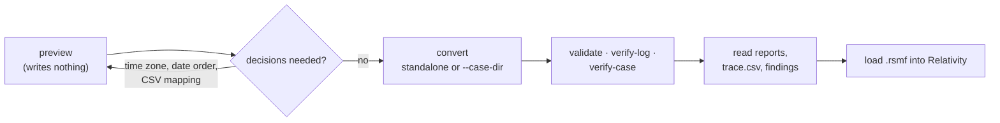

# Usage guide: from an export to verified RSMF files

This page walks through a conversion end to end: checking an export with `preview`, making the decisions only the
examiner can make (time zone, date order, custodian, CSV mapping), converting standalone or in a case folder,
validating, reading the outputs and `trace.csv`, verifying a run, and troubleshooting. Every option of every
command is in [usage-cli.md](usage-cli.md) (generated from `--help`); the desktop app is in
[usage-gui.md](usage-gui.md); what the tool does to the data is in [theory.md](theory.md).



Command outputs below come from real runs of the synthetic samples in [examples/](../examples/README.md); paths
are shortened.

## 1. Before you start

| Check | Why | How |
| --- | --- | --- |
| Work on a **verified copy** of the export, never the only copy | The tool is read-only in software, not a write blocker, and reads the export more than once | Copy to the case volume, register it with rv-hashinv (or `--intake hashinv`) |
| Keep the export **complete** | Media next to a WhatsApp `.txt`, the Telegram `photos/`, `files/`… folders, every Teams `.msg` | Give the export's folder with `-r`, not only the main file |
| Know how the export was made | The RSMF reproduces the export, not the phone | Note who exported it, on which device, with which app version and options ("with/without media") |
| The phone's **time zone** at the time of the messages | WhatsApp and most CSV times have no offset | Device settings, the custodian's statement, an extraction report; travel can change it |
| The installed tool is the genuine release | "How do you know what you ran?" | [installation.md](installation.md) steps 2–4 and 6 |
| Hash policy | MD5/SHA-1 alone are not collision-resistant | Always include `sha256` (or `sha512`) |
| Clock | Audit times come from the workstation clock | Check Windows time sync |
| Jurisdiction, timestamp, certificate | Custody form, proof of time, signed PDFs | `--jurisdiction co\|fr`, `--tsa-url` / `--no-timestamp`, `--sign-cert` |

## 2. Walkthrough

### 2.1 Preview: how will the export be read?

`preview` reads the exports exactly as `convert` would, prints the source type, the facts the parser found (date
order and why, time zone, variant), the findings and the first messages with the time **as written** next to the
UTC value. It writes nothing and logs nothing.

```powershell
rv-rsmf preview -i "E:\export\whatsapp-android-en" --timezone Europe/Paris --limit 4
```

```text
E:\export\whatsapp-android-en\WhatsApp Chat with Ana Ruiz.txt [whatsapp]
  chat_file: WhatsApp Chat with Ana Ruiz.txt
  date_order: dmy
  date_order_basis: line 11: first component 13 > 12
  lines_read: 13
  timezone: Europe/Paris
  variant: android
  conversations: 1  participants: 3  events: 10
  finding: DATE_ORDER_INFERRED (info)
  finding: MEDIA_OMITTED_IN_EXPORT (low)
  finding: ATTACHMENT_REFERENCED_NOT_FOUND (medium)
  finding: PARTICIPANT_IDENTIFIED_BY_NUMBER_ONLY (info)
  as written             UTC                    from                 text
  02/03/2026, 09:58      2026-03-02T08:58:00Z   -                    Messages and calls are end-to-end encrypted. No one outside
  02/03/2026, 09:59      2026-03-02T08:59:00Z   -                    Ana Ruiz created group "Proyecto Faro"
  02/03/2026, 09:59      2026-03-02T08:59:00Z   -                    Ana Ruiz added ‪+33 6 00 00 00 01‬
  02/03/2026, 10:00      2026-03-02T09:00:00Z   Ana Ruiz             Hola! Plan for the 14th: 1. Kick-off at 10:00 2. Review: bud
```

Compare a few lines with the export and with what the custodian says. `--json` prints one JSON object per export
(for scripts); `--limit N` sets the number of messages (default 20). Exit codes: 0 every export can be converted
with these options, 1 an export cannot be read, 2 a decision is needed.

### 2.2 Choosing `--timezone`

```text
error: …\whatsapp-dst.txt: the export's times have no UTC offset; give the device's time zone with --timezone (IANA name, e.g. Europe/Paris)
```

Give the IANA name of the zone the **phone** used (`Europe/Paris`, `America/Bogota`, `Europe/Madrid`), not your
own, and not a fixed offset such as `UTC+1` (a fixed offset ignores daylight-saving time). One run uses one zone
for every export: convert exports from phones in different zones in separate runs. The zone is also the zone in
which days are cut into files, for every source (Telegram and Teams times are UTC in the export; without
`--timezone` their days are cut in UTC).

The choice is recorded in `conversion_started`, in each RSMF conversation (`source_timezone`) and as
`TIMEZONE_APPLIED`; each event keeps the time as written (`source_time`). Times at a daylight-saving change are
converted by a fixed rule and reported (`DST_AMBIGUOUS_OR_MISSING_TIME`, [theory.md B6](theory.md#b6-time-local-time-to-utc-and-the-date-order)):
check those messages against the order of the conversation.

### 2.3 Choosing `--date-order`

```text
error: …\whatsapp-ambiguous.txt: the day/month order of the dates cannot be decided from the file (possible: dmy, mdy); give --date-order. Lines: line 1: 03/04/26, 9:05 AM - Carla Méndez: Buenos días | line 3: 05/04/26, 1:30 PM - Carla Méndez: Yes: 10 AM at the office
```

Asked for only when **every** date of a WhatsApp export could be day-first or month-first. Decide from the phone's
language and region settings, from the content ("see you on 05/06?"), or from another record of the same
conversation; then `--date-order dmy` or `mdy`. The decision is reported as `DATE_ORDER_CHOSEN`. When the file
decides by itself (a number above 12), the file wins and your option is only recorded
(`date_order_option_used = no`), so one run can convert several exports. For CSV files `--date-order` **always**
applies when given (rows that do not fit become "invalid date" in `UNPARSED_LINES`): give it only for the CSV that
needs it, or put `date_order` in that CSV's mapping instead.

### 2.4 Choosing `--custodian`

`--custodian "Ana Ruiz"` names the device owner. It:

- becomes the RSMF conversation `custodian` and the `From` header when a participant has that display name or
  number (otherwise only `X-RSMF-Custodian` is written and there is no `From` header);
- renames WhatsApp authors written as `You` / `Tú` / `Vous` / `Du` / `Você` / `Tu` (custom `author_in_export` keeps
  the original) and makes their messages `outgoing`;
- fills an empty CSV sender on an `outgoing` row.

Write it exactly as the export names the owner (or their number). It applies to every export of the run.

### 2.5 Other options

| Option | Use |
| --- | --- |
| `--source whatsapp\|telegram\|teams-msg\|csv` | Force the reader for files that are not recognised (e.g. a renamed WhatsApp `.txt`) |
| `--platform-name "WhatsApp Business"` | Platform shown in Relativity (RSMF `platform`, `X-RSMF-Application`) |
| `--csv-map FILE.toml` / `--csv-profile` | CSV column mapping ([reference](#csv-column-mapping-reference)) |
| `--hash sha256,md5` | One or two algorithms; the first is the primary (and seeds the event collection id) |
| `--lang en\|es\|fr\|all` | Report languages |
| `-i`, `-r`, `--input-list` | Inputs; folders one level deep unless `-r` |

### 2.6 Convert (standalone)

```powershell
rv-rsmf convert -i E:\export -r --timezone Europe/Paris --date-order dmy --hash sha256,md5 `
    --case DEMO-001 --actor "Ana Ruiz" --lang all --out D:\work\rsmf-demo
```

```text
DONE  run 20261027T164952Z-750c58
  items: 16  bytes: 99559  errors: 0  elapsed: 0.3 s
  findings: high 0, medium 10, low 2, info 24
  timestamp: off
  report: D:\work\rsmf-demo\reports\20261027T164952Z-750c58\statistics.en.html
  logs:   D:\work\rsmf-demo\logs\20261027T164952Z-750c58
  rsmf:   8 export(s), 10 conversation(s), 49 event(s), 17 file(s) -> D:\work\rsmf-demo\rsmf\20261027T164952Z-750c58
```

(The whole sample folder, run with `--no-timestamp`; with a reachable TSA the line reads `timestamp: ok <time>`.
Before anything is written, every export is checked for missing decisions — exit 2 if
one is needed.) What happened: every file was hashed; the files were grouped into 8 exports (media and the CSV
mapping became members); each export was read, sliced per conversation per day, written as `.rsmf`, validated and
read back; `trace.csv` was written; reports, timestamp and statistics followed. Exit code 0 = no high-severity
finding; 3 = at least one (look for `PARSER_FAILED`, `RSMF_SCHEMA_INVALID`, `RSMF_ROUNDTRIP_MISMATCH`,
`EVIDENCE_HASH_MISMATCH_WITH_CASE`).

`--progress jsonl` prints one JSON event per line on stdout for scripts (`run_started`, `item_started`,
`item_hashed`, `progress`, `export_started`, `rsmf_written`, `export_finished`, `evidence_linked`, `intake_*`,
`error`, `timestamp`, `report_written`, `run_finished`…). **Ctrl+C** stops after the current chunk, export or file:
partial reports are written, `run_cancelled` is logged, exit code 130.

### 2.7 Convert in a case folder

```powershell
# rv-hashinv registers the exports first, then rv-rsmf verifies and converts them (one command)
rv-rsmf convert -i E:\export -r --case-dir D:\cases\CASE-2026-014 --case CASE-2026-014 --jurisdiction co `
    --timezone Europe/Paris --intake hashinv --actor "Ana Ruiz"
# or, when the registry already exists: every registered item, or some of them
rv-rsmf convert --case-dir D:\cases\CASE-2026-014 --timezone Europe/Paris
rv-rsmf convert --case-dir D:\cases\CASE-2026-014 --evidence E0003,E0004 --timezone Europe/Paris
```

Outputs go to `D:\cases\CASE-2026-014\runs\rv-rsmf\<RUN-ID>\{logs,reports,rsmf}`; the summary ends with
`case: CASE-2026-014 (analysis) … verified N, mismatched 0, not in registry 0`. Each file is re-hashed and compared
with the registry before conversion; a mismatch is a high finding and the conversion still runs. With
`--evidence` or no `-i`, missing decisions are found during the run (`PARSER_FAILED`) rather than before it:
preview first. Details: [case-folder.md](case-folder.md).

### 2.8 Validate

```powershell
rv-rsmf validate D:\work\rsmf-demo\rsmf\20261027T164952Z-750c58
```

```text
OK       …\001-generic-csv-000001\Grupo-obra-aae949\2026-10-24.rsmf  (1 events, 0 attachments)
OK       …\006-WhatsApp-Chat-with-Ana-Ruiz-txt-000014\Ana-Ruiz-aa3173\2026-03-02.rsmf  (7 events, 1 attachments)
…
```

It applies the official schema and the strict checks ([theory.md B11](theory.md#b11-validation-and-read-back)) to
any `.rsmf` — ours or another vendor's — and prints each problem (`schema: …`, `strict: …`). Exit 0 all valid, 3 at
least one invalid, 1 a file could not be read. The conversion already ran the same checks plus a read-back; run
`validate` again on the copy you deliver, after any transfer.

## CSV column mapping reference

A mapping is a TOML file. rv-rsmf uses, in this order: `--csv-map FILE`; a file `<csv stem>.map.toml` next to the
CSV (so one run can convert several CSVs with different mappings); the built-in profile (`--csv-profile`, default
`generic`; with no mapping at all and a header without the generic columns, `xry-draft` then `cellebrite-draft`
are tried). Unknown keys are rejected (`deny_unknown_fields`), so a typo stops the run with exit 2 instead of being
ignored.

```toml
[columns]                       # a column name, or a list of alternative names; matched case-insensitively
timestamp = "Time"              # REQUIRED
timestamp_format = "auto"       # "auto" (default), "iso", "epoch_s", "epoch_ms", or a chrono strftime pattern
timezone_column = "Zone"        # optional: per-row IANA name or UTC offset
conversation = "Chat ID"        # REQUIRED: one RSMF conversation per distinct value
sender = "From"                 # REQUIRED: "Name", "+57 300 000 0001", "a@b.c" or "Name <+57 300 000 0001>"
sender_number = "From number"   # optional: overrides the number of the sender
recipients = "To"               # optional: several separated by ';'
body = "Body"                   # REQUIRED
direction = "Direction"         # optional: values mapped by [direction]
application = "Source"          # optional: kept as the conversation's custom field "application"
deleted = "Deleted"             # optional: true when the value is in [deleted] values
attachment = "Attachment(s)"    # optional: path(s) relative to the CSV folder, separated by ';' or a line break

[direction]                     # optional; replaces the default lists when given
incoming = ["Incoming", "Received"]
outgoing = ["Outgoing", "Sent"]

[deleted]                       # optional; replaces the default list when given
values = ["yes", "true", "1", "deleted"]

[options]
delimiter = "auto"              # "auto" (default), or one ASCII character such as "," ";" "|", or "tab" / "\t"
encoding = "auto"               # "auto" (default), "utf-8", "utf-16le", "utf-16be", "windows-1252", or another
                                # WHATWG label; a BOM always wins; a declared encoding is applied strictly
skip_rows = 0                   # lines before the header line
date_order = "dmy"              # "dmy", "mdy" or "ymd": numeric dates in "auto" format (--date-order wins)
```

| Key | Default when absent | Notes |
| --- | --- | --- |
| `timestamp_format` | `auto` | `auto`: RFC 3339, else numeric date + time with optional seconds, fraction, `am/pm`, offset (`Z`, `+02:00`, `UTC+2`, `(UTC-05:00)`, `GMT`). `iso`: the same but year-first only. `epoch_s` (fraction allowed), `epoch_ms`. Otherwise a chrono `strftime` pattern, e.g. `%d/%m/%Y %H:%M:%S`; with `%z`/`%:z` the cell is an instant; a date-only pattern gives midnight |
| `delimiter` | `auto` | the most frequent of `,` `;` tab `\|` in the header line; none → tab for `.tsv`, comma otherwise |
| `encoding` | `auto` | UTF-16LE when ≥ 30 % of the odd bytes are NUL, else UTF-8, else windows-1252 |
| `[direction]` | `incoming in received inbox rx entrante` / `outgoing out sent outbox tx saliente` | case-insensitive; an unknown value is kept as custom `direction_raw` |
| `[deleted] values` | `1 true yes y x deleted si sí oui vrai` | case-insensitive |
| optional columns | not used | with your own mapping (file or sibling), a named optional column missing from the header is an **error**; with a built-in profile it is only noted |

Built-in profiles ([csvmap.rs](../src/core/src/sources/csvmap.rs)):

| Profile | Columns | Status |
| --- | --- | --- |
| `generic` | `timestamp`, `timezone`, `conversation`, `sender`, `sender_number`, `recipients`, `body`, `direction`, `application`, `deleted`, `attachment` | rv-rsmf's own column names |
| `xry-draft` | timestamp `Time\|Date\|Timestamp\|Date/Time`; conversation `Chat ID\|Chat\|Conversation\|Thread`; sender `From\|Sender`; recipients `To\|Recipients\|Recipient`; body `Body\|Text\|Message`; direction; application `Source\|Application\|App`; deleted `Deleted\|Deleted?`; attachment `Attachment(s)\|Attachments\|Attachment` | **DRAFT, unverified**: MSAB XRY/XAMN layouts are not publicly documented; reported as `CSV_MAPPING_DRAFT_PROFILE` |
| `cellebrite-draft` | timestamp `Timestamp: Time\|Timestamp\|Time\|Date`; conversation `Chat ID\|Chat #\|Chat\|Identifier`; sender `From\|Sender\|Participant`; recipients `To\|Participants\|Recipients`; body `Body\|Message\|Text`; direction; application `Source\|Source App\|Application`; deleted `Deleted\|Deleted - Instant Message`; attachment `Attachment(s)\|Attachments\|Attachment #1` | **DRAFT, unverified**: same caveat |

Before relying on a draft profile, or on your own mapping, check a few converted messages against the source tool's
own view (sender, time, text, direction) and keep that check with the case. The sample
[generic.map.toml](../examples/sample/evidence/csv/generic.map.toml) maps Spanish column names with a fixed
`strftime` format. A mapping problem stops the run with exit 2 and names the missing columns and the header found:

```text
error: …\n.csv: CSV mapping incomplete: missing columns: timestamp ("timestamp"), conversation ("conversation"), sender ("sender"), body ("body"); header has: Fecha, Chat, De, Texto
```

## 3. Reading the outputs

| Look at | To learn |
| --- | --- |
| `reports\<RUN-ID>\statistics.<LANG>.html` | the run: exports by source, conversations, events, RSMF files (and invalid ones), attachments packed and missing, findings by severity and code |
| `reports\…\items\<NNNNN>-<export>\technical.<LANG>.html` | one export: every finding with what it shows / does not prove, the parser's facts (date order and why, time zone, variant, CSV columns), the RSMF files with their SHA-256 |
| `reports\…\items\…\summary.<LANG>.html` | the same for the customer, in plain words |
| `rsmf\<RUN-ID>\trace.csv` | where each event came from and where it went |
| `rsmf\<RUN-ID>\conversions.json` | every file of every export with its validation result |
| `logs\<RUN-ID>\audit.jsonl` | every action, option and digest |

Every file is described in [reports.md](reports.md).

**Checking a message with `trace.csv`.** In Relativity, note a message's file and its event id (custom fields
`source_file`, `source_lines` or `source_id`, `source_time` are also shown with the message). In `trace.csv` (open
it in a spreadsheet, it is UTF-8):

```text
export,source_file,line,line_end,native_id,source_time,utc,rsmf_file,event_id,conversation,kind,attachments
WhatsApp Chat with Ana Ruiz.txt,WhatsApp Chat with Ana Ruiz.txt,4,6,,"02/03/2026, 10:00",2026-03-02T09:00:00Z,006-WhatsApp-Chat-with-Ana-Ruiz-txt-000014/Ana-Ruiz-aa3173/2026-03-02.rsmf,e-000004,c-554810aa3173,message,0
```

Open the export at lines 4–6 and compare the author, the text and the time as written; `utc` is that time in the
chosen zone converted to UTC. For Telegram and Teams use `native_id` (the message id; `0002.msg` for Teams is in
`source_file`). For CSV files use `native_id` (the data row number): the line numbers of CSV files with Windows
line ends are one too low in this version ([theory.md B5.4](theory.md#b54-csv--tsv-with-a-column-mapping)). Lines
and rows that were **not** converted are not in `trace.csv`: the `UNPARSED_LINES` finding gives their count and
the first three; review the rest of the export around them by hand.

## 4. Interpreting each finding

What every finding shows and does not prove: [reports.md](reports.md#findings-catalogue). What to do:

| Finding | Check before relying on the RSMF |
| --- | --- |
| `PARSER_FAILED` (high) | Read the error; a damaged or unsupported export is not converted. Re-export if possible; never edit the export to make it pass (if you must, convert a documented copy and say so) |
| `RSMF_SCHEMA_INVALID` / `RSMF_ROUNDTRIP_MISMATCH` (high) | Do not load that file. A `parent … is not an event in this file` error comes from a reply to a message of another day ([theory.md B7](theory.md#b7-slicing-conversation--day-and-the-10000-event-rule)); other errors: report them to engineering with the file |
| `EVIDENCE_HASH_MISMATCH_WITH_CASE` (high) | Expected and actual digests in the finding; who had the file since intake (case log) |
| `UNPARSED_LINES` (medium) | Open the export at the quoted lines/rows: headers, a mixed format, damaged lines? Is content missing from the conversation? |
| `DST_AMBIGUOUS_OR_MISSING_TIME` (medium) | Is the order of those messages plausible? For a repeated hour, the earlier instant was used |
| `NON_MONOTONIC_TIMESTAMPS` (medium) | Is the export in time order? Clock changes, wrong time zone or date order, or edits cause this |
| `ATTACHMENT_REFERENCED_NOT_FOUND` (medium) | Was the whole export given (media folder, zip)? Ask for the missing files |
| `CSV_MAPPING_DRAFT_PROFILE` (medium) | Compare messages with the source tool, or write and use your own mapping |
| `POSSIBLE_EXPORT_LIMIT` (medium) | Compare the first and last messages with the phone or an extraction |
| `DATE_ORDER_INFERRED` / `DATE_ORDER_CHOSEN` / `TIMEZONE_APPLIED` (info) | Your decision and its basis are stated; repeat them in your report |
| `DELETED_MESSAGES_NOT_IN_EXPORT`, `MEDIA_OMITTED_IN_EXPORT`, `TELEGRAM_FILE_NOT_INCLUDED`, `EDIT_HISTORY_NOT_IN_EXPORT` | State the limitation in your report; corroborate with an extraction if it matters |
| `PARTICIPANT_IDENTIFIED_BY_NUMBER_ONLY` | Establish who used the number from other evidence |
| `PART_OF_EXPORT`, `NOT_A_CHAT_EXPORT` | Check that every chat export was recognised (`--source` to force); the export named by `PART_OF_EXPORT` can be wrong when two exports share a folder ([theory.md B3](theory.md#b3-recognising-and-grouping-exports)) |

## Timestamps, signing and verifying a run

**Timestamps.** By default each run asks the TSA (`http://timestamp.digicert.com`, change with `--tsa-url`) to sign
the audit chain head before the statistics report. Offline, the run logs `timestamp_pending`; later run
`rv-rsmf timestamp <log folder>`. `verify-log` checks the token's imprint, **not** the TSA's signature (gap G18):
do that with OpenSSL (Git for Windows ships `openssl.exe`):

```bash
cd <log folder>
N=00131                                                   # from the file name timestamp-00131.tsr
H=$(python -c "import json;print(json.load(open('timestamp-$N.json'))['head'])")
openssl ts -reply -in timestamp-$N.tsr -text              # genTime, policy OID, TSA name, serial, nonce, accuracy
openssl ts -reply -in timestamp-$N.tsr -token_out -out token.der
openssl pkcs7 -inform DER -in token.der -print_certs > tsa-certs.pem
openssl ts -verify -digest "$H" -in timestamp-$N.tsr -CAfile <TSA root.pem> -untrusted tsa-certs.pem
# → "Verification: OK"
```

**Signing.** `--sign-cert <file.p12|.pfx>` signs every PDF report with your certificate (RSA only); the password
comes from `RV_SIGN_PASSWORD` (or `--sign-pass-env NAME`) or a prompt without echo, and is never logged:

```powershell
$s = Read-Host "Certificate password" -AsSecureString
$env:RV_SIGN_PASSWORD = [Runtime.InteropServices.Marshal]::PtrToStringBSTR(
    [Runtime.InteropServices.Marshal]::SecureStringToBSTR($s))
rv-rsmf convert -i E:\export -r --timezone Europe/Paris --sign-cert C:\certs\ana-ruiz.p12
Remove-Item Env:RV_SIGN_PASSWORD
```

Check a signed report with Acrobat or `pyhanko sign validate --pretty-print --trust <CA .pem> technical.en.pdf`.

**Verifying a run.** Anyone can check a run with its three folders and the export copy:

| Step | Command | Proves |
| --- | --- | --- |
| 1 | `rv-rsmf verify-log <log>` (0 intact, 3 broken or truncated) | No entry edited, deleted or reordered; the `truncation:` line names what anchors the end |
| 2 | `python tests/verify_chain.py <log>` (source tree) | Same, independent implementation; also re-hashes the input files listed in `hashes.csv` |
| 3 | OpenSSL (above) | The TSA really signed that head at that time |
| 4 | Script below | Every `.rsmf`, `trace.*`, `conversions.json`, report, `environment.json` and `hashes.csv` still has the digest the log recorded |
| 5 | `rv-rsmf validate <rsmf folder>` | Every RSMF file is still valid |
| 6 | `rv-rsmf verify-case <CASE> --rehash` | Case folder: the run is the one the case log announced; the reachable evidence matches the registry |
| 7 | `python tests/validate_reports.py <reports folder or CASE>` | Every JSON report matches its schema |

Step 4 (no built-in command yet, gap G19):

```bash
python - "<log folder>" "<reports folder>" "<rsmf folder>" <<'EOF'
import hashlib, json, pathlib, sys
log, rep, rsmf = (pathlib.Path(a) for a in sys.argv[1:4])
def digest(p, algo):
    h = hashlib.new({"sha3-256": "sha3_256"}.get(algo, algo)); h.update(p.read_bytes()); return h.hexdigest()
checked = bad = 0
for line in (log / "audit.jsonl").open(encoding="utf-8"):
    e = json.loads(line); a, d = e["action"], e["details"]
    if a == "item_reports_written":
        files = {rep / d["folder"] / k: v for k, v in d["files"].items()}
    elif a == "statistics_report_written":
        files = {rep / k: v for k, v in d["files"].items()}
    elif a in ("environment_recorded", "hash_register_written"):
        files = {log / e["item"]: d}
    elif a == "trace_written":
        files = {rsmf / e["item"]: d}
    elif a == "rsmf_written":
        files = {rsmf / e["item"]: {"sha256": d["sha256"]}}
    else:
        continue
    for p, digests in files.items():
        algo = next(x for x in ("sha256", "sha512", "sha3-256", "sha1", "md5") if x in digests)
        checked += 1
        got = digest(p, algo) if p.is_file() else "missing"
        if got != digests[algo]:
            bad += 1; print("MISMATCH", p, algo, got)
print(f"{checked} files checked, {bad} mismatches"); sys.exit(3 if bad else 0)
EOF
```

On the whole-sample run above (one language) it checks 201 files; appending one byte to one `.rsmf` gives
`MISMATCH …/2026-03-13.rsmf sha256 …` and exit code 3.

## 5. Troubleshooting

### By exit code

| Command | 0 | 1 | 2 | 3 | 130 |
| --- | --- | --- | --- | --- | --- |
| `convert` (alias `scan`) | done, no high finding | runtime error: input not found, output not writable, wrong certificate password, case log locked, rv-hashinv not found or failed, an attachment that cannot be read while writing | usage error or examiner decision: unknown option, time zone or algorithm, three algorithms, unknown language; `--timezone` / `--date-order` / CSV mapping needed; with `--case-dir`: another case's folder, `--case` missing at creation, unknown evidence id | done with ≥ 1 high finding (`PARSER_FAILED`, `RSMF_SCHEMA_INVALID`, `RSMF_ROUNDTRIP_MISMATCH`, `EVIDENCE_HASH_MISMATCH_WITH_CASE`, `UNREADABLE`, `EXECUTABLE_CONTENT`); or the case folder fails verification (nothing written) | cancelled, partial reports written |
| `preview` | every export can be converted | an export cannot be read; no export found | a decision is needed | — | — |
| `validate` | every file valid | a file could not be read (not an RSMF message, no `rsmf.zip`) | — | at least one invalid file | — |
| `verify-log` | intact | log unreadable | — | broken chain, token mismatch, truncated | — |
| `verify-case` | case intact (warnings printed) | not a case folder | — | a check failed | — |
| `timestamp` | obtained and logged | TSA unreachable | — | log missing or broken (nothing added) | — |
| `self-test` | all pass | a failure: do not use the build | — | — | — |

### Messages

| Message | Fix |
| --- | --- |
| `the export's times have no UTC offset; give the device's time zone with --timezone …` | [2.2](#22-choosing---timezone) |
| `the day/month order of the dates cannot be decided from the file (possible: dmy, mdy); give --date-order. Lines: …` | [2.3](#23-choosing---date-order) |
| `CSV mapping incomplete: missing columns: …; header has: …` | Write a mapping with those columns ([reference](#csv-column-mapping-reference)) or fix `skip_rows` |
| `CSV mapping incomplete: the file is not valid windows-1252; set [options] encoding …` | Declare the right encoding in the mapping |
| `CSV mapping incomplete: mapping … is not valid: unknown field …` | A typo in the TOML key (the list of keys is above) |
| `unknown time zone '…': use an IANA name such as Europe/Paris or America/Bogota` | Use the `Region/City` name |
| `no chat export found among N file(s); use --source to force the type` (`preview`) | The files were not recognised; check the names (`result.json`, `.txt` with WhatsApp lines) or force `--source` |
| `mixed date formats: …` / `inconsistent dates: …` / `… not a valid date as dmy` (`PARSER_FAILED`) | The WhatsApp file mixes formats or was edited; inspect the two quoted lines |
| `no WhatsApp message lines found` | Not a WhatsApp export, or an unsupported locale format: send a redacted sample to engineering |
| `no Teams message (IPM.SkypeTeams.*) among the .msg files` | The `.msg` files are e-mails or other items, not Teams messages |
| `parent e-… is not an event in this file` (`RSMF_SCHEMA_INVALID`) | A reply to a message of another day; known defect ([theory.md B7](theory.md#b7-slicing-conversation--day-and-the-10000-event-rule)) |
| `--intake hashinv needs the evidence to register (--input or --input-list)` / `… cannot be combined with --evidence` | [case-folder.md](case-folder.md#one-step-intake-with-rv-hashinv) |
| `rv-hashinv not found (install RV HashInv ≥ 0.3.0, or give its path with --hashinv-exe or RV_HASHINV). Looked in: …` | Install RV HashInv or pass `--hashinv-exe` |
| `rv-hashinv intake failed (exit code N); nothing was analysed. …` | Read rv-hashinv's own messages (last lines quoted) and its run folder |
| `the case folder … belongs to case X, not Y` / `evidence id(s) not in the case registry: …` | Wrong folder or id; see [case-folder.md](case-folder.md) |
| `the case log is locked by …` / `stale case lock …` | Another tool is writing; for a stale lock make sure no tool runs, delete `case-log.lock` by hand and note it |
| `cannot load signing certificate …` / `only RSA signing certificates are supported` | Check `RV_SIGN_PASSWORD` and the certificate type |
| `warning: timestamp pending (…)` | Run `rv-rsmf timestamp <log folder>` when online |
| `refusing to append to a broken audit log` / `truncated: …` | The log was edited; investigate with `verify-log`; do not repair |
