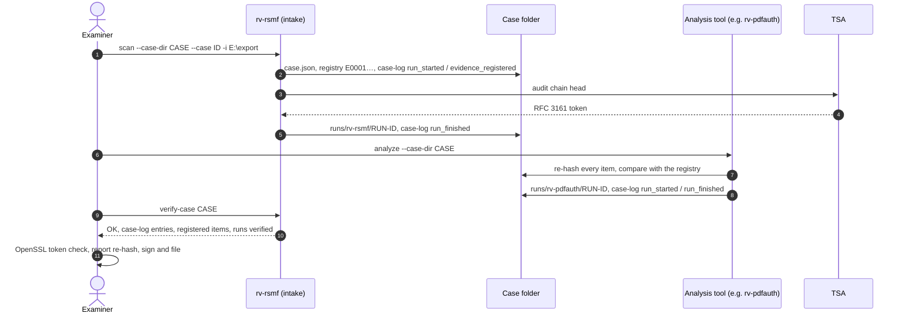
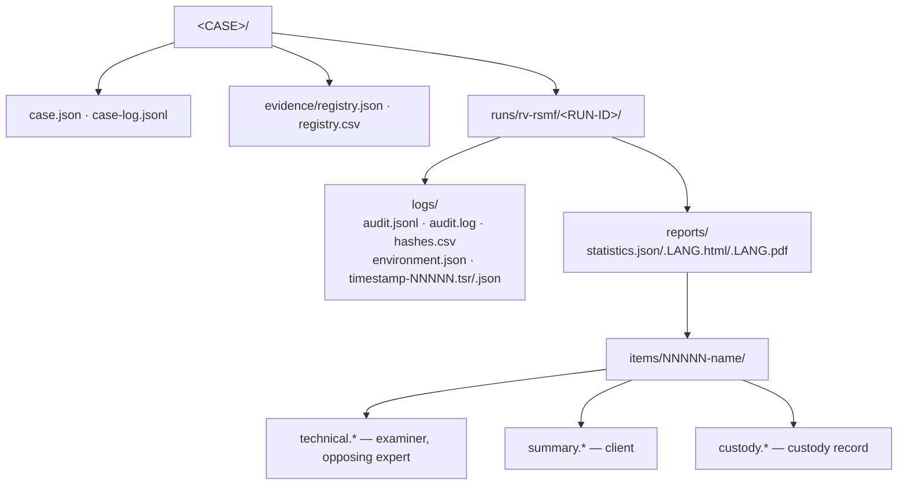

<!--
  Template note for the docs agent of a tool scaffolded from rv-rsmf: sections 1, 2.3, 3 (shared rows), 6, 7,
  8 and the shared troubleshooting tables apply to every Rakvor tool. Rewrite the parts between forge:domain
  markers: the walkthrough steps that show what THIS tool does in the case (intake here; analysis in a new tool),
  the domain outputs, the findings table and the domain messages.
-->

# Usage guide: from intake to a verified case

This is the end-to-end guide for an examiner. It walks through one case, explains every output, says how to read
each finding, and how to prove afterwards that nothing changed. Option lists are not repeated here:

- every command, option, default, example and exit code: [usage-cli.md](usage-cli.md) (generated from `--help`);
- the desktop app, window by window: [usage-gui.md](usage-gui.md);
- the case folder contract: [case-folder.md](case-folder.md);
- why each check works: [theory.md](theory.md); legal weight: [admissibility.md](admissibility.md);
- installing and verifying the tool: [installation.md](installation.md).



## 1. Before you start

| Check | Why | How |
| --- | --- | --- |
| Work on a **verified copy** (forensic image, write-blocked export), never the original media | The tool is read-only in software, not a write blocker | Imaging tool + write blocker; note model and serial |
| The installed tool is the genuine release | Court question: "how do you know what you ran?" | [installation.md](installation.md) steps 2–4 and 6 |
| Hash policy | MD5/SHA-1 alone are not collision-resistant | Always include `sha256` (or `sha512`): `--hash sha256,md5` when an older record uses MD5 |
| Clock | Audit times come from the workstation clock | Check Windows time sync before the run |
| Jurisdiction | Selects the custody form | `--jurisdiction co` (default) or `fr`; in a case folder it is fixed at creation |
| Timestamp | Online TSA by default | `--no-timestamp` offline, then `rv-rsmf timestamp` later; `--tsa-url` for a qualified / ECD TSA |
| Examiner certificate | Signs every PDF report | `--sign-cert examiner.p12` ([signing](#7-signing-reports-with-the-examiner-certificate)) |
| One case, one folder | Every tool of the case links to the same registry and case log | Create the case folder on the case volume, e.g. `D:\cases\CASE-2026-014` |

## 2. Case walkthrough

The example case: `CASE-2026-014`, Colombian jurisdiction, examiner Ana Ruiz, a client export on `E:\export`
(here: the three sample files). Command outputs below come from a real run of the sample against the local test
TSA (`tests/fake_tsa.py`); paths are shortened.

<!-- forge:domain -->
### 2.1 Intake: register the evidence

```powershell
rv-rsmf scan --case-dir D:\cases\CASE-2026-014 --case CASE-2026-014 --jurisdiction co `
    -i E:\export -r --hash sha256,md5 --actor "Ana Ruiz" --sign-cert C:\certs\ana-ruiz.p12
```

```text
DONE  run 20261021T154339Z-6e298b
  items: 3  bytes: 234  errors: 0  elapsed: 1.2 s
  findings: high 0, medium 1, low 0, info 2
  timestamp: ok 2026-10-21T15:43:40Z
  report: D:\cases\CASE-2026-014\runs\rv-rsmf\20261021T154339Z-6e298b\reports\statistics.en.html
  logs:   D:\cases\CASE-2026-014\runs\rv-rsmf\20261021T154339Z-6e298b\logs
  case:   CASE-2026-014 (intake) registered 3 (new 3), verified 0, mismatched 0, not in registry 0
```

What happened, in order: the case folder did not exist, so `case.json` was written once (`--case` and
`--jurisdiction` are needed only now) and `case_created` opened the case log; `run_started` was appended to the
case log; every file was hashed once with SHA-256 and MD5 and typed by its first bytes; the three files were
registered as `E0001` (`acta-copia.txt`), `E0002` (`acta.txt`) and `E0003` (`foto-vacaciones.jpg`) — sorted by
path — in `evidence\registry.json` / `.csv`, and `evidence_registered` recorded the new registry SHA-256 in the
case log; reports and the custody form of each item now carry its evidence id; the audit chain head was
timestamped; `run_finished` in the case log recorded the run's final audit head.

Re-running the same intake on unchanged files keeps the ids (`registered 3 (new 0)`). A changed file at a
registered path gets a new id and `REGISTRY_PATH_CONTENT_CHANGED`. Use `-i` repeatedly, `-r` for subfolders, or
`--input-list files.txt` (one path per line, `#` comments, relative paths from the list's folder).

### 2.2 Analysis: later tools re-verify every item

Every Rakvor analysis tool (any tool scaffolded from this template, where `CASE_ROLE` is `analysis`) takes the same
`--case-dir`. Without `-i` it examines every registered item; `--evidence E0001,E0003` selects some.

```powershell
rv-pdfauth analyze --case-dir D:\cases\CASE-2026-014 --actor "Ana Ruiz" --sign-cert C:\certs\ana-ruiz.p12
```

Before analysing each file, the tool re-hashes it (adding SHA-256 if your selection shares no algorithm with the
registry, logged as `case_algorithm_added`) and compares it with the registry — by `--evidence` id, else by path,
else by content. Its summary ends with a line such as
`case: CASE-2026-014 (analysis) registered 0 (new 0), verified 3, mismatched 0, not in registry 0`. A file that no
longer matches raises `EVIDENCE_HASH_MISMATCH_WITH_CASE` (high, exit code 3) and **is still analysed**, so the
examiner can decide; a file never registered raises `EVIDENCE_NOT_IN_CASE_REGISTRY` (medium).

> **rv-pdfauth at its current commit does not implement `--case-dir` yet** (its admissibility page lists this as
> gap G24). Until it does, run it with `--out D:\cases\CASE-2026-014\runs\rv-pdfauth` and compare its `hashes.csv`
> with `evidence\registry.csv` by SHA-256, as described in rv-pdfauth's own usage guide. Keep that output with the
> case file.
<!-- /forge:domain -->

### 2.3 Verify the whole case

```powershell
rv-rsmf verify-case D:\cases\CASE-2026-014
```

```text
OK  case CASE-2026-014: 4 case-log entries, 3 registered items, 1 runs verified: D:\cases\CASE-2026-014
```

Every Rakvor tool has `verify-case` and they agree (a case written by the Rust build verifies with the Python
build and the reverse). It checks the case-log chain, `case.json`, the registry digest, every run's audit chain and
timestamp tokens, and the cross-links between the case log and each run ([theory.md B7](theory.md#b7-the-case-folder)).
Exit 0 = intact (warnings, such as a run still in progress, are printed), 3 = broken, 1 = not a case folder.
By default it does not re-hash the evidence; add `--rehash` to read every registered item that is still reachable
at its registered path and compare its digests with the registry (a path registered several times is compared with
its latest registration):

```text
rv-rsmf verify-case D:\cases\CASE-2026-014 --rehash
OK  case CASE-2026-014: 4 case-log entries, 3 registered items, 1 runs verified: D:\cases\CASE-2026-014
    re-hashed 3 of 3 registered items: 3 match the registry
```

A file that differs is listed as `E0002 <path>: sha256 differs from the registry (registered …, now …)` and the
exit code is 3; a file not reachable from this workstation is a warning, not a failure.

### 2.4 The same from the desktop app

Start **RV RSMF**, fill **Case folder** in section 1 (and **Case ID** plus the custody form's jurisdiction for a
new case), add the evidence (files, folders, drag and drop) — or none, to re-examine every registered item — tick
one or two hash algorithms, set the report language and examiner in *3. Reports*, the timestamp and certificate in
*4. Trust*, then **Start review**. The output folder is derived from the case folder and locked; the result panel
lists every evidence id and its status. Every setting you change before starting is written to the run's audit log
(`ui_*` actions). The engine, outputs and findings are the same as the CLI's. Details:
[usage-gui.md](usage-gui.md).

## 3. Reading the outputs



Without `--case-dir`, `logs\<RUN-ID>\` and `reports\<RUN-ID>\` are created under `--out` (default `.\rakvor-out`).

| Output | For | What to use it for |
| --- | --- | --- |
| `statistics.*` | Examiner, lawyer | Run overview: who, when, interface, algorithms, totals and throughput, findings by severity and code, items by detected type, duplicate groups (paths), the case-folder section (registered / added / verified / mismatched / not registered), timestamp status, signer, audit chain head and entry count at the time it was written |
| `technical.*` | Examiner, opposing expert | One file: path, size, modification time, extension, detected type, status, evidence id and intake date (case folder), all digests, findings with *what it shows / what it does not prove*, method, audit entries `#first–#last`, limitations |
| `summary.*` | Client | Plain-language status, the primary fingerprint, the findings in one sentence each, the next step |
| `custody.*` | Custody record | Jurisdiction form (Spanish for `co`, French for `fr`) + English copy, pre-filled from the run, with 6 blank transfer rows to sign. An internal record, used **alongside** the official form ([admissibility.md](admissibility.md#consolidated-gap-list) G9) |
| `audit.jsonl` / `audit.log` | Verification | Every action, hash-chained / the same, readable (not authoritative) |
| `hashes.csv` | Verification | Hash register: `index,path,size,<algo1>[,<algo2>],status,error` |
| `environment.json` | Reproducibility | Tool, compiler, every dependency version, OS, host, user, command line (or GUI settings) |
| `timestamp-NNNNN.tsr` / `.json` | Verification | RFC 3161 response for audit entry NNNNN, and its summary |
| `case.json`, `case-log.jsonl` | Verification | Case identity (written once); every tool run on the case, registry changes, final audit heads |
| `evidence\registry.json` / `.csv` | Everyone | The evidence list of the case: id, path at intake, size, digests, which run registered it and when |

**Status and next step per item:** `problem` (a high finding: do not rely on the file until explained),
`attention` (medium or low: review with the examiner), `ok` (informational only). **Exit code 3** means
"completed, at least one high-severity finding" — a normal outcome for evidence, not an error.

## 4. Interpreting each finding

Severity in brackets. "Check next" is what an examiner should do before relying on the finding; "do not
conclude" is the overreach to avoid in a report. The exact wording printed in reports is in `i18n/en.json` (es, fr).

<!-- forge:domain -->
| Code | Check next | Do not conclude |
| --- | --- | --- |
| `EXTENSION_MISMATCH` (medium) | The detected type; open the file with a tool for that type; ask how the file was named at the source | Intent to hide anything — exports, downloads and messaging apps rename files |
| `EXECUTABLE_CONTENT` (high) | Confirm with a PE/ELF parser (a 2-byte `MZ` match can be a false positive); treat as hostile; analyse in a sandbox | That the program is malicious, or that anyone ran it |
| `EMPTY_FILE` (info) | Whether the source holds the file with content; the size at acquisition | That it was emptied on purpose |
| `DUPLICATE` (info) | The group in `statistics.*` (paths) and `hashes.csv`; check the primary algorithm is SHA-256 | Who copied the file, when, or which copy is the original |
| `UNREADABLE` (high) | The OS error (permissions, locks, path length); re-acquire and re-run; unreadable items are **not** registered | That the file is damaged or was hidden |
| `REGISTRY_PATH_CONTENT_CHANGED` (medium) | Both evidence ids in `registry.csv`; which run registered each; how the source changed between intakes | Which version is the original, or why it changed |
<!-- /forge:domain -->

| Code (case folder, analysis tools) | Check next | Do not conclude |
| --- | --- | --- |
| `EVIDENCE_HASH_MISMATCH_WITH_CASE` (high) | Expected and actual digest in the finding; re-hash the file and the intake copy by hand; check storage, transfers and who had access since intake (case log) | Who changed it, when, or that it was deliberate |
| `EVIDENCE_NOT_IN_CASE_REGISTRY` (medium) | Whether the file should have gone through intake; register it (intake run) if it is new evidence | That the file is altered or irrelevant |

## 5. Working without a case folder

The same command works standalone for a quick inventory (no registry, no case log):

```powershell
rv-rsmf scan -i D:\evidence -r --hash sha256,md5 --lang all --case CASE-2026-014 --out D:\work\inventory
rv-rsmf scan --input-list files.txt --progress jsonl > events.jsonl      # one JSON event per line on stdout
```

`--progress jsonl` prints every event (`run_started`, `item_started`, `item_hashed`, `progress` with elapsed time
and ETA, `item_finished`, `evidence_linked`, `error`, `cancelled`, `timestamp`, `report_written`, `run_finished`)
for scripts; a closed stdout never aborts the run. **Ctrl+C** stops after the current 1 MiB chunk: partial reports are written,
`run_cancelled` is logged, exit code 130.

## 6. Timestamps

By default each run asks the TSA (`http://timestamp.digicert.com`, change with `--tsa-url`) to sign the audit
chain head just before the statistics report is written. The token covers every evidence digest, finding and
item-report digest recorded before it, not the statistics report and `run_finished` written after it
([theory.md B8](theory.md#b8-rfc-3161-trusted-timestamp)).

| Situation | What happens | What to do |
| --- | --- | --- |
| TSA reachable | `timestamp_obtained`; files `timestamp-NNNNN.tsr` and `.json` in the log folder; statistics report shows the time | Verify with OpenSSL (below) |
| Offline | `timestamp_pending`; the run completes; warning on the statistics report and the console | Later, online: `rv-rsmf timestamp <log folder>` |
| `--no-timestamp` / `RV_NO_TIMESTAMP=1` / GUI unticked | No request | Use `rv-rsmf timestamp` later if needed |
| Broken chain | `rv-rsmf timestamp` refuses (exit 3): no timestamp is added to a broken log | Investigate; do not repair |

`verify-log` checks the token's digest and that it covers the logged head, **not** the TSA's signature and
certificate (gap G18). Do that with OpenSSL (Git for Windows ships `openssl.exe`):

```bash
cd <log folder>
N=00022                                                   # from the file name timestamp-00022.tsr
H=$(python -c "import json;print(json.load(open('timestamp-$N.json'))['head'])")
openssl ts -reply -in timestamp-$N.tsr -text              # genTime, policy OID, TSA name, serial, nonce, accuracy
openssl ts -reply -in timestamp-$N.tsr -token_out -out token.der
openssl pkcs7 -inform DER -in token.der -print_certs > tsa-certs.pem   # certificates sent by the TSA
openssl ts -verify -digest "$H" -in timestamp-$N.tsr -CAfile <TSA root.pem> -untrusted tsa-certs.pem
# → "Verification: OK"
```

Get the TSA root certificate from the TSA's own repository, not from the token. Record the output in the case file:
it is the evidence that the time is genuine.

## 7. Signing reports with the examiner certificate

`--sign-cert <file.p12|.pfx>` signs **every PDF report** (statistics, technical, summary, custody) with your own
certificate (RSA keys only). The password is read from the environment variable named by `--sign-pass-env`
(default `RV_SIGN_PASSWORD`) or asked for on the terminal (nothing is echoed while you type). It is never logged;
the log records `signing_certificate_loaded` with the subject and the certificate's SHA-256, and every report prints
both (`Signed by <subject> (certificate SHA-256 <fingerprint>)`). A wrong password stops the run (`run_failed`, exit 1) before any evidence is read. In the GUI: *4. Trust →
Signing certificate* and *Certificate password* (kept in memory only).

```powershell
$s = Read-Host "Certificate password" -AsSecureString
$env:RV_SIGN_PASSWORD = [Runtime.InteropServices.Marshal]::PtrToStringBSTR(
    [Runtime.InteropServices.Marshal]::SecureStringToBSTR($s))
rv-rsmf scan --case-dir D:\cases\CASE-2026-014 -i E:\export -r --sign-cert C:\certs\ana-ruiz.p12
Remove-Item Env:RV_SIGN_PASSWORD
(Get-PfxCertificate C:\certs\ana-ruiz.p12).GetCertHashString("SHA256")   # publish this fingerprint
```

Check a signed report with Adobe Acrobat/Reader (Signature panel) or pyHanko:
`pyhanko sign validate --pretty-print --trust <your CA or certificate .pem> technical.en.pdf` (expected: intact,
coverage of the entire file). HTML and JSON reports are not signed; their digests are in the timestamped audit
chain. The legal weight of this signature depends on the certificate ([admissibility.md](admissibility.md) G3).

## 8. Verifying a run

Anyone — you, a colleague, an opposing expert — can check a run with its log folder, its report folder and the
evidence copy:

```powershell
rv-rsmf verify-log D:\cases\CASE-2026-014\runs\rv-rsmf\20261021T154339Z-6e298b\logs
# OK  25 entries, chain intact: …\audit.jsonl
#     timestamp 2026-10-21T15:43:40Z by http://127.0.0.1:33481/tsr covers entry #22
#     truncation: the final entry #25 is anchored by the case log (run_finished)
```

The last line says what vouches for the length of the log. A standalone run with a timestamp prints
`truncation: entries up to #22 are anchored by the RFC 3161 timestamp (timestamp-00022.json); 3 entries after it
(timestamp_obtained, statistics_report_written, run_finished) cannot be proven complete`; a standalone run without
a timestamp prints `truncation not detectable without a timestamp or case record`. A log shorter than its
timestamp or case record is `BROKEN` (`truncated: …`, exit 3).

| Step | Command | Proves |
| --- | --- | --- |
| 1 | `rv-rsmf verify-log <log>` (exit 0 intact, 3 broken or truncated) | No entry edited, deleted or reordered; timestamp token matches the head it covers; the log still reaches the entry its timestamp covers and, in a case folder, the final entry recorded in the case log (the `truncation:` line names the anchor) |
| 2 | `python tests/verify_chain.py <log>` (source tree) | Same, with an independent implementation; also re-hashes the evidence listed in `hashes.csv` |
| 3 | OpenSSL ([Timestamps](#6-timestamps)) | The TSA really signed that head at that time |
| 4 | Script below | Every report file, `environment.json` and `hashes.csv` still has the digest recorded in the log |
| 5 | `rv-rsmf verify-case <CASE> --rehash` | The run is the one the case log announced, complete up to its recorded final entry; the reachable evidence still matches the registry |
| 6 | `python tests/validate_reports.py <CASE or report folder>` | Every JSON report, `case.json` and `registry.json` match their schemas |

Step 4 (no built-in command yet, gap G19) — re-hash every file the run recorded:

```bash
python - "<log folder>" "<report folder>" <<'EOF'
import hashlib, json, pathlib, sys
log, rep = pathlib.Path(sys.argv[1]), pathlib.Path(sys.argv[2])
def digest(p, algo):
    h = hashlib.new({"sha3-256": "sha3_256"}.get(algo, algo)); h.update(p.read_bytes()); return h.hexdigest()
checked = bad = 0
for line in (log / "audit.jsonl").open(encoding="utf-8"):
    e = json.loads(line); a, d = e["action"], e["details"]
    if a == "item_reports_written":
        files = {rep / d["folder"] / k: v for k, v in d["files"].items()}
    elif a == "statistics_report_written":
        files = {rep / k: v for k, v in d["files"].items()}
    elif a in ("environment_recorded", "hash_register_written"):
        files = {log / e["item"]: d}
    else:
        continue
    for p, digests in files.items():
        algo = next(x for x in ("sha256", "sha512", "sha3-256", "sha1", "md5") if x in digests)
        checked += 1
        got = digest(p, algo) if p.is_file() else "missing"
        if got != digests[algo]:
            bad += 1; print("MISMATCH", p, algo, got)
print(f"{checked} files checked, {bad} mismatches"); sys.exit(3 if bad else 0)
EOF
```

On the sample run (3 items, one language) this checks 38 files; appending one byte to `statistics.json` gives
`MISMATCH … statistics.json` and exit code 3. A single file in PowerShell: `(Get-FileHash <file> -Algorithm
SHA256).Hash.ToLower()` and search the value in `audit.jsonl`.

## 9. Troubleshooting

### Exit codes

| Command | 0 | 1 | 2 | 3 | 130 |
| --- | --- | --- | --- | --- | --- |
| `scan` | done, no high finding | runtime error (input not found, output not writable, wrong certificate password, case log locked) | usage error (unknown option or algorithm, three algorithms, unknown language; with `--case-dir`: another case's folder, `--case` missing at creation, unknown evidence id) | done, ≥ 1 high finding; or the case folder fails verification (nothing written) | cancelled (Ctrl+C), partial reports written |
| `verify-log` | intact | log unreadable | — | broken chain, token mismatch, or truncated (shorter than its timestamp or case record) | — |
| `verify-case` | case intact (warnings printed) | not a case folder (no `case.json`) | — | at least one check failed (with `--rehash`: an evidence file differs from the registry) | — |
| `timestamp` | obtained and logged | TSA unreachable (nothing changed) | — | log missing, broken or unreadable (nothing added) | — |
| `self-test` | all pass | a failure: do not use the build | — | — | — |

### Messages

<!-- forge:domain -->
| Message | Fix |
| --- | --- |
| `at most 2 hash algorithms can run at the same time (got 3)` | Pick one or two algorithms |
| `unknown hash algorithm '…': use md5, sha1, sha256, sha512, sha3-256 or blake3` | Spelling: `sha3-256` (also `sha3`, `sha3_256`) |
| `… is neither a file nor a folder (symbolic links are not followed)` | Point at the link's target, or copy it |
<!-- /forge:domain -->

| Message | Fix |
| --- | --- |
| `… is not a case folder yet: give --case ID (and --jurisdiction) to create it` | First run in a new case folder: add `--case` |
| `the case folder … belongs to case X, not Y` | Wrong folder or wrong `--case`; leave `--case` out after creation |
| `evidence id(s) not in the case registry: E0042` | Check `evidence\registry.csv`; ids are `E` + number (`e7` = `E0007`) |
| `--evidence needs an existing case folder with a registry` | Run the intake first |
| `refusing to extend a broken case (…)` / `the case folder … fails verification` | Run `verify-case`; investigate what changed; **do not repair** a case log by hand — open a new case folder and document why |
| `the case log is locked by <tool> run <id> (since …)` | Another tool is writing; wait and run again |
| `stale case lock … held by … for more than 10 minutes` | Make sure no Rakvor tool is working on the case, then delete `case-log.lock` by hand (never automatic) and note it in the case file |
| `cannot load signing certificate …: wrong password or unsupported file` | Check `RV_SIGN_PASSWORD`; the file must be a `.p12`/`.pfx` with a private key |
| `only RSA signing certificates are supported` | Use an RSA certificate (ECDSA is not supported for report signing) |
| `warning: timestamp pending (…)` | See [Timestamps](#6-timestamps) |
| `refusing to append to a broken audit log` (`timestamp`) | The log was edited; investigate with `verify-log`; do not repair |
| `no audit log at …: nothing to timestamp` (`timestamp`) | Point at the run's `logs\<RUN-ID>` folder (or its `audit.jsonl`) |
| `truncated: …` (`verify-log`) | Entries were removed from the end of the log after the timestamp or the case record was made; investigate, do not repair |
