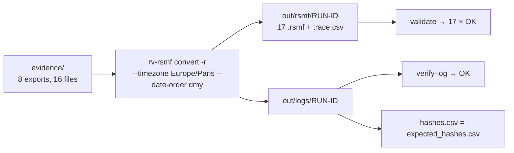

# Examples

## `sample/` — synthetic chat exports of every supported source

Everything here is **invented** (people, numbers `+33 6 00 00 00 0x` / `+57 300 000 000x` / `+34 600 000 00x`,
`example.org` links, tiny placeholder media). The files are generated deterministically
([development.md](../docs/development.md#samples-and-expected-results)), so their digests in
`expected_hashes.csv` never change.



| Sample (`evidence/…`) | Source | What it exercises | Expected result (`expected/*.json`) |
| --- | --- | --- | --- |
| `whatsapp-android-en/WhatsApp Chat with Ana Ruiz.txt` + `IMG-20260302-WA0001.jpg` | WhatsApp Android, English, 24 h | disclaimer, group created, member added, multi-line message, an attached file present and one absent, `<Media omitted>`, a number-only participant, a member leaving; day-first decided by `13/03/2026` (line 11) | 1 conversation, 10 events, 1 attachment packed, 2 missing; `DATE_ORDER_INFERRED`, `MEDIA_OMITTED_IN_EXPORT`, `ATTACHMENT_REFERENCED_NOT_FOUND`, `PARTICIPANT_IDENTIFIED_BY_NUMBER_ONLY` (options: `--timezone Europe/Paris`) |
| `whatsapp-ios-es.zip` (`_chat.txt` + `00000003-PHOTO-….jpg`) | WhatsApp iOS, Spanish, zip, `p. m.` with U+202F | bracketed headers, system text under the chat's name after U+200E, the owner written as `Tú` (direction set), a multi-line message, `<adjunto: …>` from inside the zip | 1 conversation, 5 events, 1 packed, 0 missing; `DATE_ORDER_INFERRED` (`--timezone America/Bogota`) |
| `whatsapp-ambiguous.txt` | WhatsApp, every day and month ≤ 12, 12-hour clock | the examiner decision: without `--date-order` the conversion stops with exit 2 and writes nothing; `12:00 AM` = midnight | with `--date-order dmy`: 1 conversation, 4 events; `DATE_ORDER_CHOSEN` (`--timezone Europe/Madrid`); also `NON_MONOTONIC_TIMESTAMPS` (the midnight message is earlier than the one before it) |
| `whatsapp-dst.txt` | WhatsApp, `dd.mm.yy` dates | a header line before the first message, the Paris clock changes of 29 Mar 2026 (02:30 does not exist) and 25 Oct 2026 (02:30 happens twice) | 1 conversation, 5 events; `DATE_ORDER_INFERRED`, `DST_AMBIGUOUS_OR_MISSING_TIME`, `UNPARSED_LINES` (`--timezone Europe/Paris`) |
| `telegram/result.json` + `photos/`, `voice_messages/` | Telegram Desktop full export | personal chat and supergroup, `date_unixtime`, text entities and links, replies, reactions (`👍` → `:+1:`, `❤` → `<3`, a custom emoji kept as the text `custom_emoji`), edited messages, service messages, location and poll, a file not included, a photo named but absent, a voice note present | 2 conversations, 15 events, 2 packed, 2 missing; `ATTACHMENT_REFERENCED_NOT_FOUND`, `EDIT_HISTORY_NOT_IN_EXPORT`, `TELEGRAM_FILE_NOT_INCLUDED` (no time zone needed); the run adds `REACTION_NOT_SUPPORTED_BY_RELATIVITY` and `DELETED_MESSAGES_NOT_IN_EXPORT` |
| `teams-msg/0001.msg` … `0004.msg` | Microsoft Teams `.msg` (Purview-style, built from MAPI properties; **not** a real Purview export) | `PR_BODY` and `PR_HTML` bodies, a reply (`PR_IN_REPLY_TO_ID`), an attachment, a system message timed by `PR_MESSAGE_DELIVERY_TIME`, and `0004.msg` of class `IPM.Note` (an e-mail, skipped) | 1 conversation, 3 events, 1 packed; `UNPARSED_LINES` ("0004.msg: message class IPM.Note is not Teams") |
| `csv/generic.csv` + `generic.map.toml` + `media/plano-0001.png` | CSV with a sibling mapping (Spanish column names, fixed `strftime` format) | the mapping found automatically as `<stem>.map.toml`, numbers and recipients, direction values, an attachment path; 2026-10-25 02:30 happens twice in Spain | 1 conversation, 3 events, 1 packed; `DST_AMBIGUOUS_OR_MISSING_TIME` (`--timezone Europe/Madrid`) |
| `csv/xry-like.csv` | CSV in UTF-16LE with BOM and CRLF, XRY-like columns | no mapping → the `xry-draft` profile is detected; `Name <+57 …>` parties; a multi-line body; an impossible date `31/02/2026`; an attachment not present | 2 conversations, 4 events, 0 packed, 1 missing; `CSV_MAPPING_DRAFT_PROFILE`, `UNPARSED_LINES`, `ATTACHMENT_REFERENCED_NOT_FOUND`, `PARTICIPANT_IDENTIFIED_BY_NUMBER_ONLY` (`--timezone America/Bogota`, `--csv-profile xry-draft`) |

Each `expected/<name>.json` gives the options of that sample, the counts and the finding codes that must be reported
for it; pipeline-level informational findings (`TIMEZONE_APPLIED`, `DELETED_MESSAGES_NOT_IN_EXPORT`, …) may be added
on top. [tests/run_samples.py](../tests/run_samples.py) converts each sample alone with those options and checks
them (in CI), then converts it a second time and requires byte-identical `.rsmf` files.

Known effects visible in the samples: `csv/media/plano-0001.png` and `csv/generic.map.toml` are reported as
`PART_OF_EXPORT` of `xry-like.csv` although they belong to `generic.csv` (two exports in one folder; the conversion
itself is right), and the trace line numbers of `xry-like.csv` (CRLF) are one lower than the file's lines
([theory.md B3, B5.4](../docs/theory.md#b54-csv--tsv-with-a-column-mapping)).

`expected_hashes.csv` holds the digests of all 16 evidence files in all six algorithms, computed independently with
Python's `hashlib` and `blake3`.

## Running it

```bash
examples/sample/run.sh target/release/rv-rsmf          # Linux / macOS (default binary: rv-rsmf on PATH)
```

```powershell
.\examples\sample\run.ps1 -Bin .\rv-rsmf.exe          # Windows (default: rv-rsmf on PATH)
```

Both scripts do the same, and stop with a non-zero exit code at the first failure:

1. `rv-rsmf self-test`;
2. `rv-rsmf convert --input evidence --recursive --timezone Europe/Paris --date-order dmy --hash sha256,md5
   --lang all --case DEMO-001 --actor "Sample" --out <out> --progress none` — every sample in **one** run (all
   times read as Paris time, which for the Spanish and Colombian samples changes the UTC values compared with
   `expected/`, not the counts; the ambiguous WhatsApp sample read day-first); a TSA is asked unless
   `RV_NO_TIMESTAMP=1`;
3. `rv-rsmf verify-log` on the run's log folder;
4. `rv-rsmf validate` on the run's `rsmf` folder;
5. compares the tool's `logs/<RUN-ID>/hashes.csv` with `expected_hashes.csv` (path below `evidence/`, size,
   SHA-256, MD5) and prints `hashes.csv matches expected_hashes.csv (16 files: size, SHA-256, MD5)`, or the
   mismatches and exit code 3.

Output folder: `examples/sample/out` (`run.sh` honours `RV_SAMPLE_OUT`). Expected summary (this commit):

```text
  items: 16  bytes: 99559  errors: 0
  findings: high 0, medium 10, low 2, info 24
  rsmf:   8 export(s), 10 conversation(s), 49 event(s), 17 file(s)
```

and exit code 0. The release workflow runs `run.ps1` on the built executable before packaging.
